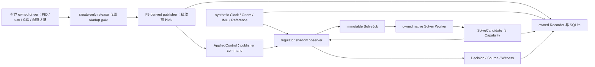

# 方案 A：C3.4 实现与有界验证报告

日期：2026-10-13。承接[代码复核后的实施计划](/home/trevor/MPC/scheme_A_review_20261013_08/方案A_C3_4_下一步实施计划_2026-10-13.md)。该计划的原件作为历史记录保留；本文件记录实际执行结果。

**发布竞态、精确类型、独立 last-valid 租约重放及相应有界证据已实现。当前版本通过五角色 owned 正例、真实 expired 反例和准备证据 IO 异常案例。组件验证通过；strict、动态接管、P1/execute 和研究结论仍未取得资格。**

## 1. 本批位置与架构

新作者目录：[N10](/home/trevor/USV/.sgh-research/experiments/p1_execution_architecture_20261005_01/authored_D1_C3_4_20261013_v10)。本批过程与原始结果：[batch09](/home/trevor/USV/.sgh-research/experiments/scheme_A_C3_4_20261013_09)。历史 N9、batch07、review08、原 expected、旧失败和旧资格均未覆盖。

研究“方案 A”沿用仓库 `scheme=B` 的动力学 NMPC 路线。本夹具直接构建冻结 F5 的 `DynamicMpc` 源与既有 codegen，并由新目录启动可认证角色；没有覆盖默认 install，也没有把仓库 scheme=A 当作研究方案 A。本次 publisher 实际参数为 horizon=20、mpc_dt=0.2、dynamic.dt=0.2、output_mode=vrx_thrust、max_solve_time_ms=200。配置依据完整参数查询、native owned manifest、typed canonical digest 和 F5 参数来源对账，不凭 launch 文件名推定。

目前 observer 仍是 shadow，双路命令由 F5 derived publisher 发出。AppliedControl 表示 publisher command；不是测得推力、plant ACK 或实际保持区间。本批没有运行 Gazebo、plant 或硬件。

## 2. S0 / S1 实时核验

- HEAD=`78999cf380c0b0dd7f545e4dc8103b7c4c2f7b15`；branch=`codex/scheme-c-rl`；boot=`b4f820cc-bcd4-4274-9a7f-45f7ad98c9a4`。
- 原 24 项业务 diff 保持 151961 bytes，SHA256=`d901511293df5be4aecb988509e4c4107977dc7c05f042286869c36e0a239ba5`。额外 `.gitignore` dirty 与 ArduPilot submodule 状态保留，未归为本批研究修改。
- N9 冻结 136 对 original/copy、F5 source146 / installed177 / model5 个快照、固定 scoped dependency2818 项、当前 support141 项及原业务 diff，收尾声明范围内全部符合原固定 SHA。共 3411 个唯一路径内容读取。support 中目录 symlink 单独核对类型、目标和 resolved path，不做目录内容文件 hash。
- 旧全工作区 3864 guard 没有重新授予资格；未重算 expected 来消除既有漂移。
- 新五角色二进制逐个锁定并重建。owned 正例实时检查 actual endpoints/GID、进程身份、source FD、完整有效配置、native readiness receipts、全局图和正常 hook=0。新 seed wire producer 使用另一 ROS domain 与独立许可范围，未纳入正常 owned 图门。

依据：[收尾资产核验](/home/trevor/USV/.sgh-research/experiments/scheme_A_C3_4_20261013_09/postrun/preserved_assets.json)、[当前五角色构建清单](/home/trevor/USV/.sgh-research/experiments/p1_execution_architecture_20261005_01/authored_D1_C3_4_20261013_v10/build_manifest_current.json)。

## 3. 修改了什么，为什么修改

| 工作包 | 具体修改 | 作用与保留的约束 |
|---|---|---|
| A 发布 | 新 `common/p1_create_only_atomic.hpp`；C++ owned identity / startup gate 与 Python `owned_release.py` 共用同目录 no-replace rename 协议 | 临时文件写完并 fsync 后，以 Linux renameat2(RENAME_NOREPLACE) 原子发布；目标首次可见即 single-link。EEXIST 不覆盖，unsupported 明确拒绝。nofollow、原 nlink reader、3s release 与 freshness 规则保持。目录 fsync 失败保留可见目标和异常。 |
| B 类型 | 新 `strict_types_v1.py`；release checker v2、owned_auth canonical 解析 | count/time/identity/ledger/cleanup/session/stream 使用精确 int64/uint64/bool/finite/nullable 域，拒绝 bool==int 和 JSON 指数溢出。完整 source、transport、SQLite 与原 expired 预期保持。 |
| C 租约 | 新 `lease_replay_v1.py`；atomic/readiness 的 Capability 校验；原 callback 增补 MessageInfo/CDR/GID 与同锁 flags/instance 观察 | 从原身份、资源、renew、check-before-renew、fatal/instance/expiry 转移独立计算 last-valid 与不可恢复状态。Capability 不增加 input commit ordinal；原业务门读取、短路 null、锁和 timeout 不变。 |
| C 来源 | 原回调 native10、实际 tick2、独立 DDS / SQLite component 与 checker | 六类实际有限异常报文逐条关联 writer GID、CDR、typed payload、原 callback、SQLite，再检验独立状态重放和 coherent 语义反例。显式 seeded producer 不等同 Production Worker 或 native solver。 |
| D IO | 新 receipt directory-fsync 源链接探针；新版本原56项 publisher 测试；实际 owned 准备证据异常对账 | 分开记录 target 可见、receipt 完成、Fault/Released、原 freshness 读数和 commit。未增加正常 runtime 诊断文件 IO、轮询补读或期限重置。 |
| E 域与身份 | 新 `config_scope_v1.py` / `verify_config_scope_v1.py`；显式四工具 component rule map | ASCII、精确 typed 参数和 finite IEEE 域有明确边界；当前五角色 digest 对账。旧 shared-v2 四 SHA 没有冒充恢复，以新组件身份登记覆盖及欠缺项。 |

源码与 SHA 清单见[最终冻结 manifest](/home/trevor/USV/.sgh-research/experiments/scheme_A_C3_4_20261013_09/final_frozen_snapshot/manifest.json)及[两个辅助探针来源补件](/home/trevor/USV/.sgh-research/experiments/scheme_A_C3_4_20261013_09/final_frozen_snapshot/source_supplement.json)。模型、权重、映射、QoS、T=200ms、ready=150ms、原租约和时钟门、准备25s / 总体60s / 关闭15s保持。

## 4. 必要验证与结果

| 类别 | 本次结果 | 能支持的结论 |
|---|---|---|
| A 当前 ext4 | renameat2 正常和 EEXIST 实测；原 gate10/10、共用 C++ 原语7/7、新 Python14/14 | 目录 fsync 尚未返回时目标 nlink=1；原合法 reader 可以接受。foreign hardlink / symlink / FIFO 等拒绝规则保留。 |
| B 完整反例 | 原相关41 + 新32通过；旧正常/expired analyze 兼容；12组完整 byte overlay 被拒绝 | 审查发现的 bool 冒充计数/时间、清理码和非有限等漏洞得到针对性修复。旧原件未修改。 |
| C 离线 | 新22 + 原 atomic28通过；N9 normal finite replay40 / expired10 callback 兼容 | 独立 last-valid 规则与有限原回调资料一致。N9 缺少的新 raw / flags 没有事后补造。 |
| 当前 ROS native | publisher56 + observer119，共175项通过 | 包含原回调租约10项和实际 tick2项；readiness、gate 短路、arm/expiry/integrity/shutdown 组件回归。 |
| 实际异常 wire | 6场景、15份 payload、12个 coherent 语义反例通过 | invalid_foreign / fatal / instance / expired / duplicate / no_valid 的实际 DDS/原回调/storage 链及独立状态一致。 |
| D receipt 故障 | receipt 可见/nlink1；gate Fault/receipt_io；completed=false；原 freshness2读；final/commit null；第二 poll 不恢复 | 可见 prepared receipt 不构成 Released，未完成字段保持未知。故障仅由专用链接 wrapper 注入。 |
| E 支持域 | 五角色148项参数 canonical 与原 C++ 函数差分通过；冻结119个 IEEE bits一致；配置域6项负边界通过 | 当前有限 ASCII/IEEE typed 配置域明确。未宣称任意 Unicode / 通用十进制 reference formatter。 |
| 最终 Python | 原69 + 新74，共143项通过 | 最终相关工具版本回归通过；测试数量不累加阶段资格。 |

证据：[A结果](/home/trevor/USV/.sgh-research/experiments/scheme_A_C3_4_20261013_09/A_publication/result.json)、[B结果](/home/trevor/USV/.sgh-research/experiments/scheme_A_C3_4_20261013_09/B_types/ready_v1.json)、[DDS矩阵](/home/trevor/USV/.sgh-research/experiments/scheme_A_C3_4_20261013_09/C_lease/wire_matrix01/result.json)、[publisher原生](/home/trevor/USV/.sgh-research/experiments/scheme_A_C3_4_20261013_09/D_IO/native_publisher01/result.json)、[observer原生](/home/trevor/USV/.sgh-research/experiments/scheme_A_C3_4_20261013_09/D_IO/native_observer01/result.json)、[receipt故障](/home/trevor/USV/.sgh-research/experiments/scheme_A_C3_4_20261013_09/D_IO/receipt_fsync_fault_02.json)、[配置差分](/home/trevor/USV/.sgh-research/experiments/scheme_A_C3_4_20261013_09/E_scope/differential01/result.json)、[Python143日志](/home/trevor/USV/.sgh-research/experiments/scheme_A_C3_4_20261013_09/postrun/python_final143_attempt01.log)。

## 5. 当前 owned 案例与实际控制含义

[三组 owned 结果](/home/trevor/USV/.sgh-research/experiments/scheme_A_C3_4_20261013_09/runs/owned_matrix01/result.json)：

1. **正例：** normal=true。owned、atomic、release、配置域四个 checker 全通过。Source47 Decisions，Witness47 ticks / 22 activations，publisher23 AppliedControl。21次 anchor_mismatch；唯一 accepted shadow proposal 为约 `[7.95336,7.95336]`，anchor=[23,23]、previous_n=[0,0]，位于 publisher 关闭尾部；diagnostic_only=true、publish_success=[false,false]、plant_acceptance_observed=false。这证明该 shadow 候选/门组件在记录条件下成立，不能解释为新 regulator 已发送非零命令或动态接管成功。
2. **真实 expired：** normal=false、预期拒绝组件=true。原 gate Fault，release_parse_and_validation，freshness1次；未 arm/receipt/final/commit。publisher四个研究流、AppliedControl和双路命令的实际 transport/storage 全零；五角色退出码均0。
3. **准备证据 IO 异常：** 在实际 create-call 中声明注入 Python driver directory-fsync exception。preparation evidence 已可见且 hash符合异常；release/sensor-start/receipt 未生成。publisher 原观察为 Held、freshness0读；四流和双路实际 storage/transport 零。正常资格与 evidence_qualification_clean=false，监督关闭完成、五角色退出码0。这是准备证据边界；不能推广成“driver失败时任何 release 都不可能可见”。

依据：[具体统计](/home/trevor/USV/.sgh-research/experiments/scheme_A_C3_4_20261013_09/postrun/observed_results.json)、[准备证据异常的独立全量对账](/home/trevor/USV/.sgh-research/experiments/scheme_A_C3_4_20261013_09/D_IO/ambiguous_preparation_actual_join01.json)。

## 6. 审查补修、失败与版本边界

独立审查指出新 lease 模块缺少工具闭包，以及 wire checker 写死 GID24而本机RMW16。补修只涉及 Python工具：atomic锁定当前 lease snapshot/inputs/module同SHA，readiness要求合同纳入 lease helper，wire锁实际 helper/header/binary/source bundle。实际 lease snapshot 字节篡改反例被拒绝。GID支持域固定本版16及实际 header SHA。

所有已发现失败保留：preflight 首轮误把两个声明目录 symlink 当文件 hash；B overlay 文件名冲突；D receipt harness 字段名错误；observer aggregate native build 超过300s；wire prototype unique_ptr executor API编译失败；修订 wire 初次纯编译缺少测试 include path。root编排/统计时两次被 guard/字段 KeyError拒绝也列入[失败台账](/home/trevor/USV/.sgh-research/experiments/scheme_A_C3_4_20261013_09/postrun/failure_inventory.json)，未保存的stdout不补造。修正后的 DDS component 单独锁 source/bin 并运行通过，失败 prototype及旧 observer bundle原件保持。它不成为正常 owned新角色。

observer runtime 与其余七个 native target 继续绑定未改的 role bundle；修订 wire 是独立 derivative component bundle。`build_c34_v10.py` 收尾工具版逐 target180s构建并排除已保留的失败 prototype；owned run捕获的旧构建工具版本 snapshot另保留。构建预算调整没有改变 runtime25/60/15s或3s release。

原生平台 header 以本机16-byte GID为域；resource reason超限和恰好 timeout 的覆盖来自 source-linked native，**未计作异常 wire 覆盖**。duplicate payload仅证明 receipt lease续期，不证明 packet freshness 或 native solve进度。两次历史 receipt-timeout 根因仍 unknown。

## 7. 当前状态、资格与下一步

| 层次 | 状态 |
|---|---|
| 有界组件 | A/B/C/D及E支持域/新身份登记已完成上述验证。175 native、143 Python、6 wire、3 owned案例分别记录。 |
| strict依赖与阶段 | 原四工具身份未恢复；新[组件规则映射](/home/trevor/USV/.sgh-research/experiments/scheme_A_C3_4_20261013_09/E_scope/component_rule_map_v1.json)声明部分覆盖，尚未成为完整新阶段接受合同。strict_full_chain、C3_general、D1、B4/B5、M0b/M4、F6/P1、execute、dynamic20s/R5、mixed-turn、true Master Clock均false。 |
| 研究结论 | 仍false。新 regulator 接管、有限模型事务与P2备份/证书尚未实施；GP/PPO与公平研究对照继续后置。 |

本批冻结193项source/bin与160项owned raw，所有original/copy SHA双向读回一致。下一批先把新规则映射变成可执行依赖矩阵，闭合B4/M0b/B5的当前预算、身份、配置域及关闭政策，再创建不可变执行合同。随后按M4实施唯一双路接管；不能以一次关闭尾部 shadow accepted 或翻 flags替代。

详见[下一步实施计划](/home/trevor/USV/.sgh-research/experiments/scheme_A_C3_4_20261013_09/方案A_C3_5下一步实施计划_2026-10-13.md)。
