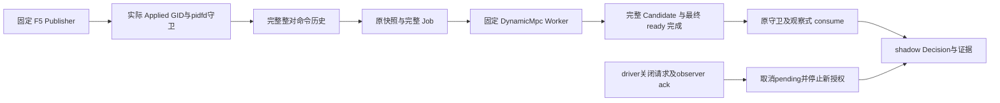

# 方案 A：C3.6 shadow 适配器接入与验证

完成文档日期：2026-10-14（客户端日期）。本批登记与目录沿用 2026-10-13：batch12 / N13。承接 [batch11 后续计划](/home/trevor/MPC/scheme_A_C3_6_20261013_11/方案A_C3_6A后续实施计划_2026-10-13.md)，继续基于 DynamicMpc（交接中的 scheme=B 路线）。

**新 command-anchor 组件已接入独立 owned shadow observer，完成原生守卫和一次真实 4s owned 运行。现有动作仍是观察和拒绝；没有接入 regulator 实际双路执行事务。运行 driver 正常结束，Applied/配置/消息关联检查通过，但旧 normal Witness 检查失败：全部20次激活被拒绝，没有 BusinessReady。该失败保留，不能把它称为完整 normal 资格。C3.6整体、B4/M0b/B5/M4与研究结论均未完成。**

完整观察人口一致性使用单独的事后离线范围，结果见 [独立人口核验](/home/trevor/USV/.sgh-research/experiments/scheme_A_C3_6_adapter_20261013_12/runs/positive01/observation_population_result.json)；它不改变旧normal gate或授予阶段资格。

## 1. 资产、工作区与配置来源

原 HEAD `78999cf380c0b0dd7f545e4dc8103b7c4c2f7b15`、分支 `codex/scheme-c-rl`、boot `b4f820cc-bcd4-4274-9a7f-45f7ad98c9a4`。24个业务文件的151961字节diff与SHA `d901511293df5be4aecb988509e4c4107977dc7c05f042286869c36e0a239ba5` 保持。已有 `.gitignore`、子模块、其他未提交/未跟踪内容保留，没有commit、reset、install或codegen。

保护范围继承N10 355对、N11 18对、N12 388对、3411内容pin、141 support声明及batch11的4544固定路径；另回读batch11的603个登记文件及MPC对应副本。初始与续接证据见 [S0初始](/home/trevor/USV/.sgh-research/experiments/scheme_A_C3_6_adapter_20261013_12/preflight/workspace_initial.json)、[10月14日续接](/home/trevor/USV/.sgh-research/experiments/scheme_A_C3_6_adapter_20261013_12/preflight/continuation_20261014_v1.json)。声明资产核验不等于整机资格。

本批只新增observer运行版本。Publisher、Worker、synthetic、Recorder复用N10原source/bin pins。新observer的34文件v2 bundle SHA为 `82b4ce2c96882ef0772e0db494ea0b253ec96bdb7983f5fed7d20cd59d281db7`，运行binary SHA为 `42b7907d9627b8d054d990fc92681c69b07ca01b59e394aa3f5ab4e6b16b3834`。

Publisher参数来自固定F5参数dump与本次显式覆盖；Worker/observer来自固定contract与完整显式argv；fixture/Recorder来自登记topic与参数。五个角色owned manifest均记录完整typed参数与IEEE754 canonical digest；对Publisher、Worker、observer、synthetic另作实时服务全名/全值/类型查询及修改拒绝验证。Recorder按owned manifest/固定CLI及终端记录认证。证据保存在 [原始运行副本](/home/trevor/USV/.sgh-research/experiments/scheme_A_C3_6_adapter_20261013_12/runs/positive01/raw_run/inputs.json)。

## 2. 修改内容与作用

| 内容 | 修改及作用 |
| --- | --- |
| [owned_peer_c36_v1.hpp](/home/trevor/USV/.sgh-research/experiments/p1_execution_architecture_20261005_01/authored_D1_C3_6_adapter_20261013_v13/common/owned_peer_c36_v1.hpp) | 用完整manifest、进程PID/start/exe/bin、typed配置、source与实际Applied DataWriter GID建立peer；初始化 `/proc → pidfd → /proc`，回调先核实际GID和零等待pidfd。字符串身份不再单独授权anchor合并。 |
| [command_anchor_v2.hpp](/home/trevor/USV/.sgh-research/experiments/p1_execution_architecture_20261005_01/authored_D1_C3_6_adapter_20261013_v13/common/command_anchor_v2.hpp) | 引入原始完整FrozenJob，保留早期anchor/history和非零target prediction；新增observation-only consume、pending取消、最终ready完成检查及schedule重置策略。shadow不会创建Active事务。 |
| [c36_runtime_adapter.hpp](/home/trevor/USV/.sgh-research/experiments/p1_execution_architecture_20261005_01/authored_D1_C3_6_adapter_20261013_v13/common/c36_runtime_adapter.hpp) | 将完整Job echo、版本、认证反馈、ready/cutoff/final consume和close连接到真实节点；不创建publisher或模拟调用成功。 |
| [regulator_shadow_observer.cpp](/home/trevor/USV/.sgh-research/experiments/p1_execution_architecture_20261005_01/authored_D1_C3_6_adapter_20261013_v13/observer/src/shadow/regulator_shadow_observer.cpp) | 在原决策mutex内接入组件，保留完整载荷、state/clock/RTF/source-age/lease/resource/history守卫；读关闭文件在业务锁外，Job DDS publish仍锁外，线程join后才关闭组件。 |
| [prepare_fixture.py](/home/trevor/USV/.sgh-research/experiments/p1_execution_architecture_20261005_01/authored_D1_C3_6_adapter_20261013_v13/prepare_fixture.py) | Publisher启动认证后生成peer pins；测量结束先发driver关闭请求、等observer ack，再发Publisher SIGINT；保留完整zero-tail与有限角色清理。 |
| 原生与离线核验 | 真实DDS同名/同payload但foreign GID反例、全快照/时间/slot边界、真实Candidate回调deadline、Applied资源人口/尾包判据；Source/SQLite/transport/完整payload与关闭顺序独立核验。 |

图中的Decision没有regulator双路物理输出。F5 fixture在隔离domain中的两路命令写入仍被synthetic与Recorder记录。

## 3. 审查与时间边界修订

首版编译成功后，独立源审查发现四项P2，原32文件快照、三份binary与报告均保留。v2复审34源文件匹配，审查范围内没有剩余P1/P2。[首轮发现](/home/trevor/USV/.sgh-research/experiments/scheme_A_C3_6_adapter_20261013_12/review/node_review_attempt01.md)、[v2复审](/home/trevor/USV/.sgh-research/experiments/scheme_A_C3_6_adapter_20261013_12/review/node_review_attempt02.md)。

1. adapter处理与诊断之后重新读取ready完成时刻，两套slot用同一最终时间检查150ms原deadline；跨界、stop或owner/lease丢失均清候选。
2. submit在import/evidence之后重新检查deadline、tick、version、owner、lease、source与stop；最终Job提交时刻等于WitnessSubmit时刻。组件导入时刻单独标为preliminary。
3. final inspect之后重新检查年龄、jitter、target sim、命令、owner与stop；Decision最终commit不沿用较早组件检查时间。
4. 超界Applied完整计收到人口/ordinal/callback一次，永久保留完整性缺口，不序列化超界字符串。已退出owner的tail例外须精确原GID、实际有限双零、两路成功、关闭后有序调用时域、request起2s及已关闭业务；字符串shutdown_zero不能单独授权。

T=200ms、ready=150ms、prepare/total/close=25/60/15s、release=3s、正常hooks=0保持。20ms轮询是新观察周期，不是保证20ms完成；1s ack界与2s受限尾包域有独立来源。最大观测值不是WCET。

## 4. 原生验证及保留失败

当前173个组件用例通过：新peer24（含真实DDS相同payload的不同DataWriter）、adapter17、实际Candidate完成边界3、Applied资源/tail10，以及原七组守卫119。范围见 [当前native评定](/home/trevor/USV/.sgh-research/experiments/scheme_A_C3_6_adapter_20261013_12/component/native_current_assessment.json)。

构建首轮在最后lease测试目标触及600s编译预算，rc124；同一v2源码另以180s有界补完该目标。原失败保留，控制运行窗口未调整。[构建补完记录](/home/trevor/USV/.sgh-research/experiments/scheme_A_C3_6_adapter_20261013_12/build/observer_attempt02_completion01/final_build_manifest_entry.json)。

Native首轮172/173：旧Atomic测试要求同一Candidate两次重新序列化整个CDR一致，失败字节仅在padding offset9/10。每条自身SHA有效。新增独立typed fixture对完整CDR实际deserialize，全部Job/Candidate字段转IEEE位比较，保留signed-zero差异；原11例不变，修订套件12/12通过。没有修改已锁v2运行源、CMake或binary。[padding证据与处理](/home/trevor/USV/.sgh-research/experiments/scheme_A_C3_6_adapter_20261013_12/review/atomic_padding_failure_resolution_v1.md)。173是当前有限用例人口，不是控制工况数。

## 5. 真实4s owned运行与关闭

使用localhost domain122、rmw_fastrtps_cpp、固定五角色及正常hooks0；无Gazebo/硬件/execute。总历时约10.4935s，关闭约1.9328s，五角色rc=0，无close_errors，清理完整。[driver结果](/home/trevor/USV/.sgh-research/experiments/scheme_A_C3_6_adapter_20261013_12/runs/positive01/result.json)。

SQLite完整1552条消息；Applied24、两路F5命令各24、Job/Candidate各21、Decision30。Applied实际callback GID均等于owned publisher，完整typed回调payload与Storage逐条一致；transport与Storage原CDR另作逐条比对。回调CDR是typed重序列化，不能称原网络padding。

21个Job/Candidate与accepted registration全关联；20次实际激活均为anchor_mismatch，来自F5命令值改变。没有shadow激活accepted，没有regulator物理publisher或Active事务。旧predicate允许连续同值重发布，这次结果不表示seq/time递增本身被禁止，也不证明NMPC控制性能。

关闭时序（CLOCK_MONOTONIC ns）：

| 事件 | 实际时刻 |
| --- | ---: |
| driver request | 161628649195533 |
| observer观察请求并取消pending | 161628728366384 |
| driver回读ack，Publisher仍活 | 161628792199948 |
| Publisher SIGINT | 161628835814471 |
| 最终Applied24双零被observer处理 | 161628837760017 |

Job21最终ready后在其target前约7.276ms被close取消；之后没有激活接受。全部24个callback认证检查点owner仍活，本次没有观察到post-exit queued-tail例外，不能把原生seeded tail判据当作真实退出分支集成证明。driver request、owner意图、session end、process cleanup与endpoint消失继续分账。

## 6. Witness失败与资格分层

原normal检查器失败：`business_ready_count=0`、`complete_flag_disagrees`。raw库快照audit_complete=true，记录30tick、21submit、20rejected activation、3phase；没有BusinessReady。这个标志不能替代旧normal合同所要求的首次真实accepted activation。[原失败结果](/home/trevor/USV/.sgh-research/experiments/scheme_A_C3_6_adapter_20261013_12/runs/positive01/check_result.json)。

本批另用事后声明的all-rejected观察一致性范围核验上述完整人口与关闭取消，并保留normalWitnessQualified=false。该检查不是运行前资格登记，也没有伪造accepted或补写BusinessReady。

| 项目 | 当前状态 |
| --- | --- |
| 新shadow接入、native有限组件 | passed |
| 4s driver/Applied/config/transport/Storage关联 | passed |
| 闭合观察人口一致性 | passed：30tick/21submit/20activation/3phase；三个coherent内存反例拒绝，仅组件范围 |
| 旧normal Witness合同 | failed，未合格；原结果保留 |
| 当前统一anchor执行合同、C3.6整体 | unknown，未完成 |
| 当前20s/turn-mixed/统一pressure-recovery-failed-close | not_run |
| Worker实时callback GID、真实逐路partial/unattempted adapter | 未实现或未验证 |
| 连续DDS唯一owner、post-pin exec、owner intent/endpoint退出 | unknown |
| Master Clock硬界、plant接收/保持、全调度WCET | unknown/null |
| B4/M0b/B5/M4 | unknown；qualified=false |
| D1/strict/C3_general/F6/P1/execute/研究结论 | false |

本批的命令组件只观察旧whole-pair准入成功的反馈；旧partial失败策略仍先拒绝。N12逐路组件模拟结果不等于实际逐路执行接入。本次也没有真实observer foreign Applied入侵全链运行；实际DDS peer反例与source-linked分支测试按各自范围登记。WorkerCapability在Storage有36条、observer callback有35条：第36条transport receipt晚于Observer Source闭合144.577ms；完整Source闭合与全Storage人口不能推导每条发布都送达Observer。

## 7. 下一步与归档

下一步先处理Worker双接口GID绑定、真正退出后tail/外来消息的完整节点负例及Witness观察/业务ready契约分层；然后设计实际逐路IO许可/结果与有限工程时域、域外/恢复/关闭政策；再登记非零20s/turn-mixed及压力恢复，按证据逐阶段复判。不能用本次全拒绝4s取得M4。

[具体下一步计划](/home/trevor/USV/.sgh-research/experiments/scheme_A_C3_6_adapter_20261013_12/方案A_C3_6shadow后续实施计划_2026-10-14.md)。全部失败见 [失败清单](/home/trevor/USV/.sgh-research/experiments/scheme_A_C3_6_adapter_20261013_12/postrun/failure_inventory_v1.json)。最终QA回读603个batch11登记文件与MPC副本、1463个compiler-reported依赖，新增1697对冻结副本；另以实际launch SETUP复核54个静态链接文件并单独封存，缺失数0。外层未source SETUP的ldd探测曾缺一个generator_c库，该有限探测不当作运行closure；动态加载插件、整机与WCET仍unknown。见 [实际环境链接复核](/home/trevor/USV/.sgh-research/experiments/scheme_A_C3_6_adapter_20261013_12/postrun/runtime_env_link_verification_v1.json)。最终保护/封存以postrun/final_QA_current.json、final_frozen_snapshot/manifest.json及链接环境补充记录为准；过程文档和证据以新MPC目录的delivery_verification.json实际回读状态为准。旧批次、旧expected和冻结资产不覆盖。
