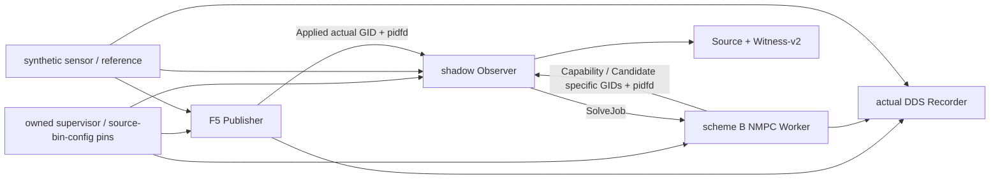

# 方案 A C3.7：Worker 端点认证、Witness 语义与当前状态

日期：2026-10-14（用户工作日期）。本批为 batch13，新作者目录 `/home/trevor/USV/.sgh-research/experiments/p1_execution_architecture_20261005_01/authored_D1_C3_7_20261014_v14`；承接 batch12 下一步第一项。中间证据和文档归档目标为 `/home/trevor/MPC/scheme_A_C3_7_20261014_13`，归档是否已完成以 `delivery_verification.json` 为准。

本批完成的是 **Worker 两接口 owned 认证与闭合 shadow 观察的组件验证**。239 项原生用例通过，新版本实际 4 秒运行的全人口检查通过；实际 accepted activation=0、BusinessReady=0，normal business 记录合同未通过。B4/M0b/B5/M4/F6/P1、execute 与研究结论继续不授予资格。

## 1. 与整体计划的关系

继续以仓库 scheme=B 动态 NMPC 为基线；旧 F5 Publisher 保持命令发布者身份，Worker 求解，Regulator 作为 shadow Observer 提交 Job、登记候选并作最终守卫判断，Recorder 保存实际 DDS Storage，Synthetic Source 提供已登记的输入。新 Observer 没有创建执行出口或发布 Active 事务。

此图只表示当前数据与证据链。shadow 判断、组件内部关闭、进程退出和 DDS endpoint 消失分别记账，不能互相替代。GP/PPO、执行接管、备份/证书和研究强对照仍按整体路线后置。

## 2. S0/S1 复核结果

HEAD=`78999cf380c0b0dd7f545e4dc8103b7c4c2f7b15`，分支=`codex/scheme-c-rl`。既有 24 项业务 tracked 差异（排除 `.gitignore`）为 151961 bytes，SHA256=`d901511293df5be4aecb988509e4c4107977dc7c05f042286869c36e0a239ba5`；本批保留现有 dirty、子模块状态、未跟踪资产及所有原失败，未 reset/stash/commit。

复用四个运行角色的既有 source/bin pin，只新建 Observer 版本。读回 batch12 原/MPC 2194 条库存文件及三条元数据，并沿用其 4612 个固定输入、1697 对冻结文件、54 对实际环境动态库及更早保护链。当前最终复核以 `/home/trevor/USV/.sgh-research/experiments/scheme_A_C3_7_20261014_13/postrun/final_QA_current.json` 为准，范围是已声明资产，不能据此声称完整机器认证。

WorkerCapability 和 SolveCandidate 分别获取实际 DataWriter GID。身份来自 independently pinned owned manifest 与实际 PID/start/pidfd、source/bin、run/boot、contract/nominal、worker_instance 和完整 typed 参数；实际参数通过完整 live query 与拒绝修改回执核对。故障注入许可 `fault_injection_enabled` 的真实来源是完整 Worker `contract_configuration`，不是 ROS 参数；本合同该值为 true，但正常 hooks=0。检查器 v2 同时核对合同原件 SHA、manifest 完整配置和 typed `contract_file/contract_hash` 参数来源。

端点图查询只是有限时刻快照。此认证在登记的 RMW、owned 进程和 manifest 假设下过滤回调；没有证明任意同 UID 攻击者或 RTPS GUID 伪造下的密码学身份、连续唯一性或 post-pin exec 连续性。

## 3. 修改了什么，起到什么作用

| 内容 | 本批实现与作用 | 主要代码 |
|---|---|---|
| Worker 专用 peer | 严格 17 项 pin，限定 Worker 角色，区分两接口 GID/type；进程绑定与零等待 pidfd 检查先于业务 merge | [owned_worker_peer_c37_v1.hpp](/home/trevor/USV/.sgh-research/experiments/p1_execution_architecture_20261005_01/authored_D1_C3_7_20261014_v14/common/owned_worker_peer_c37_v1.hpp) |
| 实际订阅回调 | Capability/Candidate 接收真实 MessageInfo；认证/资源拒绝仍记计数、时刻和原始 GID，且不调用 semantic callback、不续租、不登记或改变现有候选 | [regulator_shadow_observer.cpp](/home/trevor/USV/.sgh-research/experiments/p1_execution_architecture_20261005_01/authored_D1_C3_7_20261014_v14/observer/src/shadow/regulator_shadow_observer.cpp) |
| 保留原业务守卫 | 认证通过后才记录有界完整 typed CDR，再走原 schema、Job echo、state、clock、lease、resource 与最终 activation 守卫 | 同上 |
| 接收窗口关闭 | executor detach、tick/prep join 后记录两接口最终 received/sequence 计数，随后 Source flush 和 Witness Close；不把它解释为 Worker 全发布都送达 | 同上 |
| Witness-v2 | 分开 observation_complete、business_ready_observed 与 normal_contract_qualified；旧 v1 normal gate 和失败保持原样 | [p1_witness.hpp](/home/trevor/USV/.sgh-research/experiments/p1_execution_architecture_20261005_01/authored_D1_C3_7_20261014_v14/observer/src/shadow/p1_witness.hpp)、[check_p1_witness_v2.py](/home/trevor/USV/.sgh-research/experiments/p1_execution_architecture_20261005_01/authored_D1_C3_7_20261014_v14/runtime/check_p1_witness_v2.py) |
| owned 全量检查 | 分别检查 Worker 发布、Storage 和 Observer 接收人口，完整 Job/Candidate/Capability、CDR/IEEE、时序、租约、关闭与 Source/Witness 因果关联 | [check_c37_owned_run_v2.py](/home/trevor/USV/.sgh-research/experiments/p1_execution_architecture_20261005_01/authored_D1_C3_7_20261014_v14/check_c37_owned_run_v2.py) |
| 实际 fixture | 新 run 前登记 shadow profile、五角色 source/bin/config、工具快照和 Worker peer；25/60/15s prepare/overall/close、3s release、4s measurement、正常 hooks0 保持 | [prepare_fixture.py](/home/trevor/USV/.sgh-research/experiments/p1_execution_architecture_20261005_01/authored_D1_C3_7_20261014_v14/prepare_fixture.py) |

源码 v2 为 41 文件，bundle SHA256=`9b888dd51213ce0ffe2a311fd24160062377ef8b1e13cf5ae36e039336552aee`；Observer binary SHA256=`9e99b527571d626ca4765fcab0700a3206b1db13aae110a66fd78496245026fd`。构建只在新目录进行，无 install/codegen。helper v1/v2/v3 分别登记 103/106/111 条，历史变化映射原始 snapshot；前次内容没有重新绑定为当前来源。

## 4. 验证及保留的失败

- 新构建的 14 组原生测试共 **239 项通过**：原 173 项回归、Worker peer 32 项、实际 Node Worker 回调 14 项、Witness-v2 20 项。
- Worker 反例包括同名同完整 typed payload 的真实外来 DataWriter、接口 GID 混用、身份/typed 参数/过程重绑、租约/候选保留、matching fatal 的原终止语义。受控实际 exec 子 Worker 退出后，对原先收到的真实 MessageInfo 触发 pidfd 拒绝。
- 资源超限对象和 null/wrong RMW、zero GID 六输入为明确登记的 source-linked typed/metadata fixture；不声称实际网络 oversized packet 或任意网络元数据已经验证。
- Witness 原生 producer 19 场景、两个 profile 共 36 次判定通过；16 项 decoder 测试通过。修订后 producer 二进制 SHA 与前次完全相同，因此复用已保留的判定证据。检查器 v2 的 30 项有限测试通过（22 项既有谓词及 8 项合同来源反例），独立实际复核另记。

第一次 native attempt 保留原失败：两项测试误把 CDR padding 当成 payload 身份；离线完整字段/IEEE 解码差异为 0，原字节分别有 3/48 个 padding 差异。新测试独立解码每条完整 CDR，比对全字段与发送对象，原始 CDR 校验仍保留。旧 C34 fixture 未传专用目录，拒绝已有 `/tmp` 证据后，TearDown 解引用空对象崩溃；新 runner 用新目录，fixture 加空对象清理保护，旧十条临时证据不删。

审查另修复了生产缺陷：拒绝非法 RMW/zero GID 后，用严格 owned GID serializer 写日志会抛异常，丢失已计数的拒绝记录。现只复制固定 metadata bytes 作证据，认证理由仍决定是否调用业务；新增双接口反例通过。

第一次 actual run `positive01` 的运行正常，但旧 checker 因配置来源错误抛 KeyError；原结果、helper、工具快照及全部 raw 保留。v2 在第二次运行前已测试和 pin。其 CLI 全报告 71058 bytes，超出旧 release-intent writer 的 64 KiB 上限，原失败日志亦保留；[独立分析输出器](/home/trevor/USV/.sgh-research/experiments/scheme_A_C3_7_20261014_13/analyze_current_owned_v1.py) 调用原先 pin 的 v2 谓词，只用另行登记的 8 MiB create-only 报告写入边界并完整回读。未改 predicate、release writer 或 release budget。输出器范围和 SHA 见 [receipt](/home/trevor/USV/.sgh-research/experiments/scheme_A_C3_7_20261014_13/runs/positive02/analysis_writer_receipt_v1.json)。

## 5. 当前实际运行与人口结果

当前选择 `owned_C37_positive_02`，localhost domain133，测量4s。driver elapsed=9.762848606s，close elapsed=1.825667237s；五角色返回0，cleanup 无残留成员且在登记预算内。完整 [检查结果](/home/trevor/USV/.sgh-research/experiments/scheme_A_C3_7_20261014_13/runs/positive02/check_result.json) passed=true、issues=[]；未裁剪尾部窗口或规定 Accepted 数量。

| 人口/事实 | 实际结果 | 资格含义 |
|---|---:|---|
| Job / Candidate / 候选登记成功 | 22 / 22 / 22 | 登记成功不等于 activation 接受 |
| decision / attempted activation | 31 / 21 | 所有记录均与 Source/Witness 对应 |
| accepted activation / BusinessReady | 0 / 0 | normal business 记录合同未通过 |
| 拒绝原因 | anchor_mismatch21、legacy_not_ready6、no_candidate3、shutdown1 | 保留原最终守卫的真实结果 |
| Applied Storage / Observer 回调 | 24 / 24 | 实际 GID + guard 时刻 pidfd 关联通过；没有触发 post-exit tail |
| Capability 发布 / Storage / Observer 回调 | 37 / 37 / 35 | 发布人口和闭合接收人口分别完整，不声称所有订阅者全送达 |
| Candidate 发布 / Storage / Observer 回调 | 22 / 22 / 22 | 完整 Job 身份与逐条 received 关联通过 |
| Witness observation_complete | true | 只证明登记的闭合记录完整性及全人口 Source 关联 |
| Witness normal_business / normal_contract_qualified | false / false | 未观察到首次真实接受及 BusinessReady |
| Active / 新 Regulator 实际发布 | 未观察到 | execute/M4 不授资格 |

Capability 第36/37次 publish-start 分别晚于接收窗口关闭 33.881831ms / 233.375308ms，Worker Source 终止晚于 Observer Source flush。数量差有生命周期证据；Capability 相同 payload 的出现没有唯一 packet identity，Storage ordinal 的贪心匹配不能当作唯一网络包归属或开放窗口零丢包证明。

旧 F5 在 shadow 期间改变命令值，使候选最终 anchor 检查拒绝，是当前合同下的真实结果。本批没有为取得 Accepted 而删 history/state/rate 等守卫，亦没有以 closing-tail 冒充 BusinessReady。

## 6. 当前状态、边界与下一步

本批 Worker 认证与 Witness 分层的最小组件实现/验证已闭合；方案 A 整体实施和阶段资格尚未完成。Master Clock、plant acceptance/保持、完整调度 WCET、连续 DDS 唯一性、post-pin exec 连续性、owner intent 与 endpoint 退出仍 unknown；非零20s、turn/mixed、压力/恢复/failed-close 与新 execute 接管仍 not_run。

下一批优先执行 **实际 owned owner 关闭与 queued-tail 反例矩阵**，再进入左右路实际 IO adapter 与有来源的有限数值政策，随后登记统一版本运行矩阵和阶段复判。具体边界、证据和完成标准见 [后续实施计划](/home/trevor/USV/.sgh-research/experiments/scheme_A_C3_7_20261014_13/方案A_C3_7后续实施计划_2026-10-14.md)。

`/home/trevor/MPC/scheme_A_C3_7_20261014_13/archive_inventory_v1.json` 和 `/home/trevor/MPC/scheme_A_C3_7_20261014_13/delivery_verification.json` 由新目录 create-only 交付；全部既有冻结/失败/未提交改动保持。
