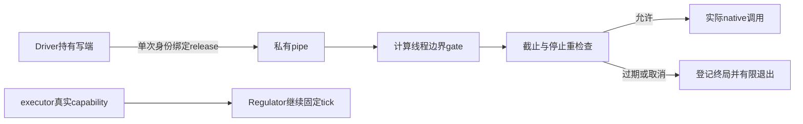

# 方案A：第56批收尾审查与W2独立释放实施计划

_审查日期：2026-10-22（北京时间）；对象：56包attempt18生成的W1/W3/W4各自`_05`运行。_

| 项目 | 审查结论 |
| --- | --- |
| 实现方向 | W4公共收尾、目标tick观察和诊断标签修复方向正确，已进入当前源码 |
| 当前实际数据 | 本次复核支持三例各自限定的组件结论 |
| 身份链 | 1541项锁定输入无失配；84项作者树bundle条目一致；三例注册、Driver及实际角色ELF一致 |
| 现有审计工具 | 三例只读重放均通过，但4种私有错误输入仍被接受，存在应修正的审计断言缺口 |
| 下一步 | 小补丁完善离线审计；推进最小W2私有pipe release；随后Fixture差集→M4复判→F6→P1 |
| 当前阶段资格 | 完整M4、F6、P1、plant接受、硬实时和研究优越性均未取得 |
| 本次操作范围 | 新增57号审查文档、只读复核和私有内存探针；未修改56包、未启动新ROS实验 |

## 📋 1. 结论及应如何承接

56包这轮是实质推进。上次指出的W4短路收尾、目标tick因果缺失和没有当前诊断审计的问题，均有实际代码或证据改善。W4现在确实形成“生成→登记丢弃→目标tick无候选/HOLD→之后投递恢复”的链，不能再用旧`W4_01`的问题描述当前`W4_05`。

本次没有发现需要撤回三例当前限定组件结论的原始数据矛盾。但是，`audit_diagnostic_v2.py`仍没有独立验证部分最重要的注册条件和身份关系。“当前数据正确”与“审计器能拒绝相关错误输入”应分别报告。

建议接受当前三例的限定实跑证据，在下一实现包中同时完成两项工作：补齐离线审计的具体断言；实现W2最小独立release。审计补强优先使用现有`_05`记录，不因为这些工具缺口再统一重跑W1/W3/W4。只有后续实现影响到相应实际分支，才补受影响验证。

本次详细证据：[身份复核](/home/trevor/USV/.sgh-research/experiments/scheme_A_M4_diagnostic_review_20261022_57/evidence/identity_review_v1.json)、[实际case复算](/home/trevor/USV/.sgh-research/experiments/scheme_A_M4_diagnostic_review_20261022_57/evidence/actual_case_recheck_v1.json)、[私有输入探针](/home/trevor/USV/.sgh-research/experiments/scheme_A_M4_diagnostic_review_20261022_57/evidence/auditor_private_input_probes_v1.json)。

## 📊 2. 本次确实核对了什么

### 2.1 身份和构建

读取56包当前prerun清单并逐项重读1541个文件，字节数和SHA全部一致。逐项核对attempt18作者bundle的84项源码文件，实际文件与记录一致。

对每个运行分别核对：当前registration文件SHA、launch回执中的registration SHA、Driver manifest中的registration SHA和旧审计输出记录的SHA，四者一致；run分别为`W1_05`、`W3_05`、`W4_05`。三例使用相同Driver SHA和selected registry。

Regulator、Worker、Fixture的实际ELF均来自`diagnostic_attempt18`，实际文件hash、registry记录和各run manifest一致。Recorder是登记的只读复用ELF，单独核对其身份，不把它描述成attempt18重新构建。

| 对象 | 核对结果 |
| --- | --- |
| 锁定输入 | 1541 / 1541一致 |
| 当前作者bundle | 84 / 84条目一致 |
| 三例registration的四处对应 | 全部一致 |
| Driver工具SHA | `b101b36aef26189f5b3d53db544b2f0c2ca213e6aaf5411e4e8986f7a7b721ad` |
| Worker/Regulator/Fixture | 实际文件与attempt18 registry、run manifest一致 |
| Recorder | 登记复用文件的SHA与manifest一致 |

本次没有检查旧superseded材料的每一个历史文件，也没有重新全量核验47/49/50/51/53的全部目录。因此，“本次未修改旧资产”和“当前选定输入一致”可以确认；历史每轮到底移动了哪些原件，应以其当时记录为准。

### 2.2 当前实现修复

Worker的drop分支已改为标记`result_dropped`，只有实际发布分支调用`out_->publish()`；两个分支之后共同执行完成计数、active清零和数值失败策略。`result_published`依据实际API返回设置，数值失败事件也分别记录发布与丢弃事实。

Decision的`diagnostic_only`、`normal_contract_complete`已结合`execute_qualified`判断；Worker source完成条件已经将登记的drop纳入计数。Source记账完整与正常业务合同完整是不同概念，诊断run的前者可以为true而后者仍为false。

Fixture在主循环尝试起跑，executor可以继续获得服务。最终启动仍通过原图检查的唯一发布者、节点和GID条件；2s约束没有被删掉。该修法避免在起跑检查中持续占据timer回调，是合理的结构调整。

关于“图缓存只能靠executor刷新”的具体因果解释，本次没有对RMW/rclcpp内部实现进行归因验证。文档宜保留实际失败现象与新实现观察，不把这一解释当成已证明的底层定理。

### 2.3 三例关键数据的直接复算

| case | 本次从原始记录核对的事实 |
| --- | --- |
| W1 | 转移原因为`active_watchdog`；转移检查时租约年龄3,657,032 ns，即3.657032 ms，小于600 ms；stall持续1,700,079,212 ns |
| W3 | 投递延迟170,553,932 ns，即170.553932 ms；实际拒绝理由为`late`；无失活转移 |
| W4 | 5条生成、4条成功发布、1条丢弃；被丢Job为3、目标tick为4；该tick为`no_candidate`且未接受；保持命令年龄200,121,183 ns，符合600 ms HOLD；tick 5接受恢复 |
| W4 idle窗口 | 下一Job到达前有2帧Worker capability，均为`active_job=0`、`completed_jobs=3`、`pending_count=0` |
| 三例capability内容 | 另行逐字段核对Worker Source payload与实际Stored的多重集，全部一致 |

两处报告措辞应更正：

- W1全流capability尝试是16次，位于stall进入与释放之间的是8次；不能写成“stall期间16次”。
- 1.7s大于600ms，也大于1s；不是“位于600ms与1s之间”。排除租约触发的证据是转移时实际租约年龄3.657032ms，而不是stall时长落在哪个区间。

## 🔍 3. 可复现的审计发现

### 3.1 方法与边界

本次通过原审计模块执行三例baseline，显式传入原registration，仅将输出目录重定向到57包。三个baseline均通过。

随后执行4个完整审计重放探针：只在内存中替换指定输入字段，保留原审计检查逻辑、既有变异自检和实际SQLite；不改原始文件，也不启动任何节点。四个探针都满足“实际改变了目标字段”，原审计仍给出`passed=true`。

这表明审计器有盲点，不表明实际`_05`run具有这些错误。实际数据的相应条件已由本次额外检查确认。

### 3.2 [P2] 注册刺激和case特有条件尚未完整独立检查

| 完整重放探针 | 改动 | 原审计结果 | 缺失的判断 |
| --- | --- | --- | --- |
| W1过期租约 | 将转移记录的最后有效capability提交时间改成`check_ns−timeout−1ns` | 仍通过 | 独立计算租约年龄，排除已过期租约 |
| W3零延迟 | 将候选发布开始/结束改成原solve结束时间，得到0ns投递延迟 | 仍通过 | 相对registration验证170ms刺激，并独立检查对应候选的拒绝 |
| W4未清active | 将丢弃后、下一Job前的2帧Source capability改成`active_job=3` | 仍通过 | 在准确idle窗口内验证active清零，并核对capability Source与Stored内容 |

原因在于：`check_transition`主要检查原因文字和转移有无；`check_worker_hooks`在W3只要求延迟非负及solve时间自洽；`check_worker_accounting`只检查active指向已知Job、计数单调和最终完成数，没有检查W4指定idle窗口。typed检查也没有将capability的Source payload与Stored逐字段对应。

W4目标tick的`no_candidate`、后续业务接受恢复等条件，Driver已经有较强检查，但独立审计还没有将registration的这些expected条件完整落实。不能仅因通用ledger与fallback检查存在，就称这些case特有条件都已独立验证。

相关源码：[W3刺激检查](/home/trevor/USV/.sgh-research/experiments/scheme_A_M4_diagnostic_worker_20261021_56/audit_diagnostic_v2.py:486)、[Worker记账](/home/trevor/USV/.sgh-research/experiments/scheme_A_M4_diagnostic_worker_20261021_56/audit_diagnostic_v2.py:528)、[转移检查](/home/trevor/USV/.sgh-research/experiments/scheme_A_M4_diagnostic_worker_20261021_56/audit_diagnostic_v2.py:596)。

### 3.3 [P2] 审计的身份校验没有闭合到实际ELF和源码bundle

第四个完整重放探针将W4 Worker manifest的`binary_sha256`改成64个0。原审计依然通过。

`check_contract_identity`检查了合同、部分配置、nominal及scope，但没有将角色manifest的ELF与registry对应项、实际文件及源码bundle闭合比较。审计主流程也没有重新检查launch/Driver所持registration pin。

这正是上一轮“运行在旧二进制、文件被重新登记”的问题类型需要强化的检查位置。本轮实际身份没有失配，已由本次1541项与角色链复核确认；应把这些少量检查收进正式审计器，避免后续再次依赖人工补证。

建议同时核对：registry bytes/hash、role manifest bytes及已登记pin、实际ELF、source bundle实际文件及其成员、Driver实际脚本和相应run/boot/contract身份。effective contract应比较完整typed配置，不能只核对其中几个字段。

相关源码：[现有身份检查](/home/trevor/USV/.sgh-research/experiments/scheme_A_M4_diagnostic_worker_20261021_56/audit_diagnostic_v2.py:120)。

### 3.4 [P2] 只接受AssertionError，仍不能保证变异确实被施加

W3实际数据没有HOLD决策。`m_hold`找不到可变异对象时直接抛`AssertionError('no hold decision to mutate')`，外层将它计入“成功拒绝”。所以W3的这一项没有实际篡改HOLD命令，却仍出现在7/7中。

正确做法是先在审计检查调用之外准备并确认变异已经改变输入；再运行被测检查。前置不满足时应标为不适用，或换成该case存在的有意义变异，不能把准备失败算作检查有效。

例如W3可以验证“把实际投递延迟改为0”或“取消对应候选的late拒绝”；W1可以验证“令转移时租约过期”；W4可以验证“恢复旧active不清零缺陷”。这些都直接针对本case的必要结论。

相关源码：[变异准备及捕获](/home/trevor/USV/.sgh-research/experiments/scheme_A_M4_diagnostic_worker_20261021_56/audit_diagnostic_v2.py:817)、[无HOLD时的前置断言](/home/trevor/USV/.sgh-research/experiments/scheme_A_M4_diagnostic_worker_20261021_56/audit_diagnostic_v2.py:876)。

### 3.5 结果文字和未来扩展还应注意什么

W1审计输出`claim`写成了`watchdog must not fire`，与实际必须触发watchdog相反。这是结果文字错误，应与前述离线修正一并处理。

`check_target_tick`有“可接受较早Job”的注释，但当前原政策要求候选准确匹配目标tick。未来扩展时不能把该注释实现成跨tick放行。当前`_05`没有观察到这种错误激活。

当前已收到Job的四类终局覆盖了这三例，但后续W2超时、停止和进程清理可能出现明确的取消/终止结果。应按实际路径增加有限、互斥的终局类型，不能为了通过ledger把取消伪装成delivered或expired。

## 🔧 4. 下一小步：离线审计补丁，不新增ROS回合

建议在新版本审计中完成以下针对性改动，保留56包v2原件和其历史报告：

1. 将本次身份比较加入审计，并核对registration、launch、Driver和实际role文件。
2. 新增case专用函数，明确读取registration的expected条件，而非只依赖Driver的`passed`。
3. W1独立计算转移时租约年龄、核对watchdog与转移关系，以及转移后无新提交/接受。
4. W3对照注册170ms延迟、原生求解事件、Candidate及发布事件/Stored时间身份，要求准确候选确实被拒。
5. W4独立要求丢弃Job的目标业务tick存在、未接受且`no_candidate`，该Job不登记/不入Stored；验证后续业务接受、准确idle窗口清零和HOLD/ramp。
6. 加入capability Source payload与Stored逐字段多重集比较。
7. 将变异准备与被测断言分离；让上述四个错误输入都以明确审计断言被拒。
8. 更正W1 claim和报告中的计数、时长文字。

完成标准是现有三例仍通过、四个反例明确被拒、变异确实发生、旧数据与原件没有变化。没有缺失原始字段时，不需要再统一构建和重跑三例。

本次审查工具也有一次自有准备错误：最初把`candidate_registration.job.job_id`误读成顶层`job_id`，以KeyError终止。已保留[首次失败记录](/home/trevor/USV/.sgh-research/experiments/scheme_A_M4_diagnostic_review_20261022_57/evidence/review_attempt01_error.json)及v1脚本，v2仅修复该审查工具字段路径并继续未完成检查；没有把此失败算成产品或审计器成功拒绝。

## ⚙️ 5. W2最小独立release：具体实现计划

### 5.1 先锁定原义务，避免继续扩大门槛

[47冻结矩阵](/home/trevor/USV/.sgh-research/experiments/scheme_A_formal_execute_profile_20261020_47/freeze/M4_fault_matrix_v1.json)要求的是`worker held at native boundary until independent release`，并观察多拍Regulator运行、槽位有界、单一backend，且不得把投递延迟叫作native阻塞。

W2应该实现并验证这个明确的调用边界。报告继续保留“未覆盖native C内部真正挂起”的边界，但不应自动把“制造acados内部死锁”增加为P1验收前提。56包文档中“native C内部挂起（W2义务）”的写法应改为“W2调用边界独立释放尚未覆盖；C内部挂起另未证明”。

### 5.2 最小结构

复用现有`owned_cold::Backend::BeforeCall` seam，让单一计算线程在明确调用边界等待。同步回调不会迫使其持有Worker pending锁或Source日志锁；关键是进入等待前已经释放这些锁。

不要增加第二套DDS topic作为首版方案。Driver现有spawn需要为Worker增加显式`pass_fds`；其余角色不继承通道。父子各自关闭不需要的端，防止额外持有者令EOF失效。

### 5.3 作用点、身份和单次政策

首版只选一个明确Job及一个内部调用ordinal，优先在已经完成首次正常求解之后使用，避免把冷启动首Job的4次内部调用混入新的刺激。

现有hook参数只有ordinal，不携带Job。应由计算线程在进入该次solve前固定不可变上下文，让hook能绑定run、Job、ordinal及单次nonce，不能仅凭“ordinal=1”每个Job都暂停。

release命令应有有限大小、明确版本、run/Job/ordinal/nonce以及单次序号。Driver通过已有Source确认边界已进入后才写release；Worker验证当前case和实际继承通道。未知profile、额外参数、错Job、重复命令、部分帧、EOF和超时都有明确拒绝或取消结果。

FD能力及命令身份应进入当前运行登记和实际effective配置/manifest。诊断profile才能启用；普通v3/frozen规则保持默认拒绝，不能把任何fault=true的Worker都放行。

### 5.4 文件级改动

以下指派生新作者树后的副本；不编辑56包原件。

| 现有文件 | 下一实现 |
| --- | --- |
| [owned_cold_backend.hpp](/home/trevor/USV/.sgh-research/experiments/scheme_A_M4_diagnostic_worker_20261021_56/author/worker/owned_cold_backend.hpp:38) | 调用hook后、真正进入backend前再次检查时间/停止；明确是否实际调用C |
| [solver_worker_m4.cpp](/home/trevor/USV/.sgh-research/experiments/scheme_A_M4_diagnostic_worker_20261021_56/author/worker/solver_worker_m4.cpp:158) | 诊断gate配置与FD校验、单次上下文、进入/释放/取消记录、终局及收尾 |
| [owned_m4_diagnostic_driver_v1.py](/home/trevor/USV/.sgh-research/experiments/scheme_A_M4_diagnostic_worker_20261021_56/author/owned_m4_diagnostic_driver_v1.py:163) | 创建私有pipe，仅Worker继承读端；按观察到的边界与tick进行释放和清理 |
| [regulator_owned_execute.cpp](/home/trevor/USV/.sgh-research/experiments/scheme_A_M4_diagnostic_worker_20261021_56/author/observer/src/shadow/regulator_owned_execute.cpp)及入口校验 | 精确认可新登记诊断能力；不修改正常准入、deadline、lease、watchdog、rho/HOLD |
| 新gate小组件 | 有界读取、单次状态机、命令匹配、超时/EOF/取消；不持共享业务锁 |
| 新registration/registry与审计 | 绑定新source/bin/Driver/实际FD能力；记录原始进入、独立release、最后guard、调用事实及终局 |

Driver或bundle变化后重新登记实际选用的角色二进制；不能继续引用旧registry冒充新实现。Recorder和未改生成库是否复用按实际依赖判断。

### 5.5 必须先处理的截止逻辑

原绝对截止是150ms，Regulator周期为200ms。若W2要求跨越至少两个完整业务tick，释放时该Job必然已经过期。

因此，不能一方面等待多拍，另一方面要求“释放后该Job仍进入C求解并正常接受”。合法结果是：独立release被验证，最后guard发现过期/停止，C调用不发生，旧候选不激活，按登记策略完成过期/取消或隔离退出。

该路径与“在native边界内等待”不矛盾。应分别记录`owned_backend_entered`、`actual_C_call_started`、guard结果和最终调用计数，不能把外层`solver_invoked`或进入C++包装器等同于C函数已进入。

现有Backend异常路径会设置terminal，且冷启动内部还有一次性状态。实现者必须明确：释放后过期是可继续服务的既有expiry路径，还是本次运行的登记隔离终局。不要捕获异常后擅自清terminal并复用可能已改变的capsule状态，也不要为了让case“恢复正常”延长deadline。

### 5.6 验证顺序与有限完成标准

先做纯组件验证，覆盖：正常profile拒绝；正确单次release；错误Job/nonce/重复/部分帧；EOF/超时/停止；释放后过期不进入C；等待期间不持capability/Source所需锁。正常释放可用短等待证明合法进入原生调用；跨多拍case则验证过期分支。

再登记一个owned W2运行：只暂停一个明确调用，Driver观察到至少两个完整Regulator业务tick再释放；真实心跳持续、active/pending/ready有界、一个backend、全API流符合约束。不得用线程自己sleep结束作为release成功证据。

各case在运行前固定预计终局、最大等待、Driver与外层预算、退出码和允许例外。沿用现有有限运行管理，不新增大范围参数扫描，不调RTI、权重、水动力、lease或watchdog。

W2完成后只按实际覆盖提升原矩阵子项；不声称C内部死锁、plant接受或硬实时。原始管道事件、实际tick、guard与API/退出证据需能独立对账。

## 🎯 6. W2之后的主线顺序

| 顺序 | 工作 | 应交付 |
| --- | --- | --- |
| 1 | 上述离线审计小补丁与W2最小实现 | 现有三例补审计、4类反例拒绝、新gate组件及W2原始证据 |
| 2 | Fixture与原九组差集 | task_reference、state_clock、候选身份/形状、时序、HOLD边界、cleanup_failed及记录压力的逐项适用证据 |
| 3 | M4范围复判 | 当前版本、正常与故障、来源和全部原义务对应；不机械重跑九轮长实验 |
| 4 | 两个有限已知模型组件及正式F6集成 | 真实M0/M1、独立capsule/warm-start、固定tick model＋plan提交、身份/期限/参考正确 |
| 5 | P1联合复判 | 原P1条件逐项结果及最终可复现输入闭包 |

连续多次丢弃可以作为连续miss/HOLD边界的一种刺激，但不必单独发明新的研究阶段；它应服务原有“五拍无候选、HOLD等号/之后”等义务。cleanup_failed也优先从监督组件与有限私有进程验证，必要时再补owned场景。

F6纯C++组件可提前准备，正式owned集成与资格继续按原顺序承接。实船B始终MANUAL＋RC覆写；本计划不进行硬件接管，不把台架作为新加的前置门槛。

## 📦 7. 本次交付与保留

本次新建57号审查包，未改动56作者树、原始run、registration、registry或原审计输出；未运行新ROS进程、控制发布或硬件命令。用户确认的20个普通工作区变更及子模块状态保留。

| 产物 | 入口 |
| --- | --- |
| 身份完整复核 | [identity_review_v1.json](/home/trevor/USV/.sgh-research/experiments/scheme_A_M4_diagnostic_review_20261022_57/evidence/identity_review_v1.json) |
| 原审计baseline重放 | [auditor_baseline_replays_v1.json](/home/trevor/USV/.sgh-research/experiments/scheme_A_M4_diagnostic_review_20261022_57/evidence/auditor_baseline_replays_v1.json) |
| 三例本次关键复算 | [actual_case_recheck_v1.json](/home/trevor/USV/.sgh-research/experiments/scheme_A_M4_diagnostic_review_20261022_57/evidence/actual_case_recheck_v1.json) |
| 4类完整错误输入重放 | [auditor_private_input_probes_v1.json](/home/trevor/USV/.sgh-research/experiments/scheme_A_M4_diagnostic_review_20261022_57/evidence/auditor_private_input_probes_v1.json) |
| 重放明细报告 | [正常W4重放](/home/trevor/USV/.sgh-research/experiments/scheme_A_M4_diagnostic_review_20261022_57/evidence/auditor_replays/baseline/postrun/W4_audit_v1.json)、[错误active重放](/home/trevor/USV/.sgh-research/experiments/scheme_A_M4_diagnostic_review_20261022_57/evidence/auditor_replays/probe_idle/postrun/W4_audit_v1.json) |
| 审查工具 | [review56_v2.py](/home/trevor/USV/.sgh-research/experiments/scheme_A_M4_diagnostic_review_20261022_57/implementation/review56_v2.py) |
| 旧输入保护 | [131项复核输入快照](/home/trevor/USV/.sgh-research/experiments/scheme_A_M4_diagnostic_review_20261022_57/evidence/review_inputs_before_v1.json)、[工作区快照](/home/trevor/USV/.sgh-research/experiments/scheme_A_M4_diagnostic_review_20261022_57/evidence/workspace_snapshot_before_v1.json) |

文档和复核结果保存于`/home/trevor/USV/.sgh-research/experiments/scheme_A_M4_diagnostic_review_20261022_57/`，同步交付至`/home/trevor/MPC/scheme_A_M4_diagnostic_review_20261022_57/`。审查状态不替代阶段资格，M4/F6/P1继续为false。
