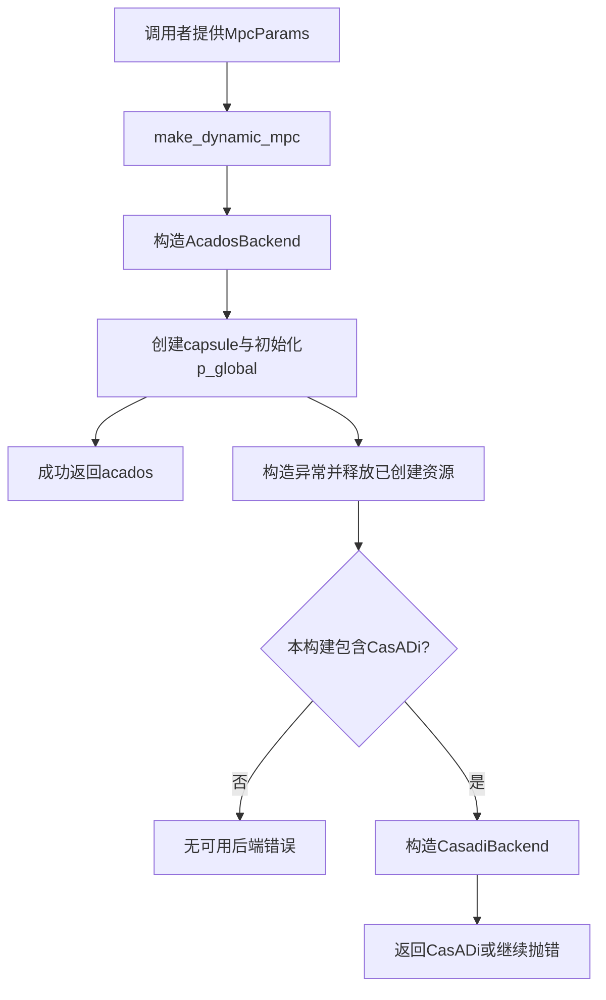

# 方案A第128批：工厂路由实证、准入修正与后续顺序

日期：2026-10-27。承接第127批的第一项后续工作。本批结论是**组件层的工厂准入与路由补证完成**；补丁尚未进入生产树，完整ROS构建、owned运行和阶段资格均未完成。

## 1. 先看这次到底推进了什么

第127批已经把30项模型及权重的打包逻辑提取为共同头，并让acados构造函数检查setter报告的结果。但调用者通常不是直接构造acados，而是调用求解器工厂。工厂会捕获构造异常，并尝试CasADi。只验证acados自己拒绝，不能证明上层最终也拒绝。

这次用真实工厂、真实两种后端编译并运行，确认了一个实际缺口：**NaN/Inf模型被acados拒绝后，仍可被CasADi构造接纳**。显式CasADi工厂也有同样问题。无效模型未进入求解。

本批只增加一个派生补丁：两处工厂入口先检查共同打包的30项参数是否全部有限，检查在异常回退块之外。非法参数直接返回明确错误；有限参数遇到后端构造失败时，仍沿用已有的CasADi回退策略。

完成量：

| 交付层 | 结果 | 含义 |
|---|---|---|
| 未修改工厂的原行为记录 | 52项完成 | 包含对非法模型接纳缺口的如实记录，不代表这项行为合格 |
| 最终矩阵 | 78项符合登记预期 | 3种组合×两种构建宏×13项输入；包含预期拒绝与API不可用 |
| 实际成功求解 | 52次 | acados 24次、真实CasADi/IPOPT 28次 |
| 有限参数前后对照 | 16项一致，最大数值差0 | 比较checked初始化配旧工厂与配新工厂，不比较acados与CasADi的数值等价性 |
| 定向变异 | 4/4准备、编译、链接成功且被指定断言捕获 | 编译失败、崩溃和超时均不计为捕获 |
| 补丁应用 | 私有目录dry-run与实际应用均通过 | 应用结果与被测候选文件逐字节相同 |
| 保护检查 | 80项输入、127批786项、126批1786项无漂移 | 原有失败证据保留；39项工作区状态无变化 |

78项中有9项是CasADi关闭时的显式API不可用记录，不能称为78次后端求解。其余还包括构造拒绝、仅构造观察和有限故障注入。

完整汇总：[final_verification_v1.json](/home/trevor/USV/.sgh-research/experiments/scheme_A_M4_factory_routing_20261027_128/evidence/final_verification_v1.json)。

## 2. 为什么上一批的构造拒绝仍不够

实际调用链是：

第127批解决的是C到E的检查与资源释放。本批观察F到R的最终结果。另有`make_casadi_dynamic_mpc`显式入口，可以直接进入D，也必须覆盖。

原工厂把“参数非法”和“后端暂不可用”等构造异常统一捕获。CasADi构造函数已有权重检查，却没有同样的水动力参数有限值检查。因此，acados的拒绝被后续构造覆盖。

对照证据：[reproduced_admission_bypass_v1.json](/home/trevor/USV/.sgh-research/experiments/scheme_A_M4_factory_routing_20261027_128/evidence/reproduced_admission_bypass_v1.json)。它固定四条实际构造证据：NaN质量、Inf阻尼项，以及两条显式CasADi入口的对应输入。

## 3. 修改了哪些文件，分别起什么作用

所有新增和修改都位于本批目录。生产仓库里的同名源文件没有修改。

| 文件/目录 | 内容 | 作用 |
|---|---|---|
| `implementation/baseline/` | 第127批当前生产源基线的副本 | 观察原setter不检查报告状态时的行为 |
| `implementation/checked_init/` | 第127批checked候选的副本，共同头保持原字节 | 检验上一批新增构造拒绝穿过实际工厂的结果 |
| `implementation/current/` | 当前工厂、CasADi源码/头与生产CMake的固定副本 | 工厂和CasADi均来自实际源码，没有替代后端 |
| `implementation/admission_guard/src/mpc_solver.cpp` | 本批唯一功能候选 | 在普通与显式CasADi工厂入口共同检查有限值 |
| `implementation/tests/test_factory.cpp` | 实际工厂驱动器及命名C边界注入 | 记录选择的后端、真实求解、释放调用、错误与加载的共享库 |
| `implementation/cmake/CMakeLists.txt` | 独立组件构建 | 构造CasADi关闭/开启两种宏配置，并使用明确的native库路径 |
| `scripts/` | 固定输入、构建矩阵、对照、变异、补丁应用核对 | 把结论落实到可回读的具体结果 |
| `postrun/` | 最终保护核验、下一步约束与交付工具 | 记录当前状态，限定下一批范围 |

候选：[mpc_solver.cpp](/home/trevor/USV/.sgh-research/experiments/scheme_A_M4_factory_routing_20261027_128/implementation/admission_guard/src/mpc_solver.cpp)。

补丁：[01_factory_shared_parameter_admission.patch](/home/trevor/USV/.sgh-research/experiments/scheme_A_M4_factory_routing_20261027_128/patches/01_factory_shared_parameter_admission.patch)。其基线是未修改的实际工厂；将来落位时还需要第127批的共同packing和checked初始化补丁，不能把这一张补丁当作独立完整集成。

## 4. 最小修正的具体行为

新增的局部函数使用第127批`p_global::pack(params)`，对其30项输出执行`std::isfinite`检查。失败抛出`invalid_argument("MPC p_global parameters must be finite")`。

调用位置有两处：

1. `make_dynamic_mpc`的`try`之前。因此非法输入不会先创建acados资源，也不会进入它的异常回退块。
2. `make_casadi_dynamic_mpc`构造CasADi之前。因此显式入口不能绕过检查。

没有改后端接口、求解逻辑、warmstart、应用控制锚点、正常回退策略或生成C。没有增加热更新接口和模型代际提交行为。

这项检查仅覆盖共同packing中的30项有限值。**有限不等于物理合理**；质量矩阵是否可逆、参数物理范围、`dt/N`及推力约束的全部合法性，不由这个检查统一认证。

### 4.1 核心结果对照

| 输入 | 第127批checked＋原工厂，CasADi开启 | 本批候选，CasADi开启 | 本批候选，CasADi关闭 |
|---|---|---|---|
| 默认/登记有限模型 | acados正常求解 | acados正常求解 | acados正常求解 |
| 运行时setter边界报告17 | 回退真实CasADi | 回退真实CasADi并成功求解 | 明确报无可用后端 |
| capsule分配边界返回null | 回退真实CasADi | 回退真实CasADi并成功求解 | 明确报无可用后端 |
| 有限的N/dt与生成码不一致 | 回退CasADi | 保持该原行为 | 明确报无可用后端 |
| NaN/Inf水动力参数 | acados拒绝，但CasADi构造接纳 | 创建后端前拒绝 | 创建后端前拒绝 |
| 显式CasADi＋NaN/Inf | 构造接纳 | 创建前拒绝 | API未编译，不可调用 |
| 非法权重 | 原有拒绝 | 保留拒绝 | 保留拒绝 |

“报告17”是链接包装器在登记的setter调用处返回的受控状态，测试保留了生成器的初始化bootstrap调用。它证明报告状态如何影响实际工厂路由，不证明真实C内部失败会正确报告17。

## 5. 两种构建配置实际验证到了哪里

当前环境为**x86_64、Python 3.12.3、CasADi 3.7.2**。这是本机独立组件验证，没有以树莓派或实船结果代称。

按生产CMake的同类链接探针实测：默认C++ ABI链接失败；`_GLIBCXX_USE_CXX11_ABI=0`链接成功。因此仅在开启配置的工厂翻译单元和CasADi实现使用旧ABI，acados实现保持默认ABI。两种配置有各自独立的工厂对象，避免同一源文件属性误施加到关闭配置。

六个最终可执行文件的编译/链接配方和动态依赖均留证。关闭配置没有`libcasadi`动态依赖；开启配置加载真实CasADi；成功求解流中观察到真实IPOPT插件。共固定19项实际加载的共享对象。

生成C归档复用自第127批`attempt02/libgenerated_current.a`：它由当前vendored生成C以O1构建，本批复制后逐字节核对。两套手写acados实现、实际工厂和CasADi实现在本批以O2编译，没有链接旧安装solver归档，也没有重新codegen。

配方证据：[parity_and_recipe01/verification.json](/home/trevor/USV/.sgh-research/experiments/scheme_A_M4_factory_routing_20261027_128/evidence/parity_and_recipe01/verification.json)。ABI证据：[abi_probe01/verification.json](/home/trevor/USV/.sgh-research/experiments/scheme_A_M4_factory_routing_20261027_128/evidence/abi_probe01/verification.json)。

**本批没有完整执行生产ament/ROS CMake构建**。独立组件配方证明两种宏和对应ABI下的真实路由，不能自动升级为完整生产构建资格。计时仅留观察值，没有延迟上界或150ms期限认证。

## 6. 失败原件和工具修正

两次前置失败完整保留，未覆盖：

| 尝试 | 实际问题 | 处理与结论 |
|---|---|---|
| `characterization01` | 开启配置的链接搜索先找到CasADi wheel自带的同名HPIPM，缺少当前acados所需符号 | 独立CMake改用登记acados库的绝对路径。属于本批测试构建配方问题，不归因为生产算法回归 |
| `characterization02` | 链接完成，但间接native依赖未找到；52个进程都在加载器以127退出 | 显式登记仅对子进程生效的库搜索环境。没有一项进入求解器，不计为行为通过 |
| `characterization03` | 原工厂52项行为记录完成 | 真实复现非法模型构造准入缺口 |
| `validation01` | 78项最终矩阵 | 包含修正候选，全部符合登记预期 |

子进程环境明确了acados与CasADi路径、单线程数学库选项，没有修改系统库或全局环境。

历史基线的非有限参数测试在setter适配器处阻止向native precompute传入非法数据，且不调用solve。因此不能把这些基线行宣称为“真实C接受NaN并完成求解”。缺口的决定性证据是**checked构造已经拒绝，而真实CasADi构造仍然返回**。

## 7. 为什么本次验证具有实际约束力

普通成功流检查两次求解、第二次前写入应用控制、预测形状、结果有限性、后端诊断一致性，并执行warmstart重置。胶囊创建、graph free、capsule free调用计数逐例对账。

四项变异分别约束四个不同要求：

| 变异 | 被哪条实际断言拒绝 | 防止什么假通过 |
|---|---|---|
| 删除普通工厂入口检查 | `nonfinite_rejected_before_allocation` | 仅依赖后端或回退工厂迟到的拒绝 |
| 删除显式CasADi入口检查 | `nonfinite_factory_rejected` | 普通工厂绿灯但直接入口漏检 |
| 只检查第一个打包参数 | `nonfinite_factory_rejected` | 只看质量，漏掉后续阻尼项的Inf |
| 破坏有限参数正常回退 | `selected_backend` | 通过禁用所有回退来让非法参数测试变绿 |

四个变异均成功编译、链接，进程退出0后才由检查器发出指定`AssertionError`；其他异常、超时或构建错误不算捕获。证据：[mutations01/verification.json](/home/trevor/USV/.sgh-research/experiments/scheme_A_M4_factory_routing_20261027_128/evidence/mutations01/verification.json)。

16项前后对照覆盖正常模型、有限setter报告错误、分配失败、N/dt差异、原有负权重拒绝和显式CasADi入口。数值最大差0只指这些相同输入、相同后端的两版工厂结果；排除了计时和进程地址映射。

## 8. 代码质量评价与仍需处理的问题

### 8.1 本批修正的质量

改动集中在一份工厂实现，复用已有共同packing，没有另写一张参数槽位表。检查放在回退捕获块外，异常归属清楚；两处公开入口均覆盖。有限回退有真实正控，避免把正常路径一起封死。补丁应用与被测文件逐字节核对，便于后续单项落位评审。

当前实现仍采用工厂中的局部验证函数；仅本文件使用，暂不抽象为新的跨模块政策层。若后续RawBackend需要复用验证，应在独立批中明确共同接口，避免复制出第三套packing/校验。无需为30项启动检查引入缓存或额外线程。

### 8.2 尚未解决的真实边界

1. **生成setter内部错误传播未闭合。** 第127批已经发现生成setter忽略部分内部precompute返回值。本批只消费它报告的状态，未修改生成器或生成C，不能宣称完整native故障认证。
2. **实际owned路径仍未迁移。** 当前owned Worker使用`owned_cold::Backend → RawBackend`，不是本批工厂。因此本批修正不会自动改变owned的模型应用行为。
3. **完整构建资格仍开放。** 本批独立构建固定了依赖，尚不能替代生产ROS构建与其实际环境核验。
4. **工厂不能接管动态加载器失败。** 当前ELF硬依赖`libacados.so`；库缺失会在进入main之前失败。文档中“acados .so加载失败后由工厂回退”的描述不准确。分配边界返回null的测试只证明构造失败回退，不证明缺库回退。此项登记为后续说明/构建评审问题，本批未重设计加载方式。
5. **热更新身份与所有者协议未完成。** Worker创建/使用/销毁线程、只读capability描述、模型与reference完整绑定、目标tick激活仍须按顺序设计和验证。

这些边界决定了当前结论只能停在组件层，而不是把矩阵通过解释成M4或P1通过。

## 9. 当前状态、资产与交付规则

| 状态 | 本批结束值 |
|---|---|
| 工厂准入/路由组件证据 | 本批登记矩阵内完成 |
| 生产补丁落位 | 未执行 |
| 完整ROS生产构建 | 未执行 |
| ROS图初始化、owned运行 | 0、0 |
| M4 / F6 / P1 / plant / 硬实时资格 | 全部false |
| 生产B控制契约 | MANUAL＋RC覆写，保持原状态 |

第126批历史失败记录继续有效；本批通过不撤销历史过程结论。输入和前批保护检查无漂移；本轮39项原有工作区状态也无漂移。没有恢复、提交或清理任何其他任务的改动。

MPC交付目录：`/home/trevor/MPC/scheme_A_M4_factory_routing_20261027_128/`。交付排除编译产物和缓存，保留源码、日志、失败原件、身份及验收结果。最终文件数、SHA与exact_population以独立回读回执为准；USV下保留本地编译产物供追溯。

镜像也排除本批复用的`libgenerated_current.a`输入归档，排除清单保留其SHA。若从MPC副本重放，须先从输入清单指向的第127批USV冻结位置取回归档、核对SHA，并满足清单中的本机native/CasADi依赖。MPC镜像不是脱离这些固定依赖即可运行的独立软件发行包。

## 10. 接下来严格按什么顺序做

下一批承接第127批原顺序的第二项：**RawBackend共同头复用草案与cold/native政策回归**。本批不继续扩展到它。

| 顺序 | 应做什么 | 达到什么要求才能前进 | 限制 |
|---|---|---|---|
| R1 固定实际路径 | 读取实际RawBackend、native政策和Worker调用图，派生新作者树 | 固定输入、记录已有dirty状态，列清正常/错误/截止/停止路径 | 不改生产树，不重设计Worker或Epoch |
| R2 纯packing先行 | 用第127批共同packing替换RawBackend的重复槽位逻辑 | 同输入逐位一致，正常cold路径和native调用事实保持 | 不混入热更新、代际提交或新的fallback政策 |
| R3 checked setter分项 | 单独接入报告结果检查和资源清理 | 非有限/报告错误不会被当成成功；已有cold/native失败策略保持可解释 | 不延长deadline，不放宽停止检查，不伪造内部C故障覆盖 |
| R4 必要组件回归 | 跑真实cold/native和目标boundary路径；加入有意义的变异正控 | 正常、stop、deadline、报告错误、释放对账、API事实满足预期；错误必须由正确断言拒绝 | 编译失败/超时/缺事件不算预期拒绝；失败原件不覆盖 |
| R5 收尾 | 分项补丁、保护报告、下一步和MPC回读 | 清楚区分组件通过与阶段资格 | 本包到此停止，不自动owned、不生产落位 |
| 后续1 | Worker唯一所有者生命周期、不可变capability与就绪协议设计 | 创建/使用/销毁、发现依赖、停止和异常路径无歧义并有反例 | 先有限组件证据，再考虑运行时采用 |
| 后续2 | 模型/reference完整绑定及target-tick激活契约 | 登记模型表、旧Job处理和新窗口生效可对账 | 不用单个generation整数代替完整绑定 |
| 后续3 | 分项生产集成评审、freeze、必要owned补证 | 每项单独满足进入条件 | 不把本轮continue解释为GP采集、plant接入或RT资源授权 |

机器可读计划：[next_plan_v1.json](/home/trevor/USV/.sgh-research/experiments/scheme_A_M4_factory_routing_20261027_128/postrun/next_plan_v1.json)。
