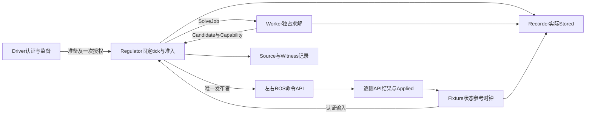
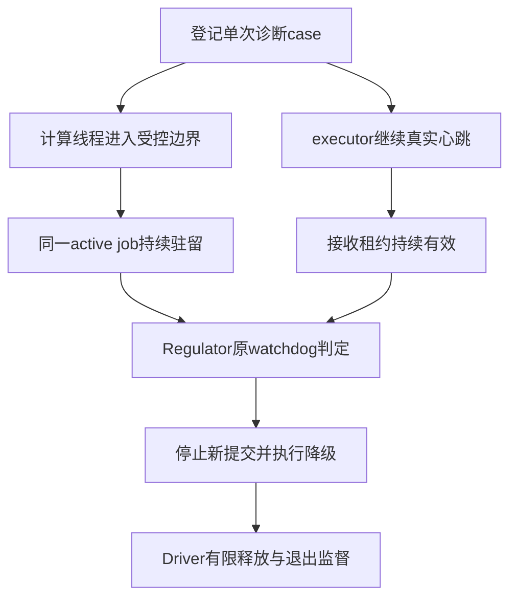
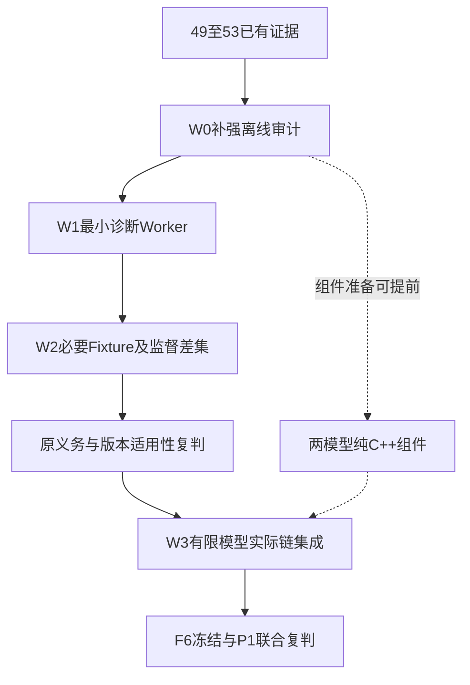

# 方案A：第53批报告复核与M4至P1后续实施计划

_记录日期：2026-10-21；工作区快照：北京时间23:14:38；对象：研究方案A，首先基于仓库scheme=B动力学NMPC。_

| 项目 | 本文定位 |
| --- | --- |
| 文档状态 | 对53批报告的复核、路线建议和具体实施计划 |
| 当前交付 | 54号文档包；不表示已经完成第54批控制实验 |
| 主要依据 | 53批报告、归档源码、R1/R2/R3原始Source与审计；52批主线计划；30批有限模型设计 |
| 当前推荐 | 最小诊断Worker路径优先，按缺口补Fixture；保持M4→有限模型事务/F6→P1联合复判 |
| 当前资格 | 完整M4、F6、P1、研究优越性结论均未取得 |
| 并行工作 | 用户已确认其他任务正在修改仓库；保留并标注，不自动恢复clean |
| MPC交付位置 | `/home/trevor/MPC/scheme_A_M4_next_steps_20261021_54/` |
| 仓库保留副本 | `/home/trevor/USV/.sgh-research/experiments/scheme_A_M4_next_steps_20261021_54/` |

---

## 📋 1. 推荐决定与适用范围

建议继续原先约定的主线：先把当前M4执行链的实际故障义务和来源适用范围收口，再完成两个有限已知数值模型的事务与F6，最后按原P1条件联合复判。实现上采用53批“路线1”的最小受限版本，并按具体缺口吸收“路线2”；不采纳报告中“先做台架，再直接跳F6”的原样建议。

53批已经带来实质进展：在实际owned运行中取得授权前取消、Worker死亡和capability接收租约过期的证据。现在应继续增加明确缺失的能力，而不是把“C++零改动”保持成长期目标，也不是反复补跑已经成功且未受影响的正常case。

本文把三种结论分别管理：

| 层次 | 含义 | 本文能确认的范围 |
| --- | --- | --- |
| 组件或故障子项验证 | 某个实现、刺激和观察窗下的行为有证据 | 53批已有三个实跑子项及现有审计结果；本文另做原始Source分类核对 |
| 阶段资格 | 原阶段要求与当前版本、来源范围逐项匹配 | 仍须补原M4差集、有限模型事务/F6及P1联合复判 |
| 研究结论 | 模型更新、性能改善、物理安全等研究主张 | 当前没有性能优越性、真实plant接受、硬实时/WCET或完整安全证书结论 |

本文所说“方案A”是研究架构，底座仍是仓库动力学`scheme=B`。仓库另有`scheme=A`运动学速度接口，这两个“A”不是同一个名称。实船B的用户契约持续是`MANUAL + RC override`；本计划不改变该契约。

主要入口：[53批修改报告](/home/trevor/USV/.sgh-research/experiments/scheme_A_M4_owned_faults_20261021_53/documents/方案A_M4_owned故障R1R2R3_改动说明与路线选择_2026-10-21.md)、[52批主线计划](/home/trevor/USV/.sgh-research/experiments/scheme_A_mainline_status_and_plan_20261021_52/documents/方案A_主线进度_代码改动与后续实施详解_2026-10-21.md)、[原M4九组义务](/home/trevor/USV/.sgh-research/experiments/scheme_A_formal_execute_profile_20261020_47/freeze/M4_fault_matrix_v1.json)。

## 📊 2. 到53批为止，已经取得什么

### 2.1 已有资产与各批作用

| 资产 | 已有作用 | 适用边界 |
| --- | --- | --- |
| 47批冻结合同与索引 | 固定执行参数、政策和来源证据 | 原件只读；不把新二进制回填进旧索引 |
| 49批正常owned运行 | 新Regulator实际成为唯一双侧输出者，完整Recorder启动后授权执行 | 有限名义来源与选定参数；不等于实船执行器接受 |
| 50批发布/退出组件 | 验证部分发布、逐侧历史、退出等源码关联子路径 | 不替代所有当前owned故障实跑 |
| 51批MANUAL契约修正 | 恢复B的MANUAL＋RC覆写约束 | 历史结果不自动授予之后的并行新源码或部署版本 |
| 52批主线承接 | 汇总资产、并行变更和R1/R2实施计划 | 其中当时“待实施”的R1/R2已由53批推进，不能继续照旧状态引用 |
| 53批R1/R2/R3 | 在选定owned链上补生命周期和租约子项 | 当前审计范围仍有限，完整M4/F6/P1均为false |

53批报告记录：作者树82文件中81个与49批逐字节相同，新增派生故障Driver；C++源码没有业务变更；Regulator、Worker、Fixture及三个验证目标进行了构建。该批报告还记录了52项native policy、38项GTest、14项原生入口拒绝和14项Recorder进程检查。这里引用的是53批历史结果，本文没有再次运行这些控制组件测试。

### 2.2 三项实跑的准确解释

| 子项 | 刺激与边界 | 现有记录 | 不能扩大解释为 |
| --- | --- | --- | --- |
| R1 | 全部准备完成、完整Recorder已绑定、ready存在而grant尚不存在时取消 | API pair为0；无Job与候选登记；Regulator退出码3 | 正常执行完成；强行要求所有角色都以0退出 |
| R2 | 首次accepted且双侧API返回成功后SIGKILL Worker | 失活原因为`worker_process_exited`；刺激至记录转移175.674321 ms；Worker为-9且无完整summary | 计算线程阻塞、active watchdog或能力租约过期已经验证 |
| R3 | 相同触发边界后SIGSTOP整个Worker，之后SIGCONT并关闭 | 原因为`worker_capability_expired`；刺激至记录转移775.498966 ms；恢复后Worker退出0 | 求解器内部挂起、独立watchdog或所有延迟故障已经验证 |

三份现有审计结果均为`passed=true`，同时明确保留`M4_stage_qualified=false`、`F6_qualified=false`、`P1_qualified=false`、`research_conclusion=false`。应保留这些历史结果及其原始依据；补强审计得到的新结论另起版本。

依据：[R1审计](/home/trevor/USV/.sgh-research/experiments/scheme_A_M4_owned_faults_20261021_53/postrun/R1_audit_v1.json)、[R2审计](/home/trevor/USV/.sgh-research/experiments/scheme_A_M4_owned_faults_20261021_53/postrun/R2_audit_v1.json)、[R3审计](/home/trevor/USV/.sgh-research/experiments/scheme_A_M4_owned_faults_20261021_53/postrun/R3_audit_v1.json)。

### 2.3 本次直接读取原始Source后发现的统计表述问题

按53批审计采用的`worker_unusable_transition.processed_ns`边界，将实际`owned_API_pair`逐行分类，结果如下。这里仅核对分类与数量，尚未执行后文要求的完整独立时序及Stored复算。

| case与范围 | pair总数 | 原始kind构成 |
| --- | ---: | --- |
| R1全流 | 0 | 无API pair |
| R2转移前 | 3 | bootstrap 1、waiting 1、accepted 1 |
| R2转移后 | 6 | fallback 5、shutdown 1 |
| R3转移前 | 6 | bootstrap 1、waiting 1、accepted 2、fallback 2 |
| R3转移后 | 4 | fallback 3、shutdown 1 |

因此，不能把R2的“转移后6个pair”全部写成“6个fallback”；也不能把R3的“转移前6个pair”写成“6个accepted”，或把“转移后4个pair”全部写成“4个fallback”。这些分类修正不否定失活和降级路径已有实跑证据，但会影响对覆盖数量、正常输出和退出行为的解释。

R1/R2/R3的Regulator原始`source_summary`均记录`dropped=0`、`generated=emitted`和`normal_source_complete=true`。R2强杀的是Worker，这一例外没有自然扩展成Regulator、Fixture或Recorder可以丢失未声明数据的许可。Worker缺尾部、其他角色的完整性、业务正常完成是三个不同问题。

本次派生统计见：[只读原始记录观察](/home/trevor/USV/.sgh-research/experiments/scheme_A_M4_next_steps_20261021_54/evidence/raw_source_observations_v1.json)。

## 🔍 3. 53批报告中需要修正的路线判断

### 3.1 “冻结”与“不能改代码”不是同一要求

应继续保留47合同、49正常资产、50组件证据以及53批运行原件。新实现应拥有自己的源码包、二进制、合同或诊断规范、注册表和审计身份。这些要求可以同时满足。

53批“控制核心逐字节未改”支持该批的复用主张。后续为了增加原本没有的能力而派生新版本，并不会使旧版本曾经完成的验证消失；真正需要做的是声明差异，并重新验证差异影响到的义务。

不应把“维持零C++变更”当作长期研究目标。否则模型切换、pending/active事务和参考epoch修正都无法真正进入代码。

### 3.2 路线3不能以“无需新合同、无需C++”为理由

30批有限模型设计已经明确：正式集成需要新的合同/registry绑定、Worker模型选择、Observer/Regulator事务、Job及参考epoch关系、所选模型数值检查器和当前版本来源证据。

当前[模型设计](/home/trevor/USV/.sgh-research/experiments/scheme_A_P1_scope_audit_20261019_30/documents/finite_model_transaction_design_v1.md)仍然是设计。53批[固定合同入口](/home/trevor/USV/.sgh-research/experiments/scheme_A_M4_owned_faults_20261021_53/author/common/m4_owned_runtime.hpp:17)硬性绑定原合同和索引hash，不能只换JSON就让旧ELF取得双模型能力。

`Version::model`、`Version::config`在固定单模型运行中不变化，不代表身份门完全无效：它们仍可拒绝错误或外来版本。准确的缺口是“尚未验证并实现两种真实数值模型之间的事务”，而非“现有所有版本检查都在空转”。

可以提前准备F6的纯C++模型组件，但必须单列为组件开发。正式owned链的F6资格和P1资格仍按原依赖顺序复判；不能以登记债务替代阶段完成。

### 3.3 SIGSTOP的局限不能推出所有剩余义务不可推进

整进程SIGSTOP使计算和capability定时发布同时停止。当前case会走租约路径；它不是隔离active watchdog的合适刺激。

应把结论限制为“当前整进程停止机制不能独立验证计算停滞而心跳继续的场景”。不能进一步声称任何外部调度、任何组件复用、任何现有证据都无法推进剩余六组。

另外，775.5 ms是刺激到转移记录的观测间隔。租约应以最后一次有效capability接收提交为起点；watchdog应以active job的实际计时起点为准。不能仅凭“775.5位于600～1000之间”代替这两个起点的独立核对。

### 3.4 新Fixture不必先放宽名义模型范围

现有Fixture要求`controlled_phase_mode=C`和`reference_speed_m_s=0.05`。新增明确的时钟、路径或profile事件，可以继续使用这套基础模型和速度；不能把输入故障刺激与扩大工作域混在一起。

候选来源则另有边界：Fixture是状态、参考和时钟来源，候选应来自实际Worker端点。不能为了制造“坏候选”而放宽Worker GID认证，或声称Fixture已经覆盖了Worker候选身份。

### 3.5 “六个target都必须重建”的说法应限定

53批CMake确实给六个target都注入了bundle/Driver宏，该批选择全部构建是可接受的实现方式。

其中三个运行角色实际调用`formal_owned::driver_peer`，因此Driver或bundle身份变化后，旧角色ELF不能继续冒充新身份。至于三个验证目标，是否需要重新构建和执行，应依据其实际编译依赖及本次选用的验证范围。仅凭宏出现在compile definitions中，不足以证明每个宏都进入并被所有目标的实际执行路径消费。

后续可以继续构建六个目标以简化构建管理，但应把“本次构建选择”与“运行身份绑定的必要条件”分清。[CMake定义](/home/trevor/USV/.sgh-research/experiments/scheme_A_M4_owned_faults_20261021_53/author/CMakeLists.txt:22)、[Driver实际认证](/home/trevor/USV/.sgh-research/experiments/scheme_A_M4_owned_faults_20261021_53/author/common/formal_owned_runtime.hpp:138)。

### 3.6 台架与“零推力”的表述应分开

MANUAL＋RC覆写的实际飞控、通道映射和执行器响应需要独立硬件证据。它有工程价值，但不是当前有限名义M4/F6计划新增的前置条件。本文不安排启动电机、解锁飞控或进行实船接管。

当前53批的左右输出是隔离ROS输出接口。API返回成功不等于飞控接受，发布零命令不等于测得零推力，进程组清空不等于plant已经停止。后续文档应分别记录“零命令请求”“左右API返回”“进程关闭”“物理反馈”，不能用一个“shutdown成功”覆盖全部层次。

## 🔗 4. 当前架构与下一步修改边界

### 4.1 实际角色关系



Driver不发布控制命令；Worker不拥有左右输出；Fixture推进的是依据实际Applied建立的名义历史，未连接真实plant；Recorder既要有真实进程身份，也要有完整订阅/记录就绪证据。不能把process-only认证当成已经获得执行授权。

### 4.2 继续保持的参数与政策

以下为当前47/53选定范围的约束。后续诊断版本继承这些业务边界，任何确有必要的变化必须另列差异，不能临场调宽：

| 项目 | 当前选定值或要求 |
| --- | --- |
| 固定周期 | 200 ms |
| Job绝对截止 | origin＋150 ms；target仍是origin＋200 ms |
| 相邻同侧实际API gap | 240 ms上界 |
| 双侧pair span预算 | 5 ms，按当前实际发布实现的定义复算 |
| tick启动jitter | 20 ms上界 |
| 每侧限率 | 80 N/s，按实际API时间和已知逐侧历史计算 |
| HOLD有效期 | 自最后一次accepted activation计600 ms，不由重发续命 |
| capability接收租约 | 600 ms |
| active watchdog | 1 s；不通过调短watchdog或调长租约来改变触发先后 |
| 数值范围 | N=20、dt=0.2、当前19项水动力与选定约束 |
| 来源范围 | 模式C、0.05 m/s名义来源；不外推完整速度/转弯/混合来源资格 |
| 环境与出口 | 选定localhost/domain120环境，Regulator唯一双侧输出 |
| 发布许可 | 普通生产物理release继续关闭；诊断运行单独登记隔离scope |

依据：[47冻结合同](/home/trevor/USV/.sgh-research/experiments/scheme_A_formal_execute_profile_20261020_47/freeze/p1_execution_contract_v1.json)、[53 owned环境与授权绑定](/home/trevor/USV/.sgh-research/experiments/scheme_A_M4_owned_faults_20261021_53/author/common/m4_owned_runtime.hpp)。

## 🔍 5. 工作包W0：补强已有R1/R2/R3离线审计

### 5.1 为什么先做这一小步

现有`check_bag_equality`逐字段比较Job，并核对Job、Candidate、Decision、Applied的部分数量；没有逐字段核对全部Candidate/Decision/Applied/左右命令。`decode_bag`生成了wire计数，但主流程没有把它用于完整Source/实际接收/Stored对账。R2/R3的限率合规主要读取`gap_exceeded`、`span_exceeded`、`rate_exceeded`等程序自产标志。

这不足以支持报告“Source↔SQLite typed全字段相等”的广泛措辞，也不足以独立证明逐侧时序。应补上缺失检查，而不是宣布三个实跑全部作废。

实际代码见：[53审计器](/home/trevor/USV/.sgh-research/experiments/scheme_A_M4_owned_faults_20261021_53/audit_fault_v1.py:109)。可复用的更完整原始逻辑见：[49正常审计器](/home/trevor/USV/.sgh-research/experiments/scheme_A_M4_recorder_bootstrap_20261021_49/audit_normal_v1.py)，但不能照搬其“全部正常完成”前提。

### 5.2 具体要增加的检查

| 检查对象 | 具体实现要求 | 例外管理 |
| --- | --- | --- |
| API全流 | 从bootstrap到waiting/accepted/fallback/shutdown全部纳入；逐侧重建成功历史 | 初始未知锚点应保持不可用，不能强造前史 |
| gap、span、rho | 使用原始starts/ends、命令和上一次成功历史独立计算，与自产标志交叉核对 | 失败一侧按实际API语义处理，不能假定成功或回滚成功侧 |
| jitter与截止 | 核对planned/start、提交、ready、激活事件的同域时间 | Bag时间与MONOTONIC不可直接相减 |
| typed内容 | Job、Candidate、Decision、Applied、capability及左右消息按明确字段映射核对 | 使用多重集或完整序列，不能让按job_id建字典掩盖重复 |
| 来源与存储 | Source生成/发射、实际接收、Stored逐层对账 | 明确首尾订阅边界；未知额外丢失或错误仍失败 |
| R1取消 | ready/fullRecorder已出现、grant缺失、零输出和禁含事件、准确退出码 | Regulator为3是该路径的既有预期，不要求改成0 |
| R2失活 | 信号边界、实际进程退出、锁内失活、停止新提交/激活、有限降级与关闭 | 只有被强杀Worker的尾部缺项获得对应例外 |
| R3租约 | 从最后一次有效capability接收提交到检查点独立计算；核对实际停止/恢复与端点来源 | 刺激后775.5 ms不能替代租约计时起点 |
| 最终退出 | 零命令两侧实际结果、grace、退出信号/RC、组空和禁止重启条件 | API完成、进程完成与plant结果分别记录 |

实际实现时，先检查每个字段是否已有原始记录。字段缺失必须记录“无法由本次原始材料独立证明”，不能根据期望值回填。只有对应义务确需且旧记录不足时，才登记针对性重跑。

### 5.3 正常与故障例外应怎样分配

R2允许Worker没有summary，不等于允许Regulator没有完整Source。R3是停止后恢复，不自然拥有Worker永久缺尾部的豁免。R1没有业务tick，不等于准备、取消、关闭证据可以缺失。

每个例外都应绑定case、角色、事件、观察窗和允许缺项。例如“R2的Worker被SIGKILL，故缺worker_summary”是可解释例外；“故障run不检查dropped或任何summary”是过度放宽。

增加针对实际审计缺口的变异检查：保持数量但篡改Applied命令、交换某侧数值、篡改原始时间而保留false标志、复制/遗漏同ID消息、引入额外Source丢失。各变异只改变隔离内存或副本，不修改原始run。

### 5.4 W0应交付什么

派生审计器及结果写到新的工作目录，保留53批v1。交付字段至少包括：所审输入身份、case分类、每侧gap/rho、pair span、jitter、typed匹配结果、各层对账、逐角色例外、无法证明项和阶段标志。

W0只读取既有run，不启动新ROS运行，不重新做20秒正常校准。它的完成标准是审计结论可追溯、统计纠正且剩余缺口具体；不是增加一个新的“全部passed”数字。

## 🔧 6. 工作包W1：最小诊断Worker与watchdog路径

### 6.1 要解决的实际缺口

现有Worker的`publish_capability`在executor定时器执行，`work`在独立线程求解。整进程停止会同时停止二者。下一实现应只让选定计算任务在明确边界驻留，同时保留来自同一真实Worker进程和GID的capability。



源码依据：[Worker构造与线程](/home/trevor/USV/.sgh-research/experiments/scheme_A_M4_owned_faults_20261021_53/author/worker/solver_worker_m4.cpp:20)、[计算路径](/home/trevor/USV/.sgh-research/experiments/scheme_A_M4_owned_faults_20261021_53/author/worker/solver_worker_m4.cpp:146)、[失活实现](/home/trevor/USV/.sgh-research/experiments/scheme_A_M4_owned_faults_20261021_53/author/observer/src/shadow/regulator_owned_execute.cpp:494)。

### 6.2 先处理完整入口链，不能只把一个bool改成true

正常47 profile要求`fault_injection_enabled=false`。Worker、Regulator、Fixture、capability校验、运行scope、context/grant和Driver分别有身份与配置约束。当前`m4_owned::frozen`还绑定固定hash；现有普通Diagnostic profile的mode许可也不等于自动获得owned执行权限。

因此，应设计独立、显式、默认拒绝的诊断profile或测试适配层。它引用47为父版本，固定允许差异、case、角色、参数、source/bin/tool hash、有限预算和隔离环境。正常入口保持原有拒绝规则。

必须逐项检查以下调用链：

1. 合同解析、字段全集、profile与mode校验。
2. Worker、Regulator、Fixture对同一有效配置的声明与比较。
3. Worker manifest及capability中的诊断能力认证。
4. Driver、选定registry、实际进程和GID绑定。
5. ready/context/grant中的新scope与合同身份。
6. Recorder就绪、唯一输出和外层退出监督。

不能在几个断言处简单删除`fault_injection_permission==false`，更不能让任何携带fault=true的Worker都被接受。有限允许必须与已登记的实际能力精确一致。

### 6.3 文件级改动建议

以下均指从53批派生到新实现包后的副本，不编辑表中旧归档原件。新文件名是实施建议，不表示本文已创建或已经验证。

| 当前真实文件 | 下一版本的具体改动 | 必须保留 |
| --- | --- | --- |
| [common/p1_full_contract.hpp](/home/trevor/USV/.sgh-research/experiments/scheme_A_M4_owned_faults_20261021_53/author/common/p1_full_contract.hpp) | 新诊断schema/profile的显式字段及模式校验；或独立校验层 | 普通formal/frozen禁止诊断的现有规则 |
| [common/m4_owned_runtime.hpp](/home/trevor/USV/.sgh-research/experiments/scheme_A_M4_owned_faults_20261021_53/author/common/m4_owned_runtime.hpp) | 新profile的父资产、scope、context、grant和registry绑定 | 唯一出口、真实图、精确GID、一次grant |
| [worker/solver_worker_m4.cpp](/home/trevor/USV/.sgh-research/experiments/scheme_A_M4_owned_faults_20261021_53/author/worker/solver_worker_m4.cpp) | 在明确计算边界挂接有界单次gate及独立结果投递策略，记录进入/释放/原生调用事实 | 独占backend、真实capability、资源上界和原准入逻辑 |
| [worker/v2_diagnostic_block.hpp](/home/trevor/USV/.sgh-research/experiments/scheme_A_M4_owned_faults_20261021_53/author/worker/v2_diagnostic_block.hpp) | 评估复用其单次策略；如需独立释放则派生新gate | 原件1700ms非执行诊断限制与native-hang=false语义 |
| [observer/regulator_owned_execute.cpp](/home/trevor/USV/.sgh-research/experiments/scheme_A_M4_owned_faults_20261021_53/author/observer/src/shadow/regulator_owned_execute.cpp) | 仅在新profile精确认可诊断能力；复用实际准入、tick、history和输出实现 | lease/watchdog/deadline/rho/HOLD及不复活旧候选 |
| [owned_m4_fault_driver_v1.py](/home/trevor/USV/.sgh-research/experiments/scheme_A_M4_owned_faults_20261021_53/author/owned_m4_fault_driver_v1.py) | 派生case注册、刺激确认、独立release、有限观察和关闭 | 实际认证、无控制发布者、无自动重试、组未空不重启 |
| [fixture/synthetic_source_m4.cpp](/home/trevor/USV/.sgh-research/experiments/scheme_A_M4_owned_faults_20261021_53/author/fixture/synthetic_source_m4.cpp) | W1如需支持新合同身份，只处理精确入口承接 | 数值模型、模式C、0.05 m/s及非plant性质 |
| [CMakeLists.txt](/home/trevor/USV/.sgh-research/experiments/scheme_A_M4_owned_faults_20261021_53/author/CMakeLists.txt) | 注册新实现、必要针对性验证和身份宏 | 不复用身份不匹配的旧runtime ELF |

若改动了共享核心，必须把变化具体列入影响清单；若只增加测试适配边界，则要用实际编译引用、函数或文件级对应证明复用关系。不能只写“同一核心”便直接转移资格。

### 6.4 必须分开的四种case

| case建议名 | 操作边界 | 能支持的结论 |
| --- | --- | --- |
| W1-work-stall-watchdog | 单一active任务驻留，真实capability持续到达，独立监督释放/结束 | 当前watchdog、停提交流程、槽位上界与降级行为 |
| W2-native-boundary-hold | 在明确native调用边界由独立release控制驻留 | 该边界下Regulator继续运行；不自动证明C函数内部hang |
| W3-result-delivery-delay | 已完成数值结果只延迟投递，时间身份保持原值 | 截止前/等/后返回与迟到拒绝；不得重新打solve时间 |
| W4-result-delivery-drop | 产生结果后按单次策略不投递，记录生成与丢弃 | 无候选、连续miss、HOLD到期与降级；不称求解失败 |

现有`test_native_block_ms`和`diagnostic_v2`实际上都在调用solver前sleep，源码明确记录`actual_native_invoked=false`。它们可作为计算线程驻留的基础，但不能据此关闭“真实native C内部挂起”的义务。如果原判据确实要求该层挂起，必须选择覆盖真实调用边界的适配实现并明确观察能力；若无法取得，保持该子项开放。

独立release不应依赖被阻塞线程自行定时醒来后宣布“释放成功”。gate等待也不能持有capability或Source所需的共享锁；否则看起来只阻塞计算，实际上仍会使心跳或记录停止。

### 6.5 W1完成标准与回归范围

先证明正常入口拒绝诊断、未知case/参数/身份被拒、heartbeat不被gate阻塞、超时清理有界；再运行最小登记case。原有52/38/14等数量不是新版本的完成标准。

watchdog case至少需要以下事实：相同active job持续驻留；最后有效capability的年龄始终满足租约；多个Regulator tick继续完成；active/pending/ready槽位没有增长；真正原因是`active_watchdog`；转移后无新提交或激活；逐侧API全流与退出结果可独立复核。

新增适配层得到的是对应故障行为证据。要用于当前M4阶段，还必须记录测试版本与当前目标版本的复用关系、改动影响和原九组判据映射；不能自动给正常profile授予诊断权限。

## ⚙️ 7. 工作包W2：按原九组差集补Fixture、候选及监督

### 7.1 先建立逐case映射，再确定最小实现

53批台账已经明确`all_nine_groups_require_new_long_ROS_runs=false`。九组是义务分类，不是九轮必须重新启动的长实验。每条required_case应登记：原判据、实际核心版本、已有证据、是否适用、剩余缺口、验证层次和完成产物。

| 原组 | 已有基础 | 需要继续完成的差集 |
| --- | --- | --- |
| compatibility_input | F5、来源和映射历史证据 | 当前代码复用、logging off/on适用性、新参考来源与无隐藏writer |
| time_boundaries | 政策组件与正常tick证据 | 50/150/250/400ms、ready前/等/后、错target、延迟tick的准确覆盖 |
| native_block_and_delivery | Worker结构和旧诊断记录 | 当前owner下明确native边界驻留、独立release、投递延迟与丢失 |
| candidate_identity_shape | 当前候选准入与源码复用 | failed、形状、NaN、重复/乱序、foreign boot/producer/version逐项覆盖 |
| task_reference | 已有清pending与参考epoch基础 | 冻结前/提交中clear或替换、同内容重发、path/profile不匹配、普通新odom |
| state_clock | 当前selector和正常来源 | stale/future、mixed skew、activation mismatch、pause/reset/jump/RTF范围 |
| anchor_fallback | 49实际正常流、50部分历史组件 | 不同API间隔、同值重发、缺锚点、5miss、HOLD等号/之后和未知单侧 |
| publication_exit | 50组件、53 R1/R2/R3 | active watchdog、cleanup_failed及剩余准确退出边界 |
| actual_source_recording | 49完整正常记录与50组件 | 53补强对账、有限队列压力、声明丢失与未知额外丢失区分 |

依据：[53覆盖台账](/home/trevor/USV/.sgh-research/experiments/scheme_A_M4_owned_faults_20261021_53/postrun/M4_fault_coverage_v1.json)。本文没有把表中任一整组提前改为通过。

### 7.2 Fixture最小事件计划

在新派生Fixture中增加不可变、有限的输入事件表。每条包含case、相对已确认事件的触发点、最大次数、精确payload或变化、预期来源与观察终点。启动后不允许通过未登记动态参数临时换刺激。

第一组只针对task_reference：clear/single-point、求解期间路径替换、相同内容重发、path/profile配对失配。第二组才处理clock/state：pause/resume、reset/backward/forward jump、stale/future及需要时的mixed skew。

事件从原来经认证的Fixture发布者产生。保持模式C、0.05 m/s基础参考、原hydro和Applied名义历史；输入刺激本身单列，不扩大模型或工作域。

混合来源分支仅在原判据确实要求且当前case明确配置时验证；不能用普通IMU存在便宣称mixed已通过。时钟域之间的年龄按各自定义记录，不能做无意义的跨域相减。

### 7.3 候选异常必须进入实际准入路径

优先复用与当前实际调用实现一致的确定性准入组件，核对其准确前提。需要真实端点的case，从登记Worker发布端发出限定异常候选；不得放松身份门接受Fixture伪装。

应观察最终选择和normal输出，而不是仅观察“收到一条坏消息”。错误候选被拒后，旧候选不能复活；重复候选最多消费一次；pending和ready不能堆积；reason必须与实际分支一致。

### 7.4 cleanup_failed与记录压力分开验证

cleanup_failed首先属于Driver/监督逻辑。可以用受控私有进程或精确监督组件验证有限INT/TERM/KILL、超时结果、组未空不得重启；组件结果只认领组件范围。真实owned运行义务需要现场证据时，再补对应有限case，不必先改NMPC数值代码。

记录压力从当前日志实现的实际队列/写入边界入手，固定有限输入量与预算。必须区分Source生成、入队、发射、传输接收和Stored数量。声明丢失只适用于登记的队列和时间窗；未知额外错误、日志写失败或输出时序超限仍应导致该case不通过。

## 🎯 8. 工作包W3：有限已知模型事务与F6

### 8.1 最小数值范围

先沿用30批设计：M0为冻结名义模型；M1只改变已知水动力参数Xu，其余权重、约束、N、dt和生成图不变。预定候选为全局index9的Xu乘1.2，即`-2.272063→-2.7264756`；最终实施前应按实际接口和typed参数序列再次固定。

这是两个有限、人工已知性能模型的切换，未实现在线辨识、GP或学习残差，也不表示真实plant发生同样变化。不能把“两个注册模型切换成功”写成“在线学习已经完成”。

### 8.2 先做纯C++组件，正式链按阶段承接

纯组件采用两个独占capsule，在同一Worker求解线程串行选用；active Job≤1、pending≤1。两个模型独立warm-start，接受轨迹深拷贝，禁止把已接受计划指向可变缓存。

保留30批已有首次组件预算：最多两个头/实现加一个针对性native测试，已有生成库只读链接，总墙钟≤120s、输出≤100MiB，构建最多两次修正。该预算适用于最初纯组件；不是整个F6集成的统一时间承诺。

若为避免研究内容长期停滞而提前准备此组件，状态只记“F6模型组件开发”。M4义务仍按主线收口，正式F6 owned运行和资格不因组件提前完成而跳过前置。

### 8.3 正式集成应修改的内容

| 部分 | 实现要求 | 关键拒绝条件 |
| --- | --- | --- |
| 不可变模型registry | 绑定两个槽位、完整typed参数、生成库、布局、N/dt、传播实现和hash | 未知槽位、NaN、错维、错误参数hash |
| 新合同与版本 | 新contract_hash绑定registry；有限首版使用现有contract/model字段唯一解析 | 不能只改generation而继续用同一数值模型 |
| Worker backend选择 | 选定确切capsule并记录实际p_global与模型指纹 | 模型身份和真实数值不一致 |
| pending/active事务 | prepare不改变active；合格候选只在固定tick提交model＋plan＋metadata | 迟到、错model、旧task、旧anchor或无候选时不激活 |
| 数值检查 | 历史reconciliation模型与候选性能模型分别明示 | 不能用M0检查M1轨迹后制造假拒绝 |
| 参考epoch | 纯性能模型变化保持同一TaskStart和任务进度 | 不通过重置参考产生表面误差改善 |
| warm-start和计划存储 | 两套缓存独立，已接受X/U不可变 | 失败pending污染active或旧轨迹被改写 |

M1准备失败不会回滚已经发生的单侧或双侧API，也不能延长旧HOLD期限。旧诊断首Job的0.5N/4RTI策略不能自动套给每次模型切换后的首个求解。

### 8.4 F6验证顺序

1. 固定同一非零状态/输入探针，证明M0与M1实际模型函数存在预期差异，并分别与独立RK4对拍；零点结果相同不等于失败。
2. 串行M0→M1→M0，核对真实capsule、参数、预测有限性、缓存隔离和所选模型defect；不以控制输出必须不同作为唯一判据。
3. 验证pending拒绝不改变active、保存轨迹不被warm-start改写、纯模型切换不重置任务进度。
4. 在已承接的唯一执行链上补原F6延迟、数值失败、旧状态、混合版本、连续五拍无候选等义务。
5. 固定最终source/bin/config/模型/工具/来源和记录身份，完成F6范围复判，再联合复判原P1。

设计依据：[30批有限模型事务设计](/home/trevor/USV/.sgh-research/experiments/scheme_A_P1_scope_audit_20261019_30/documents/finite_model_transaction_design_v1.md)。本文没有创建registry、capsule包装或模型事务代码。

## 📦 9. 分批交付、停止条件与验收方法

### 9.1 建议的推进顺序



图中的“复判”是对代码与原始证据的判断，不是新增一个与原计划无关的审批层。义务已经满足且证据足够时应直接进入下一步；出现具体缺口才补对应实现。

### 9.2 每个工作包的完成标准

| 包 | 必须交付 | 不应当作完成标准 |
| --- | --- | --- |
| W0 | 新审计源码、输入pin、分类修正、全流复算/对账、无法证明项 | 审计脚本自身返回0或新增几个测试数 |
| W1 | 限定profile/适配实现、差异清单、真实case原始记录、独立审计和适用性 | 把故障许可改true、重复SIGSTOP或只有预期reason文字 |
| W2 | 每条原义务到具体证据的映射、必要Fixture/Worker/监督case | 只更新九组总布尔值或再跑一遍正常直线 |
| M4复判 | 当前正常与故障证据、原义务、版本及来源范围一致 | 为追求“九组全绿”临时删掉原判据 |
| W3/F6 | 两个真实数值模型、固定tick事务、身份/缓存/参考正确及故障证据 | 仅使Version数字递增 |
| P1 | 原P1条件逐项结果和最终可复现输入闭包 | M4或F6单项通过就称P1完成 |

每个新run应预登记刺激、精确边界、观察终点、退出预期、允许例外、最大时间/输出、外层清理和重试政策。保持自动重试0；失败后保存首次命令、输出、source/bin/config和原始记录，修复版本另起attempt。

前述现有45/46准备与来源证据、49成功正常run、50相同组件、53同一case没有受代码影响时不机械重跑。若新profile、入口、共享核心或记录路径改变，则按实际影响补验；不能承诺所有历史资格自动继承。

### 9.3 结束“不断拒绝但不知道哪里缺”的状态

每批用同一张表更新“原义务→当前实现→原始证据→独立检查→剩余差集”，并给出具体失败原因。区分启动认证失败、业务分支拒绝、记录不完整、审计不足和阶段资格不足。

例如：坏候选因版本错误被拒，是该拒绝case的预期业务结果；它不等于实验失败。反过来，Driver返回0但没有证明对应watchdog分支，也不能宣称该义务已通过。

不要用统一“拒绝”描述所有情况，也不要通过放宽门槛把预期拒绝改成接受。真正的推进应体现在缺口变少、所需能力进入代码、当前版本证据完整，而非报告或测试总数增加。

### 9.4 哪些条件应使当前case结束

输入身份变化、出现非登记输出者、实际配置不符、记录器未就绪、超预算、未知额外丢失、逐侧输出或退出约束违反时，应结束该case并保留证据。先解决具体原因，不通过延长观察窗、改变lease/deadline或重复正常run掩盖失败。

组件无法模拟到的真实层次应如实记“尚未覆盖”。它可以提示换适配边界或补实际case，但不能凭一个宽泛的“结构性不可能”把整个后续阶段永久挂起。

## 📝 10. 当前工作区保护、证据索引与下一次任务说明

### 10.1 本次保护范围和事实

记录时HEAD为`feb50823a07054879e3c6f8d437c02595ce26976`，分支为`codex/scheme-c-rl`。工作区有16项受跟踪修改和4项未跟踪普通文件，另有`ardurover-argus`子模块未跟踪状态；这不是20项本次新改动。

用户已明确说明“有其他任务在修改，保留并标注”。本次只在新的54号文档包创建文档和复核元数据，不把并行源码收进本次实现，也不回退、清理或覆盖这些变更。具体文件和内容hash见[写入前工作区快照](/home/trevor/USV/.sgh-research/experiments/scheme_A_M4_next_steps_20261021_54/evidence/workspace_snapshot_before_v1.json)。

本次固定了30个选定文档、源码或原始Source输入的字节数与SHA，见[复核输入清单](/home/trevor/USV/.sgh-research/experiments/scheme_A_M4_next_steps_20261021_54/evidence/source_review_pins_v1.json)。该清单不等于重新核验47全部4103项冻结资产；本文也没有重跑53的ROS、GTest或完整Stored审计。

后续实施从明确父版本复制到新作者树，记录新registry。若选定输入在运行期间发生并行变化，结束对应身份检查，按新版本重新登记；不要求整个共享仓库先变clean。

### 10.2 每批状态建议保留的最少字段

```json
{
  "implemented_changes": [],
  "component_verification": [],
  "owned_case_evidence": [],
  "declared_case_exceptions": [],
  "remaining_original_obligations": [],
  "M4_stage_qualified": false,
  "F6_qualified": false,
  "P1_qualified": false,
  "research_conclusion": false
}
```

上述是状态组织示例，不是替代既有合同或运行注册表的新schema。阶段标志只能在对应义务确已满足后更新；普通生产物理release、plant接受和硬实时等状态继续单列。

### 10.3 后续执行任务可直接使用的说明

> 继续方案A，保持M4→有限模型事务/F6→P1原顺序。先派生并补强53批离线审计，核对完整API流、typed Source/Stored、逐角色例外和原始pair分类；再实现“计算线程受控驻留而真实capability持续”的最小诊断版本及独立监督case。保留正常冻结入口的故障拒绝政策，不修改旧归档、不放宽身份/时序门禁、不重复未受影响的正常校准。每包交付具体代码、原始记录、独立检查、原义务差集和下一步；Fixture按缺口增加，F6纯组件与正式阶段资格分账。保留工作区并行变更、失败证据及MANUAL＋RC覆写契约，文档同步到MPC。

### 10.4 主要证据入口

| 材料 | 路径 |
| --- | --- |
| 用户指定修改报告 | [53批报告](/home/trevor/USV/.sgh-research/experiments/scheme_A_M4_owned_faults_20261021_53/documents/方案A_M4_owned故障R1R2R3_改动说明与路线选择_2026-10-21.md) |
| 53批当前状态 | [CURRENT](/home/trevor/USV/.sgh-research/experiments/scheme_A_M4_owned_faults_20261021_53/CURRENT.md) |
| 原九组义务 | [47矩阵](/home/trevor/USV/.sgh-research/experiments/scheme_A_formal_execute_profile_20261020_47/freeze/M4_fault_matrix_v1.json) |
| 53批覆盖状态 | [覆盖台账](/home/trevor/USV/.sgh-research/experiments/scheme_A_M4_owned_faults_20261021_53/postrun/M4_fault_coverage_v1.json) |
| 现有故障审计 | [audit_fault_v1.py](/home/trevor/USV/.sgh-research/experiments/scheme_A_M4_owned_faults_20261021_53/audit_fault_v1.py) |
| 可复用正常审计 | [audit_normal_v1.py](/home/trevor/USV/.sgh-research/experiments/scheme_A_M4_recorder_bootstrap_20261021_49/audit_normal_v1.py) |
| watchdog可行性记录 | [W1原记录](/home/trevor/USV/.sgh-research/experiments/scheme_A_M4_owned_faults_20261021_53/implementation/W1_watchdog_not_isolable_v1.json) |
| R2原始Source | [R2 source.jsonl](/home/trevor/USV/.sgh-research/experiments/scheme_A_M4_owned_faults_20261021_53/runs/owned_fault_R2_01/regulator/source.jsonl) |
| R3原始Source | [R3 source.jsonl](/home/trevor/USV/.sgh-research/experiments/scheme_A_M4_owned_faults_20261021_53/runs/owned_fault_R3_01/regulator/source.jsonl) |
| 有限模型设计 | [30批设计](/home/trevor/USV/.sgh-research/experiments/scheme_A_P1_scope_audit_20261019_30/documents/finite_model_transaction_design_v1.md) |
| 历史主线解释 | [52批详解](/home/trevor/USV/.sgh-research/experiments/scheme_A_mainline_status_and_plan_20261021_52/documents/方案A_主线进度_代码改动与后续实施详解_2026-10-21.md) |
| 实船B契约 | [MANUAL＋RC覆写说明](/home/trevor/USV/usv_mpc_ws/docs/scheme_B_manual_rc_contract.md) |

本文用于承接下一步实施。当前实际完成的是文档复核和只读原始记录分类；W0完整审计补强、W1诊断实现、W2输入故障差集、W3模型事务及P1联合验收均不能据本文提前认定已完成。
