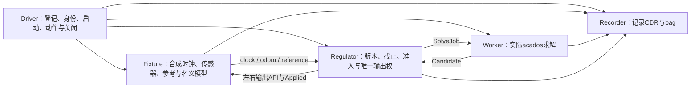

# 方案A：近期修改详解、代码质量复审与后续计划

第124批，2026-10-26，北京时间。

本文先解释98—123批改了什么及其作用，再评价代码质量，最后给出下一步实施顺序。依据是创新登记簿、122会话报告、123集成输入、关键源码、保留运行及本次独立离线反证。**本批只做审查与文档，没有修改生产代码、没有新增ROS/owned运行。**

## 一、先建立整体认识：最近主要在完善执行与验证架构

最近这26批主要增加了四种能力：任务变化后继续服务、实验暂停后恢复、求解器运行时更换模型、在压力或异常退出时保留可信证据。NMPC仍负责计算控制；这些修改围绕它解决“什么时候能用结果、结果属于哪个版本、出错后怎么停止、如何证明发生了什么”。

目前已有真实工程进展：同run参考换代后继续接纳；B2路径恢复后新Job真实激活；真实acados setter的有限对拍；真实进程组非空监督。**这些成果尚不等于三个候选已经接入生产，更不等于实船控制性能或P1验收已经通过。**

研究架构“方案A”沿用仓库实船scheme=B的MANUAL+RC覆写契约。研究方向的名称与启动配置的scheme字段是不同层次，不能据名称把实船链改为GUIDED。

### 1. 当前研究运行的结构



Fixture中的名义模型用于研究数据闭环，不能当作真实plant。Regulator拥有实际输出权限，Worker算出结果并不意味着该结果必然被使用；身份、版本、截止和激活条件仍需通过。

### 2. 几个容易混淆的词

| 名称 | 实际含义 |
|---|---|
| component验证 | 真实函数/类或求解器数值路径的有限验证，不一定启动四角色 |
| owned运行 | Driver实际创建、认证、观察并关闭角色的一次运行；不是目录存在或测试自报 |
| freeze | 固定源码、工具、ELF、合同和配置身份；证明“跑的是谁”，不自动证明行为正确 |
| scoped generation | 参考时间锚包装层的第几代；不是Job.task_generation的同义词 |
| clock_epoch | 原始clock发生特定不连续时的版本字段；正常单调resume可以保持0 |
| model_generation | 求解模型身份；需要与Job、Candidate及实际应用的数值参数一致 |
| 证据处置完成 | 每条义务有明确状态和证据，不等于所有义务在同一层级全部通过 |

## 二、按最近的推进顺序，看每一组修改的作用

| 批次 | 主要工作 | 解决的问题 |
|---|---|---|
| 98—101 | T3队列压力、关闭/cleanup、审计 | 日志洪泛、发布阻塞、角色退出但组未空时能否正确记账和停止推进 |
| 102—105 | scoped Epoch包装层、接线、POS/NEG及审计 | 静态Epoch终态后，同run能否以新身份开启下一代并继续服务 |
| 106 | N3九组69项处置复判 | 把已有证据按组件、阶段资格、研究结论分层收束 |
| 107—109 | 有限模型事务设计、真实setter对拍及审计 | 已用solver capsule能否更换全局模型数值参数并管理warm-start |
| 110 | N4/N5门判定 | 明确组件技术证据与M4/F6/P1晋级之间的差别及资源缺口 |
| 111—114 | resume新窗口初探、两次失败、归因与政策设计 | 发现终态Epoch之外还有输出历史映射阻塞；其中部分归因随后被纠正 |
| 115 | 独立复审 | 纠正跨run/跨时间域混比、L630误归因和B0接口误认 |
| 116—118 | 证据修订、纯审计/准入、B2配对映射 | 将正确时间映射落实为Fixture与测试共用的helper |
| 119—121 | RNW3单次owned、收束及链审计 | 观察到恢复后gen2 Job7真正接纳及输出 |
| 122—123 | 会话报告、创新登记、集成输入 | 整理成果与待集成候选；这两批本身没有增加运行代码 |

### A. T3：先让“日志压力和退出失败”变成可重复验证的问题

**队列压力修改。** 测试将drain阻塞在锁外publisher中，并用picked计数证明已有一条被取走。随后队列再接纳capacity条，所以在这个受控条件下可以精确断言accepted=capacity+1。它减少了“靠睡眠猜消费者有没有动”的不确定性。

这是一种有用的测试方法，不能直接读成所有调度和所有负载下都有相同接纳数量。Q2则尝试多生产者竞争，按总生成/接纳/丢弃/落盘对账。

**退出压力修改。** 专用Fixture收到终止后由主循环创建一个有界survivor，再退出父角色。Driver因此能实际观察“父角色rc0但进程组未空”，记录cleanup_failed。C12里的driver.passed=false是被测的失败事实；测试case可以因成功观察该事实而达成预期。

本次复核确认：C12的Fixture记录SIGINT→SIGTERM、group_empty=false、cleanup_failed_roles=[fixture]，Driver角色spawn为4；健康对照C3关闭干净。该证据限于这条有限监督路径，不证明所有未来restart请求都已被完整生产状态机验证。

主要文件：

- [队列压力测试](/home/trevor/USV/.sgh-research/experiments/scheme_A_M4_t3q_impl_20261025_99/implementation/t2_author/observer/tests/test_t3_queue_pressure.cpp)
- [DiagSink](/home/trevor/USV/.sgh-research/experiments/scheme_A_M4_t3q_impl_20261025_99/implementation/t2_author/observer/src/shadow/p1_diag_sink.hpp)
- [测试专用survivor Fixture](/home/trevor/USV/.sgh-research/experiments/scheme_A_M4_t3c_impl_20261025_100/implementation/t2_author/fixture/synthetic_source_m4_t3_survivor.cpp)

### B. scoped Epoch：失效后建立新一代，而不是把旧终态对象改回可用

原Epoch按静态任务设计，绑定变化后进入终态。在持续运行的场景里，这会阻止后续任务继续提交。

新包装层保留原Epoch类：旧代终态后先清候选/准入等运行状态，在满足前置条件后，将其退役到有界ledger，再创建新的Epoch实例。绑定包括run/配置、版本五元组、path/profile等身份。新Job继续使用全run递增的job_id。

主要守卫是：旧代确已终态、已同锁quiesce、完整绑定不能重复、静态参考域不放宽、Job跨代单调、代数/账本有界。当前Regulator接线在已有mutex保护下处理失效与最终提交；类本身不提供通用并发互斥保证。

**实际作用已经观察到。** 104 POS有generation1→2、task_generation2→6，Job1—27继续，存在新代接受；NEG无换代事件。这比“换参考后一直epoch_terminal”有实质进展。

边界也要保留：NEG只说明新ELF在该条无变更轨迹没有打开新代，不是旧ELF与新ELF在所有输入上逐位相同；当前派生接线没有一个可证明维持旧静态政策的完整生产opt-in入口。

主要文件：[当前scoped_epoch_v1.hpp](/home/trevor/USV/.sgh-research/experiments/scheme_A_M4_rnw_s4_owned_20261025_119/implementation/t2_author/observer/src/shadow/scoped_epoch_v1.hpp)、[当前Regulator接线](/home/trevor/USV/.sgh-research/experiments/scheme_A_M4_rnw_s4_owned_20261025_119/implementation/t2_author/observer/src/shadow/regulator_owned_execute.cpp)。

### C. model_transaction：验证运行时数值切换，不改变生成模型的维度

capsule可理解为一次创建的acados求解器实例。已有生产Backend在构造时写入30维p_global；实验事务层验证在同一已用capsule上通过setter及precompute更换数值参数，并分别保存每个模型版本的warm-start。

接口分为register_version、prepare、commit、solve。prepare期间拒绝solve；commit应用对应参数；solve携带模型代际；回切版本可取回自己的warm book。生成结构仍为NX8、NU2、N20、NP6、NPG30，因此该有限数值切换不需要重新codegen。

**已证的效果：** 原F6-1的固定M0/M1与状态/参考序列中，切换后相对fresh M1的u和六维预测状态观察差为0；已有6个组件case覆盖若干状态门与warm路径。这里确实调用了真实acados及生产Backend对拍，不是mock数值。

它还没有实现GP学习、数据采集、模型在线辨识或生产Worker端到端激活，也没有证明任意模型、任意参考、并发和所有故障路径都等价。当前断言阈值为1e-8，不能把有限正例的差0写成完整capsule/任意输入的逐位等价。

主要文件：[model_transaction_v1.hpp](/home/trevor/USV/.sgh-research/experiments/scheme_A_M4_n4_f6_impl_20261025_108/implementation/model_transaction_v1.hpp)、[F6原测试](/home/trevor/USV/.sgh-research/experiments/scheme_A_M4_n4_f6_impl_20261025_108/implementation/test_f6_model_transaction.cpp)、[现有生产AcadosBackend](/home/trevor/USV/usv_mpc_ws/src/usv_mpc_cpp/src/acados_backend.cpp)。

### D. B2：修正研究Fixture的恢复时间映射

此前silent期间源clock停止，但Regulator输出的工程sim按steady时间外推。恢复若只加一个不足的固定advance，新的工程投影会落到已有历史之前，触发历史回退和一致性停止。115已纠正“原始clock后退/L630竞态”的误归因。

B2保存最后**实际发布**的stamp与writer target配对，首个恢复步用：

```text
S_next = S_last_published + min(T_next - T_last_published_target, 4.9s)
```

首步只应用一次，避免与普通timer增量重复累加。它改的是Synthetic Fixture的clock writer；这项代码不应被理解为可以直接给实船外部时钟增加补时。

**实际进展明确。** 本次私有重放S1为18/18、S2为16/16；119的15项选定pin和108项源bundle吻合。RNW3中gen2 Job7实际C调用1次，完整Job echo一致，候选注册接受，Decision seq18 accepted且control_source=candidate，API两侧成功，Applied seq18对应。原始逻辑提交时刻也满足先提交、再注册、再激活、再API。

因此可以保留“这条已测silent hold→resume路径实现了新窗口接纳”。B0真实clock_epoch恢复未实施；本run的旧在途候选拒绝仍诚实not_covered，不能顺带补齐。

主要文件：[配对映射helper](/home/trevor/USV/.sgh-research/experiments/scheme_A_M4_rnw_s4_owned_20261025_119/implementation/t2_author/fixture/resume_stamp_mapping_v1.hpp)、[当前Fixture接线](/home/trevor/USV/.sgh-research/experiments/scheme_A_M4_rnw_s4_owned_20261025_119/implementation/t2_author/fixture/synthetic_source_m4.cpp)。

### E. 纯审计、登记与会话收束：让结果更容易复核

117将审计从执行脚本里抽成无ROS、无subprocess的纯函数，并增加接受标记、control_source、API返回与Applied的关联。它已能拒绝旧112失败、明确拒绝的候选和仅fallback等有限负例，是比事件计数更好的方向。

但目前“完整同Job链”和“顶层通过”的实现仍不足，后文给出具体反例。121重新调用同一纯函数不能自动补足它的盲点；审计数量不等于独立证据数量。

122/123的作用是把成果、复用入口、资格边界和后续候选集中整理。本轮保留这两个原件与单一创新登记簿，在本文提出修订建议，不另建第二本累计登记簿。

主要文件：[当前纯审计](/home/trevor/USV/.sgh-research/experiments/scheme_A_M4_rnw_s4_owned_20261025_119/implementation/rnw_audit_v1.py)、[S1硬准入](/home/trevor/USV/.sgh-research/experiments/scheme_A_M4_rnw_s1_pure_20261025_117/implementation/rnw_admission_v2.py)。

## 三、代码质量评价

总体评价：**已经形成有价值、能运行并有真实正例的研究原型；验证器与公开接口仍有缺口，尚不适合直接拷贝为生产组件。**

| 维度 | 做得好的地方 | 当前主要不足 |
|---|---|---|
| 架构分层 | Worker求解、Regulator准入、Fixture输入、Recorder记录分开；Epoch包装层没有改原终态类 | 库接口与调用方纪律混在一起；线程所有者、Proposal及模型提交身份没有完全封装 |
| 可追溯性 | 有设计、实现、失败原件、freeze、owned与审计；阶段资格一直保留false | 同一不充分判据被重复调用后仍被描述为独立闭合；部分复用路径是省略号 |
| 测试方法 | 真实setter、picked屏障、same-Job正事实、变异测试有价值 | Q2存在实际UB；部分负控在外层就拒绝，删除内层守卫仍全绿；边界用例不够精确 |
| 错误处理 | fail-closed、隔离失败和普通成功区分；旧失败保留 | model初始提交/零代际/NaN、setter/reset失败和原生产fallback等没有完整契约 |
| 可维护性 | 小型header和纯Python函数易单独阅读 | 多批次复制的audit/admission/Backend成功路径容易分叉；大量一行状态转换增加审查难度 |
| 生产准备度 | 有三个清晰候选和已有基线 | 尚缺唯一真实入口、默认政策兼容、故障对拍、资源/时间界及生产配置接线 |

这次最需要优先优化的是**正确性、验证器可靠性和接口边界**。先修这些再做性能优化，收益高于继续增加“全绿测试项数”。

## 四、本次发现的具体问题

P1在此表示优先修复的验证/研究代码问题，不表示已经证明实船发生故障。P2多为组件复用或生产集成前的边界缺口。

### F124-01，P1：Q2多线程测试悬空引用，原始事件ID已经重复

99测试`:99—101`在循环局部定义base，却在线程lambda里用[&]捕获。循环迭代结束后该引用失效。原Q2_r2文件的513条接纳事件只有163个唯一ID，重复350条；14/14总数断言仍通过。原Source的ASAN私有编译也明确报stack-use-after-scope。

应改为按值捕获base，增加producer身份与单调局部序号，按多重集核对提交/接纳/发布/落盘。这里重复的根源在测试负载生成，不应误报为DiagSink自行复制事件；队列总量对账也不能代替载荷身份对账。

### F124-02，P1：RNW纯审计还没有实现承诺的完整链总门

119 `rnw_audit_v1.py:194—202`记录close/pause/generation条款，但顶层passed只看R4。删除关闭文件、删除所有clock或把open generation改99，仍passed=true。它可表达有限“R4观测位”，不能当完整run验收总位使用。

R4在`:115—154`仅按job_id/sequence寻找事件，未验证完整echo、run/boot/版本/新代绑定，也未验证逻辑时刻。异run、旧schedule的同id候选和倒序链仍通过；额外把ready改到submit之前、activation改到ready之前、API改到activation之前，三个真正违反逻辑因果的反例也通过。实际RNW3的Job7正例正确，不代表这个判据能可靠拒绝错误证据。

应输出独立的r4_observed、run_accepted、coverage和stage_qualified，并明确必选与可选条款。因果应使用实际commit/API时刻：真实Source里最终Decision诊断行在API/Applied之后落盘，不能简单要求JSON行序为Decision→API。

### F124-03，P1复用前：硬准入没有成为真实spawn前唯一入口

117硬准入会拒绝false条款、缺hold、resume先于hold；119 Driver实际调用的旧t2b_gen_admission三例均接受。119 freeze_s4.py确实另外调用硬准入检查了本次合法表，因此不能说本次run输入漏检。

问题是规则有两份：未来直接走实际Driver入口时无法保证同样纪律。应让freeze和registration_preflight共用同一硬准入，再从真实入口做负控，保留一处规则来源。

### F124-04，P1验收器：105有恒真条款，20/20范围需收窄

`audit_t2bgen.py:74—78`把真实比较布尔传到obligation位置，将非空说明字符串传到ok位置；比较即使false也记录passed=true。`:122—125`又把常量1与2放入待比较绑定tuple，导致无论实际绑定相同与否都“不相等”。

本次用原函数/比较的AST片段独立复现。修复应使用keyword-only字段和严格bool类型，绑定比较中排除generation这个必定改变的对象编号；以实际full binding身份比较。实际104任务2→6确有变化，需保留；20/20不构成每项守卫都能拒绝反例的证明。

### F124-05，P2集成前：ScopedEpoch允许旧Proposal提交进未锚定的新代

103 `commit:86—92`及119对应接口没有wrapper generation/open token认证。实际header反例：保存gen1首Proposal(A)并commit；退役A、打开尚未commit的gen2(B)；用更大Job ID重新commit旧Proposal(A)，竟返回true，gen2重新锚到退役A。

当前Regulator的单prepare线程和最终版本守卫限制了实际可达性，未据此声称旧owned已复活。但作为独立复用接口，它必须拒绝旧Proposal并保证状态不变。

另外，删除G3退役ledger查重循环，原6个case、32项断言仍全部通过。原负控在gen2仍active时就被外层binding门拒绝，没有击中退役账本循环。

建议Proposal携带不可混用的generation/open token与expected binding，commit在调用方同一临界区核对；补A→B退役后再试A、旧Proposal重放、重复commit及代数上限测试。完整binding变化可以由schedule承载，不能再称“每代path/profile指纹必须不同”。

### F124-06，P2：模型零代际可绕过首次提交，模型参数域未校验

108 header `register_version:68—76`接受generation0，current_又默认0；solve没有has_committed门。真实native反例中，register_version(0,M1)后从未prepare/commit，solve(0)仍executed=true、finite=true、commits=0；与fresh M1的u差约0.245864，模型标签和实际参数不一致。

注册NaN模型也被接受。应使用非零代际和显式已提交状态，未提交前拒绝全部solve，并验证参数有限及已登记域、state/reference形状。当前M0/M1用1/2，没有触及该问题，已有数值正例不因此作废。

### F124-07，P2：事务原子性、mixed、固定tick和完整等价未由当前接口保证

108没有mutex、atomic或所有者线程检查；prepare/commit/solve共享普通状态和capsule。setter内部包含precompute，只说明一次函数调用封装了这些计算，不证明跨线程原子性。生成C函数修改输入/结果指针并执行计算，也没有原子发布或回滚协议。

当前ref没有版本戳，F6-4主要测stale/unknown/不可变注册，不足以证明模型与逐阶段reference mixed。F6-3在测试循环安排切换，不是实际运行时tick激活接口。commit还先更新current状态并忽略reset返回值。

生产Backend另有baked N/dt校验、失败fallback、fail_count及warm管理；实验wrapper只复刻成功路径。直接替换会改变现行失败行为。建议保留生产类，抽取共享setter/packing，定义单Worker所有者线程、prepare/commit/abort、同Job模型/参考身份与失败隔离，再分别对拍成功和失败路径。

### F124-08，P2：B2的通用连续性与溢出声明过强

4.9s cap下，长hold已经被header标为范围外；6s保持的有限反例中，新stamp仍比旧工程投影落后1.1s。因此登记簿应写明适用域与超域终局。

即使补时1.5s未触cap，接收延迟也会影响投影。实际helper配合现行工程公式的反例：旧接收延迟1ms，新接收延迟15ms；两个输出相隔10ms，工程历史仍回退4ms。

补充推导：若writer按S(T)=S0+(T−T0)映射，而Regulator使用E(P)=S+(P−R)，且R=T+d，则E(P)=S0+P−T0−d。接收延迟d的变化仍会改变投影偏移。该推导与纯header探针相符，不是新增ROS运行；不能把源stamp单调提升为任何传输时序下历史都单调。

此外INT64_MAX−10加100的UBSan探针在header`:40`报告signed overflow。原测试9e17远未触及int64上界。当前有限100s场景没有这项溢出，但复用前须加输入/加减溢出检查及精确边界负控。

应保留“已测轨迹下RNW3成功”的结论，增加接收错相/cap/整数边界并定义超域拒绝，继续保持真实一致性fail-closed；不要靠时间窗豁免掩盖真实分歧。

### F124-09，P2：T3终态、survivor及独立审计表述需按实际实现限定

DiagSink溢出后failed资格保持true，但排空后add还能成功。实际native探针已确认。更准确的契约是“失败资格不能恢复成功”，而不是“所有后续add永远false”；继续记录诊断可能是有意行为，不应未经设计改成丢掉所有后续证据。

survivor实际由主循环在stop后fork，handler只设位；登记I-04写“SIGTERM处理器fork”不符代码。fork失败未明确处理，fd仅关闭3—255，不能泛称所有继承fd。作为测试工具复用时应收紧，不因此否定原C12记录的真实组非空。

101部分审计重算summary，其他phase/peak/publisher性质仍引用harness结果，且bundle清单SHA不能替代逐项当前源码重哈希。“独立”应分为身份复核、原始证据重算、复用原判据三种，不把它们叠加成新的独立证明。

### F124-10，P2文档：登记把不同机制和证明层次混在一起

I-01中的p_global/模型prepare-commit属于I-03的事务概念，不能当ScopedEpoch已实现接口；“指纹全异”应修为完整binding身份不重复。

I-02的结构性保证、I-03的天然原子/逐位等价、I-05的完整因果绑定均需按上述实证域收窄。复用路径中的省略号应替换为真实文件/版本/SHA和必要前置。

六项可以登记为“有本地证据的工程成果与创新候选”。本轮没有做文献新颖性对比，不能由本地测试证明学术首创。D-01/D-02保留未验证/未写作状态正确。

## 五、可以怎样优化：先收敛规则，再优化性能

### 1. 验证架构：一份规则、三个明确结果

freeze、Driver入口和独立审计应共享同一份schema/准入规则；执行器与纯审计仍分离。输出建议分为：

```text
observed_facts：实际观察到了什么
run_accepted：本case所有必选条件是否满足
stage_qualified：是否具备原阶段的全部前置
```

not_covered、not_applicable、failed不能互换。每个结论附实际证据范围，错误类型/解析失败单列；具名反例只有被正确断言拒绝才算捕获。

### 2. 状态接口：让调用方难以错误使用

给Proposal加代际token；给model transaction加已提交状态；注册参数一次校验并绑定内容hash；commit失败保持明确终局。公开接口应写清唯一所有者线程，避免把“测试中恰好串行”当线程安全。

Job的模型、参考、配置和时间版本最终需要统一关联。scoped generation与model_generation仍是不同机制，集成时协调，不在登记文字里提前合并为一个已实现事务。

### 3. 维护成本：保留冻结副本，建立未来唯一维护入口

旧批次不搬动、不覆盖。新开发可以有一份可维护的纯策略/准入/审计库，由实验按固定版本引用；冻结时保存精确快照。减少每批复制后各自修改，尤其避免修了117纯函数、实际Driver仍调用旧实现。

model事务优先共享生产Backend的参数packing/setter，不再维护一份“据称verbatim”的成功路径副本；保留现有失败策略。capsule用RAII管理，明确版本/warm缓存容量与构造失败清理。

### 4. 性能：用量测决定，不用删证据换速度

模型版本没变时不重复setter/precompute；固定尺寸的X/U与warm数据可评估预分配。Source只在正确提交点取不可变快照，序列化/哈希如确占预算再评估移出业务临界区，保持证据语义不变。任何改动都应测平均/尾部耗时、队列深度和预算违例，不能自动改大deadline或宣称WCET。

当前最值得先做的是接口和审计正确性；微小矩阵/容器优化排在后面。

## 六、对创新登记簿的建议修订

原簿本轮保持原样，以下是供修订的评审输入，不是另建累计登记簿。

| 条目 | 建议保留 | 建议收窄/纠正 |
|---|---|---|
| I-01 Epoch | 当前接线与已测binding换代恢复、旧Epoch保持terminal、有界ledger | 去掉混入的模型事务；补Proposal token缺口；写完整binding而非仅指纹全异 |
| I-02 B2 | 已测silent hold/单调resume的owned新接纳，helper与Fixture共用 | 加cap与接收时延边界；不称普遍结构性消除所有投影回退 |
| I-03 setter事务 | 真实C API、有限M0/M1数值差0、按代warm管理 | 不称天然并发原子/任意切换逐位等价；补提交/失败/模型参考身份 |
| I-04 survivor | 测试角色产生真实组非空及有限监督证据 | 主循环fork；关闭fd范围及fork失败限制写明；测试工具不进生产角色 |
| I-05纯审计 | 接受标记与Job/sequence关联较旧计数法有进步 | 当前仍缺完整身份/逻辑时刻与必要门，修后再称通用完整链判据 |
| I-06压力 | picked屏障下capacity+1精确正事实 | 不让Q1d替代存在UB的Q2多生产者证明 |

后续若要发展为论文贡献，先做可证伪的问题定义、相关工作与公平基线，再决定方法论D-02是否有足够独特性和外部可复现性。没有必要现在就把工程闭合直接写成论文结论。

## 七、我建议接下来的固定顺序

### P0：离线修复验证与身份门——目前最优先，不依赖新资源

在新派生树完成，保留旧资产：

1. 修Q2按值捕获，补逐producer/ID多重集与ASAN；补精确命名负控。
2. 收敛RNW硬准入真实入口；把R4与完整run验收分开；补完整Job/代际/逻辑时刻与必选门。
3. 修105 clause参数与恒真绑定比较；让false比较确实失败；重新按实际数据复判现有正例。
4. 修ScopedEpoch旧Proposal、退役ledger测试盲点；补模型初始未提交/0代/NaN与提交失败状态。
5. 补B2整数边界、接收错相和cap负控；同步修订登记的适用域。

验收要求是：**真实正例继续通过，真正负例由正确具名断言拒绝，合法案例不被新门误拒。** 不是一律让所有counterexample文件失败；其中有用于证伪过强结论的合法输入。编译失败、解析异常或未执行不能算变异被捕获。

先离线复判已有104、119正例，不自动重跑全部owned。若旧证据已足够，补充新审查裁决；新行为或原合同要求新的预注册证明时才新增有限运行。

### P1：建立可信的复用基线和单项集成评审

为每项补齐：明确输入域、所有者、状态机、错误终局、身份、实际调用点、旧行为负控及证据清单。新source/bundle/ELF/registry/registration使用唯一版本路径。

三候选应按实际落位分开：

| 候选 | 合适落位 | 下一目标 |
|---|---|---|
| B2映射 | 研究Fixture/仿真基础设施 | 明确clock writer所有权与时延域；不直接改实船外部clock |
| model_transaction | 生产Backend共享setter与Worker单所有者求解路径 | 在关闭开关下行为不变，之后再接有限模型提交/结果版本链 |
| scoped Epoch | 任务参考生命周期与Regulator策略层 | 明确opt-in政策，默认旧静态政策与新政策分别负控 |

建议先把B2作为实验基础设施单项收敛；若启动**控制执行链**的生产集成评审，优先评审model_transaction的共享setter方案，避免直接替换Backend；scoped Epoch随后单独评审，涉及更多任务生命周期与准入语义。三者不捆绑合并。

### P2：需要新增行为证据时，才做最小集成运行

组件/接口/审计通过后，为每项独立冻结、独立负控。负控应同时包含“新能力未启用保持旧政策”和“新能力启用只在声明条件下生效”。保留原预算、单次有限、自动重试0、失败原件保留。

生产B契约继续MANUAL+RC覆写。新模型与参考/候选/激活必须同Job同版本；控制面收到更新不能直接跨线程改capsule。遇未知参数、过期提交或失败reset，按事前规定的拒绝/隔离/fallback处理，不继续声称旧模型标签仍正确。

### P3：资源级与写作级工作并行单列

GP数据采集（现有60×60s计划）、plant接入和RT平台确需用户安排或资源决策；这些不应成为P0离线缺陷修复的前置。N4/N5、M4/F6/P1仍按原合同判定。

论文方向先整理“问题—机制—反例—修复—适用域”的技术素材和相关工作，不先承诺论文创新或理论结论。B0保持独立可选需求，未实施B0不阻塞已声明B2域内的研究。

## 八、本轮审查做了什么、没有授予什么

本轮完整读取用户指定材料，审查五弧关键模块、实际调用点与测试。独立私有重放了S1 18/18、S2 16/16；复核RNW3 Job7/seq18的10项关键正事实及108源文件；确认104真实任务换代与F6有限差0。另完成Q2 ASAN、旧Proposal、零代未提交模型、退役ledger变异、审计恒真、B2接收错相/溢出等有限反证。

这是关键路径审查和有限重放，不是对全部vendor/所有bag/所有输入的形式化验证。没有启动ROS、owned、survivor角色，没有发送控制信号，也没有改生产实现或原创新登记簿。现有普通未提交文件及dirty子模块视为其他既有工作，保留且不归因于本批。

| 层次 | 本轮结论 |
|---|---|
| 实际工程进展 | 存在，保留104换代、119新窗口接纳、有限setter对拍、C12监督事实 |
| 通用组件/验收闭合 | 有本批已证明的缺口，应先修复再扩大复用声明 |
| 三候选生产集成 | 未完成；候选不是已落位功能 |
| 只剩用户决策 | 不成立：P0仍可在无新资源条件下推进 |
| M4/F6/P1/plant/硬实时 | 全false，不因本报告或测试数量晋级 |
| 本批owned | 0 |

证据入口：

- [本轮正面进展独立核验](../evidence/positive_progress_v1.json)
- [问题与质量判定](../postrun/review_findings_v1.json)、[固定后续计划](../postrun/next_plan_v1.json)
- [RNW重放/身份](../evidence/replay01/rnw/replay_results.json)、[RNW审计反例](../evidence/replay01/rnw/audit_probe_results.json)、[入口分叉](../evidence/replay01/rnw/admission_probe_results.json)
- [Epoch旧Proposal](../evidence/replay01/epoch_model/epoch_result.json)、[模型零代](../evidence/replay01/epoch_model/model_result.json)、[ledger变异](../evidence/replay01/epoch_model/mutation_ledger_result.json)
- [Q2原始ID重算](../evidence/replay01/t3/q2_actual_id_probe.json)、[ASAN](../evidence/replay01/t3/asan_probe.json)
- [输入保护](../evidence/inputs_before_v1.json)、[补充native输入保护](../evidence/supplemental_inputs_before_v1.json)、[最终复核](../evidence/final_verification_v1.json)

本报告按sgh-research工作流的事实/解释/衍生想法分层组织。MPC镜像排除编译程序，完成状态以交付读回回执为准。
