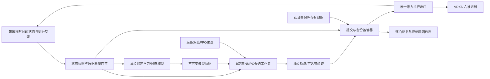

## 2026-10-09 当前推进：启动握手组件260项通过，生产准备与关闭认证待闭合

完成隔离publisher构造期身份、显式hold/release与pre-release shutdown无动作，观察器真实callback legacy_ready/永久失效及v2共同就绪协议；131个Ubuntu＋129个checker最终case全通过、0 skip。真实C++导出事件两侧ready组件兼容，synthetic输入/graph fixture不升级实际bag/Witness全链。原核心数值函数、参考算法、阈值与20ms工程门保持。

原3864资产现在25项live bringup/visualizer变化/缺失，整体guard=false；146 frozen源码和280 MPC/interface依赖仍匹配。2818 scoped输入前后不变，新隔离构建已封存；不覆盖既有文件变化、不替换原F5。owned helper不能证明DDS endpoint属于认证PID与publisher有效全配置，production release一律拒绝。完整production prepare/close、external Worker实际零hook、strict full Source/actualstorage/Witness正链、域、新版本压力/恢复与时间理由仍pending，D1/B4/M0b/execute继续No-Go。

详见[P1_M0b_B4_D1_启动握手组件_实施与验收_2026-10-09.md](C:/Users/sgh/Documents/MPC/P1_M0b_B4_D1_启动握手组件_实施与验收_2026-10-09.md)；下一最小步骤为[P1_M0b_B4_D1_owned端点与配置认证_最小计划_2026-10-09.md](C:/Users/sgh/Documents/MPC/P1_M0b_B4_D1_owned端点与配置认证_最小计划_2026-10-09.md)。旧计划和记录作为历史保留；不得从此前guard通过推断现在环境仍冻结。

# 首选 A：基于现有 ROS2 / NMPC / PPO 平台的研究可行性与实施方案

## 历史推进（本轮前快照）：冻结参考逐条重建与86项strict组件验证完成，启动握手待修复

已完成原F5 193条6×21参考、24,318元素逐项重建，索引/身份/stamp exact一致；13份冻结源/config匹配原清单。独立source37+bag49共86项最终组件测试全部通过，原F5实际40,613消息负例计数/hash闭合且缺4个P1主题时严格拒绝。

新事实纠正启动前提：原F5无动作timer前的producer startup文件，research_logging_armed=false只关闭telemetry；entry_v2无actual legacy_ready，当前source允许集与bag门不能组成共享正链。组件已验证、启动链未闭合。原≤1.2冻结只有末2条/.2s，.8参考不是实际航速上限；当前域内recipe、新统一版本R5、20ms真实主时钟界均未证明。

D1动态、B4/B5/M0b/M4/F6/P1/execute继续false；本轮无新动态launch、未改默认install/模型/权重/GP/PPO/plant。下一步先做隔离启动身份/动作release与executor实际legacy-ready版本协议，按[P1_M0b_B4_D1_启动身份与legacy就绪握手_最小计划_2026-10-09.md](C:/Users/sgh/Documents/MPC/P1_M0b_B4_D1_启动身份与legacy就绪握手_最小计划_2026-10-09.md)执行前置有限验证。详见[P1_M0b_B4_D1_冻结参考与严格检查器_实施与验收_2026-10-09.md](C:/Users/sgh/Documents/MPC/P1_M0b_B4_D1_冻结参考与严格检查器_实施与验收_2026-10-09.md)。

## 2026-10-09 历史推进：D1正文核验与隔离入口针对验证完成，动态仍No-Go

已严格只读核验七包187081条消息、23份原字节正文，metadata/实际storage计数及登记SHA一致。F5的193冻结状态只有两帧域内、最长0.2s；24.16s低速odom尾段主要零命令，不能算20s动态覆盖。twin确有旧低速转向及非空曲线参考，但持续空/非空交替与当前复现身份待解释，原≤1.2域不扩大。

已建立独立shadow-only观察入口并native构建，23新+8D0+10enqueue=41case全通过；v1测试宏编译失败与v2仅拆行修订全部保留。旧3322及v1失败199资产无漂移，本轮封存3864项；未替换默认源码/install、合同、Worker、IDL或Witness。见[本轮实施与验收](C:/Users/sgh/Documents/MPC/P1_M0b_B4_D1_前置核验与隔离入口_实施与验收_2026-10-09.md)和[精确状态](C:/Users/sgh/Documents/MPC/P1_M0b_B4_D1_前置核验与状态_2026-10-09.json)。

20ms工程门的陈述范围明确，真实时间界/参数校准未闭合。本轮有rclcpp机制测试，没有新Gazebo/F5动态运行，D1尚未采集。当前可复现域、严格shadow reader/driver、外部Worker零argv与真实legacy owner/readiness及统一版本压力资格仍pending；先执行[下一最小计划](C:/Users/sgh/Documents/MPC/P1_M0b_B4_D1_工况与严格shadow链_最小计划_2026-10-09.md)。B4/M0b/B5/M4/F6/P1/execute保持未闭合。


## 历史推进（2026-10-09）：D0来源观察机制完成，D1前置仍待闭合

已完成D0a来源缺失审查、D0b新隔离观察与18项C++/61项检查器测试，以及单次静止无输出正常管线；实际测量10.020325702s，52决策/51job/50传播成功及虚拟接纳，2无候选明确null。source/实际bag/worker/owned/Witness/输送与D0字段门全部通过，旧3067资产无漂移，当前封存3322项；普通/default安装、正式合同/IDL/Witness布局保持。见[本轮实施与验收](C:/Users/sgh/Documents/MPC/P1_M0b_B4_D0_来源观察_实施与验收_2026-10-09.md)、[契约与状态](C:/Users/sgh/Documents/MPC/P1_M0b_B4_D0_来源契约与状态_2026-10-09.json)。

D0c原≤1.2域/20ms工程门的书面决定已记录，但动态域与真实时间界没有闭合。静止速度0/history0/误差0不能作plant残差或GP标签；新增负载不继承旧压力资格。D0入口只允许no_output+diag5，D1shadow尚未启动；先按[下一前置闭合计划](C:/Users/sgh/Documents/MPC/P1_M0b_B4_D1_前置闭合_最小计划_2026-10-09.md)恢复既有域内正文和核验隔离shadow入口，满足前置后才一次20s来源窗。B4/M0b/B5/M4/F6/P1/execute仍未闭合。


## 历史推进（2026-10-09）：B4来源审查完成，动态冻结门仍待闭合

**已完成77个预冻结字段、19个hydro子字段的来源/政策/版本适用登记和旧动态全量审查；B4整体保持部分完成。** 原74字段登记、B1/C0/R5及Decision修复报告保留原字节。新入队修复隔离版本及有限静止正常对照的完成事实保持，各旧版本资格不自动转移。

旧v11本批全183决策（160有job、23无job、2接纳）和163任务均纳入；160完整六维名义传播差值未超候选门，初始化零项排除，但拒绝final来源不能自动认证传播快照。1817条实测体速度全部为1.239153–1.259542m/s、高于原拟1.2域，参考只有直线u=.8，mixed覆盖有限，不能据此冻结当前动态域。

新增明确例外：旧job16实际曾接纳，却与333.200133ms接收clock间隙、约65.233ms未来接收插值代理偏差并存。代理不是真实plant时间误差，但平均RTF和同公式自洽不足以证明20ms独立对齐。保留原阈值及全部例外；本轮没有新ROS/控制实验、源码/合同/默认安装变更，3067关闭资产提取前后无漂移。

- [x] B4逐字段来源、完整旧动态记录、异常政策与版本矩阵审查。
- [x] 创建B4-D0来源可重建与有限补证最小计划。
- [ ] B4所有execute必需参数选择依据与研究域闭合。
- [ ] 最终统一版本受影响压力/恢复/关闭资格、B5不可变合同；M0b正式冻结仍未完成。
- [ ] 默认安装切换、M4新物理出口、F6与P1整体；execute仍关闭。

**下一步先B4-D0：传播所用快照、predict成功和完整差值可用性；先决定有限研究域及20ms时钟政策，必要才一次事前有限F5 shadow。** 域内/转弯/mixed输入前置不足时先解决来源，不重复全域外直线、不改门凑通过；随后最终版本资格绑定，再B5/M4。

详细记录：[B4参数来源与版本审查](C:/Users/sgh/Documents/MPC/P1_M0b_B4_参数来源与版本适用审查_2026-10-09.md)、[新来源/冻结决策JSON](C:/Users/sgh/Documents/MPC/P1_M0b_B4_参数来源与冻结决策_2026-10-09.json)、[D0最小计划](C:/Users/sgh/Documents/MPC/P1_M0b_B4_D0_来源可重建与有限补证_最小计划_2026-10-09.md)。事实索引SHA `12fd852fe2e923c8a029d46fdb03d6b157e10a3a684a1752434477b83e837e2e`。以下日期批次属于历史范围，当前状态以本更新为准。

## 2026-10-08 归档记录：Decision 入队失败即时失效已修复并验证

**首次 DecisionEnqueue 失败可能零动作同拍退出、共享槽未清空的代码缺口，已在新的隔离版本中修复。** 普通与诊断源码均在真实 Sink 返回 false 后取得业务锁，设置停止状态，无条件清 admission ready/committed、candidate 和 pending，再判断同拍退出。Ubuntu 普通/诊断各10个正例通过；旧两源关键负例各RC1，真实检出残留槽2/候选/pending。诊断真实容量1队列拒绝测试中首次phase5/phase8均来自DecisionEnqueue/obs3，清理前后槽2→0、候选和pending true→false，未依赖下一Tick。这是实际源码链接分支验证，不是完整ROS图首次DecisionEnqueue压力顺序证明。

新诊断版本唯一实际正常no_output对照 `p1_enqueue_fix_normal_20261008_03` 窗口10.002600190s，Job/Candidate/Decision=51/51/52，虚拟激活50；source generated/emitted=1977/1977、drop0，严格source/实际MCAP/应用输送/Witness逐项对账和owned收尾通过。原2626资产无漂移，新关闭清单3067项无漂移；两次封装拒绝发生在spawn前，原夹具失败和原拒绝均保留。

**当前下一步为 B4 来源与版本适用矩阵；B5 前必须为最终统一版本补齐压力等资格绑定，之后才决定切换默认ROS安装与进入M4。** 修复产物位于 `/home/trevor/USV/.sgh-research/experiments/p1_execution_architecture_20261005_01/authored_enqueue_fix_20261008_v1`；当前ROS默认source/install仍是受旧guard保护的旧版，本轮没有覆盖默认安装。历史B0/B1/C0/R5验收按各自SHA保留，新源不能自动继承旧R5压力资格。M0b正式冻结、M4、F6、P1整体、execute资格仍未完成。

- [x] 普通/诊断代码分支修复、真实源码链接定向正例与旧源负例。
- [x] 新诊断版本有限正常ROS对照、独立对账与归档。
- [ ] 最终统一版本压力/恢复/关闭等资格复核；B4来源补齐、B5正式冻结。
- [ ] 默认安装切换、M4物理接管、新基线/F6与P1整体。

详细记录：[Decision入队失败修复与验收](C:/Users/sgh/Documents/MPC/P1_M0b_Decision入队失败即时失效_修复与验收_2026-10-08.md)。事实索引SHA `c567d850898e5c14e320125b9f56d4edcccc273aa6e0dfe4e532ccdbcba92156`；原B1/C0/R5报告及参数JSON保持原字节，下方旧批次保留当时范围，当前状态以此更新为准。

## 2026-10-08 归档记录：B3/R5 有限压力验收已完成

B0、B1、B2/C0 与本次 B3/R5 已完成。唯一 R5 压力窗口 3.113345033s，实际 Sink generated/emitted/dropped=776/762/14；旧正常源和应用账本 RC2/false 原样保留。独立机制与 worker/MCAP/输入/owned 门通过，响应保守上界 199.865993ms（事前220ms），首次停止后 Submit/accepted=0/0。123 新工具测试本地及 Ubuntu 均通过，原2521与新2626关闭资产清单无漂移，物理 publisher 观测0。

**当前下一步：首先关闭“首次 DecisionEnqueue 故障直接退出”的共享槽失效缺口，再 B4 来源补齐、B5 正式冻结与 M4。** 本次首次停于 TickStart 并真实失效，之后还有 DecisionEnqueue 失败；不能授予另一先后顺序。M0b正式冻结、M4、F6、P1整体及execute资格仍未完成。详见[R5实施与验收](C:/Users/sgh/Documents/MPC/P1_M0b_R5_日志压力机制_实施与验收_2026-10-08.md)。下方此前的日期记录属于历史范围，当前状态以本更新为准；B1/C0历史报告和参数JSON继续保留。

## 2026-10-08 归档记录：B2/C0 已完成

B0、B1与B2/C0已完成。本次唯一正常no_output对照窗口10.019557190s，Job51/Candidate51/Decision52，50次候选虚拟激活；完整source/实际bag/应用ledger/Witness逐项对账通过，物理推力publisher观测0，owned收尾完整。Ubuntu新增88单元测试及两项真实回收测试通过，原2340与新2521关闭资产清单无漂移。计数覆盖整个owned生命周期。

**下一步B3/R5：专用有限runner、机制checker、事前政策与真实日志队列压力。** 当前R5未运行；Decision enqueue失败共享槽失效缺口仍未验证/修复；M0b正式冻结、M4、F6、P1整体及physical execute资格仍未完成。详细记录见[P1_M0b_C0_正常无输出对照_实施与验收_2026-10-08](C:/Users/sgh/Documents/MPC/P1_M0b_C0_正常无输出对照_实施与验收_2026-10-08.md)。以下既存日期记录保留其历史范围，当前状态以此更新为准。


## 2026-10-07 归档记录：B0 正式合同校验已完成

**B0 已实施并验收。** 修复正式模式与诊断租约条件互斥，新增 v3 预冻结合同、完整字段/类型/模型/policy 校验及物理入口独立禁用。Ubuntu 当前 91 个不同 C++ GoogleTest 与 329 个 Python 方法全通过；565 份原始 JSON 跨语言结果一致；7 个真实启动拒绝和 4 个 formal 入口非零 hook 拒绝通过。

新旧合同分别完成 10 秒 no_output 回归：各 Job51/Candidate51，Decision52/53，候选虚拟激活50；源/bag、raw input 和应用输送分账闭合，物理 publisher 观测0，清理完整。计数覆盖 owned 生命周期，不能当作只裁剪测量窗的数量。当前源归档 v14、runtime_v30（44 Python），worker 原源 v9 未改但使用新共享 loader 重建了 bin。1845 项运行前守卫及1908项关闭证据清单核对通过。

**下一步 B1：独立诊断副本与固定容量 witness；之后 C0/R5、B4来源补齐、B5冻结和 M4。** M0b 正式冻结、M4、F6、P1整体仍未完成，`physical_execute_release_enabled=false`、`execute_qualified=false`。当前预冻结 contract diagnostic_only=true/fault=false；fake frozen marker 仅为拒绝测试夹具。完整实现、指纹与限制见 [P1_M0b_B0_正式合同校验_实施与验收_2026-10-07](C:/Users/sgh/Documents/MPC/P1_M0b_B0_正式合同校验_实施与验收_2026-10-07.md)。下方此前的批次记录保留其历史范围，以本更新判断当前版本和下一步。

## 历史推进：本轮B0之前的M0b参数准备

**M0b参数准备已完成，正式冻结尚未完成。** 已核对全部74个当前合同顶层字段、19个hydro子项及隐含硬常数，建立来源/政策/时间轴；只读补提已有原source与F5 MCAP，没有新ROS运行或生产代码变更。当前51任务freeze→ready最大4.192197ms；F5左右steady gap最大200.182406/200.184748ms、双路调用返回span最大0.095192ms。这些有限数据支持候选研究预算，不授予新监管器物理资格。

发现v13 execute非诊断门与能力租约诊断门互斥；正式合同必须显式版本/模式兼容及完整参数语义验证，不能只翻flags。**下一步先实现B0合同兼容/校验与B1独立诊断副本/有限witness，再执行C0对照和R5真实512队列溢出。** 动态容差、真实非零rho/HOLD/partial仍按具体来源与M4门处理；R5、M0b正式冻结、M4、F6和P1整体均未完成，execute_qualified=false。

完整步骤、参数JSON、实际来源指纹、停止条件及各阶段依赖见[M0b参数来源与政策及最小校准计划](C:/Users/sgh/Documents/MPC/P1_M0b_参数来源与政策表及最小校准计划_2026-10-07.md)。下方此前资源实施和各轮历史记录保留原验收范围，当前推进顺序以本更新为准。

日期：2026-10-03（Asia/Shanghai）  
研究主机：Ubuntu `192.168.1.222`；工作目录 `/home/trevor/USV`  
研究方向 A：**在线残差模型切换时，已验证安全备份的执行一致性与有效期管理**  
首次核验基线：分支 `codex/scheme-c-rl`，提交 `1e5becae622782526f20fc93928339133c94ec23`；首次只读检查开始时工作区干净。后续三次修复保留为未提交改动，不能仅凭该 HEAD 判断当前产物已包含修复。  
方法：2026-10-04补充完成同参nominal对拍、参考核验、四元数门禁和F3回归（详见第0节）。原方案按 `sgh-research` 与 `sgh-experiment-design` 进行平台核验、理论条件审查和实验设计。原版本为只读可行性分析；后续三次实施及验收记录见第0节。2026-10-04 已在 Ubuntu 实施 F1/F2 冻结、发布端最小数据契约、构建回归和三个短程 pilot，最终只读检查通过；具体证据与未知项见 P0 实施报告，连接凭据不写入文档。 2026-10-05追加完成F4配置独立、实际reference／预测观测、三组真实运行及24项配置比较；验收范围见第0节和F4报告。 同日追加F5动态B资格与输入同锁冻结、67个不同C++ GTest及一组新基线pilot；见[P1_求解资格与输入原子冻结_最小修复及验收_2026-10-05.md](C:/Users/sgh/Documents/MPC/P1_求解资格与输入原子冻结_最小修复及验收_2026-10-05.md)。

## 0. 实施进度与当前入口（2026-10-07 更新）

状态依据三次修复归档及 2026-10-04 新增 P0 构建、F1/F2 和三类 pilot 最终验收记录。仅完成发布端证据的项目不升级为 plant 执行、安全或 GP 数据准入证明。第2节的原始平台信息和旧源码行号属于首次核验快照；当前修复结果以本节及[三次修复汇总](C:/Users/sgh/Documents/MPC/USV_三次修复汇总_2026-10-03.md)为准。原始缺失数据继续保留，不因新录包通过而被回填。 2026-10-05新增F4工作包验收依据见[F4配置与参考观测实施报告](C:/Users/sgh/Documents/MPC/P0_配置独立与实际参考预测观测_实施与验收_2026-10-05.md)；旧快照信息保持历史口径。 F5同锁资格与输入冻结的新增编译/新run证据见[P1前置修复验收报告](C:/Users/sgh/Documents/MPC/P1_求解资格与输入原子冻结_最小修复及验收_2026-10-05.md)。

| 工作 | 状态 | 已完成与验收证据 | 仍未完成的条件 |
|---|---|---|---|
| NMPC 迟到解最小修复 | **已完成** | 完整调用/后端计时拒绝迟到候选；清理热启动、恢复发布锚点；37项不同GTest通过；250/400ms注入未发布迟到候选 | 同步阻塞期间独立接管、固定tick提交、按实际间隔的HOLD率限与认证备份属P1/P2 |
| v5 ONNX 物理推力缩放 | **已完成** | 新 `policy_physical_n.onnx` 图内单次缩放至N；manifest/hash/接口门禁；74项不同用例与VRX短程验收 | 历史训练资产配套尚未独立证明；训练端返回观测历史时序与统一执行反馈待核验 |
| PPO发布动作录包与验收 | **已完成最小修复与新录包验收** | recorder增加clock，动作/status沿用既有列表；40项用例通过；新bag三路各248条、最大差0N，严格验收通过 | 共同源序号、源时间和持有区间；三路共同漏拍及plant接受/实测力尚未证明，GP标签未就绪 |
| P0整阶段 | **部分完成** | 三修复、F1/F2发布端合同、F3模型／参考函数对拍与姿态门禁已完成；F4配置独立、实际reference／预测四流观测及三组真实运行／24项比较通过；F4时62个不同C++ GTest通过；F5前置修复后cpp范围67个通过 | 6DOF响应、训练端历史动作、统一执行反馈、精确plant执行时序及缺历史hash的旧run仍未闭合；GP标签未准入 |
| P1整阶段 | **部分完成；M0a资源前置和M2声明有限工程范围通过** | A1–A5资源/metadata/应用分账实施及真实拒绝恢复通过；该资源批次79项GTest、300项Python，normal/delay虚拟激活50/0；其后B0已验收，当前91项不同GTest、329项Python，diag5/pre无输出均虚拟激活50；见[P1_资源合同与输送分账_实施与验收_2026-10-07](C:/Users/sgh/Documents/MPC/P1_资源合同与输送分账_实施与验收_2026-10-07.md)和第23节 | 首次DecisionEnqueue故障失效覆盖、M0b正式冻结、M4唯一物理出口与预算、新基线/F6、真实有限模型切换与认证备份仍待验收 |
| P2/P3/P4/P5 | **未实施或未阶段验收** | 本方案保留设计与进入条件 | 不将三次工程修复等同有限安全证书、GP学习、PPO共同执行或论文贡献验证 |

- [x] NMPC迟到候选返回后拒绝及对应验收。
- [x] v5物理N输出及部署合同验收。
- [x] PPO新bag发布动作与clock录制、只读严格验收。
- [x] 冻结 F1/F2、建立发布端最小数据契约并完成三个短程 pilot 验收；精确执行时序/GP准入仍 false。
- [x] 同参 Python/C++/native acados 数值对拍、实际参考函数回归、退化 odom 四元数准入及 F3 冻结/新 pilot；见[P0_模型与参考一致性核验及四元数门禁修复_2026-10-04.md](C:/Users/sgh/Documents/MPC/P0_模型与参考一致性核验及四元数门禁修复_2026-10-04.md)。
- [x] 完成plant/controller配置独立与actual reference／同次预测观测；F4三组运行及24项比较通过，见[F4配置与参考观测实施报告](C:/Users/sgh/Documents/MPC/P0_配置独立与实际参考预测观测_实施与验收_2026-10-05.md)。plant质量探针带程序化几何耦合，不是纯载荷性能对照。
- [x] P1前置：动态B同锁资格复查与state/reference冻结，F5快照、67个GTest和新正常pilot验收；见[P1_求解资格与输入原子冻结_最小修复及验收_2026-10-05.md](C:/Users/sgh/Documents/MPC/P1_求解资格与输入原子冻结_最小修复及验收_2026-10-05.md)。冻结后clear当前候选仍可完成，下一周期待机。
- [x] 完成P1独立worker/固定tick及M2有限工程子项和资源前置；物理execute/M0b/M4及P1整阶段仍待后续门。
- [ ] 完成P2有限模型/物理包络/障碍/备份，再按门槛进入P3。

**当前下一项：** M0b参数来源、异常/恢复/关闭/部分发布政策表和有限校准计划已建立，B0正式合同兼容/完整候选参数校验已实施验收。下一项执行B1独立诊断副本与固定容量witness，之后同bin/contract的C0与真实Sink512溢出R5，再做B4具体来源决策、B5不可变冻结；冻结和独立释放门具备后才进入M4。详见页首B0实施报告及M0b计划。M0a资源前置和M2声明有限工程范围保持通过；DDS内部packet/目标typed内部路径/强杀末尾unknown和旧失败保持原范围，execute_qualified=false。

必要验收原件集中在[合并证据包](C:/Users/sgh/Documents/MPC/.sgh-research/archives/USV_三次修复验收证据_2026-10-03.zip)。后续实施前必须核对Ubuntu当前产物，原归档hash不能替代新现场核验。

## 1. 决策与研究定位

**结论：工程原型可做，研究贡献有条件成立；当前还不能声称已有递归可行性或概率避碰保证。** 你已有可复用的双推力动态 NMPC、轻量 Python 植物、PPO 训练与 ONNX 部署链路、VRX 模型生成和历史数据。最合适的路线是先复用现有动态控制器，建立控制提交和备份监管机制，用已知模型版本验证问题，再加入 GP，最后把冻结 PPO 接为性能建议器。

仓库中 `scheme=A/B/C` 分别表示运动学 MPC、动态 NMPC、PPO。**本报告“研究 A”应基于仓库 `scheme=B` 实施。** 新研究功能命名为 `research_model_update_safety`，避免误启动运动学方案 A；动态 NMPC / PPO 已直接使用左右推力，不应串入运动学 A 的 `cmdvel_to_thrust` 速度内环。

首轮研究问题收窄为：

> 对单船欠驱动 USV，在声明的动力学、输入、观测误差和静态障碍范围内，如何保证模型切换、超时和备份接续使用同一套有效条件；这种管理是否能在相同算力预算下减少“执行了迟到或过期计划”的事件，并保留足够任务进度？

先讨论有限时域可执行备份。动态目标、COLREGs、多船协调、PPO 重训练、在线超参数优化和真船试验分别作为后续扩展，不放进第一个原型的必需条件。

### 1.1 必须纠正的前提

1. **不是任何 GP 均值更新都会使旧物理备份失效。** 如果原有固定误差包络仍覆盖真实动力学，并且时间、状态、障碍和执行器条件保持有效，性能均值改变本身不改变真实动力学集合。把这种情况当作“模型更新破坏安全”会制造伪创新。
2. **拒绝更新也不等于安全。** 实际阻尼、推进效率或海流仍会漂移。旧模型的紧误差界可能到期，必须扩张误差年龄界或退回仍有效的固定宽界；两者都失效时应报告保证域外。
3. **热启动移位不等于认证备份。** 当前后端移位旧输入并补零，缺少当前状态、误差界、障碍、执行器与终端条件检查。
4. **零推力、低速、HOLD、RTL 都不能直接作为安全证明。** 船会继续漂移，欠驱动船也不能默认在世界坐标小圆域内保持不变。
5. **GP 方差变小、求解器返回成功、任务完成、历史平均求解很快，分别都不能代替安全或实时证明。** 本方案明确记录它们与真实约束违反、数据覆盖、截止时间、证书有效性之间的区别。

### 1.2 创新可行性分级

| 项目 | 判断 | 对后续工作的要求 |
|---|---|---|
| 基于当前平台实现可复现原型 | GO | 先补提交时序、数据契约与备份检查；不依赖重新训练 PPO |
| 单船静态障碍下有限时域机制实验 | CONDITIONAL | 先有已知有效扰动范围、可接续备份、独立区间检查和实际执行日志 |
| 使用经验 GP 界缩小保守性 | CONDITIONAL | 时序留出校准、工况覆盖、年龄失效与宽界回退先通过；结论限定为经验结果 |
| 严格递归可行性 / 无限时域安全 | 当前 NO-GO | 未建立安全终端集合/控制律、统一有效误差事件与持续接续条件 |
| “首次 GP+NMPC 用于 USV”“首次更新门禁” | NO-GO | 已有明确先例，不能用作贡献 |
| 独特的执行器、数据年龄、动作保持与切换充分条件 | 待论证 | 要与成熟方法逐条比较；仅 ROS 集成应按系统/经验贡献定位 |

## 2. 当前平台进度：哪些已存在，哪些仍缺证据

本次只读取得 56 个选定源码、配置与文档文件，保存了 SHA-256；读取了 checkpoint JSON 元信息、ONNX 图常量、历史 GTest XML、rosbag 元数据与已有分析报告。没有加载 checkpoint 中的 pickle 执行对象，也没有进行策略推理。源码行号对应本次快照，路径均相对 `/home/trevor/USV`。

### 2.1 平台能力与限制

| 项目 | 核验事实 | 对研究 A 的用途 / 限制 |
|---|---|---|
| Ubuntu / ROS | Ubuntu 24.04.4 LTS、ROS2 Jazzy；CPU i7-10700，8 核 / 16 线程，内存约 15.35 GiB | 足以开展 CPU 原型与批量轻量仿真；能否达到规定时延必须测量 |
| GPU | `nvidia-smi` 当前不能与驱动通信 | 不把 GPU 加速作为方案前置条件；这不证明主机没有 GPU，也不建议为本报告升级驱动 |
| ROS overlay | 原登录 shell 找不到 `usv_mpc_cpp`；加载工作空间 `install/setup.bash` 后找到已安装包 | 必须显式加载正确 overlay；不是包不存在 |
| 当前运行状态 | 本次默认 ROS domain 下未发现节点，筛选的进程名未显示 Gazebo/MPC | 只说明检查时未发现该域运行链；不是闭环性能测量 |
| NMPC 模型 | 六维 `[x,y,psi,u,v,r]`，双输入 `[T_L,T_R]`，Fossen 3DOF | 可复用；现模型没有 GP、海流状态或真实推进器滞后状态 |
| acados 结构 | 实际 acados 仓库标签 v0.5.4；NX=8，NU=2，阶段 NP=6，全局参数30维 | NX 的额外2维是上一拍输入记忆；NP目前仅参考，不能直接塞 GP / 障碍而不重新生成 |
| 控制时间 | 配置 `Ts=0.2 s`，预测步长0.2 s，N=20，预测4 s | 是配置事实；当前 wall timer 与仿真时钟混用，实际保持时间和端到端耗时尚需测量 |
| 动作限制 | 每桨 ±25 N，80 N/s；0.2 s 时每拍最大变化16 N | 是当前软件约束；±25 N的真船能力尚有未完整推力标定的注释，不能当作新测量 |
| 内部预测结果 | `SolveInfo` 有完整 `X_pred(6×21)`、`U_pred(2×20)` | 可直接复用；外部 Path 只有位姿、成功时每5拍发布，各点同stamp |
| 现有约束 | 输入幅值与变化率；状态有限值处理；地理围栏/电池等健康监控 | 当前没有预测碰撞约束、障碍消息、误差管或终端安全集合 |
| 安全监控 | 当前状态健康与新鲜度检查，默认 `report`；VRX launch 未启动 mode manager | 不能将其等同逐拍推力安全滤波器 |
| PPO | 43维观测、二维归一化动作、0.2s决策、RK4四子步；四阶段训练资产 | 已有训练流水线，但任务是轨迹跟踪，无障碍或安全证书 |
| 域随机化 | 末阶段逐episode水动力±20%、0或1步执行延迟、观测噪声 | 不等于运行中模型漂移或随机计算超时；默认评估关闭DR |
| GP | 所检查的 NMPC / RL 自有源码未发现 GP、模型快照或认证备份实现；两套 Python 环境未发现 gpytorch | 属于新增模块；不应在报告中写成已有功能 |

NMPC 证据：`usv_mpc_ws/src/usv_mpc_cpp/scripts/regenerate_acados_codegen.py:139–168,216–281`，`include/usv_mpc_cpp/mpc_solver.hpp:55–67`，`src/acados_backend.cpp:103–134,194–305`。PPO 证据：`usv_rl/usv_rl/envs/usv_tracking_env.py:124–128,204–232,273–370`。

### 2.2 已有结果能说明什么

- `usv_rl/models/v5/train_meta.json` 记录目标1000万步、16环境、seed42、耗时2281.5s；`s4_dr/model.zip` 元数据记录实际10,092,544步。它们证明训练资产存在，不证明收敛、泛化或当前 ROS 部署正确。
- 已有6份 GTest XML 共43个测试，记录失败/错误均为0，时间为2026-09-14。本次没有重跑，不能作为当前分支重新构建后的通过记录；其余lint结果也未据此宣称全部通过。
- `vrx_twin_circle_007_fixed/analysis_report.txt` 的历史报告写 CTE均值0.316m、最大0.462m、求解均值0.4ms。它是历史报告，未在本次重算；均值只涉及该报告口径，不能证明本主机当前端到端实时性。
- `data/sim_bags/rl_c_001` 约476.44s、71,960条消息，只记录路径、剖面、odom、IMU，**没有左右推力、最终执行动作、clock或策略状态**。因此不能直接生成可信的GP输入—输出标签，也不能以该bag验证v5实际动作幅值。 历史原件继续保留；后续逐条检查发现477条剖面全部为空。新录制 `rl_c_actions_20261003_01` 已通过发布流严格验收（三路各248条、含clock），但 `gp_labels_ready=false`，不能将新记录能力回填为旧实验动作或精确执行时序。
- `vrx_twin_circle_007_fixed` 有左右推力、odom、IMU、MPC状态与预测Path，适合探索重放工具。但双推力无联合sequence，也不是实测推力；历史bag中没有新证书/版本语义，不能直接验证模型切换机制。

### 2.3 两套 Python 环境须分开使用

| 环境 | 已核验包 | 建议用途 |
|---|---|---|
| `/home/trevor/venv-ardupilot` | Python3.12.3、numpy2.4.6、scipy1.17.1、casadi3.7.2、gymnasium1.3.0、rclpy7.1.11；未发现SB3/torch/gpytorch | 现有ROS/辨识工具环境；不要直接把PPO依赖覆盖进去 |
| `/home/trevor/USV/usv_rl/.venv` | numpy2.5.3、gymnasium1.3.0、SB3 2.9.0、torch2.14.0、onnx1.23.1、onnxruntime1.30.0、pytest9.1.1；未发现scipy/casadi/gpytorch | 现有PPO/导出环境；保留锁定快照 |

第一轮有限模型与故障注入不需要 gpytorch。GP 阶段可另建研究环境并锁依赖，不原地升级两套现有环境。初始诱导点32/64、三个独立输出可在CPU上评估；具体实现和实时预算由基准测试决定，不以论文其他平台耗时作为保证。

## 3. 必须先处理的具体问题

### 3.1 NMPC迟到解：最小拒绝修复已完成，独立接管仍待P1

首次快照 `mpc_node.cpp:552–577` 中先同步求解再检查超时，前4次失败仍可能发布返回候选。该原始缺陷已修复：完整调用或后端计时超预算时拒绝候选，不发布新预测轨迹，清理热启动并恢复实际发布锚点；前1–4次重复历史入口，达到既有阈值5沿用HOLD零目标。37项不同GTest和250/400ms故障发布验收通过，见三次修复汇总第2节。旧行号不代表修复后源码位置。

**仍待完成：** 当前仍先同步 `solve()`，然后拒绝迟到结果。它不能在求解阻塞期间到200ms主动接管，也没有证明HOLD变化率、避碰或认证备份有效。候选解、优化热启动与认证备份仍需在P1/P2分离；工作者独占capsule，监管器在固定tick检查仍有效的候选/回退，不等阻塞求解返回。迟到结果若留作后续输入，必须针对新的状态与执行tick重新验证。

### 3.2 v5 ONNX：物理N部署修复已完成

原 `policy.onnx` 输出仍为归一化 `[-1,1]`，原节点曾将其直接作为N发布，该缺陷已确证并完成修复。原图与checkpoint/统计保留为诊断和追溯资产。

**当前已验收合同：新 `policy_physical_n.onnx` 在图内唯一一次执行 `25×clip(actor_mean,-1,1)`，输出左右物理N；ROS节点直接消费N，不能再乘25。** 输入为原始float32 43维观测，归一化包含在图内；输出float32二维 `[T_L,T_R]`，±25N；同名manifest绑定hash、单位、维度、顺序、量程与实际ORT接口。合同不符时STANDBY零推力并报告 `model_contract_invalid`。

74项不同用例、独立SB3/ONNX数值对拍和VRX短程单位验收通过；原3模型资产hash不变，没有重训。新图最大绝对发布推力约20.154N，但该次短程横距均值并未改善，不能声称策略性能提升。历史训练量程与统计配套仍待独立证明。后续接口及唯一执行出口以物理N合同为准，原方案“节点乘25”的备选接线不再适用于当前新图。

`s4_dr/vecnormalize.pkl` 已记录hash；不得未经核验将best模型与末阶段统计配对。部署须冻结配套统计。[SB3 VecNormalize 官方说明](https://stable-baselines3.readthedocs.io/en/master/guide/vec_envs.html#vecnormalize)

### 3.3 观测历史推力：ROS已发布N反馈已验收，训练端及统一反馈待核验

首次快照显示训练环境在生成 `step()` 返回观测后才更新 `prev_thrust`（旧 `usv_tracking_env.py:227,232`），旧等价测试未覆盖返回值时序。本次三项修复没有修改该训练环境，此项仍待现场核验与两拍不同动作测试。v5部署修复已验收ROS下一拍观测使用上一拍已发布N；后续监管接管后的统一执行反馈尚未实现。

统一定义：`o_k`末两维是产生当前状态之前最近控制区间的**最终执行命令**。安全层接管或限幅后，PPO不能继续把自己的建议当作历史执行值。修复会改变旧策略观测分布，先保存旧行为并做冻结策略短程对拍；是否需要重训练根据实测决定，不把重训练作为A前置条件。

### 3.4 模型对齐与同模型试验偏差

Python默认 `Yr_dot=0、Nv_dot=-0.363545`；VRX生成的有效模型把两者都投影为−0.1817725，`model_report.json`明确记录该处理。Python–C++同参数对拍即使通过，也不能证明Python默认模型已对齐VRX。

首次核验时VRX默认把同一 `effective_vehicle.yaml` 交给plant与B控制器，属于接近同模型闭环。2026-10-05新研究入口已分别保存nominal、plant原始来源和generated effective plant，实际十九参数与solver／plant命令边界逐项验收，三组运行及24比较通过；原入口保留原默认。plant质量变更会连带生成mesh、水线与部分惯性变化，后续纯载荷实验须另冻结几何并规定质量／质心／惯量规则，见[F4配置与参考观测实施报告](C:/Users/sgh/Documents/MPC/P0_配置独立与实际参考预测观测_实施与验收_2026-10-05.md)。

### 3.5 时间、状态与约束证据链：发布端最小契约已完成，plant 执行证据待补

首次核验发现 wall timer、steady 接收与 ROS 仿真时间混用、odom/IMU 异步组合、原两路推力无 Header。2026-10-04 已在动态 B 增加 p0-contract-v1：单条 odom 六维 StateSnapshot、实际 solve 输入及混合来源 CycleTiming、联合 publisher_command 事件 AppliedControl。三 pilot 的源计数、bag 实扫、时间/映射/来源和关机刷新通过。bag 接收时间负责唯一配对，显式 clock 负责仿真边界，steady 负责本地计算时延；每 run 最后区间仍 end_unknown。plant 接受、实测力、两路原子性、精确执行时序与 GP 标签保持 false。

独立验证器要重积分候选输入，检查输入/变化率、全部预测状态以及采样间占据区域；不能只检Path端点。acados官方说明SQP_RTI的非线性残差默认并不自动提供，需要重新计算；当前生成问题也没有碰撞约束。[acados残差接口说明](https://docs.acados.org/python_interface/index.html#acados_template.acados_ocp_solver.AcadosOcpSolver.get_residuals)

## 4. 最小架构与接口契约

### 4.1 推荐接线



最初没有PPO节点，也没有真实GP；由既有B生成候选。后期PPO通过相同接口输出建议左右推力，安全NMPC可以最小化与建议的差并生成备份。前期沿用原跟踪代价以复用基线，后期才引入建议跟踪权重，所有对照使用相同权重和约束。

### 4.2 已部署 P0 三类v1消息、附加参考／预测流与P1/P2接口

已部署 `usv_research_interfaces` 的 StateSnapshot、AppliedControl、CycleTiming三类v1消息，F4附加ReferencePrediction流记录实际solve reference与同次接受后的X/U；Run计数写bag外摘要。`usv_research_safety_cpp`已实现独立worker/regulator及SolveJob、SolveCandidate、ExecutionDecision和WorkerCapability；shadow08的工程链路已通过。execute接管与证书仍待后续门禁。当前shadow物理输出仍由冻结F5 B发布到VRX左右Float64，新监管器记录检查决定。下表区分已实现字段与后续扩展，不能将计划字段当作当前证据。

| 接口 | 建议话题 | 最少字段 |
|---|---|---|
| `StateSnapshot`（P0已实现） | `/research/state_snapshot` | run/producer/baseline/config/sequence/epoch、odom原戳、clock年龄、steady接收/冻结、frame/child_frame、同源状态6、质量；估计误差集合/执行器估计待扩展 |
| `CycleTiming`（P0已实现） | `/research/cycle_timing` | 实际solve输入、state_kind、odom/IMU接收身份、回调/复制/参考/solve/发布steady、后端耗时、预算/拒绝原因、发布sequence |
| `ReferencePrediction`（F4已实现） | `/research/reference_prediction` | actual局部reference与可用同次X/U，k_major／N／dt、path/profile接收版本、nearest/start/t0、实际state/cycle/nominal hash；不等于plant执行或P1候选证书 |
| `ControlProposal` | `/research/control/proposal` | source、sequence、state_sequence、模型id、生成时刻、有效截止时间、左右推力N、可选全序列 |
| `CandidatePlan` | `/research/control/candidate` | NX物理状态6、U2、N/dt、完整X/U、计划激活tick与首段持续时间、初始状态集合、参考/障碍版本、性能/安全模型id、求解状态和各残差 |
| `ModelSnapshot` | `/research/model/candidate` | 性能模型id、固定/学习包络id、训练数据末时刻、有效域、均值/方差参数hash、年龄规则、稀疏近似版本 |
| `SafetyCertificate` | `/research/safety/certificate` | certificate_id、plan_id、state/obstacle/envelope/executor版本、验证起止、有效区间、最大保持时间、可达管摘要、终端或有限时域类型 |
| `AppliedControl`（P0已实现） | `/research/control/applied` | publisher_command身份、请求/最终N、原分支来源、左右调用起止与成功/部分异常、各自clock/epoch/年龄、映射限制/上一发布锚点；证书和备份索引待扩展 |
| `DecisionRecord` | `/research/safety/decision` | 接受/拒绝及原因码、候选与当前证书、包络年龄、端到端耗时、剩余有效期、独立约束违反 |

同一消息中的左右推力是逻辑上的同一拍；Gazebo两话题仍可能有传输先后差，记录/测量差值并纳入执行误差。`AppliedControl`初期代表最终发布命令，不冒充实测桨推力；如plant有滞后，另记录plant实际推力或估计状态。

### 4.3 状态机与提交条件

状态为 `CANDIDATE → VALIDATED → ACTIVE`；另有 `BACKUP_ACTIVE`、`EXPIRED`、`OUT_OF_DOMAIN`、`UNVERIFIED_EMERGENCY`。必须区分“候选被拒绝”与“现活动证书已经无效”。

每拍按以下顺序执行：

1. 取得一致状态、最终动作、障碍和误差年龄快照；检查仍处于声明域。
2. 优先确认当前备份还能覆盖本拍及接续，不等待新优化耗尽预算。
3. 工作线程冻结模型快照生成候选；每个worker独占solver实例。
4. 验证器从当前状态集合重算输入/状态可达外界，检查整个持有区间及备份尾段。
5. 提交时再比对state_sequence、模型/包络/障碍版本、截止时间、计划激活tick和执行器锚点。
6. 全部通过后原子提交“待激活模型+新备份+证书”；在计划执行tick核对状态集合与锚点后激活，同一拍只发布一次联合决策对应的左右命令。
7. 拒绝/超时：执行仍有效的旧备份或有效宽界备份；没有有效选项时明确记保证域外，并执行已声明的工程应急策略。

禁止读取混合的“新均值、旧误差界、旧备份”。状态在求解期间变化时，提交端需把实际测量纳入初始集合重新检查；仅版本相等仍不够。

### 4.4 时延预算：初始设计值，须测量后冻结

保持当前Ts=200ms。初始分配：状态/参考准备15ms，候选求解与GP均值计算80ms，独立验证40ms，提交/发布15ms，剩余50ms作调度和预留。**150ms为本拍候选提交截止设计值，不是本次测量结果，也不等于真船硬实时保证。** 接管动作必须由独立监管器按既定调度发布，不能等阻塞solver返回。

首版采用**固定执行tick**：在t_k执行由上一周期验证好的q_k；后台用q_k/已验证备份把状态集合传播到t_(k+1)，针对下一执行tick求解。t_k+150ms只原子提交候选，不提前发布；t_(k+1)再快速核对测量是否落在预测初始集合、执行锚点与证书是否有效，随后发布q_(k+1)，保持到再下一tick。这样候选准备与动作激活分离；启动第一拍须已有有效初始备份。新候选若不适用，执行覆盖该tick的有效备份，不临时阻塞求解。

两套时钟分工：物理积分/障碍运动用仿真时间；计算截止用steady时钟。VRX机制验收先限制real-time factor为1附近，记录实际比值；若时钟暂停/跳变或tick偏差超声明范围，候选失效并进入已定义分支。加速批量Python按仿真离散序列注入规定延迟，不将加速执行时间假装成真实调度。不得在150ms直接发布，再把到200ms的50ms首段当成完整200ms离散预测。

最大动作保持时长不能预先随意指定为安全。验证器对每个计划计算 `h_max`，监管器在保持时间达到该值之前接续。200/400ms保持是D2的受控试验变量；若某计划不能覆盖它，该计划应被拒绝或提前接管。进程崩溃后ROS层本身无法永久保证更新，后续真船还需底层watchdog且其动作同样经过物理安全分析。

## 5. 模型、GP标签与安全包络

### 5.1 原型先学离散速度增量

定义 `nu=[u,v,r]`，`q=[T_L,T_R]`。标签为

\[
y_k=\nu_{k+1}-[F_0(x_k,q_{exec,k};\Delta t_k)]_\nu.
\]

第一版GP输入 `z=[u,v,r,T_L,T_R]`，输出三个独立速度增量残差，单位分别m/s、m/s、rad/s；加入离散速度预测时**不再乘Ts**。区间内有多次命令切换时，按分段保持输入重放名义积分，或丢弃样本并记录比例。存在明显执行滞后时扩展执行器/队列状态；五维输入在这种情况下不能默认Markov。

固定200ms离散GP不能混合200/400ms的增量标签。首版只纳入固定tick、Δt在[0.198,0.202]s且区间内单一最终命令的样本；记录实际Δt积分，±2ms时间差引起的残差偏差单独纳入E0/质量检查。超时持有、应急中途换命令和不同Δt数据单列，不放入此五维GP；后续如利用，显式加入Δt/执行历史特征或改连续残差模型。分段重放得到正确名义误差并不自动让无执行历史的五维GP能解释该标签。

海流和世界方向可能依赖psi与位置。第一轮选择无海流或已声明固定流工况；随后用留出误差判断是否加入sin/cos psi、已知流或年龄特征。不得把时间戳问题和动作幅值错误交给GP“补偿”。

只修正速度不意味着位置/psi的一步离散误差为零。性能模型可先在RK4预测后注入三维速度增量，安全传播必须另覆盖位置/航向积分误差；或采用联合离散残差/连续残差正确重积分。两种方式不可混用标签单位。

### 5.2 接入acados的实际路径

当前NP=6只含参考，`p_global`仅构造时写入。修改数值 `usv_model_dynamic.cpp` 不会自动改变acados生成模型。必须扩展 `regenerate_acados_codegen.py::build_ocp()`，同步后端参数布局、重新生成、构建和做数值对拍。

最小实现分两步：

- **有限模型 / 固定偏置阶段**：每个候选快照给定有限参数版本或三维离散残差偏置；与新的求解器实例绑定。先验证事务机制，避免同时引入复杂GP导数。
- **GP阶段**：先在上一条候选/热启动轨迹各阶段计算均值，作为冻结的阶段残差参数；单次RTI中固定。这个近似不是完整状态依赖GP-NMPC，需重新预测检查其误差并计入包络。之后才考虑CasADi可微稀疏均值，纳入对状态/输入导数。固定诱导点和超参数先行，在线仅更新后验快照。

如只在旧轨迹上预计算均值，却把它说成沿新轨迹精确GP预测，会高估模型质量。NP新增参考+残差+障碍布局必须版本化；改变N、dt、状态维度、终端约束或障碍数量也需重新生成。

### 5.3 安全模型与性能模型分阶段

固定安全集合针对真实一步映射，记为 `F0(x,q) ⊕ B G0(x,q) ⊕ E0`，其中G0为三维速度增量残差集合，B∈R^(6×3)将其嵌入六维状态，E0⊂R^6覆盖其余离散化、位置/航向和估计误差。NX8的两维输入记忆另按最终执行动作传播，并用于变化率锚点，不作为物理滞后状态。性能中心可变为 `F0+B mu_v`，对应误差集合必须重心化：

\[
W_v=B(G_0-\mu_v)\oplus E_0.
\]

在精确集合语义下，中心相加后仍得到相同物理集合。首阶段GP只改性能，固定宽界安全集合不缩小。D0专门检查这一等价性。

学习界 `L_v` 第二阶段只在影子模式使用。使用旧界时引入有依据的年龄扩张 `L_v(t)=L_v(t_v)⊕D(t-t_v)`。在声明工况内失效可退回G0；超出G0时不能以拒绝更新恢复保证。

固定宽界来源分三层：

1. 有限已知plant版本：可逐版本计算当前序列与状态集合传播，先得有限模型集下的结论。
2. 已知连续仿真参数/扰动区间：用有效区间、Jacobian余项或其他有证明的外包络，覆盖整个声明域及积分误差。密集网格/蒙特卡洛只能作检查，不能替代外界证明。
3. 真实船：重新建立推力、状态估计、流扰动和漂移边界；数据分位数不能自动升级为全工况物理界。

### 5.4 GP数据与校准安排

首批收集60段×60s、5Hz，最多18,000个区间标签；包括直行、左转、右转、S形、推力阶跃和限率过渡，六类各10段。按完整episode分60%训练、20%校准、20%最终测试，避免相邻区间跨集合泄漏。模型/plant版本、执行滞后和流工况分层记录，测试保留至少一组未用于训练的版本。

先用固定超参数、输入标准化、32/64诱导点比较；记录训练与预测耗时、一步残差RMSE、分工况经验覆盖率和最差漏界。在线更新频率初始1Hz、每次最多5个合格新标签，异步形成不可变快照；更新开销不阻塞5Hz执行监管器。

安全缩界门槛初始设为留出每输出99%经验覆盖，按episode计算置信区间并列出最差工况；该门槛是工程筛选，三个输出、多拍与全域联合事件并不因此获得99%安全概率。稀疏近似误差、删点、核选择、超参数变化和闭环分布迁移必须单独处理，才能讨论统一概率事件。

## 6. 备份、障碍与理论结论的范围

首轮仅单船与静态圆形障碍。船体采用保守水平投影包围圆，初始实验半径0.7m、障碍半径0.5m、附加几何余量0.2m，名义中心间距门槛1.4m，**还要加位置可达管、估计误差和区间占据裕度**。0.7m是研究配置，不是已测船宽；运行前检查生成SDF水平包络是否被该半径覆盖，覆盖失败则扩大半径并重新冻结全部对照。

备份先采用反馈跟踪的“保持航速/左转/右转/减速”策略库，推荐目标航速0.4或0.6m/s、目标艏摇率0或±0.2rad/s，推力仍按±25N/80N/s限制。每个策略用当前状态集合、已知plant版本和执行器条件重算未来4s，保留实际可行项；无法验证的策略不进入认证库。

影子模式可先用开环序列诊断，但开环多步误差会扩大；闭环备份证书须包含反馈控制律及输入可达界，不能验证一条名义序列后随意加反馈。

### 6.1 有限时域第一目标

第一目标是“在剩余Tb≤4s内，声明条件下保持约束并执行接续”。证书记录剩余时域与保持上限，每拍都衰减或重验证。到期无新证书就算失败；不能把仿真截断或船停止前进算成持续安全。

### 6.2 何时才能升级为递归保证

至少需要：初始状态属于可验证可行集合；误差包络对整个声明时域统一有效；集合传播覆盖采样间轨迹与数值误差；执行器/消息延迟有有效界；备份尾端到达已证明可持续安全的终端集合；终端反馈在输入限制下保持安全；切换与执行保持同一证书语义。

优先研究正航速轨迹附近的反馈管或静态开阔区域中持续巡航/绕行终端。先检查对应线性化可稳定性，不能在欠驱动静止点直接调用DARE、加终端代价，就假定得到不变集。动态交通需要时变环境假设，不能套用静态终端结论。

### 6.3 可研究的充分条件草案

拟证明：若有效外包络、初始状态集合、障碍占据集和执行器界成立，备份反馈序列及其终端满足条件，且提交后的模型/包络/状态/时间与验证快照一致，则按该证书执行首段并以更新后的状态集合接续，得到相应有限时域安全；有持续安全终端及接续存在性时，再讨论递归执行。

这只是待证明命题框架，本文没有给出完整定理。实现中的每个门禁都要对应条件；若误差或执行时延超界，报告假设失效，不将命题继续使用。

### 6.4 与最接近文献的关系

Maiworm等已提出以候选最优代价不增接受在线更新，且说明不限于NARX或GP；Koller等已有安全回返、GP外包络和安全/性能预测分离。其安全定理依赖已知安全控制器、鲁棒不变安全集及统一置信条件。因此“更新门禁、旧解接续、双模型”自身不是新增贡献。[Maiworm作者原文](https://arxiv.org/html/1911.03315v3)，[Koller作者原文](https://arxiv.org/html/1803.08287v3)

本课题只有在**执行器与保持时间、非平稳误差年龄、模型/备份切换条件**形成新的可计算充分条件，或在正确强基线下形成可解释系统证据时，才有独立论文价值。还需继续比较GP-CBF递归可行性与最新GP-SMPC工作；前次《创新查新依据》提供线索，不能把有限查新写成确认新颖性。

## 7. 分阶段实施：具体工作、入口和验收

以下工期是单人熟悉当前代码、每天可投入约4–6小时的工程估计，不能当作完成承诺。若需要先修VRX或执行器辨识，顺延；每个阶段以验收通过为准。P0/P1/P2串行的最小有限模型原型约12–19个工作日，含GP与强对照的完整首轮约25–40个工作日；严格终端/理论证明不计入这个承诺范围。

### P0：冻结基线、消除量纲与时序歧义（3–5个工作日）

**状态：部分完成。** 三修复、F1/F2发布端合同及pilot、F3同参nominal／参考函数对拍与姿态门禁已完成；F4追加独立配置及实际参考／预测四流观测，三组真实运行及24项配置比较通过。完整传感器到plant端到端时延、6DOF响应、训练端历史与统一反馈仍待核验。F1～F4冻结快照及14个有历史hash的文件不变；其余4个更早run缺完整历史hash，继续未知。

**工作包：**

1. **[已完成本工作包]** F1/F2分别保存Git/dirty diff、源码/安装/模型及配置hash，实际运行参数另绑定context。原v5五资产一致；已知历史bag哈希核对通过，缺完整历史哈希的run保留未知。
2. **[已完成最小验收]** F2的overlay与实际安装程序核对、160个独立应用用例通过；F3追加回归57个不同C++ GTest和291种不同nominal数值输入通过；直行/左转/右转各约60秒墙钟终检通过。F2每类1次成功pilot，F3追加1次正常直行回归，尚非性能比较实验。
3. **[已完成最小子项]** 原PPO动作/status/clock修复继续保留；新增B的原12话题／三消息入口保留；F4专用13话题入口增加ReferencePrediction，实际参考／可用同次X/U、原odom/IMU/clock/path/profile/推力/status/预测轨迹与完整性检查已实施。候选、模型快照和decision/certificate仍待P1/P2。原缺动作bag不补写。
4. **[已完成发布端]** 同源odom与实际混合solve输入分开，frame/body twist、clock/steady域、联合N事件和源首尾计数已核验；每run末段end_unknown。F2曾发现全零四元数仍能算出有限yaw；F3已在实际odom准入中补齐模长平方非有限或小于1e-12的拒绝，研究invalid原始接收继续保留。普通非单位四元数及其他入口的姿态规范仍需独立处理。
5. **[已完成]** ONNX图内单次物理N缩放、manifest门禁与ROS已发布N历史反馈；保存旧资产。**[待核验/实施]** 训练端 `step()`返回历史动作时序、后续监管接管的统一最终执行反馈；这些PPO余项可并行进行，不阻塞以B为建议器的原型。
6. **[已完成此子项]** F4分离controller与plant输入、有效十九参数及solver／plant命令边界，三组真实运行和24比较通过。plant质量探针伴随生成几何变化；基准、来源投影与失配分别命名，不混为学习或性能改进。
7. **[已完成此子项]** F4实际reference／同次预测矩阵记录、真实编译节点来源回归与四流验收通过，旧三消息契约保留。日志开销未全部进入原solver deadline；资格／冻结两锁竞态已由F5前置修复关闭，独立worker与固定tick已完成影子工程验证；正式接管待M0b/M4。

**入口：** `usv_rl/usv_rl/export_policy.py`、`envs/usv_tracking_env.py`、`usv_mpc_ws/src/usv_rl_ros/usv_rl_ros/rl_policy_node.py`、`usv_bringup/launch/vrx.launch.py`、`config/topic_contract.yaml`、新增研究录包配置。

**验收：** 所有运行有完整manifest；独立动作映射−1/0/+1正确；两次不同动作的返回观测历史一致；同参数Python/C++离散一步和短轨迹差异能解释；VRX与模型差异另记；控制输出单一来源；得到实际P50/P95/P99/最大端到端耗时与输入应用间隔。源码/历史测试不能替代这些新记录。

### P1：独立提交监管器与有限模型切换（4–6个工作日）

**状态：部分完成。** M1/M3已有子项通过；2026-10-07 A1–A5资源/metadata/应用分账闭合，M0a资源前置及M2声明有限工程范围通过，见第23节。M0b正式冻结、M4、真实有限模型切换和认证备份未完成；见[P1_M2_范围与证据矩阵审查及最小闭合计划_2026-10-06](C:/Users/sgh/Documents/MPC/P1_M2_范围与证据矩阵审查及最小闭合计划_2026-10-06.md)及[最新实施记录](C:/Users/sgh/Documents/MPC/P1_独立执行架构_实施进展与验收记录_2026-10-06.md)。

**工作包：**

0. **[已完成最小前置项]** F5动态B在同一state_lock内复核solve资格并冻结state/reference／来源与容器身份；实际节点5项新增交错回归通过，旧新共67个GTest及新正常pilot通过，见[P1_求解资格与输入原子冻结_最小修复及验收_2026-10-05.md](C:/Users/sgh/Documents/MPC/P1_求解资格与输入原子冻结_最小修复及验收_2026-10-05.md)。F5冻结后clear仍允许当前候选完成、下一周期待机；新worker/regulator已另行实现任务generation与激活前失效政策，当前源sequence仍不替代该政策。
1. **[已实现影子工程范围]** 共用F5输入核心，监管器生成不可变SolveJob，独立worker返回完整SolveCandidate。当前shadow由冻结F5 B独占物理输出，新两进程无物理端点；M4以独立run停止F5后由监管器独占左右推力。所选架构不依赖把原B改为CandidatePlan发布器。
2. **[部分完成]** 候选solver已由单worker独占capsule，active/pending有界并保留热启动；完整结果回显身份、目标、原绝对截止和参数快照。受控屏障隔离/退出及身份通过后的布局/历史/数值/echo/timing等有限语义已有对应验收；资源/应用输送分账A1–A5已在第23节闭合，后续不可变认证备份仍待完成。认证备份属于后续研究条件，不归M2布局门。
3. **[影子工程门禁已通过]** 此前regulator v11影子回归实际记录163任务、161候选、183决定，156次拒绝有AppliedControl推力变化依据，另有2次合法虚拟接纳；F5仍每通道唯一物理publisher，新进程未实际输出。尚无新控制器闭环性能或物理接管证据。M0b冻结后进入可控仿真接管。
4. 使用有限已知模型版本和人工偏置快照，注入50/150/250/400ms异步结果返回延迟、数值失败、stale state、版本混合、连续5拍无候选等事件。用独立事件调度器释放/丢弃结果，待处理任务有界；不让独占worker堆积五个不可取消延迟任务，实际求解阻塞另设压力用例。
5. 未有碰撞证书前先验收时序/输入约束，不把该临时回退命名为安全认证。

**当前入口：** `usv_research_safety_cpp/regulator.cpp`、`solver_worker.cpp`、`p1_admission.hpp`、`p1_clock_window.hpp`，以及研究运行入口和严格检查器。solver核心沿用`mpc_solver.hpp`及acados backend，capsule由单worker独占；冻结F5 B只负责shadow实际输出。

**验收：** 所有迟到/错误版本候选执行数为0；旧热启动变化不改变已保存备份；worker阻塞时监管器仍按预算调度；输入幅值/变化率不越界；双话题应用时差被记录；连续失败不靠第5拍瞬间归零绕过率限。

### P2：静态障碍、独立可达验证与有限备份（5–8个工作日）

**工作包：**

1. 先用known finite plant set建立固定物理包络，做D0等价性检查。若逐版本传播尚未覆盖观测/积分误差，只能称有限模型数值检查，不能越级认证。
2. 新增圆形障碍与船体几何配置；验证器从当前状态集合重放候选/备份，检查输入、非线性动力学一致性、碰撞距离及采样间区域。
3. 建立有限4s反馈备份库；每拍检查实际状态是否仍在初始/接续集合内、执行器锚点、误差界与障碍版本、剩余Tb和h_max。
4. acados问题新增障碍阶段参数与硬碰撞约束；几何安全约束不能用slack软化后继续标安全。先用独立检查器发现不安全，不指望原跟踪NMPC自然避障。
5. 影子与执行两种模式对拍。保证域外事件、应急行为、数值验证失败和真实碰撞分别计数。

**验收：** 所有接受动作都能关联完整证书；独立高频plant真值检查不出现“验证接受但实际违反”而未解释的事件；剩余时域/年龄正确衰减；D0不因单纯均值切换撤销仍适用的物理备份；D2能识别采样间风险；不能延长时域时明确记失败。

**进入下一阶段条件：** 包络来源和覆盖范围清楚；备份可行率与任务进度足够。如果宽界使所有备份均不可行，先收窄工况或改策略/传播方法，不能擅自缩界以让实验成功。

### P3：GP离线训练、影子更新与误差年龄（5–8个工作日）

**工作包：** 收集第5.4节数据；建立数据质量筛选；训练三个固定结构GP；比较32/64诱导点；保存episode级留出结果；1Hz异步生成候选快照；先只改性能预测。加D1中可控连续漂移与拒绝更新，分别比较紧界、年龄扩张、固定宽界。

**入口：** 新增 `usv_gp_learning` / `research/gp_model.py`（二者择一，前者ROS包、后者批量工具）、`dataset_builder.py`、`ModelSnapshot`、codegen残差参数。建议离线训练与C++执行独立，C++只读取版本化参数，不将Python训练回调塞进实时执行线程。

**验收：** 标签只使用最终执行输入/实际区间；训练/校准/测试episode不交叉；每个版本可重放；GP更新不阻塞执行；报告遗漏率、最差工况与近似误差；学习界失效时按规则退回有效宽界，宽界失效时标域外。经验覆盖未达到预设门槛时只做性能学习。

### P4：PPO接入与公平对照（4–7个工作日）

冻结已校验43维策略与归一化统计。PPO建议不直接到推进器，而通过统一候选与验证路径；完整记录限幅、过滤或备份接管后的执行反馈。若修复后的冻结策略明显退化，用原B/LOS继续A实验，并单独评估PPO再训练成本；不要让策略性能问题阻断备份机制研究。

新建共同evaluator，而不是直接使用默认关闭DR的旧 `evaluate.py`。B与PPO用相同plant、障碍、初值、时间、约束和故障注入；不同策略的结果单独分层，先证明机制不依赖某个策略。

### P5：强基线、贡献判断与论文边界（4–6个工作日，证明另计）

完成第8节实验、失败案例和第9节统计；比较成熟框架而非仅旧代码缺陷。若只修了超时、缩放和缓存问题，按工程改进归档。若出现有效的新年龄/执行器/接续条件，整理命题、反例、适用域与实现对应表，再决定是否进入严格终端构造、动态船或Pi5验证。

## 8. 可执行实验设计

### 8.1 可证伪假设

| 假设 | 实验与指标 | 推翻条件 |
|---|---|---|
| H0 固定真实包络下单纯性能均值改变不必破坏物理备份 | D0；集合重心等价、误拒绝、实际约束 | 完整条件一致时仍出现集合不等价；先判实现/传播错误，而非创新成立 |
| H1 版本+截止时间管理减少不合法执行 | D2及故障注入；迟到/混版/过期动作数 | 全机制仍执行非法候选；或修正原时序的强基线已同样解决且无其他增益 |
| H2 非平稳误差年龄管理有独立价值 | D1；过期紧界使用数、宽界回退、任务进度、真实违反 | 固定有效宽界以同成本/进度解决全部案例；或年龄界没有可信来源 |
| H3 GP性能补偿有用且不破坏执行保证 | GP留出RMSE、跟踪误差、证书接续、延迟 | 不改善留出/跟踪，或收益全来自默认同模型差异、错误动作幅值或额外算力 |
| H4 机制在冻结PPO建议下仍有效 | B与PPO分层同场景对照 | 只在某策略/特定轨迹成立；则收窄结论，不称策略通用 |

### 8.2 参数矩阵：先按组扫描，不做全部笛卡尔积

“固定”项用于公平比较；“扫描”项逐组改变。以下新数值是可复现实验设计值，未在本次执行。

| 参数 | 固定/默认 | 扫描值与用途 |
|---|---|---|
| 控制Ts / N | 0.2s /20，预测4s | 第一轮固定；改变必须重新生成与构建 |
| RK4 | 4子步 | 真值核验用0.01s积分；D2区间局部0.002s并检查收敛，不将高频点检当形式证明 |
| 推力 / 率限 | 命令与plant实际推力均±25N /80N/s | 修正后所有方法一致；首版允许tick最短0.198s，候选全部阶段保守限制ΔT≤15.84N，执行前再按实际锚点/间隔验证；不能继续用16N后事后发现越界 |
| Q/R/Rd/Qf | `[20,20,50,8,1,8]` / `[.05,.05]` / `[.2,.2]` /8 | 同当前B；第一轮不扫权重 |
| 巡航速度 | 0.6m/s | 0.4、0.6m/s；≥1m/s另行评估，不直接继承保证 |
| 声明速度域 | u∈[−0.2,1.2]m/s，v∈[−0.3,0.3]m/s，r∈[−0.6,0.6]rad/s | 首轮验证设计域；超域单记失败/域外，不删除不利结果 |
| plant质量倍率 | 1.0，相对14.2kg配置 | 0.8、1.0、1.2；惯量与新增负载按明确规则一起更新，不任意独立乱变 |
| 阻尼倍率 | 1.0 | 0.8、1.0、1.2；只改plant，控制器名义冻结 |
| 推力效率 | 1.0 | 0.8、1.0、1.2；效率作用于实际plant推力饱和前，`T_target=clip(η×q,−25,+25)N`，滞后跟踪该目标；分别记录命令和实际推力，避免1.2使实际30N却声称物理25N硬界 |
| 推进器一阶时间常数 | 0（原模型） | 0、0.15、0.30s；实际推力单独记录 |
| 执行传输延迟 | 0 | 0、0.05、0.20s；与计算延迟分开；原DR仅0/0.2s不替代此组 |
| 计算返回延迟 | 0 | 0.05、0.15、0.25、0.40s，在t=20s注入连续5拍；0.15s边界含其他费用，可能被拒绝 |
| 海流 | (0,0)m/s | D2补充(0,0.15)、(0.15,0)m/s；分别记录相对水/地速度语义 |
| 观测噪声sigma | 首轮0 | u/v 0.02m/s、r0.02rad/s、x/y0.05m；有噪声组须扩张初始集合 |
| 状态年龄 | 新鲜 | 0.05、0.20、0.40s；必须由保持输入传播到当前时刻，不能只放宽timeout |
| 模型数据年龄 | 0 | 2、5、10s，无新合格数据；从训练数据末时刻计算 |
| 运行中漂移 | 无 | t=20–40s阻尼倍率1.0线性增至1.2；已知斜率0.01/s映射为残差漂移界 |
| 运行中突变 | 无 | t=20s推力效率1.0→0.8；若违背慢漂移假设，则检验域外检测，不假装原保证继续有效 |
| GP诱导点 / 更新 | 32 /1Hz | 32、64；更新1Hz，每批最多5样本；先固定超参数与诱导点 |
| 候选提交截止 | 150ms（设计） | 所有修正后方法相同；须在P0测量后冻结，不能仅为新方法改预算 |
| 静态障碍 | 半径0.5m | 每船体半径0.7m+额外0.2m+可达误差；几何先校验 |
| 重复seed | 0–9 | 初筛0–4，确认0–9；最终冻结场景另用100–119 |
| 单次时长 | 60s | 故障在20s；进度/安全全程记录，不因接管自动截断成功 |

### 8.3 场景与最早三个诊断

场景R0：起点(0,0,0)，目标沿x轴到(25,0)，0.6m/s，无障碍；用于单位、数据与时延门禁。  
R1：相同起点/目标，障碍中心(12,1.5)，半径0.5；设计为擦边场景，是否可行由有效可达界决定。  
R2：障碍中心(12,0)，半径0.5；路径必须绕行，原纯跟踪B可能被拒绝，需新增障碍约束/备份策略。  
R3：先固定左右转/S形路径；轨迹文件及hash保存，后续只换plant和故障。初始x/y扰动±0.1m、psi±0.05rad由固定seed生成，初始速度0或0.4m/s分别分层。

- **D0：固定宽界+均值切换。** 在R0/R1、相同plant集合、相同执行器/时间上下文中切换残差均值为0、`[+0.02,0,+0.01]`、`[−0.02,0,−0.01]`（单位m/s,m/s,rad/s每0.2s）。这些是人工性能偏置，不是学习结果。重心化前后物理安全集合应等价；检查差异是近似保守性还是实现错误。
- **D1：年龄与漂移。** R1/R2，阻尼在20–40s慢变；候选更新允许/拒绝两组，数据年龄2/5/10s。比较固定宽界、冻结紧界、年龄扩张与退宽界。突变组单列假设外压力测试，不把其失败用于推翻满足慢漂移条件的定理。
- **D2：动作保持与执行器。** R1/R2，计算返回250/400ms，执行滞后0/0.15/0.30s，必要时加入有界流。检查迟到首拍、最大持有时长与节点之间的碰撞。先找出明确反例，再做同初值重复，不按新方法有利程度挑seed。

### 8.4 对照方法与消融

| 名称 | 定义 | 使用目的 |
|---|---|---|
| B0 原仓库B | 保留原超时/移位行为，固定模型 | 只诊断既有缺陷；击败它不足以说明研究贡献 |
| B1 修正时序的固定宽界备份 | 同一执行出口、截止时间、独立验证和有效备份；无GP | 必需强基线，判断是否根本不需要学习缩界 |
| B2 固定宽界+在线性能GP | 安全包络不变，性能模型更新，同样的截止与执行链 | 对H0/H3的关键对照；不故意移除已成熟安全机制 |
| B3 代价接受规则 | 相同安全层，候选代价不增才更新 | 若RTI只给近似代价，称Maiworm风格工程门禁；不能宣称复现其最优值定理 |
| B4 安全回返框架 | 采用统一置信/包络与安全备份接口的强框架 | 有对应安全终端/控制律才作Koller式严格对照；否则标为有限时域实现，不冒称论文定理复现 |
| A-full | 当前状态/执行器一致+模型/包络事务+年龄界+截止+采样间验证+备份有效期 | 所提机制 |
| A-no-age | 同A-full但去年龄扩张/到期 | 检验非平稳年龄作用 |
| A-no-hold | 同A-full但只验离散节点 | 检验保持区间作用；仅在仿真受控压力测试 |
| A-no-applied | 同A-full但用建议而非最终执行动作作标签/锚点 | 检验执行反馈作用 |
| A-no-version | 同A-full但允许混合快照 | 检验事务一致性；受控故障注入 |

所有强方法得到相同传感信息、plant先验、障碍、初值、输入限制、CPU线程数和端到端预算。真值oracle用于离线判断，不给某个在线方法额外真值。报告每个方法实际计算消耗；若A需要更多资源，另列等资源比较。严格基线条件不满足时，先补条件或收窄实验名称，不把随意弱化的实现当作者方法。

### 8.5 首轮运行规模与资源控制

1. P0/P1接口与故障回归：12类用例×5seed×30s，60次，另有离线序列测试；先不跑GP。
2. D0：2场景×3均值×B1/B2/A-full×5seed，90次×60s。
3. D1：2场景×3年龄×4方法（B1/B2/冻结紧界/A-full）×5seed，120次×60s；原假设外突变另记。
4. D2：2场景×2计算延迟×3滞后×3方法（B0/B1/A-full）×5seed，180次×60s。
5. GP数据60段×60s；机制通过后，确认集2场景×4plant工况×6方法×10seed=480次×60s。

每组先单因素/小样本，未过门禁停止后续大批量。Python离散批量先开展，VRX仅挑关键反例与确认案例，不用Gazebo承担全部扫描。Python初始并行4环境，VRX一次1实例以避免CPU干扰；同资源对照固定线程/进程设置。

执行前先做10次×60s pilot，测每次墙钟W，预算估计为 `run_count×median(W)/parallelism`，另记录尾部与仿真real-time factor。单批初始墙钟预算6小时、VRX日志预算10GiB，超预算分批保存/分析；运行时间目前未测，不能用v5训练耗时替代安全实验预算。

## 9. 指标、验收标准和结果解释

### 9.1 必须同时报告的四类指标

| 类别 | 指标 | 解释 |
|---|---|---|
| 实际约束 | 高频真值最小船体间距、碰撞数、输入/变化率越界、域外次数 | 区分真实违反和证书失败；有限高频点检仍不是连续时间形式证明 |
| 执行/证书 | 迟到动作、混版动作、过期证书使用、备份接续成功、拒绝原因、剩余Tb/h_max | 判断机制是否真的生效，不只看最终路径 |
| 性能 | CTE均值/RMSE/最大、到达率/时间、沿路径进度、平均速度、干预率、备份占比 | 排除永久停滞导致的“零碰撞” |
| 数据/计算 | 残差RMSE与覆盖、丢样率、端到端P50/P95/P99/最大、超时率、保持时长、CPU内存 | 不能只报告求解函数平均耗时 |

控制努力采用 `sum(TL²+TR²)×Δt`，单位N²s；没有电流/电压测量就不称实际能耗。记录原建议和最终动作差，可计算过滤强度；干预高不自动等于更安全或更差，要结合距离、进度和条件有效性。

### 9.2 工程通过标准（预注册设计值）

- 量纲/sequence/快照/截止故障用例：迟到、混版、过期动作执行数为0；每一物理动作均可追溯至联合决策。
- 输入数值检查初始容差：幅值/增量1e−4N；动力学一致性位置1e−4m、yaw1e−4rad、速度1e−4m/s或rad/s。数值外界与物理误差另计；若积分误差已大于容差，应先改积分/验证方法并重新冻结，不能事后调容差抹去违规。
- 几何违反按真实有效船体/障碍边界计数，不以宽松数值容差容许碰撞；工程裕度另有第6节0.2m及可达误差。
- 候选提交初始≤150ms；端到端P99≤150ms为筛选指标，同时报告最大值。超过预算只能接续有效备份，不能继续发迟到新解。P99达标不等于硬实时证明。
- R0与明确初始可行的静态组，首轮沿路径进度至少达到对应B1的80%，确认集到达率目标≥95%。这些是效用筛选阈值，不是已经取得的结果；同时报告不可行初值组，禁止删除其失败。
- 有效条件内确认组期望没有无法解释的实际违反；只要出现一次“接受证书但实际违反”，停止概率/安全表述，定位误差、时序或传播原因后重做相关门禁。

### 9.3 统计与反偏差

采用同seed成对比较，报告每episode差值、分工况均值/中位数与95%置信区间；不能把同episode的每拍样本当成独立重复。训练/校准调参和最终确认集分开。所有提前终止、保证域外与无备份都保留在结果表。

零事故不等于概率保证。若n个真正独立episode中0次事件，单侧95%二项上界为 `1−0.05^(1/n)`；例如n=100约2.95%。分布、独立性和场景覆盖不成立时该解释也不成立，更不能把逐拍相关样本当100万次独立试验。

结论要分类：

- 接受候选后实际违反：可能是不可靠证书，优先查实现/假设。
- 验证拒绝但真值安全：保守性或近似误拒绝，不计为碰撞。
- 输入/误差/时延出声明域：假设失效，单列压力测试结果。
- 全方法无碰撞但A停滞：没有达到有效控制目标。
- B1/B2以同成本取得同效果：缩小A贡献，考虑系统实现论文或换更有依据的问题，不制造反例。

## 10. 实施入口与修改范围

| 优先级 | 文件/新模块 | 具体改造 | 应有验证 |
|---|---|---|---|
| P0（已完成单位子项） | `usv_rl/usv_rl/export_policy.py` | 图内物理N缩放、manifest与资产校验已实施；后续保持此合同 | 独立物理量纲测试与SB3/ONNX/建议消息序列对拍 |
| P0 | `usv_rl/usv_rl/envs/usv_tracking_env.py` | 返回观测历史最终执行动作时序 | reset及两拍不同动作回归，含延迟队列 |
| P0/P4 | `usv_mpc_ws/src/usv_rl_ros/usv_rl_ros/rl_policy_node.py` | 改建议输出、订阅最终执行反馈、状态新鲜度、路径/剖面版本 | 限幅/备份接管后历史动作一致；重规划重置 |
| P1（部分基础已修） | `usv_mpc_ws/src/usv_mpc_cpp/src/mpc_node.cpp` | 返回后迟到拒绝已完成；solver/提交分离及完整候选待做 | 超时250/400ms与连续失败；不得阻塞监管 |
| P1/P3 | `src/acados_backend.cpp`、`include/.../mpc_solver.hpp` | capsule快照、候选结构、残差、热启动独立于认证备份 | 并发与版本用例、旧状态重验证 |
| P2/P3 | `scripts/regenerate_acados_codegen.py` | 残差/障碍参数，硬几何约束，后期执行器/终端布局 | 生成结构一致、Python/C++模型与约束对拍 |
| P1/P2 新包 | `usv_research_safety_cpp` | 状态机、验证器、BackupPolicy、Certificate、唯一动作执行 | D0/D1/D2、证书过期与域外分支 |
| P0已建，P1/P2扩展 | `usv_research_interfaces` | 三类v1发布观察消息与F4参考／预测附加流已建；固定tick完整候选、模型/包络/环境与证书接口待扩展 | 已过P0身份/单位/来源回归；扩展后重新验收长度与版本合同 |
| P0/P2 | `usv_bringup/launch/vrx.launch.py` 与新研究launch | 隔离plant/controller配置，条件启动监管，独占物理输出 | 发布者数量、有效参数和配置hash |
| P0最小版已完成，P1/P2扩展 | `research_bag_topics.yaml` | 原12话题兼容入口及F4专用13话题／四流只读验收已部署；P1候选/版本/证书待补 | F2三pilot及F4三组源计数/实扫/首尾/只读哈希通过 |
| P3 新工具 | dataset/GP/offline verifier | 时间对齐、分段积分、episode拆分、校准 | 合成已知残差标签、无数据泄漏 |
| P4 新evaluator | `research/evaluate_safety.py` | 共同场景、明确DR/漂移/故障、独立真值事件 | 同seed重放、全失败保留、无策略独占信息 |

现有健康监控保留其用途，不让它承担未实现的碰撞证明。失败计数同步疑点、路径剖面同长度误配、硬写 `schedule_rebase_m`、缺IMU超时等列为工程维护项，按影响优先级修；不要包装成主要创新。

## 11. 操作入口与复现组织

### 11.1 当前已存在的检查入口

以下保留人工复现入口。2026-10-05前已完成P0构建／回归、F2三次B pilot、F3正常直行及F4三组配置／四流验收，具体命令/产物见实施报告；其余研究机制尚未运行。再启动时核对控制进程、隔离域和有效参数，显式指定动态B：

```bash
cd /home/trevor/USV
git status --short
git rev-parse HEAD
source /opt/ros/jazzy/setup.bash
source /home/trevor/USV/usv_mpc_ws/install/setup.bash
ros2 pkg prefix usv_mpc_cpp
ros2 launch usv_bringup vrx.launch.py --show-args
```

原B仿真基线入口（需要执行实验时使用）：

```bash
ros2 launch usv_bringup vrx.launch.py scheme:=B headless:=True record_bag:=True
```

PPO代码环境检查先用自己的虚拟环境，不假设登录shell有SB3：

```bash
/home/trevor/USV/usv_rl/.venv/bin/python -m pytest /home/trevor/USV/usv_rl/tests
```

上述测试需要先检查环境和具体测试副作用；其当前已有测试不覆盖本报告所有问题。NMPC测试先按原CMake/colcon构建实际后端，再做新增机制测试，保存完整报告，不能把9月旧XML当新通过。

### 11.2 P0记录入口已部署，安全/GP研究入口仍待实现

已部署 `p0_contract_recording.launch.py`、`capture_p0_runtime_context.py`、`check_p0_contract.py`；其流程和只读复核命令见P0实施报告。计划中的 `gp_backup_research.launch.py` 和 `evaluate_safety.py` 仍不可直接运行。建议参数包括 `proposal_source:=nmpc|ppo`、`safety_mode:=shadow|execute`、`model_mode:=finite|gp_performance|gp_calibrated`、`scenario:=R0|R1|R2`、`seed`、`fault_config`。实现后分别做固定模型、故障注入、GP影子、GP执行和冻结PPO执行的入口，不在此编造当前可用命令。

按skill组织每个实验：

```text
/home/trevor/USV/.sgh-research/experiments/<experiment-id>/
  design.md
  hypothesis_matrix.tsv
  params.json
  env_snapshot.json
  manifest.json
  commands.log
  runs/<config-and-seed>/
    metrics.json
    bag-or-raw-log/
  results/metrics.csv
  report.md
  retro.md
```

`manifest.json`包含Git/二进制/配置/模型hash、plant有效参数、输入/坐标单位、时钟、seed、事件计划、CPU线程与预算。所有新实验文件在实验目录；既有代码或基础配置修改正常走项目版本管理。报告末尾输出GO / CONDITIONAL / NO-GO及下一次只改变哪个变量。

## 12. 原始五个工作日安排与当前进度

下表是原设计依赖顺序，不是日历完成记录。F1/F2冻结与合同、三修复、F3同参模型／实际参考函数与姿态门禁、F4独立配置／实际reference及预测四流已完成。训练端历史时序、6DOF与plant执行证据和第4日独立监管仍待做。F4基线实际profile参考中位数0.8m/s、实际solve输入u均值约1.249m/s；已排除本轮使用cruise fallback的猜测，但未识别偏差根因或完成公平性能对照。

| 工作日 | 明确动作 | 当天产物 |
|---|---|---|
| 1 | 固化代码/模型/依赖/配置；建数据与单位契约；检查overlay与实际产物 | baseline_manifest、差异表、P0用例清单 |
| 2 | ONNX物理缩放已完成；核验训练端历史时序、建立研究联合事件 | 物理映射与两拍序列报告；PPO暂冻结 |
| 3 | 分离plant/controller；B的R0基线重新录包、量端到端时延 | 可重放R0 bag与时延/动作间隔报告 |
| 4 | 独立提交监管原型，移出同步solver；热启动与备份分离 | 候选/提交日志，250/400ms延迟故障记录 |
| 5 | 逐项查非法执行和快照混合；制定P2外包络/障碍实现设计 | P1验收报告；通过则进入静态障碍验证，未通过则只修时序 |

若一天工作量超出实际可投入时间，按工作包延续，不为了日历压缩验收。当前独立worker、固定steady tick与影子发布责任已通过M3工程门禁；2026-10-07资源前置与M2声明有限工程验收完成，下一步M0b来源/政策和有限校准、R5日志压力，正式唯一执行出口等待冻结后的M4。资格复查/state-reference同锁冻结、任务/时钟/版本失效、有限阻塞/退出及乱序语义已有对应证据，最坏实时、自然native永久挂死和plant安全不由这些有限用例证明。PPO训练端历史时序可并行核验，GP仍须等待精确输入/标签合同。

## 13. 停止、降级与转题条件

1. 无有效固定宽界或初始安全备份：只做性能GP和影子机制，不启动“安全认证”闭环表述。
2. 5Hz完整链始终超预算：先减少在线候选/传播计算或增加提前计算，保留真实持有时间；降低频率需要重新离散化、codegen与全部约束验收。
3. GP对留出数据无改善：保留有限模型/版本时序研究；不要继续投入在线SVGP复杂更新。
4. 校准界在未见工况失效：不启用安全缩界，保持固定宽界并单列域外检测。
5. 新机制与正确强基线同效：定位系统集成/经验贡献，或研究更弱且可证明的终端/年龄条件；不能用原仓库bug当唯一对照证明创新。
6. 终端集合迟迟不能成立：完成有限时域论文/报告，不写无限时域或递归可行性保证。
7. 真船推进器、状态估计和流界未重建：不直接迁移仿真证书。Pi5/船载平台单独量完整尾部时延和失联保持，不照抄i7或文献计算时间。

## 14. 本次核验材料与后续交付

本报告配套《NMPC与安全链路审查》《PPO与仿真接口审查》，保留准确代码行号与事实/推导/待测量界限。环境/资产核验摘要提供Git、包版本、ONNX图和历史结果来源。主报告、审查与核验材料在Windows指定创新目录同步归档；Ubuntu复制至工作空间文档目录便于实施。

研究产物应逐阶段增加：P0资产与契约 → P1故障状态机 → P2有限时域证书和反例 → P3残差数据/GP与校准 → P4冻结PPO共同评估 → P5强基线与贡献判断。任何阶段的报告均明确已运行内容、失败结果及假设，不能将本文计划中的数值和目标写成实验成果。

前次关联资料：`已读文献创新筛选_2026-10-02.md`、`创新验证实验设计_2026-10-02.md`、`创新查新依据_2026-10-02.md`，均位于 `C:\Users\sgh\Documents\MPC\02_Paper_Research\02_研究课题与创新`。本文以它们的首选A为主，根据实际源码进一步收窄实施范围。

**2026-10-05阶段决策（已由第15节更新）：GO于F5之后的独立worker／固定tick／唯一发布责任工作包；CONDITIONAL于静态障碍有限备份与GP安全缩界；严格安全／递归证明仍未完成。** 三修复、F1/F2发布合同、F3对拍／姿态门禁、F4配置／参考四流和F5同锁资格／输入冻结均通过对应工作包，最新见[P1_求解资格与输入原子冻结_最小修复及验收_2026-10-05.md](C:/Users/sgh/Documents/MPC/P1_求解资格与输入原子冻结_最小修复及验收_2026-10-05.md)。P0整阶段仍部分完成，P1整阶段未完成；exact_execution_timing_available与gp_labels_ready保持false。历史bag全量不变证明仍有缺口，plant质量探针不是纯载荷性能实验。


## 15. 2026-10-06：上一批P1监管器联动更新（历史快照）

M0a/M1/M3影子工程范围通过；当前worker v8、regulator v9、运行入口v20、整链检查器v6、独立联动检查器v2。完整事实、失败和边界见[P1实施记录](C:/Users/sgh/Documents/MPC/P1_独立执行架构_实施进展与验收记录_2026-10-06.md)。本批新增10次实际运行及1次启动前拒绝，累计保留50项运行/启动摘要，不把旧run的重新检查计为新实验。

上轮数值压力后的reset恢复失败已通过worker本run隔离修复；本轮实测发现旧regulator空闲退出后仍提交、忙时退出约1078.769ms才依靠active watchdog失效。已增加Linux pidfd固定进程身份，零超时检查与原decision mutex下的失效转换；新任务submit_commit和最终activation处复查。观察故障后无新提交/激活，之前已提交的DDS尾部单列，不声称死亡瞬间零延迟。原worker和F5模型/库不变，合同revision 3及数值不变、execute_qualified=false。

新版idle_exit03为2 job/2 candidate/10 decision，已有ready候选实际被清空；active_exit03为2/0/10；numerical03为3/3/11，以有限但超物理域reference使原始worker真实native失败，并由生产regulator以solver_failed拒绝。对应诊断观察差值198.278、209.342、184.614ms，之后1.4s无新提交/激活，各自机制及对账0问题。KILL的末尾summary/源完整性/flush仍unknown，idle截断末行原字节保留；非空preparation pending同时故障及完整异常矩阵尚未覆盖。

normal10为51/51/52、50次非零虚拟接纳；delay150_04为51/51/52、接纳0；barrier06为6/0/8、2次watchdog及owned清理通过，3项worker闭合unknown；真实VRX shadow10为169/169/183、168次拒绝均有实际推力变化依据、接纳0。F5仍每通道唯一物理publisher，新增进程零物理输出端点。151项Ubuntu Python及当前38项C++通过；含保留旧回归/oracle共114个不同GTest。817项声明资产终检无意外变化，当前host controller/Gazebo=0；本批不删除原始bag/失败/截断源。

有限样本不是最坏实时证明。pidfd证明身份和进程退出，不证明worker线程/消息响应；启动依赖当前Linux支持，不可用时拒绝启动。单次native失败隔离整个run的可用性成本仍需评估。nonzero no_output候选没有作为已执行动作反馈，仍缺真实反馈历史、变化率和双路发布预算。typed一致及publisher唯一也不证明原F5四流全量、全部raw callback、plant ACK或实际力。

**当前决定：GO于M2剩余异常候选、clock/task、源年龄/激活偏差和并发故障矩阵，再完成M0b参数来源与执行校准；M4等待合同冻结。** M2整体、P0/P1整阶段、真实有限模型切换、认证备份、精确plant时序和GP标签均未完成；F6尚未创建。


## 16. 2026-10-06：上一批时间、任务与激活门禁（历史快照）

新增12项真实双进程no_output用例全部通过独立actual MCAP/source验收：截止后clear、同点数路径替换、profile改变、配对中断/同义刷新、pause/resume、clock回跳/跃迁、odom收据过期、源时间过旧/过新、激活x偏差。原成功候选先满足ready_commit≤150ms，再在截止后、目标tick前注入；可恢复项有后续新接纳。完整计数、处理边界与原始证据见[P1实施记录](C:/Users/sgh/Documents/MPC/P1_独立执行架构_实施进展与验收记录_2026-10-06.md)。

同义成对header刷新保留原候选；源码的参考t0为前瞻点profile时间，header只配对。reset/jump清空anchor；no_output保持unknown_anchor并停止新job，不能推定实际execute同run恢复。源收据新鲜也会因物理源时间过旧/过新被拒；0.75m激活x偏差超过0.25m门槛被拒。这些经验门禁不构成可达包络或严格安全证明。

worker v8/regulator v9生产源码和二进制、F5模型/库与合同数值均未改。runtime v21新增诊断驱动/checker；173项Ubuntu Python通过，当前38项架构GTest及合计114个不同GTest保持原证据计数。842项资产终检无漂移，最终无controller/Gazebo残留；累计保留62项运行/启动摘要。未创建物理推力端点，未创建F6。

**当前决定：继续补M2其他异常候选和并发状态，完成M0b冻结后才进入M4。** P0/P1整阶段、真实有限模型切换、认证备份、精确plant时序和GP标签仍未完成。


## 17. 2026-10-06：上一批38类异常候选验收（历史快照）

1个真实双进程no_output run完成38类已声明副本的实际DDS/登记/最终决定对账。bag为42job、80candidate、43decision；候选明确分为42个原始native和38个测试注入。38项原合法候选均在注入前登记、后续各接纳一次且ready/命令未被副本替换；注入均按预声明reason拒绝。整个run41个虚拟接纳不代表实际plant执行，完整字段与逐项证据见[P1实施记录](C:/Users/sgh/Documents/MPC/P1_独立执行架构_实施进展与验收记录_2026-10-06.md)。

测试覆盖身份、N/dt/时间声明、非有限/失败标志、U0/X0、完整job回显、native timing、重复、旧目标和迟到。回显目标修改先触发echo错误，完整旧结果重放才验证wrong_tick；失败标志副本不包装成真实native失败，固定长度typed数组不代表非法CDR字节已验证。

worker v8/regulator v9生产source/bin、合同revision 3及数值均未改；runtime v22新增诊断文件。200项Ubuntu Python通过（新增27），原38项当前C++/114个不同GTest保留原计数；871项资产无漂移、终检无controller/Gazebo残留。累计63项运行/启动摘要。原始bag与失败保留，无物理接管、无F6。

**当前决定：补非空preparation pending/退出并发、活进程失联等剩余M2项，明确非法序列化边界，再冻结M0b并进入M4。** 真实有限模型切换、认证备份、精确plant时序与GP标签仍未完成。


## 18. 2026-10-06：上一批非空准备队列退出并发（历史快照）

regulator v10把pending旧身份与清除合并同一次取锁，并增加默认关闭、仅no_output fault允许且最多3000ms的准备诊断屏障，有限取消不阻塞控制tick；worker v8、F5模型/库和合同revision3数值保持不变。

真实pending_exit run为2/2/12，先接纳两个native结果，再持有active preparation tick=3、真实入队pending tick=4；worker退出后41.734516ms观测到不可用，pending_before=true→false、清除对象tick=4，active tick=3取消，后7个决定无新提交/激活。该有限诊断差值不表示精确死亡至响应或最坏上界。KILL worker完整前缀source仅1个candidate、实际bag2个，末尾summary/完整性/flush及截断末行保持4项unknown，不伪称全worker源完整。

normal回归49/49/67、46次合法虚拟接纳，保护性拒绝与启动段保留；delay150为51/51/52、接纳0、迟到拒绝机制通过，正常passed=false/RC2原状态与批次脚本门禁判读纠正记录保留。VRX shadow为170/169/171、165次锚点历史拒绝及3次收据时序拒绝、接纳0，F5仍每通道唯一物理publisher，新两个进程零物理端点。未据此宣称新控制器闭环性能或实际plant动作。

220项Ubuntu Python、当前45项C++与合计121个不同GTest通过，912声明资产无非预期漂移，终检controller/Gazebo=0；新增4run、累计67项运行/启动摘要。完整身份、来源、计数、失败/未知及下一门禁见[P1实施记录](C:/Users/sgh/Documents/MPC/P1_独立执行架构_实施进展与验收记录_2026-10-06.md)。

**当前决定：继续核对活进程失联及必要调度异常，明确有限政策与序列化合同边界，再冻结M0b并进入M4。** M2整体、P0/P1全阶段、真实有限模型切换、认证备份、精确plant时序、GP标签和F6仍未完成。


## 19. 2026-10-06：活进程能力接收失联修复与必要回归

原v10/revision3的idle STOP实际15/6/16，PID仍在且无terminal，暂停1.2s之后仍提交3个job；缺口已复现。v11/revision4增加有效能力callback本地验证提交的600ms诊断有效期，到期先检查再续期，invalid不续期/不改变active，终止清除candidate/preparation pending，同run恢复有效消息仍隔离。worker v8、IDL、F5模型库、T200/deadline150/active watchdog1000ms不变，旧v10备份保留。

新idle/active/invalid分别4/2/16、4/0/16、5/2/16，lease_age677.515059/676.921138/671.752578ms，>600且≤820ms；终止后无提交/激活，恢复窗口不复活，18条仅backend无效副本逐条核对且不续期。受控pre-native忙时暂停不是自然acados挂死。v1缺发送时间/序号，600ms只约束有效处理回调间隔，不证明源新鲜度、抗重放或求解进展；首版诊断试值仍须M0b校准。

两份能力观察总对账未通过报告保持原状态；先修正停机尾段回调处理，再在新run明示动态发现前缀。只有首次observer实际wall receipt之前、初始idle的原始能力前缀可单列，之后ordered完整内容suffix相等；调节器processed完整能力内容仍对应actual bag。原raw不删、不回填旧字段、不宣称所有包都已处理。

normal回归51/51/52、50合法虚拟接纳；delay150同计数、0接纳、故障机制通过且正常passed=false/RC2保留；barrier6/0/8期间6次有效续期，仍由原active watchdog终止；pending退出2/2/13、清除真实tick5、取消active tick3、后7决定无接纳。最新VRX shadow163/161/183、156历史拒绝、2合法虚拟接纳，新进程0物理端点而F5每通道唯一输出；未知worker闭合、4项既有不可读环境身份和RTF启动偏差保留，不宣称plant实际执行或全主机审计完整。

262项Ubuntu Python、59项当前C++，沿用已核验旧121加14共135个不同GTest；1069声明资产无非预期漂移，最终controller/Gazebo0、boot未变。本轮11份真实run摘要含旧缺口1、证据失败2、修复矩阵3与必要回归5。详见[P1统一实施记录](C:/Users/sgh/Documents/MPC/P1_独立执行架构_实施进展与验收记录_2026-10-06.md)。

**当前决定：GO于M2剩余调度/队列证据与序列化责任范围审查，先固定最小无输出矩阵；之后M0b冻结，再M4。** M2整体、P0/P1全阶段、新基线/F6、真实有限模型切换、认证备份、精确plant时序和GP标签仍未完成，execute_qualified=false。


## 20. 2026-10-06 上轮更新：M2调度跳拍、准备正常释放与CDR审计

| 新独立 run（均后缀 20261006_01） | 实际 job / candidate / decision | 预声明结果 |
|---|---|---|
| p1_scheduler_tick_skip | 48 / 48 / 49 | 等待 610.258410ms；第 2→5 拍、跳 3 拍；清除实际 ready job 2 / target 2，不补拍、不激活旧目标；等待中 3 次有效能力续期；之后 45 次新目标虚拟接纳 |
| p1_scheduler_prepare_release | 37 / 37 / 54 | 等待 2810.107477ms；活动准备 target 5 按 tick_changed_before_submit 拒绝；pending 容量 1、14 次入队/13 次替换，最新 target 19 成为第一恢复提交，保留原 deadline；等待中 14 决定，恢复后 34 次虚拟接纳 |
| p1_scheduler_normal | 51 / 51 / 52 | 48 次真实 native 结果的虚拟接纳；默认诊断参数不触发；完整正常诊断通过 |
| p1_scheduler_delay150 | 51 / 51 / 52 | 0 接纳；保留预期故障 passed=false / RC2；迟到拒绝机制与完整证据通过 |

四项均 issues=[]，source 与实际 typed bag 全内容一致、raw 输入计数和激活来源检查通过；worker/regulator 正常 source/flush 关闭、owned 清理完整、物理 publisher=0。两种新增故障的 base passed=false / RC2 保留，独立 selected proof=true；不能把故障机制通过写成 normal/execute 通过。

当前 worker v8 / regulator v12 / runtime v28，revision4 契约原字节不变；T200ms、deadline150ms、能力接收租约600ms及active watchdog1s未改变。regulator 二进制 SHA256 `2840550545057e5f71ce1d64ca8bc884c4c5ceed2771b4e1b1e2cc5f18e86efd`；worker 二进制 `e78dd29dd86a329e5edf6a92f4bd1eac778ef1fe07dcabc78ddfb4095ffb028a`；契约 `d2178741bcdd82a53089e08ffe508c16526c3782b4d4b99a8c5d22109e731e0f`。当前保护 1123 项 SHA256 `952adef65c073044d2133b3638b988ccd7524138a65be750e1bf0c785a403fb7`；旧1069仅预声明 regulator 源/CMake/二进制3项变化，worker、F5及旧失败证据保持。终检 controller/Gazebo=0、不可读cmdline=0，boot不变。

Ubuntu Python 274项；当前架构C++64个不同GTest，旧59身份包含在内、新增5；沿用此前135+5共140个不同GTest。colcon 汇总69包含5个测试入口，不能写成69个GTest。新增12个Python证据反例通过。新运行只有4份ROS摘要，另有2次本地CDR审计；不混计成6个闭环运行。

已装 rmw_fastrtps_cpp 的本地解码审计：有效 SolveCandidate 2860字节按规范完整字段内容一致；empty、截断3字节封装头、有效消息尾部少1字节均在2s单独限时子进程内返回RMWError。未创建ROS节点或publisher，**不是 live DDS / C++ take-error / 业务隔离验收**。Jazzy上游executor会捕获take阶段RCLError，取消息失败不调用业务callback；不能假定全部异常进入main catch。[rclcpp主来源](https://github.com/ros2/rclcpp/blob/jazzy/rclcpp/src/rclcpp/executor.cpp)、[rmw_fastrtps主来源](https://github.com/ros2/rmw_fastrtps/blob/jazzy/rmw_fastrtps_shared_cpp/src/rmw_take.cpp)。安装头文件SHA与包版本在事实元数据中；上游分支和已装二进制不是同一证据。

首次CDR控制样本因“再序列化原字节相等”的验收条件而失败；复核使用既有规范字段摘要，两者内容相等，原字节差异继续记录。保留首次失败报告，不重新标通过。首次构建因同一行多个GTest异常宏重复label失败，拆行后通过；原失败源码/日志保留。修复前guard发现安装入口symlink指向已重建bin，先确认恰好3项预声明漂移和固定新SHA才继续。旧v11源/二进制备份完整，未启动未验收版本。

本批最小工作包已完成；M2整体仍部分完成。下一项限定为已装C++原始消息接收管线的责任和错误观测，先声明middleware拒绝/take错误/typed callback拒绝的不同来源与有限政策；然后M0b冻结、M4。未实施物理接管、新基线/F6、有限模型真实切换、认证备份或GP标签准入。完整证据见[P1统一实施记录](C:/Users/sgh/Documents/MPC/P1_独立执行架构_实施进展与验收记录_2026-10-06.md)；[progress_v13_20261006.json](C:/Users/sgh/Documents/Codex/2026-10-02/referenced-chatgpt-conversation-this-is-an-2/work/p1_execution_architecture_2026-10-05/evidence/progress_v13_20261006.json)，SHA256 `976fc35c9ec50a6e0752c33ac5fe3dd096241f418a70e6c7d1c4ef4afd9a688e`；Ubuntu原件同字节。

## 21. 2026-10-06 上轮更新：真实DDS固定原字节观察与责任分账

本批完成 **Job/Candidate的8个对齐原字节样本：跨进程DDS观察、实际storage、生产业务响应及恢复核对**；独立门通过、issues=[]。原生产worker v8 / regulator v12 / runtime v28、revision4及模型/IDL/F5未改。新增归档诊断工具集 `authored_cdr_aligned_v2_20261006` 共48个Python文件（包含原v28及原诊断继承文件），不能冒充生产runtime升级。execute_qualified=false。

- [x] 8次对齐原字节publish尝试与独立进程raw observer/实际mcap逐条topic、长度、SHA对账；每条恰好1次，完整110条原blob存储与bag一致。
- [x] 两个通道before/after可解码foreign控制均进入业务身份门拒绝；Job tail-4实际解码/身份拒绝，Candidate tail-4和header4的目标内部路径unknown分别保留。
- [x] 原生流source/bag、激活来源、租约、生命周期与完整关闭核对；末次注入后新提交任务恢复真实native虚拟接纳。
- [x] 原v28 normal必要回归；新独立检查器及反例验证。
- [ ] M2整体scope审查：逐条要求→实现→证据→unknown→下一门；其他消息类型raw范围、责任接受政策仍需显式判定。
- [ ] M0b数值来源、恢复/失联/输出政策冻结；M4正式唯一出口、真实反馈和双路发布预算；新基线/F6。

### 本批原始结果与重要反例

当前混合run `p1_cdr_receive_aligned_20261006_01` 实际原生Job/Candidate/Decision为51/51/52；Job与Candidate各额外4条固定注入，实际raw bag两topic各55条，外部raw observer共110条、每条另存原始二进制。外部观察者PID268510与driver不同，完整endpoint GID（本批16字节）和不同participant GUID前缀均核验。四个foreign before/after控制及Job tail-4进入既有身份拒绝门；worker有3条job_rejected，监管器有2条注入candidate_registration（均不注册）。注入ID没有进入native求解或已接纳决定。原生虚拟接纳50次，首次注入前5次，末次注入返回后新提交且成功native的恢复接纳30次。

| 样本（每条只发送1次） | bytes / raw观察 / 实际bag | raw工具 / bag工具本地解码 | 生产typed响应 |
|---|---|---|---|
| Job before | 1492 / 1 / 1 | 成功 / 成功 | foreign身份门拒绝 |
| Job header4 | 4 / 1 / 1 | 失败 / 失败 | 未观察到可归因业务事件；目标reader具体阶段unknown |
| Job tail_minus4 | 1488 / 1 / 1 | 成功 / 成功 | foreign身份门拒绝 |
| Job after | 1492 / 1 / 1 | 成功 / 成功 | foreign身份门拒绝 |
| Candidate before | 2908 / 1 / 1 | 成功 / 成功 | foreign身份门拒绝 |
| Candidate header4 | 4 / 1 / 1 | 失败 / 失败 | 未观察到可归因业务事件；目标reader具体阶段unknown |
| Candidate tail_minus4 | 2904 / 1 / 1 | 失败 / 失败 | 未观察到可归因业务事件；目标reader具体阶段unknown |
| Candidate after | 2908 / 1 / 1 | 成功 / 成功 | foreign身份门拒绝 |

**“截断一定不可解码、发布API返回代表目标reader见到原bytes”不能作为前提。** 当前Job tail-4仍能被本地解码、进入worker并由身份门拒绝；Candidate tail-4本地失败且未观察到对应业务事件。后者不能反推目标typed reader是否交付/在哪层丢弃。所有固定样本的实际可解码性和业务响应单列，不按样本标签补造source行。

当前两条header4及Candidate tail-4在独立raw reader和实际storage见到精确字节、本地解码失败，未见可归因业务事件。**独立raw reader/recorder收到，不等于生产typed reader收到同一packet；具体取消息/解码/丢弃环节unknown。** 生产console只有已知localhost弃用提示和正常flush，无实际executor take ERROR，不能因此声称无错误或已证明middleware拒绝。

首次run `p1_cdr_receive_20261006_01` 的10尝试保留为独立字节门失败，verification_cdr_v1不重判。其同进程driver raw共112条，而actual bag两topic各55条，仅4个有效控制按原SHA匹配。直接MCAP Message.data与两种rosbag2读取设置结果一致：header3变4字节、Job tail1483→1484、Candidate tail2899→2900且均追加00，两个empty无记录。变化已存在于MCAP原记录，不是rosbag2读取/转换路径独有的变化；具体发生于传输、接收缓冲还是录制/写入边界仍unknown。原观察者和sender同进程，不能替代跨进程证据；旧Candidate本地失败/生产typed拒绝不能称“完全相同长度字节经过不同decoder”，因为实际跨进程记录长度已改变。新试验有此新增机制依据，使用独立PID/participant和4字节对齐刺激修正观测流程，未豁免原SHA门或删除失败证据。empty仍是未覆盖的跨进程发送边界。

未注入run `p1_cdr_normal_regression_20261006_01` 实际51/51/54，原checker passed/diagnostic_complete=true，issues=[]。混合bag原件不重写；独立checker仅从精确声明topic/hash剔除注入行构造内存中的原生合同视图，完整原source仍参与关闭计数，原raw字节单独对账。混合run不改成正常physical合同完成。

### 验证、资产与研究边界

Ubuntu归档诊断工具集完整Python测试309项通过，较原v28的274项新增35个有意义的证据负例/边界用例（原检查器21＋aligned14）；第一次295结果及失败报告保留。当前架构64个不同GTest、历史不同140个保持，不因本轮未改C++而重计。前后1123项保护清单无漂移，worker/regulator二进制、revision4契约SHA沿用上批。本工作包3份不同ROS摘要：原字节不匹配run、正常回归、aligned新run；均零物理publisher、source关闭flush和owned清理完整。当前aligned的5个owned子进程均正常退出；最终controller/Gazebo=0、不可读cmdline=0。

固定版本源码用于厘清take失败与业务callback的责任边界：[rclcpp28.1.21 executor](https://raw.githubusercontent.com/ros2/rclcpp/28.1.21/rclcpp/src/rclcpp/executor.cpp)、[rmw_fastrtps8.4.4 take](https://raw.githubusercontent.com/ros2/rmw_fastrtps/8.4.4/rmw_fastrtps_shared_cpp/src/rmw_take.cpp)。行为结论来自本批实际日志；上游tag不替代已装二进制实测。

已通过的字节接收范围只覆盖Job/Candidate规定8尝试：4有效控制、4字节mutation，不称全部损坏消息已被middleware拒绝。原10尝试中的empty/header3/tail-1原SHA跨进程不匹配保持失败/未覆盖。未独立投递损坏WorkerCapability、其他状态/参考/stop消息，未验证matching-identity损坏载荷、任意恶意长度/资源耗尽或监管器自身native反序列化崩溃隔离。既有38类可编码候选、能力失联租约等证据分别保留，不能合成为任意原始字节安全保证。有限试验不推出最坏实时界。M2整体/M0b/M4/P0/P1/plant执行/GP标签/F6未完成；最新VRX shadow仍是上轮v11，本批未做v12 VRX shadow。

下一项选择只读M2 scope证据矩阵审查：先确认每个原要求的实现、试验、unknown及所属M0b/M4门；若确需补Capability等raw类型范围，再只为具体缺项创建有限无输出计划。然后推进M0b数值与政策冻结、M4正式接管。600ms仍为诊断租约值；WorkerCapability v1没有源时序号/源新鲜度；F4 1.249m/s与拟1.2域差异、真实有限模型切换、认证备份与plant精确执行继续待办。

事实原件：[progress_v14_20261006.json](C:/Users/sgh/Documents/Codex/2026-10-02/referenced-chatgpt-conversation-this-is-an-2/work/p1_execution_architecture_2026-10-05/evidence/progress_v14_20261006.json)，SHA256 `48afaca858f958a5a211fe387a47aef6554e03f16be527f634b6986bb9c41fc6`（与Ubuntu事实原件同字节）。运行前反思：[preflight](C:/Users/sgh/Documents/Codex/2026-10-02/referenced-chatgpt-conversation-this-is-an-2/work/p1_execution_architecture_2026-10-05/preflight_reflection_20261006_cdr_aligned.md)；即时及最终复盘：[retro](C:/Users/sgh/Documents/Codex/2026-10-02/referenced-chatgpt-conversation-this-is-an-2/slurm_logs/04_delay_modeling/p1_cdr_aligned_20261006.retro.md)。原mcap/blob/source/console/owned台账及此前失败证据保留Ubuntu实验目录 `/home/trevor/USV/.sgh-research/experiments/p1_execution_architecture_20261005_01`。本轮停止重复注入递归，不删除原始或失败证据。

## 22. 2026-10-06 上轮审查（历史快照）：M2范围与资源前置

**本次M2范围与证据矩阵审查完成；M2整体仍部分完成。** 本次只读核对原要求、Windows保存事实包及生产源码镜像，没有新ROS run、没有远端连接或生产修改。已有M2正常/候选/任务时钟/退出失联/跳tick/准备恢复有限子项保持通过；8个对齐Job/Candidate字节观察通过与原v1失败、目标typed内部路径unknown分别保留。

发现原第3/6节资源前置有具体缺项：R1 max_job_bytes=8192/max_candidate_bytes=16384尚未与已装类型最大CDR尺寸及startup绑定；R2 dds_depth=1、history<=256、max_profile_rows等固定/合同兼容验证不完整；R3 profile dim/label复制及path frame fingerprint仍有未限处理范围；R4不能证明所有DDS输送丢弃已独立计数。已有IDL固定数组/bounded string/有限history和active/pending/ready容器真实有界，不能写成“没有资源限制”。此前M0a已有子项通过，但资源前置补审尚未闭合；不缩小原要求使M2通过。

- [x] M2原要求→实现→证据→unknown→下一门矩阵与范围审查。
- [x] 已有有限工程fixture及对齐raw子项证据归档；旧失败/强杀worker source和flush未知保持原判定。
- [ ] A最小资源与分账闭合：R1类型/字节派生与绑定；R2固定帽与合同兼容；R3 reference metadata允许域/前置拒绝；R4输送账本可观测性。
- [ ] 全P1日志压力门；M0b数值来源/恢复/部分发布/关闭政策冻结；M4正式接管、新基线/F6。

**下一项：执行A最小资源合同与应用输入/输送分账闭合计划；可并行准备M0b参数来源表。** 原M2不要求所有ROS类型任意恶意raw穷举，停止无新机制的固定字节递归；合法编码的准入与有界要求仍须满足。A闭合后再复判M2整体，M0b冻结后才进入M4。不能仅以文字接受unknown代替原独立分账门。R5日志压力留在全P1验收与M0b有限无输出校准，当前正常无drop不算压力通过。

完整矩阵、责任政策、A1–A5可执行步骤、阶段门及SHA来源见[P1_M2_范围与证据矩阵审查及最小闭合计划_2026-10-06](C:/Users/sgh/Documents/MPC/P1_M2_范围与证据矩阵审查及最小闭合计划_2026-10-06.md)；[审查事实索引](C:/Users/sgh/Documents/Codex/2026-10-02/referenced-chatgpt-conversation-this-is-an-2/work/p1_execution_architecture_2026-10-05/evidence/m2_scope_audit_20261006.json) SHA256 `e783e2075016d76afe1b3a8b17bc06399013aaa6d831d93669fdd755ffb0eaa1`。原progress_v14事实SHA `48afaca858f958a5a211fe387a47aef6554e03f16be527f634b6986bb9c41fc6`不变。生产worker v8/regulator v12/runtime v28/revision4未改；归档工具309 Python、生产既验274、当前64/历史140个不同GTest未重计。最新VRX shadow仍v11，未完成M0b/M4/P0/P1整体/plant执行/GP标签/F6，execute_qualified=false。本次没有重新现场核验，下一运行前须复核实际host/资产。

## 23. 2026-10-07 最新更新：资源合同与输送分账实施及M2复判

**A1–A5资源合同、应用输入上限和原生应用输送分账最小闭合已完成；M0a资源前置闭合，M2独立solver、有界交接与退出的声明有限工程范围通过复判。** 当前worker v9 / regulator v13 / runtime v29 / diagnostic revision5，79个当前不同GTest及300项生产Python测试通过；原时序/控制数值未升格为执行合同，execute_qualified=false。

- [x] R1：安装类型最大合法CDR Job6460/Candidate8204字节（含4字节封装），与实际边界序列化相符；8192/16384预算绑定loader与typed域检查。
- [x] R2：真整型、history1..256、P1交接depth1、path/profile/log实施帽和资源版本/政策兼容；预算不足启动拒绝。
- [x] R3：metadata复制/fingerprint前限制4dim、64字节label、128字节frame；实际5dim/65label/129frame各1条拒绝，合法边界14条，无旧task随后激活，恢复后49次新freeze真实native虚拟接纳。
- [x] R4：Job publish返回/worker完整receipt、Candidate publish返回/全部登记、source→实际storage多重集合及逐Job缺口/歧义拒绝门；normal和delay150均51/51/52、虚拟激活50/0，应用账本issues=[]。
- [x] A5：必要回归、实际metadata拒绝/恢复、原base与补充账本、1196资产末态无漂移和owned关闭；最终host controller/Gazebo与不可读cmdline均0。
- [ ] R5日志压力专门实测；M0b参数来源/恢复/关闭/部分发布政策正式冻结；M4真实唯一输出与预算；新基线/F6。

原计划§3要求的计数对象为应用Job/Candidate与队列处置，现已补入实际边界记录和独立计数；DDS内部packet数/原因仍null/unknown，不称DDS丢包0，也不能据unknown放行应用缺口。typed域检查不证明反序列化前资源防护，有限受控故障不证明自然native永久挂死、监管器崩溃安全或硬实时。此前失败/强杀source尾部未知/CDR未知保持原事实。

**下一项：建立M0b字段来源与政策表，创建有限无输出校准计划，统一纳入R5压力；冻结通过后才进入M4。** 最新实际VRX shadow仍v11；本批全为无输出诊断，没有v13 shadow或物理接管，P0/P1整体、plant ACK/实测力、GP标签、真实有限模型切换和认证备份仍未完成。

详细改动、结果、失败和阶段边界见[P1_资源合同与输送分账_实施与验收_2026-10-07](C:/Users/sgh/Documents/MPC/P1_资源合同与输送分账_实施与验收_2026-10-07.md)。完整事实[progress_v15_20261007.json](C:/Users/sgh/Documents/Codex/2026-10-02/referenced-chatgpt-conversation-this-is-an-2/work/p1_execution_architecture_2026-10-05/evidence/progress_v15_20261007.json) SHA256 `43da08e4fd292b16a05feb60a13210d569f66cf9c4ea1169561ab0d5d48038a6`，Ubuntu同字节；[阶段复判](C:/Users/sgh/Documents/Codex/2026-10-02/referenced-chatgpt-conversation-this-is-an-2/work/p1_execution_architecture_2026-10-05/evidence/resource_stage_decision_20261007.json)独立于首批运行时m2_complete=false，不回写旧批次。


## 2026-10-08 更新：B1 工具实施与验收已完成

独立诊断副本绑定当前 B0 v14。Ubuntu 实测 37 个新增 C++ 测试、63 个新增 Python 测试、9 个错误配置真实启动拒绝全部通过；固定 Witness 54728 bytes。生产 B0 1908 项原资产无漂移，最终继承清单 2340 项无漂移；实际拒绝测试 physical publisher 最大0，owned清理完整。新完整 C0 runtime 49文件已建立，默认 pause0/witness关闭，业务政策未变。

B1 完成仅表示诊断/独立审计工具验收。下一步 B2/C0 正常无输出对照及逐项source—witness关联，再进行 B3/R5。C0、R5、M0b正式冻结、M4、F6、P1和physical execute资格仍未完成。Decision enqueue失败可能同拍退出且未清所有共享槽，保留为待R5验证的实际政策缺口。

详细记录：[B1实施与验收](C:/Users/sgh/Documents/MPC/P1_M0b_B1_独立诊断副本与固定审计_实施与验收_2026-10-08.md)。最终事实SHA `2d34adaf5c8902f8d6737a5806a70a2ab485c82218f7b1fd8461c5ac2211a88f`；旧失败原件保留，既有B0验收事实不改。

## 2026-10-08 更新：B2/C0 正常无输出对照已验收

[P1_M0b_C0_正常无输出对照_实施与验收_2026-10-08](C:/Users/sgh/Documents/MPC/P1_M0b_C0_正常无输出对照_实施与验收_2026-10-08.md) 已归档；最终事实SHA `53b74f6103c071e4fde0a6a93170d5c4ce8b8c0b1249b7201f945483c6d22132`。C0通过仅代表有限正常对照，未授予R5/性能改进/正式冻结或physical execute。未启动的v1工具和原B0/B1历史证据保留，v2异常回收另有88单元与2实际进程组测试。
