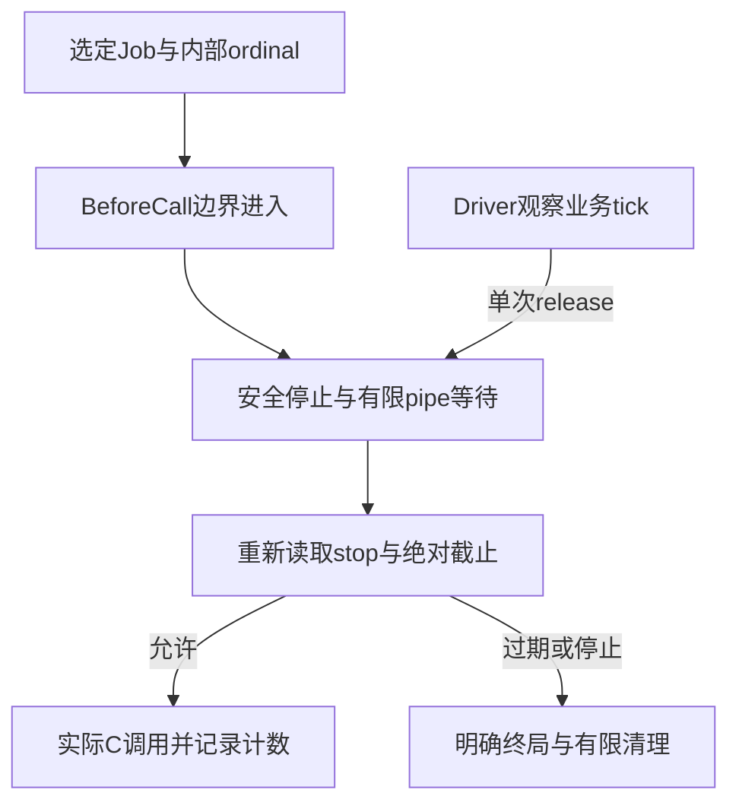

# 方案A：W2组件与审计v3代码审查及接线实施计划

_日期：2026-10-22（北京时间）；依据：57包当前W2 gate/pipe组件、审计v3及首次57号审查封存快照。_

| 项目 | 本次判断 |
| --- | --- |
| 与原计划关系 | 分离gate与pipe、先组件后owned、沿用有限deadline的方向符合计划 |
| 原有验证 | 本次复跑确认19/19组件、12/12 pipe、7个变异；审计v3三例baseline和四个既定反例结果成立 |
| 接线准备程度 | 尚未收口：新增补测发现停止与总预算问题，审计完整配置/Driver身份仍有盲点，接线文档有方向错误 |
| 推荐下一步 | 先修两个组件头文件和少量审计断言，再按正确FD方向和内部hook接线 |
| 当前阶段资格 | 完整M4、F6、P1、plant接受、硬实时及研究结论均保持false |
| 本次工作 | 新增58号审查包、复跑现有非ROS验证、补充私有反例与实施计划；未修改57包或56包 |

## 📋 1. 审查结论

当前工作是推进：W2已经有真实pipe适配器，审计v3也能拒绝上一轮四个实际构造的反例。这些结果经过本次重新执行，可以保留。

但是，“两套既定验证complete=true”不能进一步解释成“组件已经可以直接接入Worker”。停止标志的接口不符合计划中的并发使用方式；EINTR后的累计耗时仍少记，已经在真实pipe上复现总等待超预算后继续返回released；审计v3还把同伴声明当成完整配置基准。

建议把下一批范围收敛为：组件小修与针对性验证→隔离作者树接线→有限W2 owned运行。这不是要求再重跑W1/W3/W4或扩大故障矩阵；现有数据能支持的审计补丁继续离线完成。

本次产物全部写在新58目录。原57组件、原审计器、旧运行和并行工作区保持本次读入时的状态，不做回滚。

## 📊 2. 本次重新验证的结果

| 对象 | 结果 | 范围 |
| --- | --- | --- |
| 原gate组件测试 | 19/19通过 | 重新编译、执行原测试 |
| 原真实pipe测试 | 12/12通过 | 重新编译、执行原测试，含其原有fork/信号用例 |
| 原7个组件变异 | 全部被原测试捕获 | 在临时副本施加，原源码不改 |
| 审计v3 baseline | W1/W3/W4均通过 | 只读原`_05`记录，输出重定向到58目录 |
| 原4个审计反例 | 均由AssertionError拒绝 | 过期租约、零延迟、idle active不清零、错误ELF哈希 |
| 当前MPC八项镜像 | 8/8字节一致 | 两个实现目录的7个文件，加W2组件文档 |
| 追加组件补测 | 发现停止及预算缺陷 | 详见下一节，既有31项没有覆盖这些组合 |
| 追加审计反例 | 两个错误输入仍通过 | 同伴一致但不等于实际合同；Driver manifest工具SHA错误 |

证据：[组件复跑](/home/trevor/USV/.sgh-research/experiments/scheme_A_W2_component_review_20261022_58/evidence/component_recheck/component_verification_v1.json)、[审计v3复跑](/home/trevor/USV/.sgh-research/experiments/scheme_A_W2_component_review_20261022_58/evidence/audit_recheck/verification_v1.json)、[MPC八项核对](/home/trevor/USV/.sgh-research/experiments/scheme_A_W2_component_review_20261022_58/evidence/current_eight_file_MPC_check_v1.json)。

## 🔍 3. 需要先修的代码问题

### 3.1 [P2] EINTR后的累计耗时没有在成功返回时完整计入

`PipeReader`在poll被中断时累计了`waited_ns`，但成功返回数据和普通超时分支却只把最后一次`slice_elapsed_ns`交给Gate。之前被中断的等待时间被遗漏。Gate再从总预算中减去这个偏小数值，部分帧后的下一次读取便得到过大的剩余预算。

本次真实pipe补测结果：

| 补测 | 实测 |
| --- | --- |
| 信号中断一次后成功读取 | 实际200,288,469ns，报告100,082,091ns，少记约100ms |
| EINTR＋分两次写帧 | Gate预算600,000,000ns，实际750,380,846ns后仍返回`released` |

这不是单纯的poll毫秒取整误差。真实case中预算被延长约150ms，会令“在有限等待内被Driver释放”的证据失真。

修复应以一次`read_some`的起始MONOTONIC时间为基准，所有返回路径都报告完整实测耗时；每次EINTR及read重试都重新计算剩余预算。不能只修某一个异常分支。

同时，Gate目前将`elapsed>remaining`截断成remaining，收到完整帧后仍直接decode并返回released。本次Reader边界模型报告超预算后返回完整帧，Gate也会放行。建议Gate使用独立的绝对截止或等价的完整时间核验，过期时不得返回released。OS调度造成调用晚返回与“把晚到释放认定为有效”是两个不同事实，必须分别记录。

相关源码：[PipeReader成功与超时返回](/home/trevor/USV/.sgh-research/experiments/scheme_A_M4_diagnostic_review_20261022_57/implementation/w2_gate/w2_pipe_reader.hpp:88)、[Gate预算处理](/home/trevor/USV/.sgh-research/experiments/scheme_A_M4_diagnostic_review_20261022_57/implementation/w2_gate/w2_release_gate.hpp:213)。

### 3.2 [P2] 停止接口不能按文档安全接入atomic，完整读取后也没有再次检查停止

接口是`wait(const bool*)`，注释却要求Worker传入已有atomic的“relaxed视图”。标准C++没有这样的可传递视图。`atomic<bool>*`不能转成`const bool*`；把atomic复制成局部bool只得到一次快照，强制按普通bool读写则不是正确的atomic访问。

此外，Gate只在进入read前检查stop。如果read期间出现停止请求，又返回完整合法帧，循环已经结束，不会再次检查停止，结果是released。

本次在同一线程内让Reader设置stop后返回完整帧，避免任何数据竞争，实测：

```text
stop_at_return = true
observed = released
```

原测试`StopRequestedWhileWaitingWinsOverTheRelease`实际是在调用wait之前就把stop设为true，没有覆盖“读取期间发生停止”的场景。

还有一个接线后会暴露的响应问题：一次read使用全部剩余预算，PipeReader在EINTR后继续等待而不了解stop。即使上层拥有正确atomic，Gate也不能在等待中及时读取它；2s gate等待可能跨过当前500ms Worker关闭grace。

建议改为停止谓词或显式atomic引用，例如由调用方提供：

```cpp
// 下一版本接口示意；不是当前已实现代码。
gate.wait([&] {
  return stopping.load(std::memory_order_relaxed)
      || fatal_.load(std::memory_order_relaxed);
});
```

等待采用短切片或明确唤醒机制，响应目标应与现有Worker关闭预算相容；每次read返回后、宣布released前均重查stop。真正进入backend之前的最后guard仍然保留，不能用gate的停止检查替代它。

相关源码：[停止参数与循环](/home/trevor/USV/.sgh-research/experiments/scheme_A_M4_diagnostic_review_20261022_57/implementation/w2_gate/w2_release_gate.hpp:191)、[现有停止测试](/home/trevor/USV/.sgh-research/experiments/scheme_A_M4_diagnostic_review_20261022_57/implementation/w2_gate/test_w2_release_gate.cpp:253)。

### 3.3 [P2] 审计完整配置的比较基准仍是Worker声明，而非已固定合同

v3确实调用了`check_role_identity`，但传入的`c_typed`是Worker manifest中的`contract_configuration`，不是从已固定合同文件读取的`c`。

结果是三个角色只要声明同一个错误配置，就能互相“证明一致”。本次将Regulator、Worker、Fixture的manifest配置`hold_ns`在内存中全部增加1234，合同文件保持不变，完整v3审计仍通过。

修复是将已按hash读取的实际合同`c`作为基准，并逐字段要求三角色配置与它完全相等。无需引入新合同格式或改变数值政策。

相关源码：[当前主流程实参](/home/trevor/USV/.sgh-research/experiments/scheme_A_M4_diagnostic_review_20261022_57/implementation/audit_v3/audit_diagnostic_v3.py:1400)。

### 3.4 [P2] Driver manifest的工具SHA校验使用了错误字段名

实际Driver manifest字段名为`tool_sha256`。当前审计只有在存在`driver_tool_sha256`时才比较，而实际文件没有这个键，所以这段检查被跳过。

本次将实际字段`tool_sha256`在内存中改成64个0，完整v3审计仍通过。应显式读取并要求正确字段匹配registry，同时保留实际Driver脚本字节hash检查；不能把“磁盘脚本仍在”当成“这次run记录的Driver身份一致”。

相关源码：[Driver工具SHA检查](/home/trevor/USV/.sgh-research/experiments/scheme_A_M4_diagnostic_review_20261022_57/implementation/audit_v3/audit_diagnostic_v3.py:205)。

上述两个审计反例不表示实际`_05`运行配置或Driver真的错误。它们证明的是工具仍有盲点，应使用原始记录离线补强。

补测原始结果：[组件补测JSONL](/home/trevor/USV/.sgh-research/experiments/scheme_A_W2_component_review_20261022_58/evidence/w2_probe_observations_v1.jsonl)、[审计新增反例](/home/trevor/USV/.sgh-research/experiments/scheme_A_W2_component_review_20261022_58/evidence/additional_audit_identity_probes_v1.json)。

## 🔗 4. 接线计划中必须纠正的两处偏差

### 4.1 Worker继承读端，不能传write_fd

W2步骤1文档写了`pass_fds=(write_fd,)`。这与PipeReader的角色相反。正确关系是：

| 进程 | 保留端点 |
| --- | --- |
| Driver | 写端；Worker启动后关闭自己的多余读端 |
| Worker | 只继承读端，供PipeReader读取 |
| Regulator/Fixture/Recorder | 不继承任何release通道端点 |

因此Worker的Popen应只传`pass_fds=(read_fd,)`。fd整数本身不是身份；还需验证实际类型、方向、通道归属以及run/Job/ordinal/nonce绑定，并在进程实际manifest中记录对应证据。

### 4.2 不应把W2又退回外层pre-native等待

57号原计划和当前用户下一步约定均选择`owned_cold_backend.hpp`中的`BeforeCall/hook_`。新步骤1文档却建议先放在Worker外层guard之前，内部hook作为可选下移。这改变了原定作用点。

本次W2应在已选定的内部调用边界驻留，由Driver独立释放；hook返回后、实际进入`solver_.step`前重新检查deadline与stop。只复用Worker外层检查是不够的，因为它发生在进入内部等待之前。

Worker外层“尚未进入backend”、C++包装器已经进入、实际C调用已经开始，应各自如实记录。不能把外层gate同时标记成`owned_backend_entered=true`。

依据：[W2步骤1文档](/home/trevor/USV/.sgh-research/experiments/scheme_A_M4_diagnostic_review_20261022_57/documents/W2步骤1_私有pipe_release_gate组件_2026-10-22.md)、[约定内部hook位置](/home/trevor/USV/.sgh-research/experiments/scheme_A_M4_diagnostic_worker_20261021_56/author/worker/owned_cold_backend.hpp:38)。

## 📝 5. 版本历史与验证表述需要准确

### 5.1 “56包原件零修改”必须注明比较起点

本次比较首次57号审查的131项快照，其自身hash仍与当时MPC交付回执一致。131项中130项当前未变，唯一变化是56包`audit_diagnostic_v2.py`：

| 时点 | 字节数 | SHA256 |
| --- | ---: | --- |
| 首次57号审查封存快照 | 54526 | `b0d4ab221ace3684eef6fb938cebb11b69d3b377e51d9f6e210883581bd63826` |
| 本次读入的当前文件 | 58973 | `28414eb4cfec62f7aebdc4c8841c4a0c762212551d1f3538a04d32b64fc9ddd4` |

因此，“本阶段以来28414版本没有继续改动”与“相对首次审查原件从未变动”不是同一个结论。前者可以是本轮检查口径，后者不符合已有封存快照。

本次不推断由谁修改、不自行回滚当前文件。应补充该工具版本变动的来源和时间线，把当前28414作为独立版本登记。三个`_05`原始run及其他被检查的130项并未因此发生变化，也不据此撤回它们已有实跑事实。

证据：[历史差异及原回执对应](/home/trevor/USV/.sgh-research/experiments/scheme_A_W2_component_review_20261022_58/evidence/prior_56_history_delta_v1.json)。

### 5.2 几处不应扩大解读的测试文字

| 当前文字或主张 | 应修正的解释 |
| --- | --- |
| 无效fd返回−1会等满全部预算 | 当前Gate收到−1立即返回timeout；本次相同行为模型耗时122ns。现有变异失败主要证明终局从eof变成timeout，不能据此证明曾干等5s |
| 十种互不相同终局均已行为验证 | `kDuplicateRelease`目前没有实际返回路径；第二次wait仍返回缓存的released。应区分“只消费一次”和“检测并报告重复释放” |
| pipe测试不启动子进程 | 当前EINTR用例明确fork子进程写帧。准确未验证项是跨exec的pass_fds、角色隔离及真实owned继承，不是完全没有跨进程pipe |
| 变异前确认输入已经改变 | v3使用`mutated != ctx`，把子对象与完整context比较，不能证明该子对象变化。应比较同一层次的before/after或记录具体命中字段 |

本次既定31项、7个变异和四个审计反例确实可复现，这些表述问题不等于所有测试无效。需要避免将测试名称或枚举名称扩大成尚未验证的行为。

之前因`open('x')`遇到旧产物而失败，应归为输出目录占用问题，不是控制回归。后续采用新的attempt输出目录并保留旧结果；不通过清空已交付目录来制造“首次成功”。

## 🔧 6. 下一批先做的最小代码修正

| 文件 | 修改 | 必要验证 |
| --- | --- | --- |
| `w2_pipe_reader.hpp` | 从每次read_some入口起统一计时，所有返回路径包含EINTR/重试实际耗时 | 中断后成功读取的报告耗时；中断＋分片帧累计预算 |
| `w2_release_gate.hpp` | 安全stop谓词、read后stop检查、短切片/唤醒、绝对期限或等价完整预算 | 读取期间stop；无数据等待时stop；完整帧到达但已过期不released |
| `audit_diagnostic_v3.py`派生版本 | actual合同c作配置基准；校验实际`tool_sha256`；修正同层次变异比较 | 当前三例仍通过，新增两个身份反例必须断言拒绝 |
| 组件测试与变异runner | 新增针对本次缺陷的用例，更新确实受接口变化影响的变异模式 | 不能以编译失败或准备失败充当变异被正确捕获 |
| W2步骤1文档及登记模板 | 读端方向、内部hook、版本时间线、测试行为范围 | 计划、源码与证据使用同一作用点和身份 |

Gate的计时应固定于同一MONOTONIC域。使用绝对deadline时，所有切片共享同一个截止，不能每次partial read或EINTR重新获得完整窗口。短切片超时不等于总窗口到期，需要由Gate根据绝对期限决定是否继续。

“系统调度令poll晚返回”可以如实记录；但若协议窗口已经过去，就不能再把完整帧认成有效释放。实际C调用前的150ms截止检查依旧独立存在。这里没有授予硬实时保证。

最少增加以下有意义的验证：

1. stop在读取期间由false变true，最终不得返回released；再用安全atomic/predicate接法验证等待中能在现有关闭预算内响应。
2. EINTR后成功返回报告累计实测时间；EINTR与分片组合不能延长总预算。
3. 人工时钟或受控Reader覆盖截止前、等号和之后；真实pipe覆盖有足够调度余量的超时，不以1ns用例宣称真实时间精度。
4. 三角色声明一致但与实际合同不同，审计必须拒绝。
5. Driver manifest实际`tool_sha256`错误，审计必须拒绝。

上述补丁不会要求改变MPC模型、权重、lease、watchdog或HOLD政策。旧56包和57包继续保留，修正写到新派生实现及新验证目录。

## ⚙️ 7. 修正后按原计划接线

### 7.1 新作者树与改动范围

从选定56包作者树派生新目录，复制已修正的组件；新增Driver和case注册/registry。修改研究执行角色的副本，不应混入工作区正在并行维护的实船B控制器。实船B仍是MANUAL＋RC覆写。

| 研究执行角色文件 | 应完成的接线 |
| --- | --- |
| `solver_worker_m4.cpp`副本 | 校验实际读端、固定单次Job上下文、提供安全stop谓词、挂接内部hook、记录进入/释放/取消/完成 |
| `owned_cold_backend.hpp`副本 | 在选定BeforeCall边界等待，返回后紧贴实际调用做最终guard，分别记录包装器进入和实际C调用 |
| 诊断Driver副本 | 创建私有pipe，仅Worker继承read_fd，父进程保留write_fd，按已观察的边界和业务tick释放 |
| 配置/manifest/入口校验 | 正常profile拒绝该能力；诊断profile精确匹配登记参数、FD事实及实际Driver/Worker身份 |
| registration/registry/审计 | 绑定新source/bin/Driver、单次身份、有限预算、预期终局及Source/Stored/退出证据 |

Driver或bundle变更后重新构建、登记实际选择的角色ELF；不能继续引用旧registry。Recorder与未改生成库的复用按实际依赖确定。

### 7.2 FD所有权先用非ROS exec验证

先用私有小进程验证跨exec继承，完成：Worker只见读端、Driver只保留写端、其他角色无该通道、所有写端关闭时EOF可到达、错误方向被拒、重复或错身份命令不产生第二次执行。

当前fork测试提供了部分跨进程经验，但没有验证上述实际exec/角色关系。这一步可以在不运行NMPC闭环的条件下暴露接线错误。

CRC只检查帧完整性，不替代发送者身份。私有FD所有权与实际进程认证才是归属依据；run sequence与完整run/contract的映射应写入登记，不能只记一个未解释的整数。

### 7.3 内部边界、独立release与最终guard



首版选在首次正常求解之后，只针对一个明确Job及内部ordinal，避免冷启动首Job的4次内部调用混入刺激。hook只有ordinal参数，因此需由计算线程在solve前固定当前Job上下文，不能凭ordinal=1暂停每个Job。

Driver根据实际进入记录与完整Regulator tick发release，不能靠被阻塞线程自己sleep结束。等待期间不持pending或Source锁，executor继续发真实capability。

### 7.4 两类释放结果分别验证

| case范围 | 正确期待 |
| --- | --- |
| 短等待组件/exec联调 | 身份正确、未停止、未超过实际Job截止时，才允许进入实际调用 |
| 跨多拍owned W2 | 150ms截止已过，释放被验证后guard拒绝C调用，旧候选不激活，按登记政策完成过期/取消和有限清理 |

不能同时要求跨过多个200ms tick，又要求该Job在150ms截止内继续求解并被接受。

现有Backend在异常路径会进入terminal，并有已更新的冷启动/Job状态。首版长等待可以登记为过期后有限隔离退出，不必强行要求恢复求解。若希望过期后继续服务，需要显式证明状态清理正确，不能捕获异常后擅自清terminal。

终局ledger应根据真实路径加入有限的取消/终止类别，不能为了维持旧四类计数而把过期或隔离伪装成delivered。预期退出码应在运行前按真实关闭路径固定，不一律强加“所有角色必须0”。

### 7.5 原义务不扩展

原矩阵要求“native边界等待直到独立release”，并观察多个Regulator tick、槽位有界和单一backend；本次不新增“必须制造acados C函数内部死锁”的门槛。C内部挂起未覆盖继续作为结论边界记录。

## 🎯 8. 完成标准和后续顺序

| 顺序 | 完成标准 |
| --- | --- |
| 组件小修 | 原验证保留，本次停止/总预算反例被针对性断言捕获，安全atomic接法成立 |
| 审计补强 | 现有三例与原四反例仍符合预期，新增两个配置/Driver身份反例被拒 |
| 非ROS exec接线 | 私有通道方向、继承、关闭、错误身份及有限取消有证据 |
| 最小owned W2 | 实际内部边界等待、独立release、真实心跳、多个完整tick、槽位有界、释放后guard与C调用事实、全API及退出对账 |
| 原九组差集 | Fixture参考/时钟/状态、候选形状身份、时序、HOLD边界、cleanup_failed和记录压力按准确缺口补齐 |
| 阶段收口 | M4复判→有限已知模型事务/F6→P1联合复判 |

每次运行固定新attempt目录、输入身份、刺激、观察终点、预算、退出预期和允许例外；失败证据保留。没有代码影响或原始证据缺失时，不统一重跑45/46准备、49成功正常或所有W1/W3/W4。

F6纯C++组件可以单列提前准备，正式阶段资格仍按原顺序承接。组件、接线验证、阶段资格、研究结论分账。

## 📦 9. 本次证据与复现入口

| 产物 | 入口 |
| --- | --- |
| 本次审查输入快照 | [review_inputs_before_v1.json](/home/trevor/USV/.sgh-research/experiments/scheme_A_W2_component_review_20261022_58/evidence/review_inputs_before_v1.json) |
| 原31项及7变异复跑 | [component_verification_v1.json](/home/trevor/USV/.sgh-research/experiments/scheme_A_W2_component_review_20261022_58/evidence/component_recheck/component_verification_v1.json) |
| 原审计v3复跑 | [verification_v1.json](/home/trevor/USV/.sgh-research/experiments/scheme_A_W2_component_review_20261022_58/evidence/audit_recheck/verification_v1.json) |
| 追加组件补测源码 | [w2_review_probes.cpp](/home/trevor/USV/.sgh-research/experiments/scheme_A_W2_component_review_20261022_58/implementation/w2_review_probes.cpp) |
| 追加组件实际结果 | [w2_probe_observations_v1.jsonl](/home/trevor/USV/.sgh-research/experiments/scheme_A_W2_component_review_20261022_58/evidence/w2_probe_observations_v1.jsonl) |
| 追加审计源码 | [review_audit_identity_v1.py](/home/trevor/USV/.sgh-research/experiments/scheme_A_W2_component_review_20261022_58/implementation/review_audit_identity_v1.py) |
| 追加审计反例结果 | [additional_audit_identity_probes_v1.json](/home/trevor/USV/.sgh-research/experiments/scheme_A_W2_component_review_20261022_58/evidence/additional_audit_identity_probes_v1.json) |
| 历史56工具差异 | [prior_56_history_delta_v1.json](/home/trevor/USV/.sgh-research/experiments/scheme_A_W2_component_review_20261022_58/evidence/prior_56_history_delta_v1.json) |
| 当前MPC八项校验 | [current_eight_file_MPC_check_v1.json](/home/trevor/USV/.sgh-research/experiments/scheme_A_W2_component_review_20261022_58/evidence/current_eight_file_MPC_check_v1.json) |

追加审计目录中的`passed=true`来自私有篡改输入，是漏检证据，不是有效运行或阶段资格，均附有`MUTATED_INPUT_NOT_RUNTIME_EVIDENCE.json`标识。追加C++程序返回0表示补测执行完成，JSON中的`defect_reproduced=true`才表示复现了待修问题，不能读成组件通过。

本次审查工具有一次“按读取次数而非唯一manifest数量判断”的自身断言错误，已单独保留记录。Fixture被重复读取并不表示多出一个角色；正式复核改为验证三个唯一peer路径。该错误未算成产品失败或成功拒绝。

本次没有修改原57组件或审计源码，没有修改56包，没有启动ROS控制进程或硬件；只读入实际run数据并执行非ROS组件测试。普通工作区21项文件变化（含其他任务新增的HTML）和子模块状态继续保留。
