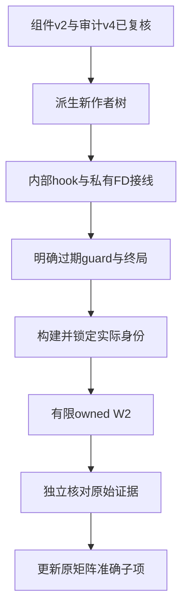

# 方案A：W2接线前复核结论与内部hook实施计划

_日期：2026-10-22（北京时间）；对象：58包组件v2、审计v4和非ROS FD exec验证。_

| 项目 | 本次复核结论 |
| --- | --- |
| 组件v2修正 | 上轮指出的累计计时、停止接口、完整帧后检查均已实际修正 |
| 原组件验证重放 | 22＋13＝35项通过，7个变异均已准备且被测试捕获 |
| 原审计验证重放 | W1/W3/W4 baseline通过，6个反例均由AssertionError拒绝 |
| 原FD脚本 | 继承方向与隔离快照成立；其收帧/EOF是父进程回环，需要限定表述 |
| 本次追加补证 | 真正exec后的C++接收端使用当前Gate/PipeReader；5类场景全部通过 |
| 是否可继续 | 可以进入新派生作者树和内部BeforeCall接线；不需要再新增一轮独立组件开发作为前置 |
| 仍未完成 | 实际Worker接线、Driver内部边界释放、真实Job过期guard、owned W2与M4/F6/P1资格 |

## 📋 1. 总体判断

本轮实现与58号计划的修正目标一致，已经解决上一轮几个具体代码问题。现有测试不是只读报告确认，而是本次在新的59目录重新编译、执行及重放，结果符合原报告。

本次没有发现需要阻止组件v2、审计v4进入接线阶段的新阻断性问题。原FD脚本有一处应修正的证据范围：它证明了exec后的FD继承，却没有让存活子进程实际读取释放帧与EOF。我已新增独立C++接收端验证并通过，补齐这个非ROS层次的缺口。

因此，建议下一步直接实施内部hook接线，并把本次新增的端到端FD验证收进后续联调工具。组件通过、exec原型通过都不等于owned W2通过；原M4、F6、P1仍按既定顺序推进。

范围文字宜写为“§6组件/审计修正与§7.2非ROS验证完成”，避免“§6至§7.2全部完成”被读成§7.1作者树已经派生。当前§7.1、§7.3和owned运行仍未实施。

## 📊 2. 已复核的代码与结果

### 2.1 组件v2

本次完整读取并检查了两个头文件、原测试与变异runner：

- `PipeReader::read_some`以调用入口为单一计时原点，所有返回均通过`finish()`报告完整耗时；EINTR重试共享同一截止。
- `Gate::wait`以绝对期限管理等待，每次最多请求50ms切片，partial read不会获得新的完整预算。
- 停止接口改成`StopPredicate`，允许调用方合法地读取atomic，完整帧装配后重新检查stop。
- 完整帧到齐后重查私有等待期限，晚到帧不再返回released。
- 原先4个失效的变异模式已按v2代码更新；本次7个模式都实际命中，而非被跳过。

重新编译执行结果：组件22/22、真实pipe13/13；7个变异均被对应断言捕获。证据：[本次组件重放](/home/trevor/USV/.sgh-research/experiments/scheme_A_W2_pre_wiring_review_20261022_59/evidence/component_recheck/component_verification_v2.json)。

50ms是单次等待请求的切片值，不是操作系统调度或进程关闭的硬实时保证。接入Worker后仍需测量真实退出情况，保持原500ms Worker关闭预算的记录和有限监督。

### 2.2 审计v4

对照v3检查了修正：

| 修正 | 本次确认 |
| --- | --- |
| 完整配置基准 | 主流程传入已按hash读取的合同`c`，不再以Worker声明充当基准 |
| Driver工具身份 | 要求真实字段`tool_sha256`存在并与registry匹配 |
| 变异比较 | prepare返回同层次的`(mutated, original)`，未改变输入不能计为被正确拒绝 |
| 已有case专用条件 | 保留租约年龄、延迟刺激、W4目标tick/idle/恢复以及capability typed对账 |

三例baseline重放全部通过，六个反例分别被预期断言拒绝：过期租约、零投递延迟、active不清零、错误Worker ELF、三角色共同偏离合同、错误Driver工具SHA。证据：[本次审计重放](/home/trevor/USV/.sgh-research/experiments/scheme_A_W2_pre_wiring_review_20261022_59/evidence/audit_recheck/verification_v1.json)。

这支持审计v4对当前W1/W3/W4记录的判断能力，不自动授予它对未来W2新终局、新输出目录和新registry的覆盖。W2审计仍需明确接入新的实际运行身份。

## 🔍 3. 原FD验证的范围问题及本次补证

### 3.1 [P2] 原脚本的收帧与EOF发生在父进程

原`fd_exec_verification.py`中的child只检查FD、写报告并返回。父进程等待child退出后，仍保留read_fd，随后执行自己的`write(write_fd)→read(read_fd)`及关闭写端后的EOF读取。

这能证明继承方向、兄弟进程不持release通道以及父进程pipe本身的性质，但不能独立证明“存活的exec子进程从私有读端接收到释放帧及EOF”。也未实际验证父进程仅持写端。

相关位置：[child报告后退出](/home/trevor/USV/.sgh-research/experiments/scheme_A_W2_component_review_20261022_58/implementation/w2_fd_exec/fd_exec_verification.py:93)、[父进程等待子进程退出](/home/trevor/USV/.sgh-research/experiments/scheme_A_W2_component_review_20261022_58/implementation/w2_fd_exec/fd_exec_verification.py:131)、[父进程收帧与EOF](/home/trevor/USV/.sgh-research/experiments/scheme_A_W2_component_review_20261022_58/implementation/w2_fd_exec/fd_exec_verification.py:150)。

建议把后续FD验证改成：子进程保持存活并运行真实接收逻辑；父进程spawn后关闭多余读端；frame与EOF由子进程报告。同时断言child/sibling的退出码，避免只凭报告文件判断本次进程执行成功。

### 3.2 本次已补真实C++ exec接收验证

新增独立C++接收端，直接编译链接所审查的Gate/PipeReader v2头文件。它不连接ROS、不加载求解器、不发布控制命令。

验证过程：

1. 父进程创建pipe，只向C++子进程传read_fd。
2. 父进程spawn后立即关闭自己的read_fd，按device＋inode核对父进程只持写端。
3. 子进程按实际device＋inode、只读模式和句柄数量核对通道，确认只持一个读端。
4. 子进程保持存活并运行Gate，父进程通过私有写端发送由Python编码的44字节帧或关闭写端。
5. 验证子进程实际结果、完整帧匹配与退出码；超时仅清理本次创建的私有测试进程。

| 场景 | 子进程实际结果 | 本次等待耗时 |
| --- | --- | ---: |
| 正确44字节释放 | `released`，与独立Python编码帧逐字节一致 | 100.187398ms |
| 父进程不发数据并关闭写端 | `eof` | 100.199521ms |
| 写17字节后关闭写端 | `partial_frame` | 0.071119ms |
| 写端保持打开，atomic停止置位 | `stop_requested` | 150.219158ms |
| 信号中断＋分片，总预算600ms | `partial_frame`，没有晚到放行 | 600.633457ms |

最后一例中父进程尝试在约750ms补齐帧；接收端已因总预算耗尽而退出。实际等待比600ms晚约0.63ms返回，但结果正确地没有认定为released。该结果是受控Linux环境下的组件观测，不是硬实时保证。

停止例只记录了进入wait至返回的总耗时，未记录atomic置位的精确时间；不据此报告精确的停止响应延迟。它支持本次受控测试中的500ms关闭预算目标。

该补证已弥补原FD脚本在非ROS层的端到端缺口，不应再为此新增一轮理论设计。建议直接复用或合并到下一接线包。证据：[真实C++ exec验证](/home/trevor/USV/.sgh-research/experiments/scheme_A_W2_pre_wiring_review_20261022_59/evidence/live_exec_gate_verification_v1.json)、[接收端源码](/home/trevor/USV/.sgh-research/experiments/scheme_A_W2_pre_wiring_review_20261022_59/implementation/exec_gate_receiver.cpp)、[父进程验证脚本](/home/trevor/USV/.sgh-research/experiments/scheme_A_W2_pre_wiring_review_20261022_59/implementation/verify_exec_gate.py)。

### 3.3 补证没有覆盖什么

补证中的接收端不是实际Worker ELF，没有BeforeCall、真实Job或Regulator。其`actual_native_invoked=false`表示测试程序没有加载求解器，不能被用作“真实Backend过期guard已验证”的证据。

实际执行角色的FD登记、数据来源认证、Driver释放时机、多拍监管、Job过期、调用计数和清理终局，仍由下一步owned W2验证。

## 🔧 4. 下一步实际修改哪些代码

从56包选定作者树和attempt18来源派生新目录，保留56、57、58原件。复制本轮已复核的组件v2；实际改动在新的研究执行角色副本，不混入并行维护的实船B生产控制器。

| 文件或层次 | 具体改动 |
| --- | --- |
| `worker/solver_worker_m4.cpp`副本 | 读取并验证继承读端，固定run/Job/ordinal/nonce，设置安全stop谓词，挂接内部hook，补终局与收尾 |
| `worker/owned_cold_backend.hpp`副本 | 在现有BeforeCall边界调用gate，hook返回后、实际backend调用前重查Job绝对截止和stop |
| `worker/raw_backend_v1.hpp`副本（确需时） | 在真实C solve入口或可核对封装记录实际调用计数；不改生成库或数值参数 |
| 诊断Driver副本 | 创建私有pipe，仅Worker继承read_fd；关闭父进程多余读端；按真实边界和业务tick写入一次释放 |
| manifest/配置准入 | 精确绑定FD类型、方向、device/inode和诊断能力；正常profile拒绝启用 |
| registration/registry/构建 | 固定新Driver、作者bundle、实际ELF和加载依赖；登记唯一case与有限预算 |
| W2审计 | 新运行目录和身份输入；按实际新增终局对账，核对边界、释放、最后guard、调用和退出 |

Driver和bundle变化后，应重建、登记实际消费这些身份的角色ELF。旧registry不能继续指向attempt18来代表新代码。Recorder和未改生成库是否复用，按实际依赖确认；不因接线而重建codegen或调参。

本次不是实船接管。实船B继续遵循MANUAL＋RC覆写，普通物理release保持关闭。

## ⚙️ 5. W2执行时序必须写清的两道期限

### 5.1 私有等待期限和Job截止分别管理

| 期限 | 决定什么 |
| --- | --- |
| Gate私有等待期限 | 释放帧是否在登记窗口内到达、等待是否需要取消 |
| Job origin＋150ms | 释放后是否仍允许进入实际求解调用 |

Gate返回released只是结束边界等待，实际native入口仍由后置guard决定。不能把released等同于Job仍有执行资格。

跨过多个200ms tick后，Job的150ms绝对截止已经过去。因此长等待case应明确期待“独立释放被验证→最后guard判过期→该Job的C调用数为0→旧候选不激活→有限清理”，不要求该Job再正常求解。

### 5.2 选定一个Job与一个内部ordinal

首版选首次正常求解之后的一个明确Job，避免冷启动首Job的4个内部调用混入新刺激。现有hook只带ordinal，因此由计算线程在solve前固定不可变Job上下文；不能仅凭ordinal=1暂停每个Job。

单次状态应包含未进入、已进入、已释放/取消、已完成。重复wait缓存结果不代表允许第二次执行。`kDuplicateRelease`仍无实际返回路径属于已声明边界；不得在新报告里改称“已检测所有重复帧”。

### 5.3 Driver根据真实事件释放

Driver看到选定边界的已落盘事件后，观察至少两个完整Regulator业务tick，再发身份匹配的单次release。不要依赖计算线程自己sleep结束。

若该case目标是独立release及过期分支，应在原1s active watchdog之前完成正常刺激路径的释放观察，不通过调长watchdog或lease制造窗口。超过原边界时按预登记失败/清理处理，不能临场改case含义。

### 5.4 最后guard及实际调用事实

现有BeforeCall位于内部deadline检查之后。新增等待必须在返回后重新检查stop/fatal及实际MONOTONIC时间，并紧贴真正调用点进行，不能只复用Worker外层、发生在等待前的检查。

分别记录：

- C++包装器已经进入；
- 内部边界已进入，包含Job、ordinal、进入时间和原deadline；
- Driver实际发帧及Worker验证收到；
- 最后guard的时间、停止状态和允许/拒绝理由；
- 实际C调用是否发生、调用计数及对应Job；
- 最终过期/取消/隔离终局和清理结果。

`solver_invoked`或进入C++wrapper不能自动等同于C函数已进入。计数应取自实际C solve入口或可核对的封装，而非提前设置一个true标记。

### 5.5 先明确过期后的生命周期，避免吞异常继续运行

当前Backend通用catch会设置terminal，并有已经更新的一次性/Job状态。首版长等待case可以登记为过期后有限隔离退出，不必追求恢复求解。

若选择非终止的expiry路径，则需明确其typed结果、backend状态和下一Job行为。不能捕获异常后擅自清terminal，也不能为使所有退出码等于0而掩盖隔离事实。

新终局应进入ledger，保持每个已收到Job只有一个准确终局。不要把取消、过期或隔离伪装成delivered，也不要让它与发布/丢弃重复记账。

## 🎯 6. 下一包的最小实施顺序

具体顺序：

1. **派生与接线**：复制已复核组件，使用read_fd、内部BeforeCall和单次上下文；把本次真实C++ exec补测纳入联调。
2. **针对性组件检查**：正常profile拒绝gate；关闭gate时原路径保持；实际后置guard在截止前/等号/之后及stop条件下行为正确；过期不会调用C。
3. **构建和登记**：固定实际source/bin/Driver/配置/通道及依赖。登记预期退出码、允许例外、观察终点、最大时间和清理规则，自动重试0。
4. **最小owned W2**：Regulator多个完整tick继续、真实心跳续租、active/pending/ready有界、独立release、Job过期后无C调用和迟到激活、全API流与退出可对账。
5. **更新状态**：只提升本次实际覆盖的native-boundary子项；Fixture差集、cleanup_failed、记录压力等仍按原义务收口。

测试不以继续增加总数为目标。此次组件和六个审计反例没有必要再单独开一轮重复验证；接线修改影响到哪些旧路径，就补哪些针对性回归。只有新代码确实影响旧实跑义务时，才重跑相应W1/W3/W4或正常run。

原47矩阵要求的是native调用边界独立释放，不新增“必须制造acados C函数内部死锁”的前置。后者继续作为未证明边界记录。

## 📦 7. 当前资格与证据入口

| 层次 | 本次状态 |
| --- | --- |
| Gate/PipeReader组件验证 | 已有35项及7变异，本次重放成立 |
| 审计v4 | 三例baseline与六个反例重放成立 |
| 非ROS exec通道 | 原继承/隔离快照成立；本次追加存活C++接收端5例通过 |
| 实际Worker/Driver接线 | 未实施 |
| 真实Job过期guard与owned W2 | 未验证 |
| 完整M4、F6、P1 | false |
| plant接受、硬实时、研究结论 | 未取得 |

| 产物 | 入口 |
| --- | --- |
| 组件重放 | [component_verification_v2.json](/home/trevor/USV/.sgh-research/experiments/scheme_A_W2_pre_wiring_review_20261022_59/evidence/component_recheck/component_verification_v2.json) |
| 审计重放 | [verification_v1.json](/home/trevor/USV/.sgh-research/experiments/scheme_A_W2_pre_wiring_review_20261022_59/evidence/audit_recheck/verification_v1.json) |
| 原FD脚本重放 | [fd_exec_verification_v1.json](/home/trevor/USV/.sgh-research/experiments/scheme_A_W2_pre_wiring_review_20261022_59/evidence/original_fd_recheck/fd_exec_verification_v1.json) |
| 本次真实exec补证 | [live_exec_gate_verification_v1.json](/home/trevor/USV/.sgh-research/experiments/scheme_A_W2_pre_wiring_review_20261022_59/evidence/live_exec_gate_verification_v1.json) |
| 补证实现 | [exec_gate_receiver.cpp](/home/trevor/USV/.sgh-research/experiments/scheme_A_W2_pre_wiring_review_20261022_59/implementation/exec_gate_receiver.cpp)、[verify_exec_gate.py](/home/trevor/USV/.sgh-research/experiments/scheme_A_W2_pre_wiring_review_20261022_59/implementation/verify_exec_gate.py) |
| 本次输入快照 | [review_inputs_before_v1.json](/home/trevor/USV/.sgh-research/experiments/scheme_A_W2_pre_wiring_review_20261022_59/evidence/review_inputs_before_v1.json) |

W2收口后继续Fixture和原九组差集→M4复判→有限已知模型事务/F6→P1联合复判。F6纯组件可单列准备，阶段资格依赖顺序不变。

本次未修改56/57/58源码或原报告，没有启动ROS、NMPC或硬件控制；新增的是59号独立审查与非ROS补证。原件、失败证据、并行工作区和版本时间线继续保留。
