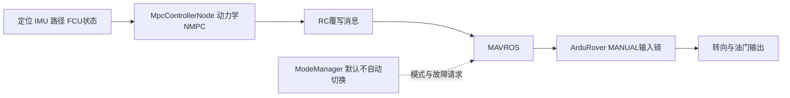
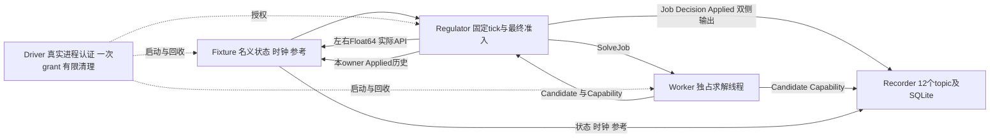

# 方案A：主线进度、代码改动与后续实施详解

记录日期：2026-10-21。主线结果截至51批封存及52批复核；活动工作区并行快照时间为**2026-10-21 20:34:29（北京时间）**。代码工作区：`/home/trevor/USV`；本批交付：`/home/trevor/MPC/scheme_A_mainline_status_and_plan_20261021_52`。用户已确认另一个任务在并行修改，本文保留这些变化并单列，不把51历史测试自动授予当前新版本。

**目前已经走到“新的Regulator成为唯一输出者并完成有限正常运行，正在补当前执行版本的故障与退出证据”。还没有完成完整M4、F6或P1验收。** 最近完成了两件实质工作：49批取得正常唯一出口组件证据，50批补齐发布/退出的源码关联故障子组件；51批纠正了实船B被错误写成GUIDED的契约。52批把这些结果及授权工作区差异接回主线，完成当前资产复核和下一运行包的代码分析。

本文件同时说明历史过程和当前有效状态。旧记录中“未交付”“未冻结”“工作区clean”等描述只对应当时，不能不加日期地拿来代表今天。

## 1. 先统一三个容易混淆的名称

| 名称 | 实际含义 | 本项目应采用的约束 |
| --- | --- | --- |
| 研究方案A | 在线模型/计划切换、独立执行监管、输入年龄与版本管理、后续备份一致性的研究路线 | 先基于仓库动力学NMPC做P1，不等于已经实现GP、PPO或安全备份 |
| 仓库`scheme=B` | `usv_mpc_cpp`动力学NMPC | 实船固定为**MANUAL＋RC覆写**，不是GUIDED |
| 仓库`scheme=A` | `usv_mpc_kinematic_cpp`运动学速度指令后端 | 独立的GUIDED速度setpoint配置，不能套到动力学B |

用户原契约在[原实施方案第108行](/home/trevor/MPC/01_MPC_Project/01_实施方案/implementation_plan.md:108)和第632项明确要求MANUAL。研究名称A不能成为改变实船B模式的理由。

## 2. 当前到底完成到哪一层

| 层次 | 当前状态 | 能据此得出的结论 | 仍不能据此得出的结论 |
| --- | --- | --- | --- |
| P0/F1～F5基础修复与冻结 | 已有历史代码和证据 | deadline、实际命令历史、输入冻结、观测契约等基础已经建立 | 不自动证明后续任何派生版本或实船正确 |
| owned端点/有效配置/C3观察 | 多批组件闭合 | 真实PID、启动身份、GID、角色、配置和Source可对应，外来输入可拒绝 | 不能仅凭拒绝反例证明正常业务可用 |
| 当前有限动态来源 | 已取得组件证据 | 一致名义源下有真实非零锚点、动态Job和连续接纳 | 不自动覆盖原F5完整plant/reference、一般转弯/mixed/1.2m/s域 |
| B4来源/政策适用审查 | 43～46批形成选定有限域台账 | 参数、来源、政策和版本有明确依据 | 不是任意域内的时钟硬界或安全保证 |
| B5/M0b选定工程冻结 | **47批已完成** | 正式v3合同、政策、profile和证据索引真实冻结 | 合同中的资格marker不等于实际生产输出释放 |
| M4正常唯一出口组件 | **49批通过** | 新Regulator在隔离nominal中独占左右实际发布API，完整正常流满足冻结预算 | 不等于完整M4故障矩阵或实船接管验收 |
| M4发布/退出故障子组件 | **50批通过** | exact49源码下partial、Applied失败、zero/grace/clear组合有受控证据 | 不等于真实Worker death、native阻塞、lease/watchdog及现场完整记录通过 |
| 实船B模式契约纠正 | **51批源码/配置及30项检查通过** | B恢复MANUAL＋RC覆写，模式管理器不再硬编码GUIDED | 不等于已认证实船部署或物理停船 |
| 完整M4阶段 | **未验收** | 已有正常和若干故障子证据，可按差集继续收口 | 不能把不同版本测试数量相加后直接写“整阶段通过” |
| F6已知数值模型事务 | **有设计和API依据，实际事务未实现/验收** | 现有生成图支持有限两模型实现路径 | 不能只改generation数字就称模型原子切换 |
| 完整P1 | **部分完成，未验收** | 主线已明显推进到执行与事务闭合阶段 | 不能宣布研究方案A整体完成 |
| P2～P5及研究结论 | 后续工作 | 可在P1稳定后继续设计 | 当前无完整碰撞证书、递归可行性、概率保证、性能优越性或GP合格数据结论 |

这里不报“完成百分之多少”：剩余义务不是等权清单，模型事务与真实故障不能用更多简单测试抵消。

### 2.1 最近三批的关键数字

| 批次 | 可复核结果 | 正确解释 |
| --- | --- | --- |
| 49 | 20.001765169s动态来源；101个动态Job；窗内100/100决策接纳；105对、210次控制API；4053条Stored；四角色仅INT、RC0、组空 | 隔离nominal正常唯一出口组件通过；实际ROS API不是plant接受证明 |
| 50 | 16项源码关联用例；28对私有控制调用、56次RCL入口；43条控制消息＋27条Applied独立解码对应；14次声明注入错误；4个证据篡改反例拒绝 | 私有topic、显式测试种子和return seam的组件结果；四角色实际M4故障run数量仍为0 |
| 51 | 18控制器回归＋6私有模式服务＋6有效launch/YAML检查，共30项最终通过；11项受跟踪文件修改＋3项新增 | 实船B源码/配置契约纠正；不是一次实船航行或新M4运行 |
| 52本轮 | 初始14文件/18,263字节patch与51一致；随后正确发现并行变化。20:34:29快照含16项受跟踪修改、4项未跟踪文件；当前patch24,950字节；47冻结4103项无失配，47/49/50/51封存包完整 | 旧基线严格复查失败保留；新并行快照与选定冻结资产核验完成；没有新控制运行或对并行版本的新测试资格 |

49最大完整流API间隔左200.139220ms、右200.174616ms，最大pair span0.100671ms、tick启动迟差0.840588ms；对应冻结上限分别为240ms、5ms、20ms。这些是本次有限观测，不是硬实时/WCET证明。

## 3. 当前代码实际上分成两条执行链

### 3.1 实船B活动业务链



这一条链的主入口在[mpc_node.cpp](/home/trevor/USV/usv_mpc_ws/src/usv_mpc_cpp/src/mpc_node.cpp)。51批修正了模式默认值、配置及模式管理器，不改水动力、Q/R/Rd、RTI、推力映射或固件。源码里允许发布RC消息，不能代替FCU实际采用输入的验证；MANUAL内部仍有其输入处理、映射和限制，不能把它描述成完全没有飞控处理的裸推进器接口。

### 3.2 当前研究M4有限隔离链



49是四角色：Regulator、Worker、Fixture、Recorder。Driver管理进程但不是额外ROS参与者；Witness在已有节点内记录观察，不应把它说成第五个独立控制进程。旧阶段的controlled Publisher在49正常唯一出口链中已不再作为输出owner。

这条链目前用Float64名义执行接口，**没有据此完成研究Regulator到实船RC覆写后端的接管适配**。研究采用动力学B求解基线，与“当前隔离输出接口已经是实船MANUAL链”是两件事。后续实船扩展必须显式设计RC后端及其Applied事实，不能把210次ROS API成功改称实船推进器执行成功。

### 3.3 一拍中各层分别负责什么

1. 输入回调记录真实源戳、接收steady时间、任务/路径版本和执行历史。
2. 准备线程在既定规则下冻结Job；输入资格与实际冻结有明确提交边界，不能用旧预检查结果掩盖期间变化。
3. Worker校验身份和完整Job，在独占backend中求解，返回候选及完整Job回显。
4. Regulator按固定tick检查绝对deadline、目标、版本、状态误差、实际逐侧锚点及来源，决定是否激活。
5. 输出线程串行尝试左右API，逐侧保存实际起始时间、返回结果与known状态；左失败仍尝试右，成功侧不可回滚。
6. Applied表达本owner实际API事实。它不是实测推力，也不证明plant收到。
7. Source、接收wire、Stored、Witness和进程退出分别核验，不能相互改名。

## 4. 从基础修复到当前主线，依次做了什么

### 4.1 基础与C3早期：10月3日至第12批

此前已有[从基线修复到C3.3逐步讲解](/home/trevor/MPC/方案A_从基线修复到C3_3_逐步讲解_2026-10-12.md)，本节承接该文，不改写旧记录。

| 步骤 | 主要变化 | 作用 |
| --- | --- | --- |
| P0三类基础修复 | 区分求解返回与deadline内有效解；建立真实已发布命令锚点；处理参考时间/输入资格等基础问题 | 防止“求解成功”但实际输出超期或后续约束使用错误历史 |
| F1/F2 | 固定修复后的基线及状态/命令/时间最小契约 | 后续比较有可复现起点 |
| F3 | 同参数模型/参考对拍、四元数准入 | 避免观测姿态、模型或参考不一致污染结论 |
| F4 | controller/plant配置分开，记录实际参考和返回预测 | 区分设计模型、模拟对象与日志里真正使用的输入 |
| F5 | 资格复查与输入冻结放进同一把锁 | 防止检查通过后输入又变，实际解算却未对应已验证快照 |
| 独立执行原型 | 拆Worker、监管器与固定tick；补候选异常、Worker生死/租约、跳拍和消息资源责任 | 把慢求解与固定节拍执行分开 |
| 资源/观察/记录 | 正式合同、队列压力、Witness、Source/输送分账和入队失败失效 | 记录可解释的事实，而非只看一个pass布尔值 |
| S0/S1及C3前期 | 当前资产、真实端点、有效配置、来源重建、同锁快照与原始候选预像 | 证明“谁在发布、用什么参数、哪些输入真的进入判断” |

这些工作提供了机制基础；早期许多正常场景实际Accepted仍为0，不能追授正常业务资格。

### 4.2 第13～19批：从身份可信转到真正阳性链

| 批次 | 改动与发现 | 起到的作用及边界 |
| --- | --- | --- |
| 13 | Worker两接口认证、Witness-v2观察；239项原生检查和有限owned审计 | 身份/配置/观察链推进；BusinessReady仍0 |
| 14 | owner实际关闭、queued terminal tail等9个关闭场景 | 正常关闭与失败关闭分账；不等于正常业务成立 |
| 15 | Worker退出后的双接口拒绝、Driver提前失败清理 | 验证死亡旧实例不能继续提供有效输入 |
| 16 | foreign producer、实际multiwriter/GID拒绝及CDR对应 | 外来输入被拒且锚点不变；Accepted仍0 |
| 17 | 只读追查7组正例：152次求解/登记，145次实际激活全部anchor_mismatch | 找到来源与冻结窗口假设冲突，承认外围负例优先过头，转向阳性链 |
| 18 | 新受控相位握手，实际Applied驱动名义动力学；零平衡、真变化及动态链逐步确认 | 第一次形成输入与执行历史一致的阳性来源；不是真船plant |
| 19 | Fixture增量checkpoint模型，迟到Applied回退重传播 | 四档有限20秒来源合计408/408接纳；发现速度相对profile偏高，不能声称性能合格 |

关键思想转变：不再把一个独立变化的F5来源和“冻结窗输入保持不变”的假设硬拼；也不再拿零合成状态配非零推力预测。先让模拟来源按实际Applied历史推进，再检查控制与时间门禁。

### 4.3 第20～29批：参考语义、启动与激活竞争修复

| 批次 | 主要工作 | 结果与意义 |
| --- | --- | --- |
| 20 | 审计最近点/offset机器码，offset2→0及投影参考语义 | 首档101/101，修正稳态偏差；新增诊断RMSE门仍失败 |
| 21 | 固定任务时间epoch在首次实际提交时绑定；修实际构造入口 | 参考时钟不再随意重锚；暴露path/profile配对后缺重试 |
| 22 | 配对完成提交后，在原锁和原资格门下触发maybe_enqueue | 首档100/100连续接纳；不是放宽输入、deadline或相位规则 |
| 23 | 102实际Job离线复现，区分native计算、等激活与首API等待 | 证据不支持直接增加RTI作为闭环修复 |
| 24 | 固定首控/尾序列离线探针 | 更快首拍是否更贵依赖比较方式，不能只凭局部探针部署常数首控 |
| 25 | 固定首控后重新优化尾部 | 明确额外等式改变可行集，不能当作原问题免费改进 |
| 26 | 因果冷启动候选：只读当前Job和本次求解结果 | 离线机制推进，尚未修改运行Worker |
| 27 | 集成owned Worker因果冷启动 | 首候选.5/.5N产生但激活拒绝；暴露目标时刻/状态竞争 |
| 28 | 32帧有界状态历史、因果选择、最多一次完整重捕获重验 | 首.5N实际接受；仍有二次竞争，发现重JSON进入验证窗 |
| 29 | 轻量ActivationCapture，完整JSON推迟到最终提交和原publish返回后 | 101/101、测量窗零激活拒绝，正常链恢复；诊断半RMSE仍NoGo，按停止条件结束调参支线 |

这里保留两个重要结论：

- 半RMSE门来自20批的诊断预注册，不是原P1数值验收门。旧NoGo保留，不能持续追加为P1前置。
- 23～26主要是离线分析，并不是每批都改了实际控制器或运行了闭环；27～29才是对应运行版本集成。

### 4.4 第30～37批：回到架构，补发布事实与真实监督

| 批次 | 主要改动 | 作用与限制 |
| --- | --- | --- |
| 30 | P1条件—代码—证据审查，有限模型事务设计 | 停止首控/权重调参；发现现有NP_GLOBAL30支持有限两模型路径，但事务未实现 |
| 31 | B4适用性登记，81字段/19水动力/角色版本台账 | 参数含义和来源有据；补交共享盘故障期间24～30批7档5411文件 |
| 32 | 共享publication_result_v1.hpp，runtime publish/finish_tick使用同实现 | API start、成功、known、partial、gap/span/rate、HOLD/ramp/shutdown分账；当时仍是注入组件 |
| 33 | 实际DiagSink队列满故障；将arm移到认证phase/Applied确认之后 | 真实日志故障路径推进，正常Source资格false保留；execute分支不能继承shadow“该拍无API” |
| 34 | 独立故障自关闭profile及回溯审计 | 不再要求已死Observer补正常ACK；回溯结果不冒充事前成功 |
| 35 | pre-native阻塞与capability receipt租约分开刺激 | 心跳继续不等于native健康；仍缺及时监督stop闭环 |
| 36 | Source FD/inode绑定的监督桥，记录终结到真实信号及组空 | 认证后有限INT/TERM/KILL升级；.5/1/1秒是各阶段预算，不是.5秒总时限 |
| 37 | shadow一次性输入交错，实际回调在复制后/commit前更新 | 第一轮拒变更、第二轮完整重验；不扩大为所有时钟/任务失效已覆盖 |

### 4.5 第38～46批：解决准备/业务启动互相干扰，形成正式冻结来源

| 批次 | 主要工作 | 实际推进 |
| --- | --- | --- |
| 38 | 普通监督器，无需诊断SIGSTOP | 三次真实尝试均因启动/接口前提失败，全部保留，没有写成监督通过 |
| 39 | 认证单次业务启动门：端点/参数/Recorder/owner准备完再开业务 | 门前Job/Decision0；门后active故障→普通监督INT-only和有限退出闭合 |
| 40 | 当前门控组合的V1真实Sink故障确认 | 复用ELF、无重建；Observer预期异常退出和normal=false如实保留 |
| 41 | 当前组合普通receipt lease失效及旧队列回调拒绝 | 旧实例不能在失效后被回调复活 |
| 42 | lease后新身份healthy run和normal tail | 新实例恢复得到有限证据，不以原失效实例“自愈”代替 |
| 43 | B4八组政策与来源实审，发现跨语言合同/入口不兼容 | 修正“当前配置直接可冻”的错误前提；旧启动gap1.4～1.6秒保留 |
| 44 | 同源spec生成Python/Native规则，正式84字段准备合同 | 恢复类型/形状/profile/marker一致性；seeded准备不等于真实端点 |
| 45 | 实际formal prepare/close，四角色真实身份和配置，一次grant | Job/Decision/Applied/API0，证明准备关闭组件，不是Regulator执行 |
| 46 | 当前五ELF连续动态来源窗与独立审计、B5候选台账 | 20.002935074秒、101动态Job、窗内100/100，完整记录与关闭；旧启动gap未改称240ms通过 |

原M0b允许独立shadow或no_output校准；45准备及46正常来源已经各自完成。不能再增加“必须完整no_output业务长跑”或“先取得首次execute数据才能冻结”作为新门槛。

### 4.6 第47～52批：正式冻结、唯一输出及回到实船B契约

| 批次 | 主要工作 | 当前结果 |
| --- | --- | --- |
| 47 | 固定正式profile、owner/bootstrap政策，提交真实合同与证据索引 | B5/M0b选定有限工程冻结通过；4103项、373401307字节；普通生产释放关闭 |
| 48 | 新Regulator/Worker/Fixture及原生GID/配置接口 | 构建和组件通过；唯一实际run在Recorder与未来Regulator Writer之间互等，API0，失败保留 |
| 49 | 拆Recorder process-only认证与完整记录就绪；完整门禁后才grant | 新版本一次正常run通过，20秒动态来源与完整API/Stored/退出审计闭合 |
| 50 | exact49源码的实际发布/锚点/Applied/关闭组合测试 | 16项、70条私有接收消息核验通过；仍无四角色现场故障run |
| 51 | 纠正实船B的MANUAL＋RC覆写契约 | 11改＋3增、30项最终检查通过；原错误注释和各失败保留在归档 |
| 52 | 主线状态汇总，承接51授权dirty基线及当前安装观察，细化R1/R2 | 本轮静态/字节核验通过，文档与可复用基线工具形成；不冒称新故障run通过 |

48的问题是生命周期依赖环，不是求解器拒绝：Driver等完整Recorder，Recorder等Regulator五个未来Writer，Regulator又要求完整Recorder pin。49允许已认证且无API的Regulator先建端点，完整Recorder/Reader/源门闭合之后才授权输出，因而解除互等而不降低记录要求。

## 5. “一直拒绝”应怎样区分

| 看到的现象 | 真实含义 | 是否算推进 |
| --- | --- | --- |
| 篡改/外来/晚到候选按预期被拒 | 反例验证通过 | 是，但仅对应防护组件，不能代替阳性运行 |
| 本应正常的场景全部anchor_mismatch | 正常来源和政策假设冲突 | 是真实失败，需要像17～19那样改来源机制，不能包装为反例通过 |
| 半RMSE诊断NoGo | 某项性能候选未达预注册目标 | 结果要留，但不是无限调参的P1前置 |
| 48准备互等 | 端点生命周期流程错误，业务尚未开始 | 修流程，不调模型或权重；49已给出新版本成功证据 |
| 组件pass、阶段仍false | 阶段还有不同义务未完成 | 不是否定组件成果，也不能靠累计测试数量提升阶段 |
| 51首轮解析失败、最终v4通过 | 测试夹具/日志环境及新增参数类型问题逐项修正 | 首轮失败仍保留，最终按当前有效版本判定，不改写历史 |

过去确实存在绕路：早期外围反例优先过多，20～29追性能诊断较久，38连续启动前提错误，43才补齐合同兼容性，MANUAL/GUIDED契约也漏审。纠偏方向是按原依赖推进到未闭合义务，而不是重新扩大准备、正常来源或调参范围。

## 6. 改了哪些文件：先看51批已验证的14文件集合

以下是51批授权改动的历史已验证集合；52开始时逐字一致，但随后并行任务继续修改了其中部分文件并迁移文档。前11项是51当时的受跟踪文件修改，后3项为当时新增。下表描述51当轮作用，当前新增差异见6.2；本轮未commit、reset或stash。

| 文件 | 51当轮修改了什么 | 51验证范围及当前说明 |
| --- | --- | --- |
| [mpc_params.yaml](/home/trevor/USV/usv_mpc_ws/src/usv_bringup/config/mpc_params.yaml:7) | 显式RC输出、FCU状态检查开启、MANUAL白名单 | 动态B通用配置不再依赖错误默认；YAML检查 |
| [mpc_params_B.yaml](/home/trevor/USV/usv_mpc_ws/src/usv_bringup/config/mpc_params_B.yaml:7) | 同上 | 实船B入口明确模式契约 |
| [safety_params.yaml](/home/trevor/USV/usv_mpc_ws/src/usv_bringup/config/safety_params.yaml:5) | 当时显式mpc_fcu_mode=MANUAL、自动切换false | 当前并行任务已移除该文件中的重复键，改由launch/节点默认确定，见6.2 |
| [real.launch.py](/home/trevor/USV/usv_mpc_ws/src/usv_bringup/launch/real.launch.py:214) | B=MANUAL/运动学A=GUIDED；模式数组使用显式List[str] | 实际参数层解析与C++声明类型一致 |
| [sitl.launch.py](/home/trevor/USV/usv_mpc_ws/src/usv_bringup/launch/sitl.launch.py:168) | 按方案传ModeManager目标并修说明 | B不再被共用GUIDED逻辑拉回；条件分支解析检查 |
| [mpc_node.hpp](/home/trevor/USV/usv_mpc_ws/src/usv_mpc_cpp/include/usv_mpc_cpp/mpc_node.hpp:209) | 成员默认白名单改MANUAL | 成员与声明/配置保持一致 |
| [mpc_node.cpp](/home/trevor/USV/usv_mpc_ws/src/usv_mpc_cpp/src/mpc_node.cpp:225) | 声明默认MANUAL；RC后端严格拒绝其他白名单；删除错误GUIDED检查 | MANUAL可解算、GUIDED状态/配置拒绝及原deadline回归 |
| [test_deadline_control.cpp](/home/trevor/USV/usv_mpc_ws/src/usv_mpc_cpp/test/test_deadline_control.cpp) | 新增模式资格与错误配置回归 | 与原输出/超时/锚点/退出共18项通过 |
| [safety CMakeLists.txt](/home/trevor/USV/usv_mpc_ws/src/usv_safety_cpp/CMakeLists.txt) | 注册真实ModeManager私有服务测试 | 后续常规构建可执行对应回归 |
| [mode_manager_node.hpp](/home/trevor/USV/usv_mpc_ws/src/usv_safety_cpp/include/usv_safety_cpp/mode_manager_node.hpp:93) | 配置目标成员及测试friend | 不增加生产故障hook |
| [mode_manager_node.cpp](/home/trevor/USV/usv_mpc_ws/src/usv_safety_cpp/src/mode_manager_node.cpp:115) | 默认关闭自动切换；读取/校验目标；实际分支用配置目标；纠正超时泛化注释 | 6项私有模拟服务检查，人工冷却和独立运动学目标保持 |
| [51归档契约说明](/home/trevor/USV/.sgh-research/experiments/scheme_B_MANUAL_contract_20261021_51/after/docs/scheme_B_manual_rc_contract.md)（当时新增） | 固定实船B模式及与研究A、运动学A的区别 | 当时活动路径为docs/scheme_B_manual_rc_contract.md，当前并行迁移见6.2 |
| [test_fcu_mode_contract.py](/home/trevor/USV/usv_mpc_ws/src/usv_bringup/test/test_fcu_mode_contract.py)（新增） | 实际解析real/SITL、尊重Node条件、严格数组类型、日志限测试目录 | 6项最终通过，不执行Node |
| [test_mode_manager_contract.cpp](/home/trevor/USV/usv_mpc_ws/src/usv_safety_cpp/test/test_mode_manager_contract.cpp)（新增） | 通过私有mock观察真实模式请求 | B请求MANUAL、已MANUAL不请求GUIDED、默认不开自动、冷却/无效值等 |

这些改动没有调整Q/R/Rd、19项水动力、RTI次数、推力上下界/变化率、RC映射或固件。

### 6.1 不要把“活动源码”“隔离新ELF”“当前install”写成同一件事

- 51当轮：活动源码/配置纠正，两个节点在51独立build目录编译验证；当轮没有执行install或接FCU。
- 52采样观察：install中的MPC和ModeManager包含新的MANUAL校验/目标标记，不能再称仍是旧GUIDED节点；各次完整SHA、解析路径与时间见`evidence/current_baseline_adoption_v1.json`及`evidence/parallel_aware_checkpoint_v2.json`。并行构建可能继续改变安装文件，不将一次采样写成永久状态。
- 它们与51隔离ELF哈希不同，不能仅凭不同hash判断版本新旧，也不能仅凭strings标记认定完整部署通过。当前构建来源、参数绑定及真实启动身份尚未由独立部署manifest认证。
- 当前install的real.launch.py及B.yaml为独立普通文件，内容SHA与活动源码一致；51当时查询为symlink。形式变化来源未由本轮证明，旧记录保留。当前内容一致不能推出今后编辑源码会自动传播到install。

因此后续实船部署应单列“实际ELF＋实际参数层＋实际固件/RC接入”的认证；不把历史“未install”无时间限定地套到今天，也不把当前marker当实船接管验收。

另一个需要分清的配置口径是：当前活动B.yaml的普通节点`max_solve_time_ms=200.0`，研究47冻结profile的绝对候选deadline为150ms、T为200ms。51只纠正模式契约，没有把这两条入口的配置自动统一。当前M4判据按其冻结合同判断；未来实船RC接管必须明确采用哪个profile和实际有效参数，不能因为都叫“动力学B”就声称配置已完全相同，也不能临场换阈值求通过。

### 6.2 用户确认的并行任务变化：截至20:34:29快照

52开始之后，严格按51状态核验的工具发现了新差异，正确返回失败，原输出保留在`evidence/final_baseline_adoption_v1.json`。用户随后明确回复“有其他任务在修改，保留并标注”。本轮没有撤销或覆盖任何并行改动，也没有把旧检查器改成对它们静默放行。

下面描述来自本批保存的时点快照；并行任务可以在此后继续变化。所有原文件内容、hash、diff及缺失旧路径见`evidence/parallel_snapshot_v2/manifest.json`，不是只列文件名。

| 相对51/HEAD的新增或变化 | 快照中看到了什么 | 本文怎样判定 |
| --- | --- | --- |
| safety_params.yaml | 移除重复mpc_fcu_mode/auto_mode_switch键，说明real/SITL显式传入、直接运行使用代码默认 | 静态检查仍是B=MANUAL/自动false；不把51旧YAML测试自动授予当前文件 |
| 动态mpc_node.cpp | include排序和空行整理 | 未见严格MANUAL门禁改变；当前文件hash已不同于51 |
| test_mode_manager_contract.cpp | 版权、include和格式整理 | 断言语义静态看未变，当前全套重新构建/测试未由本轮认证 |
| 动态mpc_node_main.cpp | 构造期std::exception捕获、日志、shutdown、return1 | 新增入口退出行为，51的30项不能替代它的验证 |
| 运动学mpc_node_main.cpp | 同类构造异常退出处理 | 不涉及B改GUIDED；新入口行为须有对应版本证据 |
| usv_safety_cpp/src/main.cpp | ModeManager构造异常转可读日志及RC1 | 不等于已经验证实际启动失败、服务/进程清理 |
| usv_mpc_ws/docs/pi_fcu_link_dataflow.md | 并行更新数据流与模式说明 | 作为当前文档差异保留，非新的运行证据 |
| usv_mpc_ws/docs/topic_contract.md | 并行更新话题/模式契约说明 | 同上 |
| 契约说明路径迁移 | 旧docs/scheme_B_manual_rc_contract.md已不在活动路径，新位置为usv_mpc_ws/docs/scheme_B_manual_rc_contract.md | 51旧副本保留；当前副本内容以本批快照为准，不把迁移当删除旧证据 |

该时点为16项受跟踪修改＋4项未跟踪普通文件；后者包含原本就有的.zcodeignore。因此不能把它描述成“20项本轮新改动”。51原14路径中有文档迁移、部分文件继续变化，当前tracked patch为24,950字节，SHA `af797f034828b2479fed96fa8ce2c16b00d1bd43e08b4da8e5be3faa9b4443d5`。

这些工作区变化与47冻结输入的直接/解析路径交集为0，选定冻结4103项仍逐字一致。下一研究包可在独立作者树继续，但每次运行必须锁定实际选用的source/bin/config/工具和加载依赖；无需要求另一任务停止或把整个仓库恢复clean。若选中输入被并行修改，则记录新版本、按差集验证，不能把旧资格自动搬过去。

## 7. 研究代码改动主要在隔离作者树中

多数主线研究并没有反复覆盖默认业务源码，而是在每批`author`或历史架构目录内派生版本、独立构建、单独注册。旧版本和失败仍可逐字复核。

| 关键文件/文件族 | 负责什么 | 当前处理方式 |
| --- | --- | --- |
| [49 Regulator](/home/trevor/USV/.sgh-research/experiments/scheme_A_M4_recorder_bootstrap_20261021_49/author/observer/src/shadow/regulator_owned_execute.cpp) | 固定tick、Job准备、最终准入、唯一左右出口、Applied与退出 | 49正常及50组件对应的实际源；下一故障包先保持核心不变 |
| [49 Worker](/home/trevor/USV/.sgh-research/experiments/scheme_A_M4_recorder_bootstrap_20261021_49/author/worker/solver_worker_m4.cpp) | 独占求解线程、能力与候选、真实Driver/配置认证 | R1/R2需重新编译身份绑定，work数值循环不应改 |
| [49 Fixture](/home/trevor/USV/.sgh-research/experiments/scheme_A_M4_recorder_bootstrap_20261021_49/author/fixture/synthetic_source_m4.cpp) | 名义状态/时钟/参考，按本owner实际Applied推进 | 不是真实plant；R1/R2保持模型和参考不变 |
| [49 Driver](/home/trevor/USV/.sgh-research/experiments/scheme_A_M4_recorder_bootstrap_20261021_49/author/owned_m4_driver_v1.py) | 认证四角色、完整准备、一次grant、正常观察和清理 | 下一包派生fault Driver，不能在原件上改或重试旧run |
| [recorder_process_pin_v1.hpp](/home/trevor/USV/.sgh-research/experiments/scheme_A_M4_recorder_bootstrap_20261021_49/author/common/recorder_process_pin_v1.hpp) | 区分真实进程认证与完整记录就绪 | 49解除依赖环；process-only不能授予API权限 |
| [formal_owned_runtime.hpp](/home/trevor/USV/.sgh-research/experiments/scheme_A_M4_recorder_bootstrap_20261021_49/author/common/formal_owned_runtime.hpp) | 实际进程、源码/ELF、Driver SHA、typed配置等认证 | 不能为复用ELF而放松绑定 |
| [m4_owned_runtime.hpp](/home/trevor/USV/.sgh-research/experiments/scheme_A_M4_recorder_bootstrap_20261021_49/author/common/m4_owned_runtime.hpp) | 原生GID、精确Writer/Reader图、context与grant字段 | 实际FastDDS16字节GID用32hex，不能补零模拟旧24字节格式 |
| [publication_result_v1.hpp](/home/trevor/USV/.sgh-research/experiments/scheme_A_M4_recorder_bootstrap_20261021_49/author/observer/src/shadow/publication_result_v1.hpp) | 串行双侧尝试、逐侧锚点、partial、shutdown分账 | 50已验证实际Regulator组合的有限子范围 |
| activation_sensor_history_v1.hpp、ActivationCapture、materialize_activation_trace | 因果状态选择、有限完整重验、提交后观察材料化 | 避免把重JSON放进激活竞争窗口 |
| task_time_profile_v1.hpp、task_time_entry_contract_v1.hpp | 固定任务时间参考和严格入口 | 模型事务时需特别审查model generation与任务epoch关系 |
| [47同源spec/生成器](/home/trevor/USV/.sgh-research/experiments/scheme_A_formal_execute_profile_20261020_47/implementation/current_contract_spec_v1.json) | Python/C++类型、资源、profile语义同源 | 不重新发明schema或改阈值制造通过 |
| [47冻结索引](/home/trevor/USV/.sgh-research/experiments/scheme_A_formal_execute_profile_20261020_47/freeze/freeze_index_v1.json) | 4103项源码/bin/参数/证据精确绑定 | 原件不修改；新ELF登记在下一包registry，不回填旧索引 |
| [49独立正常审计](/home/trevor/USV/.sgh-research/experiments/scheme_A_M4_recorder_bootstrap_20261021_49/audit_normal_v1.py) | Source、真实wire、Stored及全API流核对 | 故障审计要派生，不能继续用全normal断言 |
| [50独立组件审计](/home/trevor/USV/.sgh-research/experiments/scheme_A_M4_publication_faults_20261021_50/audit_component_v1.py) | 真实私有CDR与逐侧结果、terminal、退出对应 | 不代替下一次真实owned故障运行 |

### 7.1 历史24项集合应该如何理解

早期保护记录中的24项业务差异为151,961字节、SHA `d901511293df5be4aecb988509e4c4107977dc7c05f042286869c36e0a239ba5`，在48批开始之前已经等字节进入当前HEAD的历史提交。它是当时被保护的既有工作区集合，不能全部归因于本轮，也不能说今天仍是24项未提交修改。

这24项见文末附录。其范围包含记录/配置、动态与运动学节点、RL导出和可视化；**受保护集合里出现RL文件不代表本轮研究已接入或训练PPO**。本轮真实未提交集合是51的11改＋3增。

## 8. 本轮52批实际推进了什么

新增[adopt_mainline_baseline_v1.py](/home/trevor/USV/.sgh-research/experiments/scheme_A_mainline_status_and_plan_20261021_52/implementation/adopt_mainline_baseline_v1.py)，只读核验：

1. 初始HEAD/分支/完整porcelain状态与51记录一致，暂存为空。
2. 初始14文件与51的after快照及SHA一致，授权patch恰为18,263字节；这是当时的验证结果，不是并行变化之后的断言。
3. 47、49、50、51封存包人口、成员hash与交付回执一致，分别396/533/262/282个普通文件。
4. 47实际冻结输入4103项全量重读，失配0；不把“形状像SHA”当身份。
5. 当前安装文件类型、解析路径、mtime、SHA及MANUAL标记单独记账；不反写51历史观察或授予部署资格。

该工具没有调用旧保护器来伪造“工作区clean”，也没有重置用户修正。初始通过记录在`evidence/current_baseline_adoption_v1.json`，随后严格复查失败亦保留。新增[snapshot_parallel_workspace_v2.py](/home/trevor/USV/.sgh-research/experiments/scheme_A_mainline_status_and_plan_20261021_52/implementation/snapshot_parallel_workspace_v2.py)捕获用户确认的并行版本，并独立复核封存包与47选定输入；其结果在`evidence/parallel_aware_checkpoint_v2.json`。v2通过指快照/关键资产核验，不表示当前并行源码重新取得51的30项资格。

本轮不启动新ROS故障run、不修改生产控制算法；新增的是可复用基线承接工具、独立复核结论、阶段台账和具体代码实施方案。下面的R1/R2是**下一包待实现内容**，不能在状态表中提前勾成通过。

## 9. 下一包先做什么：两个实际owned故障case

固定顺序：**承接当前基线 → 新fault Driver/身份绑定 → R1 grant前取消 → R2 Worker退出 → 其余原矩阵与来源范围收口 → 已知模型事务/F6 → 原P1联合复判。**

### 9.1 文件修改计划

以下是下一独立运行包拟新增的相对路径，不表示这些文件已经存在或实现。

| 拟新增文件 | 从哪里派生 | 具体改法 | 保持不动的内容 |
| --- | --- | --- | --- |
| `author/owned_m4_fault_driver_v1.py` | 49 owned_m4_driver_v1.py | 正常20秒观察改为case状态机；保留实际身份认证，增加一次性刺激、预期退出分类 | process/verify_bundle/peer_pin/spawn/authenticate、create-only和有限清理原则 |
| `implementation/R1_registration_v1.json` | 49 normal_registration | 固定ready之后、grant之前的取消点、run/版本/预算/退出预期 | 冻结合同、domain120/localhost、自动重试0 |
| `implementation/R2_registration_v1.json` | 同上 | 固定首次真实接纳后Worker退出刺激、信号/RC/Source例外及观察结束条件 | 禁止临场更换刺激或扩大允许例外 |
| `build_runtime_fault_v1.py` | 49 build_runtime_v1.py | 仅重建必要身份壳，生成新bundle和compiler依赖 | 不重建数值生成图，不install覆盖旧版本 |
| `seal_selected_runtime_fault_v1.py` | 49 registry封存工具 | 新Driver SHA、三角色ELF、旧Recorder及真实LDD/bundle绑定 | 不回填或修改47/49/50冻结原件 |
| `run_fault_once_v1.py` | 49 run_once_v1.py | subreaper与owned组清理保留，按case判结果 | 不把所有故障一律要求四角色RC0 |
| `audit_fault_v1.py` | 49独立审计 | 复用真实解码/逐侧API/全流核对；替换正常窗和预登记故障例外 | 不篡改原49审计、Source或回执 |
| `postrun/*coverage*.json` | 50原9组台账 | 只提升本次真正闭合的子项 | 不能用R1/R2直接关闭全部M4 |

### 9.2 为什么恰好要重建三个角色，而不是只改Driver

49的CMake `link_owned`把`P1_DRIVER_TOOL_SHA256`和`P1_OWNED_SOURCE_BUNDLE_SHA256`编入三个runtime目标。`formal_owned::driver_peer`同时核对manifest里的Driver SHA、磁盘Driver文件SHA和编译宏，还认证实际argv中的`-B`与脚本路径。

| 角色/库 | 下一包处理 | 原因 |
| --- | --- | --- |
| Regulator | 重新编译身份壳 | 构造函数认证Driver |
| Worker | 重新编译身份壳 | 构造函数也认证Driver，不能只给Regulator换宏 |
| Fixture | 重新编译身份壳 | 同样绑定Driver，不能沿用旧Driver SHA |
| Recorder | 可复用原ELF | 没有Driver SHA宏/Driver pin参数，仍须重新认证本run进程、boot、contract、topics和完整Reader |
| 求解器库/19项水动力/参考生成器/codegen | 没有理由重建或调参 | R1/R2改变监督流程，不改变数值业务 |

因此不能通过放松Driver认证来复用三个旧ELF，也不应无差别重写Worker::work或数值模型。重新构建身份壳后，应再次证明核心方法/模型/参考字节保持、实际加载库已绑定。

### 9.3 R1：完整准备之后、一次grant之前取消

选择一个清楚且可观测的边界：四角色认证完成，Recorder完整manifest已认证，Regulator的真实ready.json已产生，grant.json尚不存在。然后对认证过的Regulator发送SIGINT，再关闭其余角色。

```text
启动并认证四角色
等待实际完整Recorder与Regulator ready
断言grant文件尚未创建、未出现Job/Decision/控制API
向认证Regulator发一次INT
按原有限顺序关闭Fixture/Worker/Recorder
按R1注册判退出、Source/Stored及owned组为空
```

Regulator的`poll_owned_start`已经有取消分支，记录`owned_prepare_closed_before_API`，无需为首个R1改控制算法。应确认prep/tick业务线程没有启动，控制API0，process-only没有被当成完整记录就绪。各角色预期退出码须在运行前依据实际关闭路径固定，不在看到结果后补允许值。

如果后续需要测完整Recorder出现之前取消，应另注册独立case，不能把本次刺激点临时前移。R1不是一次新的20秒no_output业务校准。

### 9.4 R2：首次真实接纳之后，Worker受控退出

刺激条件必须来自实际执行事实：看到完整的accepted API pair、左右成功及相应来源记录后，再对已登记Worker施加一次预登记退出刺激。不能仅看到Candidate登记就声称实际业务已激活。

```text
完成实际owned准备并创建一次grant
观察首次真实接纳及双侧API成功
再次认证Worker pid/start/exe/argv/pgid及pidfd
执行一次注册刺激，例如SIGKILL
观察Regulator真实worker_unusable_transition
核对其后的新提交/激活被禁止，已有commit tail按时间因果记账
观察若干完整固定tick的fallback/ramp及实际逐侧历史
由Driver发INT进入shutdown，有限清理，旧组空后结束
```

关键点：

- `check_worker_locked`通过真实进程活性检测进入`unusable_locked`，清candidate/pending、停止新提交/激活并标normal=false。
- **Worker死亡路径不会自动立即设置Regulator的stop_requested。** 这允许固定tick继续工程fallback/ramp。Driver必须用有限条件结束观察并发起shutdown，不能等一个并不存在的自动立即退出。
- 禁止新提交的界限是Regulator实际失活转移/check时间，不是外部kill发送瞬间。源码明确允许已提交DDS tail完成；审计应检查submit commit及后续消息因果，不能把已commit尾包错判成新提交。
- 若使用SIGKILL，Worker预期RC为-9；缺worker_summary、Source未写完整terminal等必须按注册例外如实false/unknown，不伪装为正常关闭。其他角色、Recorder、wire、Stored、时序与清理仍严验。
- 外部Worker生命周期刺激在独立case注册中声明；不因此把冻结合同的内部诊断hook许可改成true，也不把外部kill描述成Worker自身启用了诊断延迟或阻塞hook。若某个后续刺激确需改变入口权限，必须先派生明确版本，不能借用旧normal身份。
- Worker不可用属于invalid条件，HOLD不能被重复发布续期；按真实逐侧API时间与rho80执行ramp。零请求、API成功、进程退出、plant未知分别记账。

R2只证明Worker失活及监督的一部分，不自动证明native active阻塞、receipt lease、watchdog和全部恢复场景。

### 9.5 审计器具体应如何改

| 原49正常断言 | 故障包应如何派生 |
| --- | --- |
| 正常Source连续20秒、全窗normal标志 | 按case固定有限观察窗；R1要求无授权输出，R2允许唯一已登记的Worker强死不完整；不重新校准正常来源 |
| 四角色全部RC0/仅INT | R1按预登记关闭预期；R2 Worker保留-9，其余清理结果严查 |
| 必须有完整worker_summary/cap Source terminal | 仅R2允许与实际强死对应的缺项；不能允许额外未知角色缺项 |
| 所有决策normal_contract_complete | 故障后必须如实false；若被伪标true应拒绝 |
| 原正常Source/Stored/wire核对 | 继续全量类型解码、身份/序列/时间/实际API对应；分别说明哪些总体不完整 |
| 完整API gap/span/jitter/rho | 仍看启动到shutdown完整流，不裁首尾；只有事前明示的例外可单独处理 |
| “发了stop请求” | 必须补真实信号、等待阶段、回收、组空；cleanup_failed禁止重启 |

保留原49/50全部审计原件，新增故障profile与新输出文件；不能把某个fail开关改成true后称旧版本已通过。

### 9.6 运行预算与停止条件

- 每case独立注册、自动重试0；Driver最大45秒，外层监督最大90秒。完整资产保护/构建不冒充在该运行预算内完成。
- 退出沿既有Worker grace0.5s、TERM1s、KILL后检查1s、其他声明shutdown2.5s等分阶段预算；不能把分阶段上界改称总界。
- 新identity/source/bin/config/GID失配、未授权API、非法正常激活、未声明丢失/超时/partial、成功侧回滚、旧组不空或cleanup_failed时停止本case、保留失败。
- 不因R1/R2而重跑45/46准备/来源、49成功正常或50同一16项；39～42只在有实际代码影响时补验。

## 10. 原9组M4判据还怎样收口

| 原组 | 已有证据 | 尚需逐项补齐 |
| --- | --- | --- |
| compatibility_input | 同源核心、49名义来源/参考范围登记 | 原F5来源/参考/映射与logging off/on适用关系；先静态差集，再决定有限对应case |
| time_boundaries | 47政策核、49激活组件与正常tick | 原50/150/250/400ms、ready前/等/后、错target与延迟tick的当前组合覆盖 |
| native_block_and_delivery | 旧版本各自诊断记录保留 | 当前owner下真实native阻塞与单独结果延迟/丢失，不能互相改名 |
| candidate_identity_shape | 同源准入与旧组件 | 全部失败/形状/NaN/重复/旧序/外来producer/boot/version按准确case映射 |
| task_reference | path/profile/任务版本与激活组件 | clear/替换发生在solve前后、同内容重发、配对失配与普通新odom不饿死 |
| state_clock | 源年龄/状态选择及正常窗 | stale/future、mixed skew、pause/resume/reset/jump、RTF与epoch失效 |
| anchor_fallback | 正常全API、50逐侧partial历史 | 中途变化/同值重发/不同API区间/历史缺失、HOLD边界与五miss等完整覆盖 |
| publication_exit | 50有限组合组件 | R1/R2、active watchdog/lease、cleanup_failed及现场监督义务 |
| actual_source_recording | 49正常Stored、50私有Source/CDR | 故障下声明drop/queue压力、原始流/Stored/normal标志和关闭核验 |

九组是义务分类，不等于机械安排九次全量ROS长跑。相同源码路径可引用精确范围的确定性证据，真实运行时行为必须用对应现场case补齐。R1/R2结束后只勾掉真正闭合的子项，再复判M4范围，不能直接跳到“所有九组通过”。

## 11. M4之后如何实现已知模型事务与F6

第30批已有[有限已知模型事务设计](/home/trevor/USV/.sgh-research/experiments/scheme_A_P1_scope_audit_20261019_30/documents/finite_model_transaction_design_v1.md)。它仍是设计，不是当前Worker已经支持热切换的证明。

### 11.1 现有代码已经提供什么

- 生成图布局为NX8、NU2、N20、阶段参数NP6、全局参数NP_GLOBAL30。
- [生成C接口](/home/trevor/USV/usv_mpc_ws/src/usv_mpc_cpp/acados_generated/acados_solver_usv_dyn_nmpc.h:164)已有update_params及set_p_global_and_precompute_dependencies。
- [RawBackend构造](/home/trevor/USV/.sgh-research/experiments/scheme_A_M4_recorder_bootstrap_20261021_49/author/worker/raw_backend_v1.hpp:22)把19项hydro及代价参数组成30维global值；当前每个Worker仍是单run固定backend。
- SolveJob已经带contract_hash、model_generation、nominal_hash和完整版本/执行锚点，Candidate回显Job；消费者尚未实现两模型事务。

### 11.2 最小实现应新增什么

1. **不可变模型注册表**：M0是冻结名义模型；M1可采用30批预定的有限已知数值差异（候选为仅Xu乘1.2）。执行前在新registry中固定完整typed参数、精确hash、生成库、N/dt、约束和传播实现，不修改47原件或真实plant。
2. **两个独占capsule**：同一Worker线程串行选择，每个capsule构造时设置global参数；不在活跃求解期间原地改另一个模型。active Job≤1、pending≤1，warm-start矩阵独立。
3. **明确模型身份**：有限首版可由不可变registry绑定的`(contract_hash, model_generation)`唯一解析模型；nominal_hash保留基础模型语义。不是仅改generation数字；若未来注册表可动态变化，再派生独立snapshot hash/schema。
4. **准备与激活分开**：pending M1候选通过模型/状态/锚点/任务/时钟/deadline检查后，才在固定tick原子提交`active model＋不可变plan＋activation metadata`。准备M1不能提前改变当前active M0。
5. **计划与warm-start分离**：接纳X/U深拷贝，不引用可变求解缓存；拒绝pending不回滚已发生API，也不续命旧计划。无P2证书时只称保存的工程轨迹。
6. **参考epoch关系**：当前任务参考把model generation纳入失效绑定。纯性能模型切换应保持同一任务时间/进度，不能重新锚定参考来制造性能优势；这部分要按实际差集修改和验证。

还要保留原设计的两种传播用途：测量到目标时刻的执行历史重建使用明示的基础reconciliation模型，候选X/U的defect与数值一致性使用所选M0/M1性能模型；两类模型身份和参数分别记录、分别核验。不能用M0模型检查M1预测后制造假拒绝。

拟改位置包括Worker模型选择/能力声明、backend包装、Regulator pending/active状态与固定tick提交、Job及候选版本检查、task_time参考绑定、数值审计器和合同/registry。不能只改一个JSON字段后运行旧bin。

### 11.3 必要验证与后续顺序

先纯C++组件：两个模型参数/hash/布局与质量矩阵合法性；非零状态探针的独立RK4对拍；M0→M1→M0选择、旧/mixed/错模型候选拒绝；warm-start隔离、保存轨迹深拷贝及pending废弃。零状态零输入允许两个模型给同值，不能只用零点证明切换。

再接唯一执行链，确认真实数值准备、固定tick原子提交、迟到/失败/旧状态/版本混合/连续无候选的实际分支。不能自动把旧诊断首Job的.5N等式和4RTI策略套给任意M1首次求解。有限事务、身份和受影响回归闭合后才冻结F6，再按原P1义务联合复判。

这一阶段不引入GP/PPO，不重生成控制图，不调代价/RTI/半RMSE；模型数值差异是事前登记的已知模型事务刺激，不是性能调参或辨识结果。

## 12. 距离P1验收的可交付工作包

| 顺序 | 工作包 | 完成时必须交付的证据 | 当前 |
| --- | --- | --- | --- |
| 0 | 承接51授权差异、并行版本和当前安装观察 | 51初始基线、用户确认的时点快照、原资产核验、安装来源分账 | **52记录与资产复核完成；新run另锁定选定版本** |
| 1 | 实际owned R1/R2 | 新Driver/三角色绑定、独立case注册、Source/wire/Stored、实际退出与组空 | 待实施 |
| 2 | 其余原9组及F5来源范围 | 每个required_case的准确版本、已证/未证和例外，必要当前运行 | 待收口 |
| 3 | M4范围复判 | 正常＋故障及适用范围一致，原义务无遗漏 | 待复判 |
| 4 | 已知M0/M1模型事务 | 数值模型确实不同、model+plan原子提交、旧/mixed拒绝、warm/plan分离 | 待实现/验证 |
| 5 | F6冻结和P1联合验收 | 最终源码/bin/config/模型/工具/记录绑定，原P1条件逐项结果 | 待实施 |

最终验收不能靠“又跑了几轮”来判断；要以这些可审查交付物和原义务为准。P1完成后才继续P2备份/包络/静态障碍证书等后续研究。

## 13. 必须继续保留的约束

- 实船B始终MANUAL＋RC覆写；运动学A的GUIDED配置独立。没有授权改变该契约。
- 所有已封存包、失败run、旧NoGo、原stdout/stderr和原始记录保留。正例失败不能改名成负例通过。
- 本批快照HEAD为`feb50823a07054879e3c6f8d437c02595ce26976`、分支`codex/scheme-c-rl`。旧24项已在此前提交；51授权改动、用户确认的并行后续变化和既有.zcodeignore/子模块状态均保留。
- 历史两个备份头活动路径缺失、.gitignore及real.launch既有变化按已登记例外保存；不声称所有历史原路径从未变化。
- 不调RTI、权重或半RMSE绕过主线，不追加完整no_output业务阶段，不盲重跑已有闭合证据，不接GP/PPO。
- 组件pass、阶段资格、研究结论分别表述。ROS API/实际接收/Stored完整/模式请求/FCU确认/物理响应各有不同证据责任。

## 附录A：历史24项被保护的业务文件集合

这是历史记录集合，不是本轮新增改动清单：

```text
usv_mpc_ws/docs/bag_recording.md
usv_mpc_ws/src/usv_bringup/config/bag_topics.yaml
usv_mpc_ws/src/usv_bringup/config/rosbag_qos_overrides.yaml
usv_mpc_ws/src/usv_bringup/config/safety_params.yaml
usv_mpc_ws/src/usv_bringup/config/topic_contract.yaml
usv_mpc_ws/src/usv_bringup/launch/ntrip.launch.py
usv_mpc_ws/src/usv_bringup/launch/vrx.launch.py
usv_mpc_ws/src/usv_bringup/setup.py
usv_mpc_ws/src/usv_bringup/test/test_config_smoke.py
usv_mpc_ws/src/usv_mpc_cpp/CMakeLists.txt
usv_mpc_ws/src/usv_mpc_cpp/include/usv_mpc_cpp/mpc_node.hpp
usv_mpc_ws/src/usv_mpc_cpp/package.xml
usv_mpc_ws/src/usv_mpc_cpp/src/mpc_node.cpp
usv_mpc_ws/src/usv_mpc_cpp/src/mpc_node_main.cpp
usv_mpc_ws/src/usv_mpc_kinematic_cpp/CMakeLists.txt
usv_mpc_ws/src/usv_mpc_kinematic_cpp/include/usv_mpc_cpp/mpc_node.hpp
usv_mpc_ws/src/usv_mpc_kinematic_cpp/src/mpc_node.cpp
usv_mpc_ws/src/usv_mpc_kinematic_cpp/src/mpc_node_main.cpp
usv_mpc_ws/src/usv_rl_ros/usv_rl_ros/rl_policy_node.py
usv_mpc_ws/src/usv_simulation/usv_simulation/telemetry_bridge.py
usv_mpc_ws/src/usv_simulation/usv_simulation/visualizer.py
usv_rl/README.md
usv_rl/docs/rl_tutorial.md
usv_rl/usv_rl/export_policy.py
```

上述相对路径统一相对于`/home/trevor/USV`；历史集合来源为47批workspace记录。51原14文件的绝对路径及SHA见其`postrun/current_workspace_delta_v1.json`；52当前并行时点版本见`evidence/parallel_snapshot_v2/manifest.json`。

## 附录B：主要证据入口

| 内容 | 可点击原记录 |
| --- | --- |
| 原交接主计划 | [Ubuntu交接与全面推进计划](/home/trevor/USV/.sgh-research/handoffs/scheme_A_20261010_01/方案A_UbuntuCodex交接与全面推进计划_2026-10-10.md) |
| 早期逐步讲解 | [基线到C3.3](/home/trevor/MPC/方案A_从基线修复到C3_3_逐步讲解_2026-10-12.md) |
| 连续拒绝纠偏 | [17批原因分析](/home/trevor/USV/.sgh-research/experiments/scheme_A_rejection_analysis_20261015_17/方案A_多轮拒绝原因全面分析与推进纠偏_2026-10-15.md) |
| P1范围与模型设计 | [30批P1审查](/home/trevor/USV/.sgh-research/experiments/scheme_A_P1_scope_audit_20261019_30/documents/方案A_P1阶段对照与模型接口审查_2026-10-19.md) |
| 正式冻结 | [47批报告](/home/trevor/MPC/scheme_A_formal_execute_profile_20261020_47/documents/方案A_正式profile与B5M0b冻结实施报告_2026-10-20.md) |
| 启动互等失败 | [48批报告](/home/trevor/MPC/scheme_A_M4_owned_entry_20261021_48/documents/方案A_M4入口实现与首次启动失败分析_2026-10-21.md) |
| 正常唯一出口 | [49批报告](/home/trevor/MPC/scheme_A_M4_recorder_bootstrap_20261021_49/documents/方案A_M4唯一输出正常组件与Recorder生命周期闭合报告_2026-10-21.md) |
| 发布/退出子组件 | [50批报告](/home/trevor/MPC/scheme_A_M4_publication_faults_20261021_50/documents/方案A_M4发布退出故障组件与九组覆盖复核_2026-10-21.md) |
| MANUAL契约纠正 | [51批报告](/home/trevor/MPC/scheme_B_MANUAL_contract_20261021_51/documents/实船B_MANUAL_RC契约纠正与GUIDED来源审计_2026-10-21.md) |
| 当前基线工具 | [52批基线承接代码](/home/trevor/USV/.sgh-research/experiments/scheme_A_mainline_status_and_plan_20261021_52/implementation/adopt_mainline_baseline_v1.py) |

归档人口与SHA以本批`archive_inventory_v1.json`、`delivery_verification.json`为准。本文中的“拟新增”“待实施”均不计为已完成代码或运行证据。
