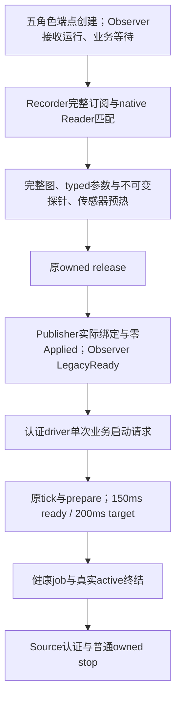

# 方案A第39批：受认证业务启动门控与普通监督实测

本批解决第38批反复停在启动前提的问题：当前版本首次完成受认证业务启动、健康job、真实active终结及无SIGSTOP的普通owned停止。只有选定名义域的本地shadow确认通过，整组阶段资格继续分账。

## 为什么调整启动接口

第38批第一轮的端点与参数准备期间，Observer已开始发送Decision。Publisher原release与peer绑定耗时覆盖了首条Decision的窗口，Applied后phase晚181.627ms而被原150ms检查拒绝，后续无job；pending保持由固定代码与queue_bound证据推断。之后两次准备重排分别遇到Recorder须先订阅完整topic和提前参数服务不可用。这些旧错误、Source和退出码均保留。

本批不改变已经可用的完整图与参数检查顺序。Observer创建所有原端点、Source与参数服务后先接收数据，tick/prepare尚未创建。原release完成后，driver核验真实Publisher绑定、初始零Applied和实际LegacyReady，再用新请求启动业务。

## 具体修改和作用

新增business_start_gate_v1.hpp。默认immediate/空请求路径/0预算保留原入口；显式owned-prepare-before-business-v1仅允许witnessed、fault-enabled shadow，等待20s、请求TTL2s，路径fresh/create-only，严格字段与类型。run/boot/合同、driver PID/start与源码SHA、双方manifest、初始Applied序号和当前版本均绑定。未知、重复、外实例、过期、错误版本及非零锚点不能开启。

Observer构造阶段创建原端点并冻结完整参数，等待原native Reader匹配；新policy下先不创建tick/prepare。main执行器继续处理Clock/Odom/IMU/Applied/Worker与参数服务，在业务锁之外读取请求和认证活driver的PID-start、exe、argv与脚本SHA。最终原就绪、源年龄、Worker状态、peer活性、adapter状态、版本和真实零锚点在锁内再验。只有Source授权记录成功后才创建线程，并调用原tick_loop；原1s lead、150ms job deadline、200ms T和20ms jitter保持。

未启动时关闭、超时或非法请求会闭合gate、请求adapter关闭、清掉未提交工作并结束；不启动业务。tick入口另有未开门防御；maybe_enqueue也不会在等待期间创建工作。旧五hook为0，Observer物理Writer仍为0。新参数进入role manifest与完整typed有效配置认证。

Python business_start_v1.py持有Observer与Publisher原Source inode并核对实际绑定和初始零输出；重新认证三方后create-only发布请求，重复写入实际被拒，等待真正C++授权与线程启动ACK。普通监督策略沿用第38批原字节，合同、认证、release及Supervisor不改。只重建Observer，另外四ELF沿用。activation、prepare、publication、来源回调和原tick主体对比字节相同；新增guard边界单独记录。

## 验证与实测

38项源链接Native全部通过，包含原activation因果/历史/竞争测试和新门控身份、类型、版本、重复、未来/过期、原前提、取消，以及实际回调仍可运行、未开门tick不能发布/提交。Native具有种入Ticket/RTF/lease/readiness的本地前提，不当作38项实际运行。

唯一实际run business_active_01，launcher15.106246226s，无外层超时。五组独立审计通过：门控与原tick、普通监督、身份/配置/owned清理、终结接收关闭协议、Stored/Fixture实际命令链。1805项运行锁前后相同，1924项审计输入前后SHA相同。

| 观测 | 实际结果 |
|---|---|
| 开门前 | 完整参数查询完成；Decision0、job0；真实Odom/能力接收继续 |
| 开门 | 单次driver身份与Source前提授权，重复create-only被拒 |
| 首tick | 新origin在授权后保留原1s lead |
| 首phase | 3.386393ms，原150ms界内，无phase_refused |
| 刺激 | job1健康完成，job2一次性pre-native1700ms，actual_native_invoked=false |
| Source终结 | 真正active_watchdog，receipt lease当时健康 |
| 通知 | 终结→读到63.494257ms；→认证144.549690ms |
| 普通停止 | 认证→INT41.930878ms；终结→INT186.480568ms，仅SIGINT |
| 退出 | Worker0、正常Source完整；五角色0，owned组空 |
| 时间 | 终结→Worker cleanup729.590491ms；INT返回→观察组空521.215710ms |
| 回退tick | 停止期间4条，最大jitter0.171947ms、start gap200.037447ms |
| Stored | 1300消息，16 Decision、14 Applied、53 capability，最后Applied14为shutdown_zero |

合同wait固定500ms Worker grace、1s TERM、1s kill postcheck。此次只使用natural和worker_grace，观察到组空有预先声明的100ms调度观测余量；500ms不是总退出硬界，729.590ms是该次实测。没有人为要求TERM/KILL，也没有注入SIGSTOP。不是acados C调用挂死证明。

独立核验完整GID/CDR/业务值、Source/Witness无新submit或accepted、终结后不续租、所有实际API幅值与按真实起点的变化率、关机零命令以及SQLite/metadata。Recorder自己的storage_stream_accounting_verified=false保留，独立SQL验证与该字段分开。16项实际证据副本反例（门控6、普通监督10）全部拒绝，原始run未改。

## 结论边界与后续

本批真正推进的是启动握手和普通active监督的一个实际闭环，未用放宽截止或修改观测记录换通过。第38批三个失败仍是失败；本次结构上消除了开门前Decision，不把跨run延迟差异解释为通用调度性能提升。

driver passed=false/normal_business_qualified=false符合预期故障case；ordinary_supervision_case_completed=true另记。Witness normal_contract_qualified只覆盖其明示的记录完整性与首次BusinessReady一致性；所有shadow Decision的normal_contract_complete按mode==execute条件仍false。所选实际通过不授予B4/B5/M4/F6/P1或研究结论。

下一步固定本次角色与门控配置，按影响图完成当前Observer的V1失效及普通lease/必要新身份恢复确认；原V3与active已命中，不重跑历史全矩阵。然后闭合B4来源/域/政策，进入B5/M0b，再M4唯一出口、已知模型事务/F6、P1复判与P2。具体最小计划另附。

所有旧dirty与冻结资产、失败已前后全字节保护；交付以本批archive_inventory_v1.json、final_QA_v1.json、delivery_verification.json为准。
