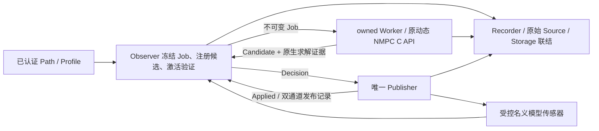

# 方案A第27批：owned冷启动集成、实际结果与拒绝复盘

本批完成了第26批因果冷启动候选向真实 owned Worker 的集成，并完成一次原定 **0.05 m/s、20 s、五角色 localhost** 实验。组件验证通过；实际实验 **NoGo**。Worker 生成了双通道各 0.5 N 的首个候选，但 Observer 在激活时拒绝了它，Publisher 实际发布零指令。因此，本批没有证明“已施加 0.5 N 冷启动策略”的闭环性能，更没有形成方案A阶段资格或研究优越性结论。

本批记录与上一批衔接；原交接计划见[方案A交接与全面推进计划](/home/trevor/USV/.sgh-research/handoffs/scheme_A_20261010_01/方案A_UbuntuCodex交接与全面推进计划_2026-10-10.md)。本批改变的是诊断实现，仍基于仓库 scheme=B 的动态 NMPC 模型与既有生成库。

## 1. 在整体架构中的位置

本批让 Worker 可以在首个严格符合条件的 Job 内执行“原自由 RTI 一次，再固定首控 0.5 N 做三次 RTI”。它没有替代 Observer 的候选激活检查，也没有绕过唯一 Publisher。实际失败恰好发生在候选已就绪、等待激活的这一层。

五角色是 Worker、Observer、Publisher、受控名义模型传感器源、Recorder。此处的 localhost 发布与名义模型反馈不等于真实艇体或执行器响应。实验中的受控 Publisher 模式标记、Git 分支名，也不能作为方案C或方案A资格的依据。

## 2. 具体改了什么

作者目录为：

`/home/trevor/USV/.sgh-research/experiments/p1_execution_architecture_20261005_01/authored_D1_owned_cold_start_20261018_v27`

| 文件或范围 | 改动与作用 |
|---|---|
| `worker/owned_cold_backend.hpp` | 新增 owned 后端适配器。先验证本次运行身份、Job 单调性、输入形状与数值、真实单调时钟截止，再允许消费一次冷启动策略。 |
| `worker/solver_worker.cpp` | 把实际 Worker 求解入口接到适配器；记录每个 Job 的原生调用次数、时序、结果和策略状态，保留原有接收、故障与清理流程。 |
| `worker/test_reference_cold_backend.cpp` | 覆盖历史 102 个 Job 数值回放、当前 Job 因果构种、外来/过期/重复 Job、一次消费、边界恢复及第 1–4 次入口异常后的终止行为。 |
| Worker 与 Observer 的 `p1_full_contract.hpp`、`p1_resources.hpp` | 共同认证新诊断修订 9 与唯一策略字段，精确资源修订同步为 9；原数值资源上限不变。 |
| Observer 的 `task_time_entry_contract_v1.hpp` 与合同组件验证 | 接受严格的新诊断合同，继续验证原任务时刻参考与入口限制。本批没有修改激活预测和快照一致性算法。 |
| `cold_start_contract_spec_v1.json`、`cold_start_contract_v1.py` | 为本批建立独立严格规范。保留旧运行工具所需的历史 Python 合同文件，避免把旧规则冒充新规则。 |
| `cold_start_policy_audit_v1.py` 与 `check_pair_wakeup_v1.py` | 在完整旧证据检查之外，检查首 Job 的四次求解、种子来源、限幅、热启动与撤销恢复，并强制联结真正的接受、Publisher 指令和 StoredApplied。 |
| 本批构建、预注册、运行、复盘与归档脚本 | 固定源码、库、配置、帮助程序、原始失败与下一步；独立记录组件通过和实际实验未通过。 |

新旧合同只有两项语义差异：诊断修订 8→9，以及新增 `cold_start_policy=current_job_free_once_then_fixed050_three_rti_v1`。模型、目标函数、预测域 N=20、dt=0.2 s、输入与变化率限制、参考采样和时刻、150 ms 截止、200 ms 周期及原性能门均保留。

新合同 SHA256：`162741dfb9c1454f8e19fbad41c7b96315544819a688029609488c3778eb510f`。

Worker 的四次求解仅处理当前真实 Job：先用自由求解结果的控制尾部构种，仅将首个控制改为 0.5 N，再按原模型前向生成种子状态；三次固定首控求解后只做一次最终热启动平移，撤销首控等式并恢复原 ±25 N 首项边界。后续 Job 各执行一次原自由 RTI，配置代数变化不重新武装冷启动。内部异常终止本次后端，不把半成品作为成功结果返回。

## 3. 组件验证与失败构建

| 验证层 | 结果 | 能说明什么 |
|---|---|---|
| Worker 原生组件 | 9 个 GTest、94 项纯合同检查通过 | 实际 C API、模型、种子、一次消费、恢复与异常终止组件符合本批范围。历史回放使用受控构造时钟，不证明真实运行时效。 |
| Observer 原生组件 | 19 个 GTest、337 项纯检查通过 | 本进程 localhost 回调与已设置前提下的入口行为；不等价于五角色全链资格。 |
| Python 策略与检查器 | 64 项通过 | 新规则、负例和继承的参考/所有者检查具有有限验证证据。 |
| 当前有效配置 | 实验启动后核对参数全集、类型值与不可变性；五角色进程、二进制和通信端点按本次运行认证 | 本次入口有效；旧实验端点资格没有被直接转移。 |

第一次 Worker 构建运行纯检查时暴露资源修订仍要求 8；第一次 Observer 构建暴露旧父级反例与新公共头文件的包含冲突。两次失败结果和日志均保留。随后只同步精确资源修订，并让旧父级反例使用其冻结的旧包含目录，再完成第二次构建和全部原生目标验证，没有删掉反例。

本批实际 Worker 二进制 SHA256 为 `88862fe7c05dca54bed5a4913fa977ce0041424bf032882eb3d21425ab298acd`，Observer 为 `870cd857b9a498281d10afff0e49c678f96a7715cdd0c672f6a238104217ce82`。其余三角色复用已核验的旧二进制，并在本次运行重新认证。没有重新生成求解代码或覆盖安装区。

## 4. 唯一一次实际实验

原始目录：[owned_cold_s005_01](/home/trevor/USV/.sgh-research/experiments/p1_execution_architecture_20261005_01/authored_D1_owned_cold_start_20261018_v27/runs/owned_cold_s005_01)。原始判定：[check_result.json](/home/trevor/USV/.sgh-research/experiments/scheme_A_owned_cold_start_20261018_27/runs/s005_01/check_result.json)。

| 项目 | 观察值 | 原门或解释 |
|---|---:|---|
| 全部原生 Job / 候选 / 策略记录 | 101 / 101 / 101 | 包括测量边界外记录，均保留。 |
| 首 Job 的内部求解次数 | 4 | 生成首控 `[0.5, 0.5]`；后续 100 个 Job 各一次。 |
| 首 Job 的 Worker 求解入口耗时 | 0.968237 ms | 后端适配器内 0.923055 ms；求解核合计 0.770075 ms。均为一次观测，不是 WCET 认证。 |
| 首候选 Ready 提前量 | 192.296780 ms | 已在原截止前注册，拒绝原因不是求解迟到。 |
| 测量窗候选尝试 / 接受 | 100 / 90 | 原要求所有测量窗候选均接受，并至少连续 90 次。 |
| 最长连续接受 | 19 | 不通过。 |
| 全窗 surge RMSE | 0.0110037220 m/s | 原门 ≤0.0073924958 m/s，不通过。 |
| 最后 5 s 平均 surge | 0.0496545680 m/s | 相对误差约 0.691%，原 5% 门通过。 |
| 独立名义模型复算 | 1161 个状态，最大误差约 7.55×10⁻¹⁵ | 说明本次受控模型证据一致，不是实艇验证。 |
| 五角色退出与清理 | 全部退出码 0，清理完成 | 驱动正常完成不等于候选和性能门通过。 |

首个真正接受并施加的候选来自 Job 2，控制约 `[0.4100875744, 0.4100875744]` N。Job 1 的四次求解及热启动会影响后续数值轨迹，但 `[0.5, 0.5]` 从未作为该首候选通过 Applied 链路。不能把本次 RMSE 归为“成功执行 0.5 N 冷启动策略”的性能。

## 5. 为什么拒绝

只读复盘见[activation_refusal_audit_v1.json](/home/trevor/USV/.sgh-research/experiments/scheme_A_owned_cold_start_20261018_27/postrun/activation_refusal_audit_v1.json)。复盘前后复核原始输入哈希，未改写原检查器、原报告或任何阈值。

### 5.1 七次目标与最新里程计的时间倒置

| Job | 冻结目标 − 验证快照最新 Odom | 原始拒绝 |
|---:|---:|---|
| 1 | −91,209 ns | `activation_history_or_time` |
| 21 | −277,066 ns | 同上 |
| 33 | −220,871 ns | 同上 |
| 38 | −89,415 ns | 同上 |
| 63 | −49,343 ns | 同上 |
| 79 | −6,571 ns | 同上 |
| 98 | −84,017 ns | 同上 |

冻结的目标模拟时刻与随后时钟/传感器回调采样存在微小相位差。到激活时，当前最新 Odom 有时已经略晚于目标；现有前向传播入口拒绝负时间区间，因而返回 `history_or_time_failed`。七次捕获的验证状态均未混入 IMU。不能因为差值很小就夹成零或绕过保护。

对 1137 条有效 Odom 回调的完整 CDR 做了完整性检查。上述七次捕获前，均已有一条不晚于目标的有效 Odom：接收年龄约 19–21 ms，向目标的前向区间约 19–21 ms，原 100 ms 接收年龄门内，且捕获历史具有双通道起始输入。这是有界历史状态选择的可行性线索；本批运行没有选择这些历史点，尚未证明状态误差、混合 IMU、版本与最终提交能通过。

### 5.2 三次快照验证期间有新输入

| Job | 验证快照 → 最终快照 | 原始拒绝 |
|---:|---|---|
| 22 | Odom 306 不变，IMU 306→307；混合标记 false→true | `activation_input_changed_during_validation` |
| 45 | Odom 536→537，IMU 537；混合标记 true→false | 同上 |
| 94 | Odom 1026→1027，IMU 1027；混合标记 true→false | 同上 |

三次预测均成功，但验证锁外计算到最终提交之间有回调更新。原严格版本/序列检查识别了不一致，拒绝是当前规则的正确结果。Job 22 即使验证快照未混入 IMU，原规则仍比较原始 IMU 序列；不能据此直接删掉检查。下一步应研究有界重新捕获并重验，保留这些检查以及同一个不可变候选。

### 5.3 一项独立的诊断记录域缺口

8 条 `reference_pair_retry` 均有真实有效触发提交。其中首条为 Profile 序列 1 已提交、Path 尚未到达：Path 序列 0、未冻结、仍在等待阶段。冻结检查器要求两路序列都大于零，因此记下 `pair_retry_exact_Source_domain`。

该事件与源码启动流程相符，是诊断域对“对侧参考尚不存在”覆盖不足。后续修复应严格限定“合法触发提交 + 对侧确实不存在 + 不冻结 + 仍等待”，不能泛化放行零序列。本批原报告保留该失败；即便独立修复这个检查器缺口，10 次激活拒绝和 RMSE 失败仍足以判定 NoGo。

## 6. 当前资格与下一步

| 层级 | 当前结论 |
|---|---|
| 冷启动原生组件 | 本批有限组件验证通过。 |
| 原 0.05 m/s、20 s 实验 | 已执行并留证，NoGo。 |
| 首个 0.5 N 候选实际施加 | 未完成。 |
| 更高速度、转弯、真实艇体、execute、方案A阶段资格 | 未取得。 |
| 研究性能结论 | 不成立，继续保留原性能门。 |
| 本地归档 QA | 只认证资产、完整性、组件和证据边界，不将失败实验改判。 |

下一步按[激活时刻对齐最小实施计划](/home/trevor/USV/.sgh-research/experiments/scheme_A_owned_cold_start_20261018_27/documents/next_activation_alignment_plan_v1.md)固定顺序推进：先离线设计与有限反例，再新诊断修订和真实组件，最后重做原首档一次。

## 7. 保存与可恢复性

315 个作者文件及原始运行文件、共 47,598,907 字节，已作逐文件副本与 SHA256 绑定。两次初始构建失败、实际 NoGo 原报告、Source、Storage、关闭与清理证据全部保留。

本批末重新流式核验 35,912 条历史本地资产路径、4,152,821,165 字节。原 24 个业务未提交文件的 diff 仍为 151,961 字节、SHA256 `d901511293df5be4aecb988509e4c4107977dc7c05f042286869c36e0a239ba5`。已声明的 `real.launch.py` 既有独立差异继续单独保留，不能表述为所有历史原路径均无差异。

按要求尝试向 `/home/trevor/MPC/scheme_A_owned_cold_start_20261018_27` 保存时，宿主层仍返回 `Errno 112: Host is down`。共享盘交付未完成，历史网络镜像本次完整性也未认证；第24–27批交付待办保留。本批可恢复副本位于本地目录，最终交付状态以后续成功的 `delivery_verification.json` 为准。未重挂载、未覆盖远端旧文件。
