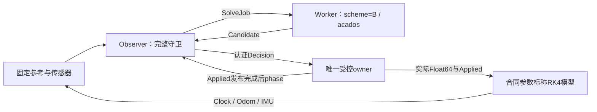

# 方案A：阳性链条、输入负例与动态一致性实施记录

日期：2026-10-16。第18批。本文 A / A2 / B / C 是本批验证顺序标签；方案A底层求解仍承接仓库 **scheme=B 动态NMPC / acados**。

## 当前结论

固定顺序已完整执行：A真实DDS合法阳性 → A2新受控版本恒定输入对照 → B单一冻结窗实际输入变化 → C实际Applied驱动的标称动态一致性原型。四项组件判据通过。未删除或放宽精确锚点、完整历史、状态、rate、身份、150ms截止或200ms激活守卫。

| 场景 | 测量窗候选激活 | 接受 / 拒绝 | 实际结果 |
|---|---:|---:|---|
| A 原冻结F5 + 新零参考Fixture | 22 | 22 / 0 | 22连续接受；25条Applied及左右各25条真实Float64均精确零 |
| A2 新受控基线恒定零输入，v2正式判定 | 20 | 20 / 0 | 20连续接受；22条实际phase全部接收并对应Storage |
| B 同一受控版本，仅一次冻结窗+0.1N | 20 | 19 / 1 | Job1先Ready，真实Applied序号3改变输入；原生anchor_mismatch拒绝；随后19连续接受 |
| C 0.05m/s参考 + 实际Applied驱动模型 | 21 | 21 / 0 | 21连续接受；357条状态与实际Odom/IMU全人口对应，独立重算最大误差1.734723475976807e-18 |

计数严格取 Ready ≤ activation < driver关闭请求，owner在测量期存活；不计停机尾端偶然接受。初始无候选决策、关闭未激活Job等仍保留在完整Source/Storage/Witness人口中，没有裁剪原记录。

## 这次具体修改了什么

1. 新零平衡Fixture：61个零位置、单位四元数姿态；profile每行[0,0,0,k×0.2]。零状态同时配零参考，避免旧夹具“船静止但参考0.6m/s”造成持续输出变化与状态不一致。A仍复用冻结F5、Worker、Observer、Recorder四个实际二进制。
2. 独立controlled_phase子scope：新基线CONTROLLED_PHASE_20261015_DIAGNOSTIC_01、新合同SHA。Worker/Observer/owner分别严格绑定该新基线，其他原合同参数保持不变；不冒用F5运行资格。Worker实际调用acados求解；受控owner不执行原F5自主控制循环，只按已认证Decision授权真实诊断输出。
3. 显式相位：Observer完成本拍Decision后等待；owner认证实际Observer Job/Decision Writer的GID、PID/start、代码/配置与pidfd；先完成左右Float64真实发布、再完成Applied的实际DDS发布、再发送17字段phase。Observer分别认证Applied与phase，两者都完成且字段一致后才冻结下一Job。跨topic到达先后均可，原planned+150ms / +200ms不变。
4. B是有意违反保持输入前提的有限负例：真实Job冻结后，在原origin+100ms附近发布一次双通道+0.1N，再保持到对应Decision后恢复零。路径、状态、合同和二进制相同；运行ID、域与预声明mode参数按场景区分。拒绝必须绑定同一个已Ready候选和实际改变的输入，不能只数Accepted=0。
5. C标称模型：只用认证接收的实际Applied每通道publish API完成时刻和值分段RK4；采用完整合同19个hydro参数，禁止默认参数悄然代入。模型对已收到的实际历史做有界回放，50Hz发布Clock/Odom/IMU，并记录全部输入前缀、水位、状态、时间戳与参数SHA。不是实际船体或物理执行回执。
6. 新判定器：完整继承原Source/Storage/Witness、Worker接收与发布、配置、ownership与回收检查；增加物理Float64全值对齐、全部phase与owner Source发布时间关联、模型Source实际FD身份、模型回放和真实传感器全值/时间戳对应。对所有接收人口做闭合；没有声称每个订阅者收到所有发布。

## 验证证据与边界

正式选用Observer01、Worker01、Fixture01、Publisher03以及原冻结Recorder。Observer/Worker新增83个纯逻辑检查通过；Publisher/Fixture共22个GTest用例通过。判定器v1共60个有限测试；修正采样时间语义后的v2共66个有限测试通过。83个纯检查与22个GTest不混称105个GTest，也不把旧251项历史证据冒充新二进制回归。

C全Source期间最大命令约0.570173N，最大x约0.287146m，最大surge速度约0.0631883m/s。这些包含预热和关闭，属于有限标称仿真观测；不当作稳态跟踪误差、真实模型精度或0.6m/s性能结论。1.73e-18是两份数学实现的一致性误差，绝不是模型与真实船体的误差。

实际端点通过owned manifest真实句柄GID、当前boot/PID/start、/proc代码与参数、pidfd、外部完整参数服务查询和配置冻结核验；未沿用旧boot端点权限。真实Source文件FD与录制Storage绑定，完整进程关闭/回收证据通过。连续DDS全局唯一性、post-pin exec连续性、MasterClock、WCET、真实Plant接纳等仍未知。

## 失败与历史保留

- 零参考Fixture首次测试编译缺头文件：保留attempt01快照和失败；独立attempt02通过。
- 新保护helper两次适配检查失败：原文件完整保留，最终使用明确版本入口。
- 受控Publisher attempt01为JSON/原子类型等编译适配失败；02构建通过但Source的executor_detached事实标签需显式remove_node支撑，因此03新增该实际操作并通过13项GTest。旧失败与通过产物都保留。
- 首个A2_01实际已有20连续接受，但新增判定器错误要求外层callback入口时间与内层CDR采样时间相等，正式判定失败保留。v2改为核验真实夹住顺序，并用同一组冻结二进制、独立新run A2_02复验通过；没有改Cpp接纳门。
- 工具宿主曾EAGAIN，程序当时未启动；不记为编译或ROS失败。恢复后继续。
- 原24项未提交业务改动摘要保持151961bytes / d901511293df5be4aecb988509e4c4107977dc7c05f042286869c36e0a239ba5。恢复时另见real.launch.py一行删除，来源未知；保留当前完整文件、515byte diff与快照，另从固定HEAD核验旧blob。严格保护明确唯一live原路径例外，不再声称所有旧原路径字节未变；其余封存资产仍按原pin核验。

## 组件、阶段与研究结论分别是什么

**组件验证**：A、A2、B、C本批预注册的隔离localhost DDS诊断判据通过，显示正常链条可以持续接受；输入变化负例准确拒绝；显式phase加输入一致的状态模型可以消除本批复现的持续锚点冲突。

**阶段资格**：未授予B4/M0b/B5/M4/F6/P1、正式execution或实际船体资格。新合同仍temporary_shadow_diagnostic、execute=false；Observer仍shadow。有限4秒测量窗不等于20秒R5资格。

**研究结论**：没有完成性能比较、消融、真实扰动/噪声、多种场景、统计重复或实船验证。本批支持“先修正相位和状态一致性，再评价控制性能”的工程推进判断，不能宣称方案A已完成或优于基线。

## 下一步固定优先级

1. 在新版本预注册下，把C从当前0.05m/s、有限4秒测量推进到有界开销的长时标称验证。先处理模型每次从起点回放的开销、长路径覆盖、传感器/Clock实时性；再分层扩到20秒、0.1/0.3/0.6m/s，不能只改时长就套用现有通过结论。
2. 量化并校准剩余假设：实际源延迟与双通道时间语义、目标状态传播、rho/hold/容差、截止与发布预算。保留所有合法接受和首失败门，按预注册门槛判断阶段资格。
3. 达到正式合同所需证据后，再单独推进执行模式与真实Plant测试。外围foreign/关闭故障扩展留在待办；不重新让它们取代主线。

主要证据：runs/A_zero_01/check_result.json；runs/controlled_A2_01/check_result.json（保留的判定器失败）；runs/controlled_A2_02/check_result.json；runs/controlled_B_02/check_result.json；runs/controlled_C_02/check_result.json；对应author_snapshot中的原始Source/Storage/Witness、编译快照和preregister。
