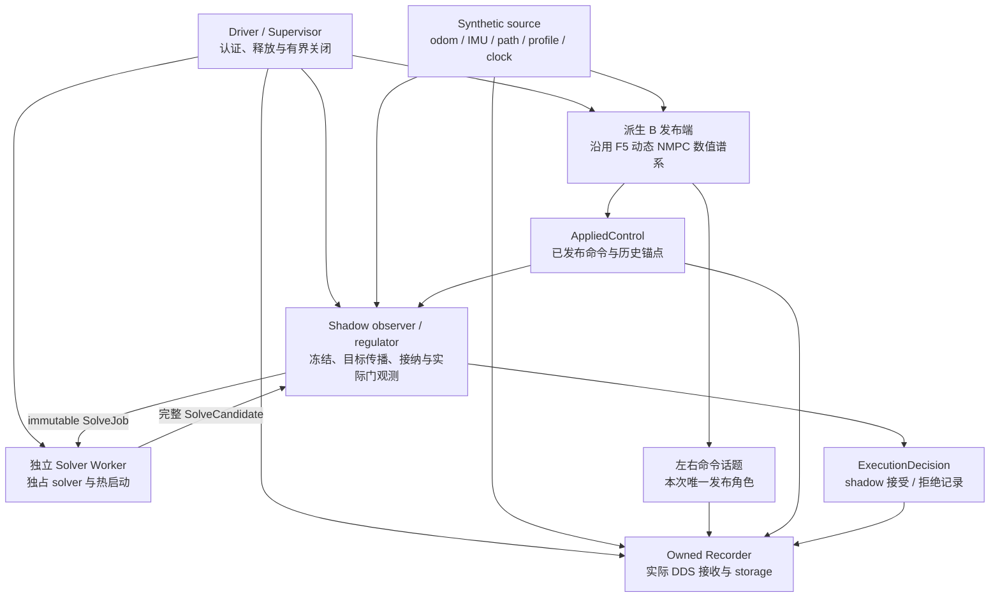

# 方案 A：从基线修复到 C3.3 的逐步讲解

整理日期：2026-10-12（北京时间）  
覆盖记录：2026-10-03～2026-10-12，第 07 批 C3.3 封存为本次状态截止点。  
历史记录目录：`/home/trevor/MPC`；研究源码、运行原件和冻结资产主要在 `/home/trevor/USV/.sgh-research`。

本文按实际推进顺序解释：每一步为什么做、修改了什么、产生了什么作用、验证到了哪里。它是历史说明文档，依据已有报告和机器状态整理；不新增实验，不改变原阶段判定，不替代各批原始证据。

## 1. 先弄清楚：你研究的“方案 A”是什么

**研究方案 A 是围绕在线残差模型更新、备份执行一致性、数据年龄与有效期管理建立控制机制。当前首先使用仓库的 `scheme=B` 动态 NMPC 作为基础控制器。**

仓库的三个运行选项与研究题目是两套命名：

| 名称 | 含义 |
|---|---|
| 仓库 `scheme=A` | 运动学 MPC |
| 仓库 `scheme=B` | 动态 NMPC；当前研究方案 A 的基础 |
| 仓库 `scheme=C` | PPO 路径跟踪 |
| 研究“方案 A” | 在建议器之外建立独立监管、版本化模型、有效备份与年龄管理机制 |

因此，最近的工作虽然大量修改了动态 B、记录器和监管器，仍是在推进研究方案 A。前期修复 PPO 是整理共同平台的一部分，不表示已经进入方案 A 的 PPO 接入阶段。

整体路线是：

1. **P0：** 把单位、状态、参考、模型、时间和记录来源核实清楚，建立可追溯基线。
2. **P1：** 分离求解与执行，建立候选接纳、固定执行节拍、版本一致性和有限模型切换。
3. **P2：** 加入静态障碍、独立可达验证和有限备份，明确备份何时仍有效。
4. **P3：** 用合格数据训练 GP 残差模型，先改善性能预测，再研究数据年龄与包络失效。
5. **P4：** 将 PPO 作为建议器接入统一监管路径，使用最终发布命令反馈历史动作。
6. **P5：** 做公平强基线与消融对照，判断是否存在研究贡献。

**目前完成了许多 P0/P1 子工作包，最新推进到 C3.3 的有限组件验证；P0/P1 整阶段尚未完成资格闭合，P2～P5 的本路线阶段验收尚未完成。**

主路线依据：[首选 A 实施方案](/home/trevor/USV/.sgh-research/handoffs/scheme_A_20261010_01/source_docs/首选A_现有ROS平台可行性与实施方案_2026-10-03.md)。

## 2. 这几天的步骤总览

部分早期报告持续在顶部追加新状态。下表按工作发生的先后排列，而不是按文件最后修改时间排列。

| 顺序 | 日期 | 主要工作 | 带来的变化 |
|---:|---|---|---|
| 1 | 10-03 | 三项平台修复 | 拒绝迟到解；统一 PPO 推力单位；补齐新录包的动作检查 |
| 2 | 10-04 | F1/F2 冻结与最小数据契约 | 让软件版本、状态、发布命令和周期时间有明确身份 |
| 3 | 10-04 | F3 模型/参考对拍与姿态门禁 | 核实同参数实现一致性，阻止退化四元数进入控制 |
| 4 | 10-05 | F4 配置独立与实际预测观测 | 区分 controller/plant，记录真正交给 solver 的参考与返回预测 |
| 5 | 10-05 | F5 同锁资格复核与输入冻结 | 关闭“资格通过后输入被回调改坏”的竞态 |
| 6 | 10-05～06 | P1 独立求解与固定节拍 | 求解器可以慢，监管器仍能独立作决定 |
| 7 | 10-06 | 候选、进程、租约、调度和字节责任核验 | 拒绝失效候选，明确异常由哪一层处理 |
| 8 | 10-07 | 资源合同、输送分账与 B0 校验 | 限制资源规模，严格核对配置结构与实际传输 |
| 9 | 10-08 | Witness、C0、R5 与入队失败修复 | 用独立记录核验日志压力及故障后失效行为 |
| 10 | 10-09 | 来源审查、冻结参考重建与启动握手 | 从“字段一致”推进到“来源可解释、释放前可核验” |
| 11 | 10-10 | 环境差异处置与 Ubuntu 交接 | 保留旧差异，建立适用的新辅助资产锁和接续顺序 |
| 12 | 10-10，第 01 批 | S0/S1、owned 端点与配置认证 | 认证实际进程、DDS 端点、有效配置与全流记录 |
| 13 | 10-10，第 02 批 | 关闭路径、末帧确认与独立协议复核 | 有界关闭，并检查记录是否完整收到尾部 |
| 14 | 10-11，第 03 批 | 严格原始来源与拒绝策略 | 对齐 raw 输入、Capability 发布总体与实际 storage |
| 15 | 10-11，第 04 批 | 配置字节身份与当前组件汇总 | 独立重建配置哈希，识别同步伪造的身份声明 |
| 16 | 10-11，第 05 批 | 优先 C3：激活来源重建 | 重建每次激活所用状态、历史命令、参考与拒绝原因 |
| 17 | 10-11～12，第 06 批 | C3.2 原子观测与候选原始预像 | 记录同锁快照、真实候选对象和实际短路门读取 |
| 18 | 10-12，第 07 批 | C3.3 输入/并发矩阵与释放终态 | 补真实源码分支测试，明确释放成功和过期拒绝的实际过程 |

这些工作逐渐解决三类问题：**控制行为本身是否正确；运行证据是否可信；这些证据是否足以授予下一阶段资格。** 三类问题分别验证。

## 3. 按步骤讲解

### 第 1 步：先修复三个会污染后续研究的基础问题（10-03）

#### 1.1 动态 NMPC 迟到解拒绝

**原问题：** 仅看求解后端内部报时，不能判断整个同步求解调用是否超时。候选已经过期时，继续发布它会把“计算成功”误当成“当前仍可使用”。

**修改内容：** 动态 NMPC 的 [mpc_node.cpp](/home/trevor/USV/usv_mpc_ws/src/usv_mpc_cpp/src/mpc_node.cpp)、[节点头文件](/home/trevor/USV/usv_mpc_ws/src/usv_mpc_cpp/include/usv_mpc_cpp/mpc_node.hpp)、构建配置及 [deadline 测试](/home/trevor/USV/usv_mpc_ws/src/usv_mpc_cpp/test/test_deadline_control.cpp) 增加完整 `solve()` 调用的单调时钟测量。默认预算 200 ms，严格超过预算才判迟到；非法计时也拒绝。拒绝时不发布迟到候选或其预测，并清理受污染的热启动状态。发布锚点保留最终映射后的 N，防止重复缩放。关机与输出使用互斥保护，避免关机之后迟到解重新发布。

**作用：** 把“解算完成”与“解仍有执行资格”分开，保护后续时序研究的基础。旧策略前几次失败重复上一命令、连续失败达到原阈值后 HOLD 的行为仍按当时规则保留。

**验证及边界：** 16 个新增与 21 个既有独立 GTest，共 37 个通过；250/400 ms 受控迟到结果被拒绝。此时仍要等待同步 solver 返回，**尚不能在 200 ms 到点时独立接管**。后续 P1 正是为了解决这一剩余问题。

#### 1.2 PPO/ONNX 推力单位统一

**原问题：** 网络动作、ROS 节点缩放及历史动作反馈若含义不一致，会出现重复乘 25、观测历史不代表最终命令等问题。

**修改内容：** [export_policy.py](/home/trevor/USV/usv_rl/usv_rl/export_policy.py) 与 [rl_policy_node.py](/home/trevor/USV/usv_mpc_ws/src/usv_rl_ros/usv_rl_ros/rl_policy_node.py) 改为：43 维原始观测输入，归一化在图内完成；图内只做一次 `25 × clip(actor_mean, -1, 1)`；输出左右两路物理 N，范围 ±25 N。新增 `policy_physical_n.onnx` 及 manifest，ROS 直接使用 N。下一拍观测的末两维使用限幅后上一拍已发布 N。模型/manifest 哈希、单位或布局不合格时进入零输出待机。

**作用：** 为 B/PPO 共用控制约束与后续执行反馈提供一致单位。它是重新导出和部署修复，**没有重新训练策略**。

**验证及边界：** 74 个不同检查用例通过；旧模型和归一化资产保留。短程运行没有证明跟踪性能提升，训练环境 `step()` 返回历史动作的时序仍需独立核验。

#### 1.3 新录包补 clock，并检查动作配对

**原问题：** 旧 `rl_c_001` 缺推力、status 和 clock，477 条 profile 记录不能补出真实执行动作。

**修改内容：** 现行录制已有左右推力与 status，在 [vrx.launch.py](/home/trevor/USV/usv_mpc_ws/src/usv_bringup/launch/vrx.launch.py) 的相关录制配置增加 `/clock`，新增 [check_ppo_bag.py](/home/trevor/USV/usv_mpc_ws/scripts/check_ppo_bag.py)、检查器测试和录包说明。按接收顺序做左右命令/status 的一一配对，使用预先固定的 20 ms 界，并检查单位、异常值、计数和 clock epoch。

**作用：** 新数据可以检查“记录的动作是不是节点发布的动作”；旧缺动作 bag 保持缺失状态。

**验证及边界：** 40 个检查用例通过；新 bag 每路 248 条推力与 248 条 status 全部配对，数值差为 0 N。发布记录一致仍不能证明 plant 已接受，也不能排除多流共同丢失。

依据：[三次修复汇总](/home/trevor/MPC/USV_三次修复汇总_2026-10-03.md)。

### 第 2 步：冻结 F1/F2，并建立状态、命令和时间的最小契约（10-04）

**为什么做：** 修复后的代码还包含未提交改动，仅记 Git HEAD 无法说明某次实验究竟运行了哪个版本；普通 ROS bag 也缺少把状态、求解和两路动作关联起来的身份。

**修改内容：**

- 保存 F1 修复后原始基线、F2 发布端契约基线的 source/install/model 快照、dirty diff、配置和清单哈希。F1 为 122/53/5 项，F2 为 136/153/5 项。
- 新增 [StateSnapshot.msg](/home/trevor/USV/usv_mpc_ws/src/usv_research_interfaces/msg/StateSnapshot.msg)、[CycleTiming.msg](/home/trevor/USV/usv_mpc_ws/src/usv_research_interfaces/msg/CycleTiming.msg)、[AppliedControl.msg](/home/trevor/USV/usv_mpc_ws/src/usv_research_interfaces/msg/AppliedControl.msg)。
- 动态 B 增加默认关闭的观测插桩与 [research_logger.hpp](/home/trevor/USV/usv_mpc_ws/src/usv_mpc_cpp/include/usv_mpc_cpp/research_logger.hpp)：容量 1024 的异步队列，分别计数 generated/emitted/dropped。
- 新增研究录包入口、[check_p0_contract.py](/home/trevor/USV/usv_mpc_ws/scripts/check_p0_contract.py) 与运行上下文采集工具，关机先保留有效 ROS context 下的零输出及日志刷新。

**作用：** `StateSnapshot` 记录同一条 odom 的六维状态；`CycleTiming` 另外记录真正进入 solver 的状态及 odom/IMU 混合来源；`AppliedControl` 把左右两次发布调用作为一个逻辑事件登记。这避免把不同采样来源拼成“同一真实状态”，也避免把两路无 Header 消息凭数值随意配对。

时间用途被明确分开：bag 接收时间用于消息配对；显式 clock/epoch 用于仿真时间边界；同机同 boot 的 steady 时间用于本地计算耗时。

**验证及边界：** 直行/左转/右转三个约 60 s 墙钟 pilot 合计 9,010 条状态、905 条发布事件、902 条周期记录，研究流生成/发出/bag 计数闭合、队列无丢弃。每个 run 最后一段动作保持仍为 `end_unknown`。这一步验证了发布端数据契约，P0 整阶段仍部分完成，GP 标签仍未准入。

依据：[P0 冻结与最小数据契约报告](/home/trevor/MPC/P0_冻结基线与最小数据契约_实施与验收报告_2026-10-04.md)。

### 第 3 步：同参数模型与参考对拍，修复四元数准入（F3，10-04）

**为什么做：** 若 Python、C++ 和 native acados 的名义动力学不一致，后面“学到的残差”可能只是实现差异；全零四元数也可能经 yaw 公式算出有限数而错误进入控制。

**修改内容：** 在实际 Python 动力学、C++ 模型、当前生成的 acados 离散函数之间做显式同参数对拍，并测试真实参考函数。生产修复仅在动态 B 的 `odom_callback_`：yaw 转换前拒绝四元数模长平方非有限或小于 `1e-12` 的输入。研究记录仍保留原始 invalid 接收，坏输入不更新 accepted 状态身份或 watchdog。保存 F3 快照。

**作用：** 数值对拍核实软件实现；控制 gate 阻止无效姿态污染状态。两者分别解决模型实现问题和输入质量问题。

**验证及边界：** 三组 19 参数、共 291 种不同输入的 RHS/单步/轨迹对拍通过，57 个不同 C++ GTest 通过，新增正常直行回归通过。早版有重复输入导致“291 次执行却只有 285 种输入”的记录保留，最终改用独特语料。

同参数相等不证明真实船模型准确，也不证明 Gazebo 与控制器完全等价。例如原非对称参数 `Yr_dot=0、Nv_dot=-0.363545` 经 plant 的 `symmetric_mean` 投影后，两者均为 `-0.1817725`，应分别登记。

依据：[F3 模型/参考一致性与姿态门禁报告](/home/trevor/MPC/P0_模型与参考一致性核验及四元数门禁修复_2026-10-04.md)。

### 第 4 步：分离 controller/plant 配置，记录实际参考和返回预测（F4，10-05）

**为什么做：** controller 和 plant 若读取同一个生成配置，就难以设计可信模型失配；只看配置参考速度或 solver 热启动缓存，也不能知道当次实际优化用了什么。

**修改内容：** 新增 [p0_config_reference_recording.launch.py](/home/trevor/USV/usv_mpc_ws/src/usv_bringup/launch/p0_config_reference_recording.launch.py)、独立 nominal/plant 配置与 [research_config_sources.py](/home/trevor/USV/usv_mpc_ws/src/usv_bringup/usv_bringup/research_config_sources.py)。`vrx.launch.py` 支持单独传入 controller vehicle 和推力限制，`setup.py` 安装新 helper。每次运行同时核对实际参数 dump、生成的 SDF/YAML/model report。

新增 [ReferencePrediction.msg](/home/trevor/USV/usv_mpc_ws/src/usv_research_interfaces/msg/ReferencePrediction.msg) 和 [check_reference_prediction.py](/home/trevor/USV/usv_mpc_ws/scripts/check_reference_prediction.py)。记录求解前真正的局部 reference，以及同次 `SolveInfo` 返回的可用 X/U；不读取事后已移位的热启动缓存。N=20 时，reference/X 是 6×21，U 是 2×20；未求解不伪造记录，失败或迟到不保留“可用预测”。

**作用：** 为模型失配实验建立独立来源，同时解释当前 NMPC 实际参考和预测行为。核验发现此批实际使用 profile 参考，其速度中位数为 0.8 m/s；配置中的 0.6 m/s 是未采用的 fallback。

**验证及边界：** 基准、plant 质量探针、nominal 质量探针三次真实运行，四流记录和 24 项配置比较通过。质量从 14.2 kg 改到 17.04 kg 的 plant 探针同时改变生成船体几何，不能称固定几何纯载荷阶跃。三次初态未按公平比较统一，不从轨迹或求解次数推断性能提升；日志开销也未全部纳入原 solver deadline。

依据：[F4 配置独立与实际参考预测观测报告](/home/trevor/MPC/P0_配置独立与实际参考预测观测_实施与验收_2026-10-05.md)。

### 第 5 步：把资格复查和实际输入冻结放进同一把锁（F5，10-05）

**为什么做：** 旧控制循环先检查 `can_solve_`，释放状态锁后再取锁复制输入。两次取锁之间，真实 path callback 可以把合法路径清空或改成单点，造成“检查时能求解，使用时不能求解”。

**修改内容：** 动态 B 的 `run_dynamic_mpc_` 在最后一个输入临界区重新检查资格，并在同一 `state_lock_` 内冻结 state/reference。锁在 native solve 前释放，不跨求解持有；无资格时先解锁再待机，保持原锁序。补节点交错测试，并调整旧测试夹具使其具备真实合法 odom/path。

**作用：** 一次求解的资格和输入属于同一冻结时点。它关闭的是竞态，不是对候选永久有效的保证，也没有让同步求解可取消。

**验证及边界：** 旧 62 + 新 5，共 67 个不同 GTest 通过；F5 保存 146 项 source/config、177 项 installed、5 项 model，共 328 项。新 60 s 基线包含 193 条实际参考记录，发布端和参考契约通过。

冻结之后再 clear 的当前同步候选仍按旧 deadline 规则完成，下一周期进入 no_path 待机。这一行为明确保留；后续 P1 使用 task generation 和激活门处理在途失效。首轮 CLI arm 的 NodeNotFound 失败也保留。

依据：[F5 同锁资格与输入冻结报告](/home/trevor/MPC/P1_求解资格与输入原子冻结_最小修复及验收_2026-10-05.md)。

### 第 6 步：拆出独立 Worker、监管器和固定执行 tick（10-05～06）

**为什么做：** 第 1 步只能在 solver 返回之后拒绝迟到结果。真正的独立执行机制需要在 solver 仍阻塞时，也能决定是否继续旧命令、降级或停止接纳新候选。

**修改内容：** 新增 [solver_worker.cpp](/home/trevor/USV/usv_mpc_ws/src/usv_research_safety_cpp/solver_worker.cpp)、[regulator.cpp](/home/trevor/USV/usv_mpc_ws/src/usv_research_safety_cpp/regulator.cpp)、[protocol.hpp](/home/trevor/USV/usv_mpc_ws/src/usv_research_safety_cpp/protocol.hpp) 与 admission/clock 等公共组件；提取共享动态 B 输入和参考核心。增加 `SolveJob`、`SolveCandidate`、`ExecutionDecision`、`WorkerCapability` 消息。

Worker 独占 solver capsule 和热启动；Job 冻结完整 state/reference、配置与任务版本、目标 tick、历史命令和 deadline；Candidate 返回完整 X/U 并回显 Job。active/pending/ready 有界，不因超时无限新增线程或积累任务。

监管器使用绝对单调时钟节拍，当前候选设计 T=200 ms；完整 ready 提交截止为 150 ms，包含冻结、排队、求解、复制、传输和验证。候选早到也等目标 tick，旧目标结果不能平移到新 tick 使用。根据已记录发布历史预测到未来激活时点，再构建目标时点参考，激活前再次核对状态和动作锚点。

**作用：** 把“准备一个可能可用的方案”和“到点决定能否使用”分开。未来模型切换、证书和备份可以依附这个提交边界。

**验证及边界：** 当时版本完成无输出/影子正常与迟到、受控阻塞、输入/时间等有限机制验证。shadow 中实际推力仍由旧 B 发布，新监管器只建议和记录；受控屏障不证明自然 acados 永久挂死。200/150 ms 是当时工程合同数值，当前仍需要来源和受影响版本资格闭合。工程 HOLD/归零尚无认证备份含义。

依据：[P1 独立执行架构记录](/home/trevor/MPC/P1_独立执行架构_实施进展与验收记录_2026-10-06.md)。

### 第 7 步：补异常候选、Worker 生死/租约、跳拍和消息字节责任（10-06）

**为什么做：** 一个计算结果可以数值有限却来自错误进程、旧任务、旧 clock epoch 或已退出 Worker；进程还活着也可能已失联。只有正常候选用例不足以检验这些路径。

**修改内容：** [p1_admission.hpp](/home/trevor/USV/usv_mpc_ws/src/usv_research_safety_cpp/p1_admission.hpp) 检查 shape/finite、foreign、重复乱序、目标拍、echo、时限和版本等条件；[p1_worker_liveness.hpp](/home/trevor/USV/usv_mpc_ws/src/usv_research_safety_cpp/p1_worker_liveness.hpp) 使用 Linux pidfd、boot/start-ticks 识别真实 Worker；[p1_capability_lease.hpp](/home/trevor/USV/usv_mpc_ws/src/usv_research_safety_cpp/p1_capability_lease.hpp) 管理有效能力租约。

native 失败或返回完整预测无效时，Worker 在本 run 中进入 fatal，清空 pending 并拒绝后续任务，不假定 reset 能恢复同一实例。退出/失联使旧候选与待准备任务失效。调度跳拍清槽，避免恢复后连发“补拍”。另以实际 DDS/CDR、storage 和业务日志核验损坏消息是否真正到达、在哪层拒绝。

**作用：** 防止旧候选在其来源失效之后重新获得资格，并区分 middleware take 失败与业务 callback 拒绝。

**验证及边界：** 历史矩阵包含 38 类可编码异常候选、任务/clock/源年龄变更、非空 pending 与退出并发、能力失联、受控调度异常，以及声明范围内的原字节样本。600 ms 租约是当时诊断值；Capability v1 没有完整源时序身份，不能把“刚收到”直接当成“源端刚产生”。部分原字节传输 SHA 不匹配的尝试仍未覆盖；重新序列化的填充字节差异不能直接等同字段内容变化。全部任意损坏消息、全部并发调度和硬实时上界均未证明。

依据：[P1 架构异常与责任边界记录](/home/trevor/MPC/P1_独立执行架构_实施进展与验收记录_2026-10-06.md)、[M2 范围审查](/home/trevor/MPC/P1_M2_范围与证据矩阵审查及最小闭合计划_2026-10-06.md)。

### 第 8 步：资源合同、应用输送分账与正式合同校验（10-07）

**为什么做：** 有界槽位不代表消息、参考、历史和日志内存都已受限；“source 有一条”和“bag 有一条”也不代表同一消息。合同若只校验哈希，会漏掉类型错误或互相矛盾的模式开关。

**修改内容：** [p1_resources.hpp](/home/trevor/USV/usv_mpc_ws/src/usv_research_safety_cpp/p1_resources.hpp) 对 history、path/profile metadata、log、消息字节预算和交接 depth 实施上限。限制在额外复制/fingerprint/发送前执行，native 原因字符串按固定容量读取。Job 发布→Worker 完整接收、Candidate 发布→完整登记、source→actual storage 分别建立应用账本。

B0 新增 [p1_full_contract.hpp](/home/trevor/USV/usv_mpc_ws/src/usv_research_safety_cpp/p1_full_contract.hpp)、[contract_validate_cli.cpp](/home/trevor/USV/usv_mpc_ws/src/usv_research_safety_cpp/contract_validate_cli.cpp) 和跨语言校验器。拒绝重复 key、未知/缺字段、bool 冒充整数、溢出、非有限值、错误模型/政策和不支持的版本组合，区分 diag、pre-freeze 与结构 frozen 夹具。

**作用：** 合同从“一个文件和几个 flag”变成代码可以严格判断的语义对象。伪造 frozen=true 或哈希字符串不能打开真实 execute；物理执行入口继续关闭。

**验证及边界：** 资源边界、metadata 拒绝/恢复和应用分账取得当时有限验收。B0 当时 91 个不同 C++ GTest、329 个 Python 方法及 565 份跨语言语料通过，实际错误配置启动拒绝和新旧无输出正常链通过。565 份语料与测试方法数分别登记。合成静止输入的虚拟激活不代表物理执行；typed 上限也不证明反序列化前资源耗尽已被防护。

依据：[资源合同与输送分账](/home/trevor/MPC/P1_资源合同与输送分账_实施与验收_2026-10-07.md)、[B0 正式合同校验](/home/trevor/MPC/P1_M0b_B0_正式合同校验_实施与验收_2026-10-07.md)。

### 第 9 步：独立 Witness、正常 C0、日志压力 R5 和入队失败失效（10-08）

**为什么做：** 日志本身会失败。只用正在受压的日志证明故障处理成功，容易缺少关键尾部；而“已请求停止”不必然代表候选和 pending 已及时失效。

**修改内容：** B1 建立独立诊断副本，不覆盖生产 ROS 包，并加入固定容量 Witness：256 Tick、128 Submit、128 Activation、32 Phase，固定对象 54,728 bytes。Witness 在实际授权提交/激活边界记录，关闭与活动写入使用生命周期保护，容量不足或未发布行使审计失败。

C0 使用合法合成输入建立正常无输出对照，逐项关联 source/storage/Witness。R5 保持实际日志容量 512，使用 5000 ms Sink 暂停触发压力，并在有限窗口中检查实际入队拒绝、失效状态和后续提交。

进一步发现 Decision 入队失败路径只置 stopping，某些直接退出分支可能尚未清完共享槽。最小修复在实际 `finish_tick` 尾部即时使 candidate/admission/pending 失效；审计去重只控制记录次数，不能跳过清理。先保存旧失败逻辑与证据，再建立新修复版本和正常对照。

**作用：** 即使证据通道受压，仍有独立有限审计来检查真实业务边界。入队失败之后不允许未来的新 submit/activation 继续取得旧资格。

**验证及边界：** B1 当时新增 37 个 C++、63 个 Python 检查及 9 个真实错误配置启动拒绝通过；随后 C0 和历史 R5 在各自锁定版本上得到有限验证。修复分支测试通过真实 Sink 拒绝进入业务尾部，另有新正常 ROS 对照。

修复测试中容量 0/1 的夹具与正式容量 512 的历史 R5 分开记账。即时失效不能撤销已经发布的命令，也不能补造已经丢失的 source 行；旧 R5 资格不能自动转移到新修复版，更不能转移到当前 v9。

依据：[B1 固定审计](/home/trevor/MPC/P1_M0b_B1_独立诊断副本与固定审计_实施与验收_2026-10-08.md)、[C0 正常对照](/home/trevor/MPC/P1_M0b_C0_正常无输出对照_实施与验收_2026-10-08.md)、[R5 日志压力](/home/trevor/MPC/P1_M0b_R5_日志压力机制_实施与验收_2026-10-08.md)、[Decision 入队失败修复](/home/trevor/MPC/P1_M0b_Decision入队失败即时失效_修复与验收_2026-10-08.md)。

### 第 10 步：审查参数来源、重建冻结参考，建立启动握手（10-09）

**为什么做：** 工程数值有了，不代表数值已有足够来源；进程启动和 DDS 图中出现同名节点，也不代表它可以发布。需要知道“为何选这个阈值、谁实际创建端点、何时真正就绪”。

**修改内容：**

- B4 将参数区分为模型推导、有限测量、工程预算和 unknown，并检查证据适用的软件版本。
- D0 隔离观察记录传播所用状态、clock/RTF、历史命令及预测差值，补来源字段。
- 严格检查器逐条重建 F5 的 193 条 6×21 参考，共 24,318 个元素，核对原始索引、stamp 和身份。
- 新派生 publisher 在首个控制 timer 前写 create-only startup manifest；所有输出入口共用 hold/release 门，release 绑定进程/版本/manifest 身份、nonce 和有效期。
- observer 只有收到从 1 开始的连续 Applied、真实双路 held history 和 post-pair odom，并满足输入/clock/Worker 等门之后，才产生一次 `legacy_ready`；此前不 enqueue shadow Job。

**作用：** 从“启动了”推进到“准备条件足够且本次发布者已被绑定”。hold/release 也为后续防止双重输出提供启动边界。

**验证及边界：** 冻结参考和 strict 组件 86 项通过；启动握手最终 260 次 case invocation 通过、无 skip。这里的 260 是当时组件调用口径。

此时仍缺真实 owned DDS 端点归属与 publisher 全有效配置认证，生产 helper 在写 release 前主动拒绝，不能称完整启动链已成功。F5 在拟定 ≤1.2 m/s 域内只有末两帧、约 0.2 s；不能据此证明 20 s 动态域资格。20 ms 时间工程门也没有真实主时钟硬界证明。

依据：[B4 来源与版本审查](/home/trevor/MPC/P1_M0b_B4_参数来源与版本适用审查_2026-10-09.md)、[D0 来源观察](/home/trevor/MPC/P1_M0b_B4_D0_来源观察_实施与验收_2026-10-09.md)、[冻结参考与严格检查器](/home/trevor/MPC/P1_M0b_B4_D1_冻结参考与严格检查器_实施与验收_2026-10-09.md)、[启动握手组件](/home/trevor/MPC/P1_M0b_B4_D1_启动握手组件_实施与验收_2026-10-09.md)。

### 第 11 步：处理环境差异，形成 Ubuntu 接续计划（10-10）

**为什么做：** 原 3864 项环境清单已经出现变化/缺失，旧 guard 不再通过。直接更新 expected 消掉差异，会破坏原始证据；忽略安装链接与真实导入路径，也会误判实际运行版本。

**修改内容：** 先做 25 项环境差异审计，再最小修改 7 个文件：

| 文件 | 修改目的 |
|---|---|
| `bag_topics.yaml` | 修正未经实测的频率与回放说明 |
| `rosbag_qos_overrides.yaml` | 修正 GPS 等 QoS 绝对化描述，保留待实测项 |
| `safety_params.yaml` | 使参数说明符合已有实现 |
| `topic_contract.yaml` | 修正接口/契约说明 |
| `test_config_smoke.py` | 配套检查当前配置 |
| `visualizer.py` | 同锁返回轨迹与累计绝对游标 |
| `telemetry_bridge.py` | 在帧构建成功后提交绝对游标，避免 deque 淘汰后的重复消费 |

游标例子：容量为 3、累计已收 6 点时，缓冲只剩第 4～6 点；消费后应该记“到第 6 点”，不能只加本次读出长度 3。内部 `track.next` 不进入 TCP v1 输出格式。

另核验 develop/symlink 安装的实际模块导入，建立 141 项辅助资产锁。所审阅仿真路径不加载 NTRIP，实机 NTRIP 配置和 relay 入口保留。形成交接主文档、manifest 与五组优先材料。

**作用：** 给新会话一份真实、有限、可核验的接续范围。交接顺序是 S0 资产/工作区 → S1 实际接口/配置 → 隔离实现 → 有界 owned 准备/释放/关闭 → 明确资格范围。

**验证及边界：** 模块导入、回调回归、配置 smoke 和资产检查器通过；辅助锁 141 项独立核验通过。原 guard 仍 false，差异由 25 增至 26，新增的是有意修改的 telemetry 文件；旧 expected 未改。游标修复不保证慢客户端收到所有中间帧，也没有给动态仿真放行。

依据：[环境差异审计](/home/trevor/MPC/P1_环境25项差异_原因与影响审计_2026-10-10.md)、[7 文件最小修复](/home/trevor/MPC/P1_剩余环境差异_最小修复与验证记录_2026-10-10.md)、[交接主文档](/home/trevor/USV/.sgh-research/handoffs/scheme_A_20261010_01/方案A_UbuntuCodex交接与全面推进计划_2026-10-10.md)、[handoff_manifest.json](/home/trevor/USV/.sgh-research/handoffs/scheme_A_20261010_01/handoff_manifest.json)。

### 第 12 步：S0/S1 与 owned 端点/配置认证（Ubuntu 第 01 批，10-10）

**为什么做：** 这是你要求 Ubuntu 会话首先承接的最小计划。此前只能看到同名节点和图端点，还不能证明端点确属认证进程、实际配置与预登记值一致。

**修改内容：** 新实现放入 [v2 派生目录](/home/trevor/USV/.sgh-research/experiments/p1_execution_architecture_20261005_01/authored_D1_owned_endpoints_20261010_v2)，不覆盖 F5 冻结二进制或默认 install。

S0 核对交接材料、原 dirty diff、F5、安装链接、原 26 差异与 scoped/support 锁。S1 实测本机 Fast DDS GID 为 16 字节，确认真实 publisher/subscription 句柄和 Recorder subscriptions 接口。

实现公共身份模块，绑定 boot/PID/start-ticks/exe/argv、完整 typed 参数和 IEEE 表示摘要；Recorder 使用薄 wrapper，取得本角色实际端点并写真实 storage。driver 外部复核全有效配置、参数修改拒绝、实际 source FD 与端点 GID/type，Worker 实际故障 hook 必须为零。认证完成才 create-only 发布有限有效期 release；实际 Applied 和输入历史随后触发一次 legacy_ready。

**作用：** “owned”开始意味着本批实际创建并认证的进程及端点，而不只是同名图条目。完整全流 checker 将 transport 的 writer GID/CDR 与 source、typed 字段、publisher session、Witness 和 storage 对齐。

**验证及边界：** 最终正例 07 的 18 topics、1556 条消息全流通过，五角色退出码 0；150 项组件检查通过。外来同名 Float64、同名错误 String、`dynamic.Rd` 漂移、Worker 非零 delay 四个实际负例均在释放前拒绝；还有四个副本篡改被检出。

前六次正例尝试暴露 GID 假设、额外 clock reader、参数编码、Applied 首序号及 Capability 首包守恒问题，全部保留，再用新编号修正。最终只验证 localhost 合成 owned/config 前置链路，没有运行 Gazebo/plant，D1/B4/B5/M0b/M4/F6/P1/execute 均未放行。

依据：[第 01 批报告](/home/trevor/MPC/scheme_A_owned_20261010_01/方案A_S0S1与owned认证_本批完成报告_2026-10-10.md)。

### 第 13 步：补关闭路径、末帧确认与独立协议检查（第 02 批，10-10）

**为什么做：** 正常运行成功还不够。启动半途、诊断写入失败、未知子进程或收尾异常时，也必须回收本批资源；退出之前最后动作不能凭“应该收到了”来判断。

**修改内容：** [v3 派生目录](/home/trevor/USV/.sgh-research/experiments/p1_execution_architecture_20261005_01/authored_D1_prepare_close_20261010_v3) 中修改 `prepare_fixture.py` 和 `owned_process_supervisor.py`，始终从登记表关闭本批角色，记录 cleanup 与 qualification 两个不同结果。关闭先结束 publisher，再有界等待 observer/transport 完整 Applied 和左右命令尾部，保存 tail ack，最后依序关闭其他角色与 Recorder。

新增独立 `validate_readiness_v3.py`，全量解码 storage，核对 ready/Applied、输入和命令历史、Worker Job/候选注册、session、Source 终态和 Witness。读取使用 nofollow/非阻塞 FD，并核对读取前后身份。此批复用父 C++/二进制，没有重建其控制核心。

**作用：** 有界“清理完了”与“证据有资格”分别成立：例如错误 exe 可以被回收，但仍不能认证为正确角色。tail ack 也只证明声明消息总体的尾部收到，不是 plant ACK。

**验证及边界：** 新正例 18 topics/1549 条、23 Applied 和左右各 23 命令通过；7 个生命周期负例、4 个监督组件、7 组独立正例、29 个语义副本负例和 5 个读取案例取得预期结果。四个旧 shared-v2 checker 按交接 SHA 搜索仍未恢复，新 v3 不能冒充旧工具身份。Capability 全部来源、完整 raw 重建和整链资格仍有缺口。

依据：[第 02 批报告](/home/trevor/MPC/scheme_A_prepare_close_20261010_02/方案A_关闭负例与独立协议复核_本批报告_2026-10-10.md)。

### 第 14 步：补严格原始来源和“全部被拒绝”的政策解释（第 03 批，10-11）

**为什么做：** 字段声明一致还可能全部引用同一个错误来源。Capability 只检查 admitted 子集，也可能忽略准备期与尾部实际发布。全部候选被拒绝的运行，完整性通过与正常业务就绪通过也应分开。

**修改内容：** 在 [v4 派生目录](/home/trevor/USV/.sgh-research/experiments/p1_execution_architecture_20261005_01/authored_D1_strict_source_20261011_v4) 中，observer 保存五类原始输入的完整 CDR、GID、callback 序号与实际字段投影；Worker 记录 Capability 发布来源总体。新增严格 source 与策略检查，独立从选择的 raw 前缀重建 state/reference、RTF 和 nominal 传播，检查原始拒绝原因。

**作用：** 可以从实际收到的原始字节追问“当次 Job 为何是这个状态和参考”，也能解释合法完整记录为什么仍不符合正常 Witness 的 BusinessReady 政策。

**验证及边界：** 正例 18 topics/1528 条；52 条 Capability source 与 52 条 storage 对齐，23 个 Job 按声明范围独立重建。35 个 source 语义负例、11 个 Witness 政策负例与 65 个原生回归通过；实际 expired-release 负例验证零输出和清理。

旧 all-rejected 的 22 次激活审计保留，正常 Witness 失败仍为失败；旧启动 timeout 的完整证据不足也保留。此时配置哈希字节公式、通用 formatter 和每次 activation 的完整实际对象尚未闭合。

依据：[第 03 批报告](/home/trevor/MPC/scheme_A_strict_source_20261011_03/方案A_严格来源组件与拒绝策略复核_本批报告_2026-10-11.md)。

### 第 15 步：独立重建配置字节身份，汇总当前组件（第 04 批，10-11）

**为什么做：** 每条消息写同一个 `nominal_hash`，只证明声明相同。若所有声明同步改成伪造值，缺少独立配置预像校验时仍可能“对账通过”。

**修改内容：** [v5 派生目录](/home/trevor/USV/.sgh-research/experiments/p1_execution_architecture_20261005_01/authored_D1_config_identity_20261011_v5) 新增 `check_config_identity_v1.py` 等离线工具。确认 nominal_hash 来自 Python helper 生成的排序/缩进 JSON 文件字节，包含 19 项 vehicle 和 2 项 thruster，末尾换行；独立重建 610 字节预像及 SHA。

另外绑定 9 项 solver 字段与四角色完整 typed 参数。对真实 C++ JSON 浮点表示做封闭语料比较：26 个 path/profile 回调中 110 个独特 IEEE 值，加边界共 119 个。整合 readiness、来源/数值、配置身份和 tail 共 18 组组件。

**作用：** 把“hash 声明”连接到实际生成公式和独立预登记来源。nominal_hash 不覆盖 Q/R/Rd、参考或 plant，它们需要各自绑定，不能靠一个哈希统称全配置。

**验证及边界：** 最终 18 组通过、32 个反例按预期拒绝，另有 1 个空白排版语义不变案例。递归同步伪造实际 120 条 nominal-bearing storage 消息及 195 个 JSON 声明位置，仍被独立预像检查检出；最初仅覆盖 75/97 条的不足案例保留。

**本批仅离线复核，没有新建运行二进制或启动 ROS。** 119 值验证不代表通用浮点 formatter、任意 Unicode/YAML 或所有参数域已经认证。应以修订 2 最终报告为准，不能继续引用初版 31 个反例作为最终数量。

依据：[第 04 批最终报告 v2](/home/trevor/MPC/scheme_A_config_identity_20261011_04/方案A_配置身份与当前组件_最终报告_v2_2026-10-11.md)。

### 第 16 步：按你“优先 C3”的要求，重建每次激活来源（第 05 批，10-11）

**为什么做：** Job 提交时数据正确，不代表候选激活时仍正确。候选激活前状态和已发布命令已变化，需要检查它实际采用的输入前缀、目标状态、参考和第一拒绝理由。

**修改内容：** [v6 派生目录](/home/trevor/USV/.sgh-research/experiments/p1_execution_architecture_20261005_01/authored_D1_activation_provenance_20261011_v6) 新增 `check_activation_provenance_v1.py` 及测试，从已认证 raw 记录、ClockWindow/RTF 和 Applied 历史出发，独立执行：

1. 找到此次实际选择的 raw 输入前缀。
2. 重建冻结状态与命令持有历史。
3. 按 nominal 模型传播到目标激活时刻。
4. 在目标状态上重建真实 reference。
5. 重建 state error、phase error、fallback 和原拒绝覆盖顺序。

**作用：** C3 开始回答“该次接受/拒绝是否有实际来源”，而不是只验 Job 的静态数字。纠正了旧离线 helper 直接在冻结状态上构造参考的做法；当前直线语料结果相同只是一种巧合，不能泛化。

**验证及边界：** 此批仍离线，没有新运行。当前组件 24 组（前 18 + 新 6）、45 个最终新副本语义负例通过；重建原记录 31 个 Decision、23 个 Job、22 次实际激活，其中 1 次接受、21 次 anchor_mismatch。62 个 validation/final raw 快照的来源被绑定。

唯一接受在零锚/零预测的关闭尾部，不代表动态非零控制可接纳。还缺完整当前参考身份、全 history、实际候选对象和门读取值，成为下一批 C3.2 的任务。

依据：[第 05 批当前状态](/home/trevor/MPC/scheme_A_activation_provenance_20261011_05/current-status.md)、[机器状态](/home/trevor/MPC/scheme_A_activation_provenance_20261011_05/batch_status_2026-10-11.json)。

### 第 17 步：C3.2 补同锁全快照、候选原始预像与实际门读取（第 06 批，10-11～12）

**为什么做：** 事后补读“当前值”可能不是当时 gate 使用的值；只保存候选哈希也无法证明当时比较的是哪个对象。此前 C3 的离线重建需要更直接的运行观测。

**修改内容：** 从 v7 原子观察演进到 [v8 原始预像派生目录](/home/trevor/USV/.sgh-research/experiments/p1_execution_architecture_20261005_01/authored_D1_atomic_preimage_20261012_v8)。修改实际 observer，增加 `check_atomic_observation_v2.py`：

- validation/final 在原 mutex 下保存完整六维状态、raw 来源、参考 seq/原始 sec/nanosec/指纹/长度、held 和完整 publication history、anchor。
- 每次输入 callback 在同一 mutex 下递增 input-only commit ordinal，包括 invalid；快照和 Job 复制 ordinal，不额外递增。
- 实际 immutable CapturedCandidate 保存完整 CDR hex/长度/SHA，独立解码并与认证 wire 的 Candidate/echo Job 全字段、IEEE 和负零匹配。
- 记录 18 项实际 gate 操作数读取；短路未执行的保留 null，按原返回值继续判断，不预读后来状态补齐。
- runner 先 TERM observer，有界等待 3.5 s，来自原 2.5 s grace + 0.2 s tick + 0.8 s flush；总体/清理预算与业务门保持。

**作用：** 提高对真实判断时点和真实对象的可重建程度。input ordinal 只描述这些输入临界区的提交次序，不代表所有 callback 的全局总序；gate 记录是实际被读取的条件，不是事后推测。

**验证及边界：** 原生口径 77 个，其中 **12 个改动测试本批重建/运行，65 个未变测试沿用受保护旧结果**；离线单元 28 个。v8 正向与 all-rejected 各 9/9 组件通过，36 个新副本语义负例通过，五角色均退出 0。

正向记录 33 Decision/24 Job/23 激活对，1 次零尾部接受、22 次 anchor_mismatch。全拒绝记录 43 Decision/22 Job/21 对、0 接受；正常 Witness 仍 false，原 shutdown_grace_exceeded=true 与 zero_target_published=false 保留。

v7 只有不透明候选哈希时仍是 8/9，不能回填为 v8 资格。Captured CDR 与独立 wire 的原字节 SHA 可不同，完整字段相等也没有证明指针身份；差异根因未闭合。两次历史 receipt-timeout、夹具等待错误和 SMB SQLite 写锁失败全部保留。

依据：[第 06 批当前状态](/home/trevor/MPC/scheme_A_atomic_observation_20261011_06/current-status.md)、[机器状态](/home/trevor/MPC/scheme_A_atomic_observation_20261011_06/batch_status_2026-10-12.json)。

### 第 18 步：C3.3 补真实输入/并发矩阵与释放终态（第 07 批，10-12）

**为什么做：** C3.2 有了观测，还需要证明无效输入、参考身份、租约变化和提交前交错符合实际源码规则；release 文件出现也不能直接说明 publisher 已放行。历史 timeout 更不能仅凭推测归因。

**修改内容一：观察器真实源码矩阵。** 在 [v9 派生目录](/home/trevor/USV/.sgh-research/experiments/p1_execution_architecture_20261005_01/authored_D1_C3_3_20261012_v9) 的 `observer/tests/test_c33_input_matrix.cpp` 直接包含实际 observer 源码，调用原 odom/IMU/path/profile/clock/Capability 回调、快照函数和 tick。新增 30 项，包括：

- invalid odom/IMU 不覆盖已接受状态，但接收事实和输入 ordinal 保留；合法 odom 后混合标志按原规则恢复。
- path/profile 清空、无效或单点分别走原任务/资格规则。
- 同内容 reference 重发保留语义 generation，却更新实际 seq/原始 stamp 身份。
- clock 回退/大跳变、pause/resume 处理 epoch、schedule 和历史。
- 有效 Capability 后的 foreign/invalid 非 fatal 消息不能伪装有效续期；matching 实例变化、fatal/expiry 导致原不可逆失效。
- 六种提交前跨线程变化：odom、IMU、reference 变化、invalid odom、stop requested、lease unusable。

测试钩子只在测试宏下出现。统一来源宏后，运行二进制所用预处理文本与 v8 相同；这证明该观察器运行路径没有编入测试钩子。部分 tick 先决状态由夹具明确设置，不能外推网络交付或任意并发时序。

**修改内容二：publisher 释放终态。** 修改 `publisher/include/usv_mpc_cpp/p1_startup_gate.hpp`、节点及 main、startup 测试。原 gate mutex 下保存 Held/Released/Fault、精确 failure phase/reason、原三处新鲜度读取及实际 read/arm/receipt/commit 诊断时间。短路未读字段为 null。safe_shutdown 后按 output→gate 锁序取终态，create-only 写 `release_observation.json`；原 3 s 释放有效期、门限、QoS 和输出政策保留，不再次 poll/arm，不重置释放期限。

**修改内容三：driver 与独立释放检查。** `owned_auth.py`/`prepare_fixture.py` 在原 `create_only_json` 调用外记录开始/结束、返回与原异常，不在释放路径中增加诊断文件 I/O。新增 `check_release_observation_v1.py` 及测试，分别检查正例与 expired-release，绑定 owned 身份、配置、源码/二进制及完整 transport/storage。

**作用：** 分清 driver 写入、publisher 读取/验证、prepared receipt、最终 Released 四个事件。写调用区间不是文件首次可见时刻；link 后目录 fsync 出错时，文件可能已可见而持久化未确认。receipt 也不是实际推进器确认。

**验证及边界：**

| 证据 | 本批结果 | 能说明什么 |
|---|---|---|
| 原生测试 | 本批新执行 86：observer 30、publisher 56（原 48 + 新 8） | 当前源码的声明矩阵与释放组件回归 |
| Python | 69：发布/认证 21、继承原子观察 28、释放 checker 20 | 当前检查与负例逻辑 |
| 正向 owned run | 35 Decision，1 次零尾部接受，21 次 anchor_mismatch；五角色 rc0；原 Source/storage/Witness 与继承 9 组通过 | 当前固定直线 synthetic shadow 链路 |
| 正向释放终态 | Released，原三处新鲜度读取均有记录 | 本次 publisher 的放行判断过程 |
| 实际过期 run | 5 Decision、0 接受；Fault，精确原因 release expired；仅第一处新鲜度读取执行 | 本次过期在原验证处被拒绝 |
| 过期零输出 | publisher 四流、物理推力/Applied 的 Source、transport 与 SQLite 均 0；五角色 rc0 | 当前 held 负例按预期关闭 |

过期 run 原 session 的 start=0、normal_end=false 保留，**normal_run_passed=false，held-negative 组件通过**。这两个结果不冲突，也不解释历史两次 receipt-timeout 的根因。

首轮测试夹具缺 TickBarrier 初始化导致 SIGSEGV、三条旧事件名断言、作者路由拒绝、ImportError、过期 checker 错用正常结束规则及构建日志 NUL 间隙都保留。修正夹具/检查器之后重新验证，没有改生产门限凑通过。

本批发现外部 HEAD 已加入 ArduPilot 子模块迁移相关变化，`.gitignore` 新增 dirty；原 24 项业务差分逐字节保留，该批审计登记 tracked 文件变化为 25（原 24 + `.gitignore`，子模块内部状态另记）。该外部迁移不能归功于方案 A 本批实现。主机 boot 改变，新运行重新绑定当前 boot，不跨 boot 比较 steady 时长。

**第 07 批组件工作包已完成并封存；strict_full_chain、C3_general、D1、B4/B5、M0b、M4、F6、P1、execute、dynamic20s/R5、mixed-turn、true Master Clock 与研究结论均仍 false。**

依据：[C3.3 实现与有界验证报告](/home/trevor/MPC/scheme_A_C3_3_20261012_07/方案A_C3_3实现与有界组件验证报告_2026-10-12.md)、[第 07 批机器状态](/home/trevor/MPC/scheme_A_C3_3_20261012_07/batch_status_2026-10-12.json)。

## 4. 这些改动合起来形成了什么架构

下面表示最近 owned 合成 shadow 的角色关系。输入由 synthetic source 提供，未接 Gazebo/plant。图中的左右命令是隔离 ROS 域里的推力话题发布，不能解读成真实推进器已经执行。

Recorder 还记录实际 Job/Candidate/Capability 等全流。observer 和 Worker 在此模式没有物理推力发布责任。Driver 本身负责认证与生命周期，五个受管子角色是 source、publisher、observer、Worker、Recorder。

这套架构同时建立了三层记录：

| 层 | 它回答的问题 | 局限 |
|---|---|---|
| Source/session | 角色实际产生、接收、提交或拒绝了什么？首末计数是否闭合？ | 自报身份需外部绑定；丢失行不能事后补造 |
| DDS transport + actual storage | 哪个 writer GID 的哪些 CDR 真正被 Recorder 收到并保存？ | 不直接证明业务使用，更不证明 plant 接受 |
| 固定 Witness 与实际门观测 | 真实提交/激活边界与短路条件当时是什么？ | 只有声明字段、容量和版本范围；不能代替物理证书 |

未来要在这个基础上增加：**唯一执行监管 → 模型/备份/证书原子事务 → 有效有限备份 → 合格残差数据 → GP 和年龄机制**。这些是计划中的后续闭合内容。

## 5. 主要文件和目录分别负责什么

以下用于理解代码分工。工作区入口反映早期集成来源；最近验证使用各批显式锁定的 authored 副本，不能把默认 `ros2 run` 当成自动部署了 v9。

| 文件或目录 | 主要作用 |
|---|---|
| [动态 B mpc_node.cpp](/home/trevor/USV/usv_mpc_ws/src/usv_mpc_cpp/src/mpc_node.cpp) | deadline、输入质量、同锁冻结、原控制发布与 P0 记录 |
| [research_logger.hpp](/home/trevor/USV/usv_mpc_ws/src/usv_mpc_cpp/include/usv_mpc_cpp/research_logger.hpp) | 有界异步研究日志与源端完整性计数 |
| [usv_research_interfaces](/home/trevor/USV/usv_mpc_ws/src/usv_research_interfaces) | 状态、联合发布、参考/预测、Job/Candidate/Decision/Capability 消息契约 |
| [p1_input_core.cpp](/home/trevor/USV/usv_mpc_ws/src/usv_mpc_cpp/src/p1_input_core.cpp) | 动态 B 状态与参考公共逻辑 |
| [usv_research_safety_cpp](/home/trevor/USV/usv_mpc_ws/src/usv_research_safety_cpp) | 独立 Worker/regulator、时钟、接纳、进程、租约、资源与合同组件 |
| [research_config_sources.py](/home/trevor/USV/usv_mpc_ws/src/usv_bringup/usv_bringup/research_config_sources.py) | 独立 nominal/plant 配置来源及字节身份 |
| [P0 检查器](/home/trevor/USV/usv_mpc_ws/scripts/check_p0_contract.py) / [参考检查器](/home/trevor/USV/usv_mpc_ws/scripts/check_reference_prediction.py) | 原发布合同与实际求解参考/预测核验 |
| [baselines](/home/trevor/USV/.sgh-research/baselines) | F1～F5 的不可覆盖快照与清单 |
| [P1 实验根目录](/home/trevor/USV/.sgh-research/experiments/p1_execution_architecture_20261005_01) | 各 authored 版本、运行原件、检查工具、失败与冻结证据 |
| [C3.3 实际 observer 源码](/home/trevor/USV/.sgh-research/experiments/p1_execution_architecture_20261005_01/authored_D1_C3_3_20261012_v9/observer/src/shadow/regulator_shadow_observer.cpp) | 同锁快照、Candidate 实际预像、真实接纳门与 tick |
| [C3.3 输入矩阵测试](/home/trevor/USV/.sgh-research/experiments/p1_execution_architecture_20261005_01/authored_D1_C3_3_20261012_v9/observer/tests/test_c33_input_matrix.cpp) | 30 项实际回调/租约/提交前交错矩阵 |
| [C3.3 startup gate](/home/trevor/USV/.sgh-research/experiments/p1_execution_architecture_20261005_01/authored_D1_C3_3_20261012_v9/publisher/include/usv_mpc_cpp/p1_startup_gate.hpp) | 原输出释放门及同锁终态诊断 |
| [C3.3 release checker](/home/trevor/USV/.sgh-research/experiments/p1_execution_architecture_20261005_01/authored_D1_C3_3_20261012_v9/check_release_observation_v1.py) | 实际释放终态、身份、全流和 held 零输出检查 |
| [MPC 历史目录](/home/trevor/MPC) | 过程计划、当前状态、批报告及独立说明文档 |

最近七批以 v2→v3→v4→v5→v6→v7/v8→v9 派生演进。**早期有业务逻辑修复，后期许多改动集中在来源观测、认证、检查器和测试；它们不是每批都修改 NMPC 模型或控制权重。** 第 04/05 批明确仅离线工作。第 06/07 批有新观测/诊断实现和有界 owned 运行。

## 6. 哪些结论已经成立，哪些还没有

### 6.1 已经积累的成果

你现在拥有的成果是：可恢复的 F1～F5、明确的物理 N 单位、实际参考/预测记录、同锁输入冻结、独立求解交接和固定 tick、有限异常处理、有界资源、严格合同、owned 配置与端点认证、全流对账、激活来源重建、真实 gate 读取及释放终态证据。

这些成果减少了后续研究的歧义。例如，学习残差前必须先确认模型、输入、状态和作用区间；否则把一次过期动作或错误参考造成的差异当成模型残差，会错误评价 GP。备份执行前必须先确认候选到哪个 tick 仍有效、锚点是否变化；否则“验证过一个轨迹”也不等于当前仍能接续。

### 6.2 当前资格与研究边界

| 项目 | 截至第 07 批的判断 | 主要剩余条件 |
|---|---|---|
| 最近 owned 合成组件 | 当前声明范围已验证 | 不能扩展到所有输入/并发/网络域 |
| C3.3 最小工作包 | 完成并封存 | 通用 C3、strict 整链仍 false |
| P0 整阶段 | 部分完成 | 完整执行时序、plant 响应、训练历史与统一反馈等 |
| P1 整阶段 | 部分完成；整阶段资格 false | M0b/B5 冻结、M4 接管、真实有限模型事务与 F6 |
| 新监管器 execute | false | 唯一实际输出、预算、恢复/关闭/部分发布等需闭合 |
| 当前版本动态 20 s/R5、转弯/混合输入 | 未资格 | 新版本工况、时序来源及受影响回归 |
| 真实 Master Clock 硬界 | 未证明 | 不能把有限 RTF/clock 样本当全局硬界 |
| 已发布命令到 plant 实际接受/力 | 未闭合 | AppliedControl 仍是 publisher_command |
| 有限认证备份/碰撞保证 | 未完成本路线验收 | P2 包络、可达验证、接续和采样间检查 |
| GP 标签、在线年龄机制 | 尚未完成本路线准入/验收 | 合格数据、真实作用区间、模型版本和年龄规则 |
| PPO 接入统一监管 | 尚未完成本路线验收 | 建议与最终发布历史反馈统一 |
| 性能优势、稳定性/安全性、论文创新 | 没有形成已验证研究结论 | 需要强基线、消融、失效案例与适用域 |

最近许多 `anchor_mismatch` 是实际记录的拒绝：旧 B 正在独立发布，其命令锚点可能在新候选等待激活期间改变。拒绝审计符合规则，不能据此推断新监管器已经实现正常非零闭环。零输出尾部的一次接受也不足以覆盖动态控制域。

测试数量按版本和用途登记，**本文不把历次测试数量相加成一个“总通过数”**。比如第 06 批的 65 个未改测试复用旧证据，而第 07 批 86 个原生测试是在本批源码上实际执行；两者证据强度和适用版本有区别。

### 6.3 保留了哪些重要失败与变化

保留旧缺动作 bag、原编译/格式失败、启动/端点/参数认证失败、原字节传输不匹配、native 恢复失败、历史 timeout、all-rejected 正常 Witness 失败、SMB 写锁/读取失败、C3.3 夹具崩溃和旧检查器错误等。

原 3864 资产 guard 仍是 3838 匹配 + 26 已知差异，旧 expected 保留。新 scoped 或辅助锁通过，只能说明自己的范围通过。最近外部 Git/子模块变化另记事实，原 24 项业务未提交差分保持，不能写成“整个工作区完全没有变化”。

保留这些证据的作用是让后续比较可审计：能够区分软件修复带来的效果、配置变化带来的效果与研究机制本身的效果。

## 7. 后续推进顺序与这份说明的截止点

已登记的下一最小包是 C3.4，优先解决明确剩余项：

1. Capability 离线重建按 **last valid renewal** 处理租约，而不是把最后任何一次 receipt 当成续期；扩展实际 foreign/invalid wire 的来源规则。
2. 用实际终态诊断处理有界 receipt timeout/IO 边界；历史未知根因保持未知。
3. 处理 shared-v2 四工具身份、formatter 支持域和当前版本严格规则的明确缺口。
4. 补齐明确工况 recipe、动态/压力/恢复与真实时间来源。
5. 冻结执行合同，进入 M4 唯一输出接管，再做有限模型/备份/证书事务与 F6/P1 闭合。
6. 随后推进 P2 有限备份、P3 GP 与年龄、P4 PPO、P5 强对照。

依据：[第 07 批当前状态](/home/trevor/MPC/scheme_A_C3_3_20261012_07/current-status.md)、[C3.4 最小计划](/home/trevor/MPC/scheme_A_C3_3_20261012_07/next_minimal_plan_C3_4.json)。

本次请求完成的是历史讲解文档；没有启动 C3.4，没有改封存目录、原状态、研究台账或业务代码。

## 8. 常见术语对照

| 术语 | 在这些记录中的具体含义 |
|---|---|
| 冻结/封存 | 保存并锁定明确文件字节、身份与证据；不自动赋予执行资格 |
| owned | 本次创建并绑定 boot/PID/start-ticks/exe/端点的受管角色 |
| GID / CDR | DDS writer/reader 身份；消息实际序列化字节 |
| snapshot / prefix | 某次判断使用的状态副本；已接受输入的因果前缀 |
| input ordinal | 指定输入 callback 在原 mutex 内的提交次序；不等于全系统总序 |
| generation / identity | 任务内容是否发生语义变化；该次原始消息是谁、序号和 stamp 是什么 |
| anchor | 最近最终发布命令及其身份，候选接续必须与适用锚点相符 |
| lease | 在声明期限内仍可用的 Worker 能力资格；续期需满足原合法规则 |
| Job / Candidate | 冻结的求解任务；Worker 返回的完整候选轨迹和任务回显 |
| ready / tick / activation | 完整候选登记；独立执行节拍；在目标拍实际作接纳判断 |
| RTF | 仿真时间与单调墙钟的速率关系估计；不是真实主时钟硬界 |
| release / receipt | 授权文件；publisher 准备接受的收据，receipt 不是 plant ACK |
| AppliedControl | 已发布命令事件，尚非实测推力或精确 plant 持有区间 |
| 组件验证 | 给定版本、输入和前提下某条逻辑或链路得到验证 |
| 阶段资格 | 该阶段全部必需条件满足，允许进入其后续依赖动作 |
| 研究结论 | 经可比较实验、强基线和适用域核验后成立的机制/性能判断 |

命名容易混淆：工程前置里的 B0～B5、D0/D1 与论文对照里的基线编号、研究 D0/D1/D2 是不同对象。**当前启动/来源组件通过，不能转写为论文 D1 漂移实验完成。** F1～F5 是具体基线快照；C3.3 是当前来源与释放组件工作包，二者也不是整阶段完成编号。
