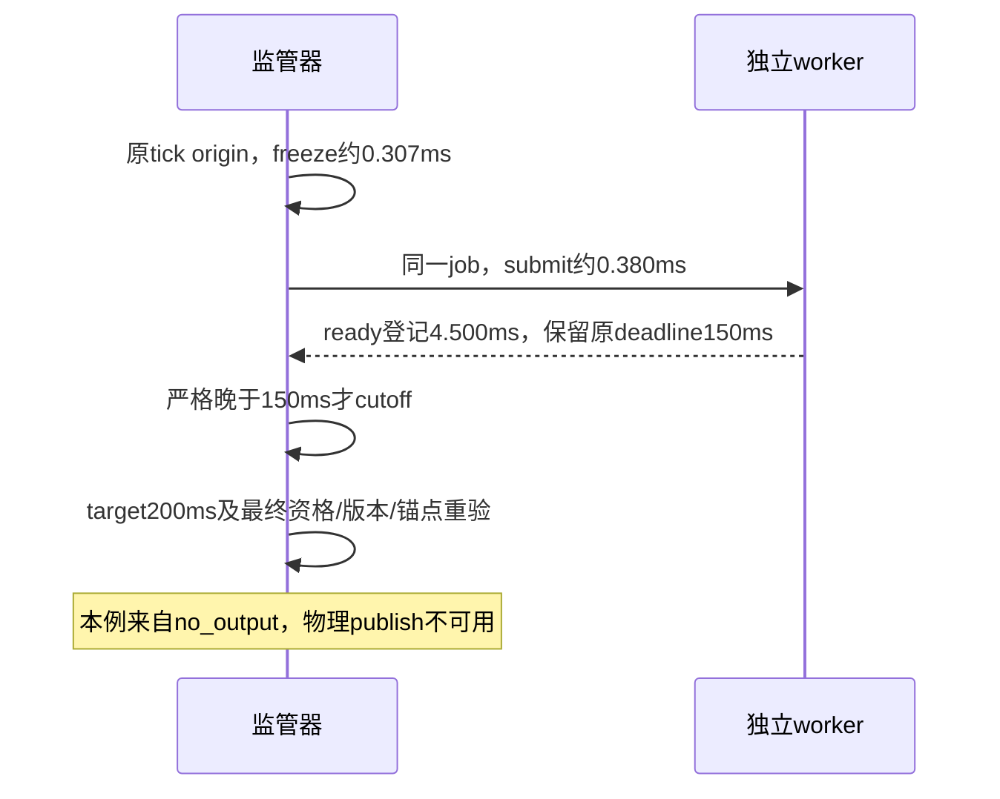

## 2026-10-09 当前推进：启动握手组件260项通过，生产准备与关闭认证待闭合

完成隔离publisher构造期身份、显式hold/release与pre-release shutdown无动作，观察器真实callback legacy_ready/永久失效及v2共同就绪协议；131个Ubuntu＋129个checker最终case全通过、0 skip。真实C++导出事件两侧ready组件兼容，synthetic输入/graph fixture不升级实际bag/Witness全链。原核心数值函数、参考算法、阈值与20ms工程门保持。

原3864资产现在25项live bringup/visualizer变化/缺失，整体guard=false；146 frozen源码和280 MPC/interface依赖仍匹配。2818 scoped输入前后不变，新隔离构建已封存；不覆盖既有文件变化、不替换原F5。owned helper不能证明DDS endpoint属于认证PID与publisher有效全配置，production release一律拒绝。完整production prepare/close、external Worker实际零hook、strict full Source/actualstorage/Witness正链、域、新版本压力/恢复与时间理由仍pending，D1/B4/M0b/execute继续No-Go。

详见[P1_M0b_B4_D1_启动握手组件_实施与验收_2026-10-09.md](C:/Users/sgh/Documents/MPC/P1_M0b_B4_D1_启动握手组件_实施与验收_2026-10-09.md)；下一最小步骤为[P1_M0b_B4_D1_owned端点与配置认证_最小计划_2026-10-09.md](C:/Users/sgh/Documents/MPC/P1_M0b_B4_D1_owned端点与配置认证_最小计划_2026-10-09.md)。旧计划和记录作为历史保留；不得从此前guard通过推断现在环境仍冻结。

# P1 M0b：参数来源、异常政策与最小校准计划

## 历史推进（本轮前快照）：冻结参考逐条重建与86项strict组件验证完成，启动握手待修复

已完成原F5 193条6×21参考、24,318元素逐项重建，索引/身份/stamp exact一致；13份冻结源/config匹配原清单。独立source37+bag49共86项最终组件测试全部通过，原F5实际40,613消息负例计数/hash闭合且缺4个P1主题时严格拒绝。

新事实纠正启动前提：原F5无动作timer前的producer startup文件，research_logging_armed=false只关闭telemetry；entry_v2无actual legacy_ready，当前source允许集与bag门不能组成共享正链。组件已验证、启动链未闭合。原≤1.2冻结只有末2条/.2s，.8参考不是实际航速上限；当前域内recipe、新统一版本R5、20ms真实主时钟界均未证明。

D1动态、B4/B5/M0b/M4/F6/P1/execute继续false；本轮无新动态launch、未改默认install/模型/权重/GP/PPO/plant。下一步先做隔离启动身份/动作release与executor实际legacy-ready版本协议，按[P1_M0b_B4_D1_启动身份与legacy就绪握手_最小计划_2026-10-09.md](C:/Users/sgh/Documents/MPC/P1_M0b_B4_D1_启动身份与legacy就绪握手_最小计划_2026-10-09.md)执行前置有限验证。详见[P1_M0b_B4_D1_冻结参考与严格检查器_实施与验收_2026-10-09.md](C:/Users/sgh/Documents/MPC/P1_M0b_B4_D1_冻结参考与严格检查器_实施与验收_2026-10-09.md)。

## 2026-10-09 历史推进：D1正文核验与隔离入口针对验证完成，动态仍No-Go

已严格只读核验七包187081条消息、23份原字节正文，metadata/实际storage计数及登记SHA一致。F5的193冻结状态只有两帧域内、最长0.2s；24.16s低速odom尾段主要零命令，不能算20s动态覆盖。twin确有旧低速转向及非空曲线参考，但持续空/非空交替与当前复现身份待解释，原≤1.2域不扩大。

已建立独立shadow-only观察入口并native构建，23新+8D0+10enqueue=41case全通过；v1测试宏编译失败与v2仅拆行修订全部保留。旧3322及v1失败199资产无漂移，本轮封存3864项；未替换默认源码/install、合同、Worker、IDL或Witness。见[本轮实施与验收](C:/Users/sgh/Documents/MPC/P1_M0b_B4_D1_前置核验与隔离入口_实施与验收_2026-10-09.md)和[精确状态](C:/Users/sgh/Documents/MPC/P1_M0b_B4_D1_前置核验与状态_2026-10-09.json)。

20ms工程门的陈述范围明确，真实时间界/参数校准未闭合。本轮有rclcpp机制测试，没有新Gazebo/F5动态运行，D1尚未采集。当前可复现域、严格shadow reader/driver、外部Worker零argv与真实legacy owner/readiness及统一版本压力资格仍pending；先执行[下一最小计划](C:/Users/sgh/Documents/MPC/P1_M0b_B4_D1_工况与严格shadow链_最小计划_2026-10-09.md)。B4/M0b/B5/M4/F6/P1/execute保持未闭合。

## 历史推进（2026-10-09）：D0来源观察机制完成，D1前置仍待闭合

已完成D0a来源缺失审查、D0b新隔离观察与18项C++/61项检查器测试，以及单次静止无输出正常管线；实际测量10.020325702s，52决策/51job/50传播成功及虚拟接纳，2无候选明确null。source/实际bag/worker/owned/Witness/输送与D0字段门全部通过，旧3067资产无漂移，当前封存3322项；普通/default安装、正式合同/IDL/Witness布局保持。见[本轮实施与验收](C:/Users/sgh/Documents/MPC/P1_M0b_B4_D0_来源观察_实施与验收_2026-10-09.md)、[契约与状态](C:/Users/sgh/Documents/MPC/P1_M0b_B4_D0_来源契约与状态_2026-10-09.json)。

D0c原≤1.2域/20ms工程门的书面决定已记录，但动态域与真实时间界没有闭合。静止速度0/history0/误差0不能作plant残差或GP标签；新增负载不继承旧压力资格。D0入口只允许no_output+diag5，D1shadow尚未启动；先按[下一前置闭合计划](C:/Users/sgh/Documents/MPC/P1_M0b_B4_D1_前置闭合_最小计划_2026-10-09.md)恢复既有域内正文和核验隔离shadow入口，满足前置后才一次20s来源窗。B4/M0b/B5/M4/F6/P1/execute仍未闭合。

## 历史推进（2026-10-09）：B4来源审查完成，动态冻结门仍待闭合

**已完成77个预冻结字段、19个hydro子字段的来源/政策/版本适用登记和旧动态全量审查；B4整体保持部分完成。** 原74字段登记、B1/C0/R5及Decision修复报告保留原字节。新入队修复隔离版本及有限静止正常对照的完成事实保持，各旧版本资格不自动转移。

旧v11本批全183决策（160有job、23无job、2接纳）和163任务均纳入；160完整六维名义传播差值未超候选门，初始化零项排除，但拒绝final来源不能自动认证传播快照。1817条实测体速度全部为1.239153–1.259542m/s、高于原拟1.2域，参考只有直线u=.8，mixed覆盖有限，不能据此冻结当前动态域。

新增明确例外：旧job16实际曾接纳，却与333.200133ms接收clock间隙、约65.233ms未来接收插值代理偏差并存。代理不是真实plant时间误差，但平均RTF和同公式自洽不足以证明20ms独立对齐。保留原阈值及全部例外；本轮没有新ROS/控制实验、源码/合同/默认安装变更，3067关闭资产提取前后无漂移。

- [x] B4逐字段来源、完整旧动态记录、异常政策与版本矩阵审查。
- [x] 创建B4-D0来源可重建与有限补证最小计划。
- [ ] B4所有execute必需参数选择依据与研究域闭合。
- [ ] 最终统一版本受影响压力/恢复/关闭资格、B5不可变合同；M0b正式冻结仍未完成。
- [ ] 默认安装切换、M4新物理出口、F6与P1整体；execute仍关闭。

**下一步先B4-D0：传播所用快照、predict成功和完整差值可用性；先决定有限研究域及20ms时钟政策，必要才一次事前有限F5 shadow。** 域内/转弯/mixed输入前置不足时先解决来源，不重复全域外直线、不改门凑通过；随后最终版本资格绑定，再B5/M4。

详细记录：[B4参数来源与版本审查](C:/Users/sgh/Documents/MPC/P1_M0b_B4_参数来源与版本适用审查_2026-10-09.md)、[新来源/冻结决策JSON](C:/Users/sgh/Documents/MPC/P1_M0b_B4_参数来源与冻结决策_2026-10-09.json)、[D0最小计划](C:/Users/sgh/Documents/MPC/P1_M0b_B4_D0_来源可重建与有限补证_最小计划_2026-10-09.md)。事实索引SHA `12fd852fe2e923c8a029d46fdb03d6b157e10a3a684a1752434477b83e837e2e`。以下日期批次属于历史范围，当前状态以本更新为准。

## 2026-10-08 归档记录：Decision 入队失败即时失效已修复并验证

**首次 DecisionEnqueue 失败可能零动作同拍退出、共享槽未清空的代码缺口，已在新的隔离版本中修复。** 普通与诊断源码均在真实 Sink 返回 false 后取得业务锁，设置停止状态，无条件清 admission ready/committed、candidate 和 pending，再判断同拍退出。Ubuntu 普通/诊断各10个正例通过；旧两源关键负例各RC1，真实检出残留槽2/候选/pending。诊断真实容量1队列拒绝测试中首次phase5/phase8均来自DecisionEnqueue/obs3，清理前后槽2→0、候选和pending true→false，未依赖下一Tick。这是实际源码链接分支验证，不是完整ROS图首次DecisionEnqueue压力顺序证明。

新诊断版本唯一实际正常no_output对照 `p1_enqueue_fix_normal_20261008_03` 窗口10.002600190s，Job/Candidate/Decision=51/51/52，虚拟激活50；source generated/emitted=1977/1977、drop0，严格source/实际MCAP/应用输送/Witness逐项对账和owned收尾通过。原2626资产无漂移，新关闭清单3067项无漂移；两次封装拒绝发生在spawn前，原夹具失败和原拒绝均保留。

**当前下一步为 B4 来源与版本适用矩阵；B5 前必须为最终统一版本补齐压力等资格绑定，之后才决定切换默认ROS安装与进入M4。** 修复产物位于 `/home/trevor/USV/.sgh-research/experiments/p1_execution_architecture_20261005_01/authored_enqueue_fix_20261008_v1`；当前ROS默认source/install仍是受旧guard保护的旧版，本轮没有覆盖默认安装。历史B0/B1/C0/R5验收按各自SHA保留，新源不能自动继承旧R5压力资格。M0b正式冻结、M4、F6、P1整体、execute资格仍未完成。

- [x] 普通/诊断代码分支修复、真实源码链接定向正例与旧源负例。
- [x] 新诊断版本有限正常ROS对照、独立对账与归档。
- [ ] 最终统一版本压力/恢复/关闭等资格复核；B4来源补齐、B5正式冻结。
- [ ] 默认安装切换、M4物理接管、新基线/F6与P1整体。

详细记录：[Decision入队失败修复与验收](C:/Users/sgh/Documents/MPC/P1_M0b_Decision入队失败即时失效_修复与验收_2026-10-08.md)。事实索引SHA `c567d850898e5c14e320125b9f56d4edcccc273aa6e0dfe4e532ccdbcba92156`；原B1/C0/R5报告及参数JSON保持原字节，下方旧批次保留当时范围，当前状态以此更新为准。

## 2026-10-08 归档记录：B3/R5 有限压力验收已完成

B0、B1、B2/C0 与本次 B3/R5 已完成。唯一 R5 压力窗口 3.113345033s，实际 Sink generated/emitted/dropped=776/762/14；旧正常源和应用账本 RC2/false 原样保留。独立机制与 worker/MCAP/输入/owned 门通过，响应保守上界 199.865993ms（事前220ms），首次停止后 Submit/accepted=0/0。123 新工具测试本地及 Ubuntu 均通过，原2521与新2626关闭资产清单无漂移，物理 publisher 观测0。

**当前下一步：首先关闭“首次 DecisionEnqueue 故障直接退出”的共享槽失效缺口，再 B4 来源补齐、B5 正式冻结与 M4。** 本次首次停于 TickStart 并真实失效，之后还有 DecisionEnqueue 失败；不能授予另一先后顺序。M0b正式冻结、M4、F6、P1整体及execute资格仍未完成。详见[R5实施与验收](C:/Users/sgh/Documents/MPC/P1_M0b_R5_日志压力机制_实施与验收_2026-10-08.md)。下方此前的日期记录属于历史范围，当前状态以本更新为准；B1/C0历史报告和参数JSON继续保留。

## 2026-10-08 归档记录：B2/C0 已完成

B0、B1与B2/C0已完成。本次唯一正常no_output对照窗口10.019557190s，Job51/Candidate51/Decision52，50次候选虚拟激活；完整source/实际bag/应用ledger/Witness逐项对账通过，物理推力publisher观测0，owned收尾完整。Ubuntu新增88单元测试及两项真实回收测试通过，原2340与新2521关闭资产清单无漂移。计数覆盖整个owned生命周期。

**下一步B3/R5：专用有限runner、机制checker、事前政策与真实日志队列压力。** 当前R5未运行；Decision enqueue失败共享槽失效缺口仍未验证/修复；M0b正式冻结、M4、F6、P1整体及physical execute资格仍未完成。详细记录见[P1_M0b_C0_正常无输出对照_实施与验收_2026-10-08](C:/Users/sgh/Documents/MPC/P1_M0b_C0_正常无输出对照_实施与验收_2026-10-08.md)。以下既存日期记录保留其历史范围，当前状态以此更新为准。

## 2026-10-07 归档记录：B0 正式合同校验已完成

**B0 已实施并验收。** 修复正式模式与诊断租约条件互斥，新增 v3 预冻结合同、完整字段/类型/模型/policy 校验及物理入口独立禁用。Ubuntu 当前 91 个不同 C++ GoogleTest 与 329 个 Python 方法全通过；565 份原始 JSON 跨语言结果一致；7 个真实启动拒绝和 4 个 formal 入口非零 hook 拒绝通过。

新旧合同分别完成 10 秒 no_output 回归：各 Job51/Candidate51，Decision52/53，候选虚拟激活50；源/bag、raw input 和应用输送分账闭合，物理 publisher 观测0，清理完整。计数覆盖 owned 生命周期，不能当作只裁剪测量窗的数量。当前源归档 v14、runtime_v30（44 Python），worker 原源 v9 未改但使用新共享 loader 重建了 bin。1845 项运行前守卫及1908项关闭证据清单核对通过。

**2026-10-07归档时的下一步为B1；B1与C0现已完成，当前下一步为B3/R5，再B4来源补齐、B5冻结和M4。** M0b 正式冻结、M4、F6、P1整体仍未完成，`physical_execute_release_enabled=false`、`execute_qualified=false`。当前预冻结 contract diagnostic_only=true/fault=false；fake frozen marker 仅为拒绝测试夹具。完整实现、指纹与限制见 [P1_M0b_B0_正式合同校验_实施与验收_2026-10-07](C:/Users/sgh/Documents/MPC/P1_M0b_B0_正式合同校验_实施与验收_2026-10-07.md)。下方此前的批次记录保留其历史范围，以本更新判断当前版本和下一步。

日期：2026-10-07（Asia/Shanghai）。适用：首选A、Ubuntu `/home/trevor/USV`、动态B、ROS2 Jazzy、acados、N=20/dt=0.2s。

**本轮已完成参数准备：逐字段来源登记、异常/恢复/关闭政策、既存原始数据补提和最小实施计划。M0b正式冻结尚未完成；R5日志压力未执行，M4物理接管、F6和P1整体未完成，execute_qualified=false。** 现有M0a资源前置与M2声明有限工程范围的完成结论保持有效，不重新开放已经闭合的无关矩阵。

本文件承接[P1最小实施计划](C:/Users/sgh/Documents/MPC/P1_时间与候选接纳契约及独立执行架构_最小实施计划_2026-10-05.md)§6/§M0b与[资源合同实施报告](C:/Users/sgh/Documents/MPC/P1_资源合同与输送分账_实施与验收_2026-10-07.md)。完整逐字段登记另存[参数来源JSON](C:/Users/sgh/Documents/MPC/P1_M0b_参数来源登记_2026-10-07.json)，本文件末尾有对应可读表。参数表记录的是当前实施和候选依据，不能当成已资格化的执行合同。

## 1. 已完成内容和仍缺的前置

| 项目 | 当前状态 | 下一步含义 |
|---|---|---|
| 原三项修复与F5原子输入基线 | 已有验收归档 | 本轮不修改F5、ONNX、PPO或nominal/plant |
| M0a资源前置、M2声明有限工程范围 | 已完成 | 复用既有证据，不重跑所有raw或typed矩阵 |
| M0b逐字段来源、单位、门槛语义和政策准备 | 本轮完成 | 逐项核对设计选择与实测来源，留下明确冻结条件 |
| v13到正式执行合同的模式兼容/完整参数校验 | B0已实现并验收 | 正式冻结仍须B4/B5，不可只改JSON两个flag |
| R5独立有限审计与真实日志队列压力 | B1/C0与本次有限R5验收已完成 | 仍须关闭首次DecisionEnqueue错误分支，然后B4/B5 |
| 动态激活容差、真实非零锚点/HOLD/rho | 来源不足或待M4 | 静止zero fixture不能替代；先声明研究域和待确认项 |
| M0b正式不可变合同及其hash | 未冻结 | 满足本文件§7才勾选 |
| M4正常/故障真实唯一输出；F6/P1整体 | 未完成 | M0b冻结后独立运行，首次确认内不改阈值 |

**已核实的错误前提：当前regulator v13不能接受任何“仅翻flags”的execute合同。** `regulator.cpp:56`要求execute_qualified=true且parameters_are_diagnostic_only=false；`:59`的能力租约门又无条件要求parameters_are_diagnostic_only=true/revision5。Python的`diagnostic_revision_supported`同样只认诊断合同。当前表现是锁住execute；没有发生物理误接管。后续须建立显式模式/合同版本规则，并逐角色核查worker、regulator、runner和checker。

另外，资源revision5已有真整型验证，但所有时间、容差、映射和关系字段尚未获得同等完整校验；`get<int64_t>()`转换不等于原JSON就是整数。正式合同不能依赖hash掩盖这个缺口。

## 2. 证据来源和本轮实际工作

当前生产版本：worker v9 / regulator v13 / runtime v29 / diagnostic revision5。当前生产源码、入口和二进制本轮未改，未启动新ROS节点或Gazebo。只读Ubuntu已归档文件，补提既存source/台账及F5实际MCAP；未重做normal/delay/shadow实验。

| 来源 | 内容、身份与范围 |
|---|---|
| E15：progress_v15_20261007.json | SHA `43da08e4fd292b16a05feb60a13210d569f66cf9c4ea1169561ab0d5d48038a6`；当前79个不同safety GTest、41个当前runtime Python文件/300测试是既有通过记录，本轮未重跑；colcon85含包装项不改称85个GTest |
| diagnostic contract5 | SHA `0e3eb70e74e922059ff17014ab1971b8a9fe20be0171964fc26410b7d769a933`；当前诊断值，pending_final_calibration仍有效 |
| 当前实现 | worker源码 `37bb25b6a8cfe0f44435ed9bb5d36c67ab46dbf0800fe15d3e36a4a62f363d8c`；regulator源码 `77a7d3f5eec5d3717a3b91460bcd7fedece7246c5229cc1bb7a1cacd3c1cf8e1`；逐文件指纹见参数JSON |
| F5旧发布基线 | 成功run `p1_f5_atomic_baseline_20261005_02`；metadata SHA `93e9a3870d27eb1ab33d59b168301019618dc3af886f46f4bbc78ba1c03046ca`；实际MCAP SHA `a53282182a8dec94f51658a2731080156f90506d0094609c424ad21d78fade50` |
| 本轮已有数据补提 | [existing_raw_analysis_20261007.json](C:/Users/sgh/Documents/Codex/2026-10-02/referenced-chatgpt-conversation-this-is-an-2/work/p1_execution_architecture_2026-10-05/m0b_preparation_20261007/existing_raw_analysis_20261007.json)，SHA `ed8fcdbcdd7a12177e3c863052c9ed1bcdd87a5c33695d68a3b9955fcf0d3845`；输入预存SHA先核对再读取，读后再次核对；逐任务/间隔明细保留 |
| 现场保护核验 | 1196个声明资产前后SHA相等，manifest SHA `d2a4b4d348fe30c05118e83fc057c591781c40a44379b4f8d952e5dfe5931a98`；controller/Gazebo数0、不可读cmdline数0；boot `5a417cdc-1c7f-4c5c-8186-6d7e9a85ddcb`。仅代表此次采样，下次launch仍须重验 |

旧失败原件保持：delay150的base RC2/正常判据false、metadata早期工具异常、原raw样本未闭合范围、强杀worker源flush unknown等，没有被这次再分析改写成成功。DDS内部packet loss仍unknown；应用消息分账不因内部原因未知而豁免缺失。

## 3. 参数选择的实测依据与限制

### 3.1 当前无输出路径的时间数据

`p1_resources_normal_20261007_01`的51份job与51次candidate registration按job_id唯一联接，完整job echo相等，时钟为同boot CLOCK_MONOTONIC。下表使用整个源记录中的全部51份任务，包含准备/收尾项，不仅是声明10秒测量窗。

| 指标 | 样本 | P95 / 最大值 | 支持什么 |
|---|---:|---|---|
| freeze→ready_commit | 51 | 3.631507 / **4.192197ms** | 包含准备、交接、native与登记的既存完整路径观测 |
| tick origin→ready_commit | 51 | 3.925691 / **4.499532ms** | 和150ms原绝对截止比较；最小剩余截止裕量145.500468ms |
| native call本地wall | 51 | 0.406007 / 0.524776ms | 只是native段，不能代替freeze→ready |
| tick start jitter | 52 | 0.057996 / 0.061255ms | 相对原计划tick的有限观测；不是最坏界 |
| activation commit jitter | 52 | 0.124475 / 0.138354ms | 最终业务提交相对计划tick，不是物理publish时刻 |
| odom receipt age / source sim lag | 50 | max20.095349 / 20.218273ms | 静态50Hz合成输入支持100ms研究门的来源记录 |
| mixed IMU receipt age / sim lag | **2** | max17.868965 / 19.030069ms | 样本很少，不支持动态IMU充分性结论 |
| 六维激活预测误差 | 每分量50 | 全0 | 静止状态与synthetic零锚点；不支持当前非零容差的动态有效性 |

T=200ms、deadline=150ms是固定设计，deadline等号允许登记，cutoff只有严格大于deadline才封口；不得以实测4ms为由改成无来源的新deadline，也不能宣称150ms是native最坏执行界。原delay150是native结束后的受控延迟，保留51次拒绝/0激活及原base失败。

### 3.2 发布5ms/240ms和RTF的来源

F5实际AppliedControl有302条连续序列、同一producer和steady_clock_domain，逐侧连续publish-start共602个间隔全部计入；没有按预算筛掉长样本，没有使用bag接收戳或sim stamp。

| 指标 | 完整样本 | P95 / 最大值 | 冻结边界 |
|---|---:|---|---|
| left连续publish-start steady gap | 301 | 200.118531 / **200.182406ms** | 旧F5路径的本地调用间隔 |
| right连续publish-start steady gap | 301 | 200.123910 / **200.184748ms** | 旧F5路径的本地调用间隔 |
| left start→right end双路调用返回span | 302 | 0.057210 / **0.095192ms** | 可支持5ms候选预算的工程裕量来源 |
| 旧callback入口→publish完成 | 301，原metadata | 0.377102 / 0.560139ms | 比上一指标多了本地控制准备；两者定义不同 |

两个通道没有>240ms的已存间隔。240ms还可解释为T200ms加相邻两拍各20ms相位偏差的40ms设计余量，但只有相应调度与调用假设成立才适用，不是硬实时推导。F5实测支持把5ms/240ms保留为**新架构首次执行前的候选研究门槛**；新regulator的实际两路调用仍须M4独立确认。`publish()`在no_output直接返回，当前新路径publish span样本数0，不能据无输出运行勾选发布预算通过。

v11历史VRX shadow clock记录9036条，按原消息的rtf_valid字段分类：有效8815条，min0.994545、max1.006570；无效221条，max1.777915。两组都保留，不把无效异常事后删掉或把“RTF有效”改称全部控制资格有效。它支持[0.95,1.05]门的有限运行来源，仍不是v13实际影子运行或任意短区间1:1推进保证。当前target sim/source lag外推是clock sim加monotonic elapsed，**没有乘measured RTF**；400–600ms平均RTF门不能证明20ms目标对齐误差的最坏上界。

### 3.3 幅值、rho、HOLD与动态研究域

后端80N/s按固定dt0.2s转成每预测阶段16N增量，首步相对job冻结anchor；监管器rho80N/s按每通道真实publisher-start锚点与当前时间差限制发布增量。单位相同而锚点/间隔不同，不能互相替代。

当前幅值±25N、map_scale1/publisher_max100N沿用实施边界，是研究发布范围，不是plant已证明安全包络。HOLD≤600ms只适用于source/task/worker均合格而单纯no_candidate，时间从last_accepted计算；clear/shutdown、worker unusable、来源失效立即进入按已知anchor的ramp，不先等待HOLD。

仅作政策算术：已知25N、rho80N/s的连续理想归零时间25/80=312.5ms；按200ms离散更新约需两拍400ms，实际还受停止观察/锚点时间/发布失败影响。不得把这算术写成plant停止时间，或机械要求shutdown_grace≥HOLD+ramp。no_output synthetic0不能实测非零斜坡。

六维容差当前[0.25m,0.25m,0.15rad,0.3m/s,0.2m/s,0.15rad/s]，逐项闭区间、heading误差wrap。暂定为工程接纳门，动态研究域及拒绝分布来源仍需补足。先明确参考/实际速度、曲率、source频率、模型/plant/锚点身份，再决定候选容差能否冻结。F4实际平均速度1.248533m/s、最大1.256615m/s超过拟1.2m/s域；不能默认为同域或为迁就原run暗改边界。`cruise_speed=.6`仅无profile时使用，不代表profile运行都为.6m/s。

先只读v11已有全部accepted/rejected状态、锚点及传播记录；不要只看2次成功激活造成幸存样本偏差。若仍不足，在单独预声明的冻结F5 shadow中只补具体动态来源，旧F5是唯一物理publisher、新regulator无输出；这类整场实验仍有旧物理输出，不能称整个实验no_output。影子阶段同时有旧NMPC求解器与新worker，比最终两进程执行多一套求解负载；记录其CPU/RTF背景，不能把影子延迟直接用于新旧公平性能比较。当前最小批次不自动新增60秒生产正常运行。

## 4. 异常、恢复和关闭政策真值表

下表描述当前代码及拟冻结政策。对物理行为未有新实测的行标出M4限制；门在同一决定mutex下的最终检查/commit定义业务边界，不能宣称传感器瞬变或callback到达后能撤回已经发布动作。

| 条件 | 新submit / 候选激活 | 当前fallback/恢复 | 记录与后续门 |
|---|---|---|---|
| 版本、source、锚点、时序/容差、幅值/rho均合格且ready≤deadline、target已到 | 允许；每目标tick单候选 | candidate | 最终commit后才是本次业务接纳；本地publish返回不是plant ACK |
| 唯一缺项no_candidate，其余均合格，last_accepted>0且age≤600ms | 新job可按有效状态提交；无候选激活 | HOLD已知anchor | 等号保持；>600ms变ramp；no_output无法证明真实保持终点 |
| candidate迟到/旧tick/echo/version/rate/state不合格 | 不激活该候选；run仍可在后续资格合格时提交新job | 除单纯no_candidate外立即ramp | 不复活旧候选；严格保留拒绝reason和原deadline |
| source过龄、未来、mixed skew、clock age/RTF无效 | 不提交，不激活 | 已知anchor ramp；后续有效来源可恢复资格 | 坏odom/IMU不续accepted receipt；既有准备在提交时重验 |
| clear/path/profile新语义或model/config版本变化 | 原在途失效；clear无任务时不提交 | 已知anchor ramp；新有效任务可产生新代job | callback invalidation晚于final commit仅影响后续tick，不能撤回已commit动作 |
| clock暂停、倒退、>5s jump或schedule变 | 原schedule/epoch候选失效 | clock恢复推进重建资格；epoch/history reset可能使真实anchor unknown | 普通tick skip不平移旧deadline；schedule重锚单列 |
| native failed/invalid、worker死、capability租约失效、active watchdog | 同run禁止后续提交/激活 | worker unusable terminal；已知anchor ramp | 新能力心跳不恢复同run，必须新run及owned清理；自然永久native挂死仍未制造 |
| Sink overflow/写入/DDS日志失败被业务观察 | 观察提交停止边界后禁止新submit/activation | stopping、在途失效、已知anchor ramp、有限关闭 | 失败异步flag发生到业务观察间的已授权项保留；R5必须独立witness |
| execute bootstrap尚无真实双侧anchor | 不允许正常候选 | 先请求双路零；成功侧建立真实anchor | 首个成功无previous anchor，rho unavailable；plant实际零unknown；待M4 |
| 单侧publish失败 | 业务normal incomplete，worker unusable；后续候选关闭 | 成功侧保留成功更新锚点，失败侧unknown并请求零 | 不回滚健康侧已发布动作；未知侧rho unavailable，不能伪装双路成功；待M4 |
| 双路publish返回span>5ms或已知侧gap>240ms/实际率超限 | 标normal incomplete、worker unusable | 后续ramp/未知处理 | **返回后才检查**，无法抢占阻塞publish；此次已经输出不可撤回 |
| stop/SIGINT/SIGTERM请求被tick观察 | 不再提交/激活 | 立即ramp；requested final≈0或grace2.5s到即结束tick | requested零不等于双路零发布成功，更不等于plant零；zero_target_published单列 |
| Sink close/join/owned退出未完成 | 后续launch禁止 | 每owned组SIGINT等0.5s→TERM等1s→KILL后查1s | 逐组窗口，不是全run2.5s硬界；source flush缺失保持unknown，remaining group非空是失败 |

capability600ms是通过身份校验的callback validation receipt租约；没有packet源序号/发送时刻，source_freshness_available=false。active watchdog1s从观察到active job状态的时刻开始，不是native真实入口时刻。timeout严格大于才到期，等号允许；已有terminal lease观测age约671.8–677.5ms体现检查/调度延迟，不能写成600ms精确停止承诺。外部监督、监管器自身关闭和plant watchdog各自有边界，不混成一个安全保证。

## 5. 正常、迟到与clear时间轴

正常例取本轮补提的当前job1，相对其原tick origin：freeze=0.307335ms、submit=0.380134ms、ready=4.499532ms，native本地段0.524776ms；deadline=150ms、target=200ms。这些实际前段时刻和50次虚拟激活的总体证据可以联接，但本表不伪造该job的未补提exact cutoff/activation/publish值。

迟到/clear为**预声明逻辑例**：某job仍以origin0、deadline150ms、target200ms为身份；登记150ms允许，登记150ms+1ns拒绝，拒绝后不把deadline移到新收到时刻；candidate即使在200ms前收到也不能复活。若clear最终提交发生在目标激活commit之前，旧任务代号失配而拒绝；若clear在本次最终commit之后，当前已commit动作不撤回，clear关闭下一次旧任务提交/激活。用真实run记两个commit时间及代号判断，不能只按bag接收顺序推断。

## 6. 最小执行步骤和产物

顺序：**B0共享合同规则与拒绝门 → B1诊断副本/有限witness → B2无hook对照 → B3/R5真实溢出 → B4逐字段冻结决策 → B5不可变合同 → M4独立确认。** B0纯校验规则与B1工具开发可并行；任何物理execute依赖B5。B0 已按上述最新更新实施并验收；B1/C0与本次有限R5现已完成；首次DecisionEnqueue故障失效、B4/B5仍为待执行计划。本文件的逐字段来源登记不因 B0 加载成功而转为冻结结论。

### B0：修复模式兼容并补全执行参数校验

1. 保留现有diagnostic revision5含义和拒绝execute的行为，给正式执行合同定义显式新schema/revision与qualification；建议`p1-execution-contract-v3`、execution revision1，区分`execution_pre_freeze`与`execution_frozen`。新字段名称在实现前一次定稿、归档schema/hash；本参数来源JSON不是该合同。
2. 建立角色/模式矩阵：diag5只允许no_output/shadow；正式预冻结合同仅允许无输出验证，不允许execute；正式冻结合同只有execute_qualified=true且parameters_are_diagnostic_only=false才能通过execute门。worker按角色接受匹配的diag/正式合同；新execute的有效能力租约规则独立于“必须诊断”条件。所有工具加载同一版本规则，未知组合拒绝。正式执行fault_injection_enabled=false，所有非零/显式故障hook拒绝。
3. C++与Python都先验证必需字段及JSON真类型，禁止bool冒充整数、浮点时间隐式取整、NaN/Inf、默认值静默补资格参数。固定N20/dt.2/T200ms/deadline150ms与当前baked backend匹配；时间正整数有有限上界，幅值/rho/tolerance/RTF/映射有限且满足关系；资源仍按当前固定支持范围，不借兼容修复放宽已验上限。topic/frame/身份、policy及nominal/codegen指纹一起核查。
4. 逐字段登记具体支持域；特别固定`deadline<T`、publish预算与调度门、lease/active独立语义、history≥有效传播需要、当前protocol硬编码±25范围、mapping结果变化拒绝以及关闭政策。政策算术是检查依赖，不把HOLD+ramp作为误加的shutdown必需关系。未支持的参数改变启动拒绝，不能随意把所有值设成可调。
5. 验证有意义的正/负用例：diag5原行为、预冻结物理拒绝、完整正式profile的纯加载/无输出验证、互斥flag/缺字段/错整型/不有限/错政策/资源不足等启动拒绝；失败时source/物理publisher未创建，节点基类短暂DDS可见单列。正式execute启动的正路径直到B5/M4才运行，纯校验通过不创建物理publisher。

产物：模式/角色真值表、共享schema与验证器、受控差异、编译/必要测试报告和拒绝门审计；不生成资格化F6，不在本步骤发推力。旧diag5回归只跑受影响门，不无依据重做M2全矩阵。

### B1：独立诊断副本与固定容量witness

创建独立目录/入口如`p1_regulator_r5_diag`，从已锁当前B0 v14复制诊断副本并逐行归档差异；保护生产v14源码/入口/bin。仅增加一次可释放的Sink消费暂停和有限审计，不改submit/admission/fallback/publish业务决定。生产保护资产前后核验；worker使用现有v9、contract5、原fixture。

hook默认关闭，压力必须同时满足no_output、diagnostic fault允许和显式arm；shadow/execute/未声明组合启动拒绝。消费暂停放在**队列mutex之外**，按预声明monotonic截止释放，最大5s，不使用永久FIFO、磁盘满或无限sleep。

witness独立于Sink，用预分配固定数组与atomic摘要：**256个tick行（每行planned/start/end）、128个真实submit commit、128个带candidate身份的最终activation尝试（保留accepted bool）、32个phase/故障边界行**。activation不得只记录成功项；没有candidate的tick仍由完整tick行及aggregate计数覆盖。前置与收尾都计入；任一数组满即audit incomplete且机制失败，不扩容、不覆盖旧数据。之所以不把所有事件塞进128总槽：15秒可有75拍，仅start/end加提交已超过128。记录使用固定数值结构及共享immutable身份header，避免std::string/Json额外heap；各数组容量、实际sizeof、共享header及总字节在构建报告中记录，内存边界明确。

每条真实commit记录job/tick/run/boot/contract/bin身份与failed/stopping快照；phase记录pause/overflow/首次失败/业务观察stopping/失效后candidate与admission/pending状态/解除。观察点覆盖tick开头、最终activation重验及Decision enqueue失败等实际路径，不把所有失败假定成一个mutex位置。tick不能同步写磁盘；业务结束与pause解除后写独立小量最终audit文件，不经过失效Sink。固定audit摘要不能参与控制决定；缺失/写失败/审计溢出皆失败。异步worker/准备线程写入需要有真实并发安全与完整published-record协议，不能因预分配就假定没有数据竞争。

专用runner复用owned supervisor，但单列R5预期regulator早退出：原normal runner/checker不改宽；RC2/source false照存。运行前preflight须同时识别新增诊断入口和旧fixture残留，不能只复用不含新名字的旧禁止列表；发现非owned进程时拒绝launch，不据扫描结果杀进程。身份检查包括PID/start_ticks/PGID/SID/exe hash/boot，按每组有限等待清理，清理不完整禁止下一launch。

### B2与B3：仅两个新增最小批次

| 批次 | 配置与触发 | 必需观察/通过条件 |
|---|---|---|
| B2/C0对照 | 同一新诊断可执行文件、512日志队列、hook关闭；业务就绪后10s测量；旧合法50Hz fixture | source/实际bag/base/应用ledger正常闭合；witness与完整日志的tick/submit/activation逐项对拍；两物理topics端点0；差异与当前B0 v14绑定；审计不读入控制决定 |
| B3/R5 | 与C0同bin/contract/tool配置；source/worker/clock业务就绪且≥2次native候选虚拟激活后，显式arm一次消费暂停；测量上限15s、暂停上限5s | **真实队列达到512且enqueue drop>0**，容量不超512；失败前暂停期至少5个真实tick完成；首次业务观察在预声明220ms内；该stopping观察提交边界后新submit/accepted activation增量0（拒绝尝试单列）；固定witness完整；有限解除与owned收尾 |

正常fixture理论约150回调事件/s，5s提供超过512项机会；这只是触发设计，实际DDS/executor接收和排队可能不同，不能从尝试发送数推算溢出。若没有实际overflow，本run为未触发/未覆盖；保留原件，修改计划/工具版本后才重试，不能运行中延长直到过关。

R5时序判据事前保存：tick_jitter候选20ms、失败观察上限T+jitter=220ms（有限测试要求，非WCET）、pause≤5s；release后优雅收尾观察≤2.5s。超过任一预算报告相应失败，不用平均值掩盖。随后owned每组SIGINT0.5s、TERM1s、KILL后查1s；这些不保证内核绝对退出。实际pause位置/arm/窗口/overflow/stop/release/close单列，whole owned证据涵盖前后准备，不能称所有phase均在15s测量窗。

溢出异步时刻与业务停止commit不是同一边界；两者之间的已授权在途项完整归因，不能要求从atomic overflow瞬间撤回已提交DDS尾部。R5独立审计记录真正的submit/activation commit，不能以晚到接收包判定发生新提交，也不能仅凭日志缺失判定停止。停止后candidate/admission失效、pending不得再提交的实际状态也必须观察；若原业务路径不满足预声明要求，保留本次机制失败，另做最小失败路径修复、升源码/bin版本并重验受影响批次，不允许witness补造失效状态。

机制flag应独立写：`expected_log_overflow_mechanism_passed`只有上述全部门闭合才true。普通source可出现dropped>0/normal_source_complete=false、close_flush=false、regulator RC2，原base/正常应用ledger失败照存；不能为了机制通过改成normal合同完整。source summary若缺失保持unknown，不能补造源记录。预期丢失仅限声明的原Sink；worker/recorder/owned/audit额外缺口或未知尾部仍使机制失败。两物理topics端点全run0；normal_contract_complete=false、publisher_rate_verification_available=false、plant_acceptance_observed=false、execute_qualified=false。

### B4：仅为具体不足补来源并完成冻结决定

优先使用本轮已有raw结果和逐字段登记，不追加无新机制的正常/迟到重复。对动态激活容差、混合IMU、真实HOLD/rho填写独立选择理由、研究域及后续M4确认判据。动态来源仍不足时，先只读旧v11全部拒绝/接受记录；必要才创建单独有限F5 shadow来源run，事前指定长度、参考/速度/曲率域和需要的原字段。不能以“只采到容易接纳的工况”证明全域有效，不同步调权重/GP/PPO/plant。

如果动态容差不能有依据地冻结，即使R5通过也停在M0b部分完成。对于新物理5ms/gap/rho/partial等可选研究预算，在首次execute前可以按旧数据+设计分配冻结**要验证的要求**，并明确M4确认范围；不需要先执行物理run来反向决定首次预算。

### B5：冻结和M4交接

正式合同按原计划生成JSON或YAML、版本/hash、必需字段来源表和研究域；先保存资格化校验/模式证据与R5报告，再设置执行资格并形成新的不可变hash。所有角色和runner使用同一文件/hash，缺来源阻止execute；禁止将候选登记JSON换名充当正式合同。

创建独立M4计划：先结束shadow并确认旧publisher退出；新run中仅新regulator拥有两个物理publisher，worker不建推力端点。保持F5模型/plant/参考资产；正常有限直行确认实际双路span/gap、真实anchor/rho、完整source/bag与执行决策，随后受控故障确认预声明政策。检查实际输出预算时报告每个超期/部分失败，不要求新异步closed loop逐动作等同旧B；不宣称性能改进。超预算保留失败run，修改合同升版本并重验受影响项，不在该run内调整门槛。

## 7. 阶段勾选、停止条件和交付

- [x] 当前源码/合同/报告核对及模式互斥发现。
- [x] 全部contract5顶层字段来源、单位、真实门及冻结条件登记，另列隐含硬常数。
- [x] 既存原始时间/steady publisher/RTF分组数据补提，输入与保护资产前后哈希核验。
- [x] 政策真值表、正常与迟到/clear时间轴、有限R5实施与验收计划。
- [x] B0正式合同版本/模式兼容、完整候选参数支持域及拒绝门实现；真实构建与跨语言、启动拒绝、新旧无输出回归已通过，详见B0实施报告。
- [x] B1诊断副本/witness构建和默认关闭/并发完整性验证（2026-10-08；37 C++/63 Python/9实际启动拒绝；B1/C0和本次有限R5已完成，首次DecisionEnqueue故障失效覆盖仍待完成）。
- [x] B2/C0正常对照与source/bag/ledger/Witness逐项匹配（2026-10-08；唯一10s批次）。
- [x] B3/R5 本次单次有限压力验收；首个DecisionEnqueue失效分支另列待修复。
- [ ] B4所有execute必需字段选择依据与研究域闭合。
- [ ] B5正式不可变执行合同冻结；**M0b整体未完成**。
- [ ] M4正常/故障真实唯一出口确认、新基线/F6；P1整体未完成。

新launch前必须重验live源码、安装/依赖、合同/hash、已有保护资产、ROS端点/进程与owned清理状态；本轮只读采样不永久授权跳过门禁。双物理publisher、旧/迟到候选被正常接纳、审计无界或丢失、无法解释资产漂移/计数、partial伪装成功、确认中调阈值、清理失败时停止依赖步骤。保留source、MCAP、二进制、原失败和版本差异；不得删除证据来获得闭合。

本工作不推出：plant ACK/实测推力、物理保持终点或安全停止、监管器自身崩溃后的plant watchdog、自然native永久挂死、任意磁盘I/O绝对终止、任意DDS内部packet损失数量、反序列化前所有资源耗尽防护、硬实时最坏界、GP标签准入、真实有限模型切换或认证备份。这些按M4及后续研究/物理层逐项承担。

本轮独立审查及前置反思保存在[M0b准备目录](C:/Users/sgh/Documents/Codex/2026-10-02/referenced-chatgpt-conversation-this-is-an-2/work/p1_execution_architecture_2026-10-05/m0b_preparation_20261007)。B0已于2026-10-07完成，B1/C0与本次有限R5已于2026-10-08完成；后续首先修复并定向覆盖首次DecisionEnqueue故障，再B4/B5，物理execute仍关闭。

## 8. 逐字段参数登记

以下表从同目录参数来源JSON生成；字段原值与contract5逐项相等，来源分类不是校准完成标志。各分类的实际来源和冻结限制以每行描述为准。

### 8.1 全部74个当前合同字段

分类含义：固定F5基线/固定设计已实现/诊断阈值待冻结/诊断身份/政策待正式兼容/不可用观察。各行仍execute_qualified=false。

| 字段 | 当前原值与单位 | 来源性质、实际语义 | 冻结条件与实施定位 |
|---|---|---|---|
| `schema` | "p1-execution-contract-v2"；字符串 | 当前诊断身份，未授execute资格。当前p1-execution-contract-v2是诊断合同路径；不是已资格化执行schema。 | B0定义显式正式schema/revision/角色矩阵，保留diag5。 [protocol:30](C:/Users/sgh/Documents/Codex/2026-10-02/referenced-chatgpt-conversation-this-is-an-2/work/p1_execution_architecture_2026-10-05/resource_closure_20261006/safety/protocol.hpp:30)、[revision](C:/Users/sgh/Documents/Codex/2026-10-02/referenced-chatgpt-conversation-this-is-an-2/work/p1_execution_architecture_2026-10-05/resource_closure_20261006/runtime/p1_contract_revision.py) |
| `qualification` | "temporary_shadow_diagnostic"；字符串 | 当前诊断身份，未授execute资格。temporary_shadow_diagnostic说明当前身份；不能单独赋予execute。 | 正式pre_freeze/frozen资格及来源门需要实现并归档。 [regulator:56](C:/Users/sgh/Documents/Codex/2026-10-02/referenced-chatgpt-conversation-this-is-an-2/work/p1_execution_architecture_2026-10-05/resource_closure_20261006/safety/regulator.cpp:56)、[runner:41](C:/Users/sgh/Documents/Codex/2026-10-02/referenced-chatgpt-conversation-this-is-an-2/work/p1_execution_architecture_2026-10-05/resource_closure_20261006/runtime/run_no_output_calibration.py:41) |
| `execute_qualified` | false；bool | 当前诊断身份，未授execute资格。当前false；execute要求true并且非诊断，另一个无条件诊断门形成互斥。 | B0兼容修复，B4/R5门闭合与B5不可变冻结之前保持false。 [regulator:56](C:/Users/sgh/Documents/Codex/2026-10-02/referenced-chatgpt-conversation-this-is-an-2/work/p1_execution_architecture_2026-10-05/resource_closure_20261006/safety/regulator.cpp:56) |
| `clock` | "CLOCK_MONOTONIC"；时钟标识 | 固定设计已实现，有限结构证据。CLOCK_MONOTONIC；boot/domain身份匹配，禁止与bag接收或sim域直接混减。 | B0完整角色/模式/类型/finite/支持域校验及实际资产绑定；保持已验F5数值，不当作plant安全保证。 [protocol:30](C:/Users/sgh/Documents/Codex/2026-10-02/referenced-chatgpt-conversation-this-is-an-2/work/p1_execution_architecture_2026-10-05/resource_closure_20261006/safety/protocol.hpp:30)、[regulator:59](C:/Users/sgh/Documents/Codex/2026-10-02/referenced-chatgpt-conversation-this-is-an-2/work/p1_execution_architecture_2026-10-05/resource_closure_20261006/safety/regulator.cpp:59) |
| `N` | 20；阶段数 | 固定F5基线，需实际资产绑定。固定20控制阶段、21状态/参考列；baked codegen维度不是任意JSON可调。 | B0完整角色/模式/类型/finite/支持域校验及实际资产绑定；保持已验F5数值，不当作plant安全保证。 [protocol:31](C:/Users/sgh/Documents/Codex/2026-10-02/referenced-chatgpt-conversation-this-is-an-2/work/p1_execution_architecture_2026-10-05/resource_closure_20261006/safety/protocol.hpp:31)、[worker:81](C:/Users/sgh/Documents/Codex/2026-10-02/referenced-chatgpt-conversation-this-is-an-2/work/p1_execution_architecture_2026-10-05/resource_closure_20261006/safety/solver_worker.cpp:81)、[backend:103](C:/Users/sgh/Documents/Codex/2026-10-02/referenced-chatgpt-conversation-this-is-an-2/work/p0_contract_impl_2026-10-03/source/usv_mpc_ws/src/usv_mpc_cpp/src/acados_backend.cpp:103) |
| `dt` | 0.2；s | 固定F5基线，需实际资产绑定。固定0.2秒预测阶段，时域4秒；生成后端必须同dt。 | B0完整角色/模式/类型/finite/支持域校验及实际资产绑定；保持已验F5数值，不当作plant安全保证。 [protocol:32](C:/Users/sgh/Documents/Codex/2026-10-02/referenced-chatgpt-conversation-this-is-an-2/work/p1_execution_architecture_2026-10-05/resource_closure_20261006/safety/protocol.hpp:32)、[backend:103](C:/Users/sgh/Documents/Codex/2026-10-02/referenced-chatgpt-conversation-this-is-an-2/work/p0_contract_impl_2026-10-03/source/usv_mpc_ws/src/usv_mpc_cpp/src/acados_backend.cpp:103) |
| `T_ns` | 200000000；ns，monotonic | 固定设计已实现，有限结构证据。200ms原绝对tick；普通skip不补拍或平移旧deadline，schedule重锚另列。 | B0精确支持T固定值及deadline<T；用已有tick观测作有限证据，非WCET。 [admission:13](C:/Users/sgh/Documents/Codex/2026-10-02/referenced-chatgpt-conversation-this-is-an-2/work/p1_execution_architecture_2026-10-05/resource_closure_20261006/safety/p1_admission.hpp:13)、[regulator:257](C:/Users/sgh/Documents/Codex/2026-10-02/referenced-chatgpt-conversation-this-is-an-2/work/p1_execution_architecture_2026-10-05/resource_closure_20261006/safety/regulator.cpp:257) |
| `deadline_ns` | 150000000；ns，monotonic偏移 | 固定设计已实现，有限结构证据。origin+150ms；submit/native/ready严格>deadline拒绝，等号允许；cutoff严格>deadline，target=origin+T。 | 保持原绝对deadline语义与固定支持值；不从native耗时代替端到端截止。 [protocol:42](C:/Users/sgh/Documents/Codex/2026-10-02/referenced-chatgpt-conversation-this-is-an-2/work/p1_execution_architecture_2026-10-05/resource_closure_20261006/safety/protocol.hpp:42)、[admission:108](C:/Users/sgh/Documents/Codex/2026-10-02/referenced-chatgpt-conversation-this-is-an-2/work/p1_execution_architecture_2026-10-05/resource_closure_20261006/safety/p1_admission.hpp:108)、[worker:76](C:/Users/sgh/Documents/Codex/2026-10-02/referenced-chatgpt-conversation-this-is-an-2/work/p1_execution_architecture_2026-10-05/resource_closure_20261006/safety/solver_worker.cpp:76) |
| `baseline_input` | "F5_20261005_atomic_freeze_01"；基线ID | 固定F5基线，需实际资产绑定。F5_20261005_atomic_freeze_01是不可变输入基线身份，不只看Git HEAD。 | B0完整角色/模式/类型/finite/支持域校验及实际资产绑定；保持已验F5数值，不当作plant安全保证。 [contract](C:/Users/sgh/Documents/Codex/2026-10-02/referenced-chatgpt-conversation-this-is-an-2/work/p1_execution_architecture_2026-10-05/resource_closure_20261006/p1_shadow_contract_v5.json)、[F5](C:/Users/sgh/Documents/Codex/2026-10-02/referenced-chatgpt-conversation-this-is-an-2/work/p1_atomic_freeze_2026-10-05/metadata_summary.json) |
| `nominal_hash` | "78d7133fd4f11d47bd534d820b02489e440bd8664bef254893e830fe4bc7dc84"；SHA256 | 固定F5基线，需实际资产绑定。绑定本固定nominal；模型、配置代号与代码/生成资产也须一致。 | B0完整角色/模式/类型/finite/支持域校验及实际资产绑定；保持已验F5数值，不当作plant安全保证。 [protocol:35](C:/Users/sgh/Documents/Codex/2026-10-02/referenced-chatgpt-conversation-this-is-an-2/work/p1_execution_architecture_2026-10-05/resource_closure_20261006/safety/protocol.hpp:35)、[worker:18](C:/Users/sgh/Documents/Codex/2026-10-02/referenced-chatgpt-conversation-this-is-an-2/work/p1_execution_architecture_2026-10-05/resource_closure_20261006/safety/solver_worker.cpp:18)、[F5](C:/Users/sgh/Documents/Codex/2026-10-02/referenced-chatgpt-conversation-this-is-an-2/work/p1_atomic_freeze_2026-10-05/metadata_summary.json) |
| `Q` | [20,20,50,8,1,8]；由代价定义决定的权重；非物理界 | 固定F5基线，需实际资产绑定。六维状态代价权重；heading实际使用sin/cos单位圆残差。 | B0完整角色/模式/类型/finite/支持域校验及实际资产绑定；保持已验F5数值，不当作plant安全保证。 [protocol:32](C:/Users/sgh/Documents/Codex/2026-10-02/referenced-chatgpt-conversation-this-is-an-2/work/p1_execution_architecture_2026-10-05/resource_closure_20261006/safety/protocol.hpp:32)、[backend:73](C:/Users/sgh/Documents/Codex/2026-10-02/referenced-chatgpt-conversation-this-is-an-2/work/p0_contract_impl_2026-10-03/source/usv_mpc_ws/src/usv_mpc_cpp/src/acados_backend.cpp:73)、[codegen:178](C:/Users/sgh/Documents/Codex/2026-10-02/referenced-chatgpt-conversation-this-is-an-2/work/a_feasibility_2026-10-03/remote_snapshot/usv_mpc_ws/src/usv_mpc_cpp/scripts/regenerate_acados_codegen.py:178) |
| `R` | [0.05,0.05]；由代价定义决定的权重；非物理界 | 固定F5基线，需实际资产绑定。两通道推力代价权重。 | B0完整角色/模式/类型/finite/支持域校验及实际资产绑定；保持已验F5数值，不当作plant安全保证。 [protocol:32](C:/Users/sgh/Documents/Codex/2026-10-02/referenced-chatgpt-conversation-this-is-an-2/work/p1_execution_architecture_2026-10-05/resource_closure_20261006/safety/protocol.hpp:32)、[backend:73](C:/Users/sgh/Documents/Codex/2026-10-02/referenced-chatgpt-conversation-this-is-an-2/work/p0_contract_impl_2026-10-03/source/usv_mpc_ws/src/usv_mpc_cpp/src/acados_backend.cpp:73)、[codegen:178](C:/Users/sgh/Documents/Codex/2026-10-02/referenced-chatgpt-conversation-this-is-an-2/work/a_feasibility_2026-10-03/remote_snapshot/usv_mpc_ws/src/usv_mpc_cpp/scripts/regenerate_acados_codegen.py:178) |
| `Rd` | [0.2,0.2]；由代价定义决定的权重；非物理界 | 固定F5基线，需实际资产绑定。相邻预测推力增量ΔT平方的权重，不是连续dT/dt平方。 | B0完整角色/模式/类型/finite/支持域校验及实际资产绑定；保持已验F5数值，不当作plant安全保证。 [protocol:32](C:/Users/sgh/Documents/Codex/2026-10-02/referenced-chatgpt-conversation-this-is-an-2/work/p1_execution_architecture_2026-10-05/resource_closure_20261006/safety/protocol.hpp:32)、[backend:73](C:/Users/sgh/Documents/Codex/2026-10-02/referenced-chatgpt-conversation-this-is-an-2/work/p0_contract_impl_2026-10-03/source/usv_mpc_ws/src/usv_mpc_cpp/src/acados_backend.cpp:73)、[codegen:178](C:/Users/sgh/Documents/Codex/2026-10-02/referenced-chatgpt-conversation-this-is-an-2/work/a_feasibility_2026-10-03/remote_snapshot/usv_mpc_ws/src/usv_mpc_cpp/scripts/regenerate_acados_codegen.py:178) |
| `Qf_scale` | 8；由代价定义决定的权重；非物理界 | 固定F5基线，需实际资产绑定。终端代价缩放；阶段按dt积算，终端不按阶段dt缩放。 | B0完整角色/模式/类型/finite/支持域校验及实际资产绑定；保持已验F5数值，不当作plant安全保证。 [protocol:32](C:/Users/sgh/Documents/Codex/2026-10-02/referenced-chatgpt-conversation-this-is-an-2/work/p1_execution_architecture_2026-10-05/resource_closure_20261006/safety/protocol.hpp:32)、[backend:73](C:/Users/sgh/Documents/Codex/2026-10-02/referenced-chatgpt-conversation-this-is-an-2/work/p0_contract_impl_2026-10-03/source/usv_mpc_ws/src/usv_mpc_cpp/src/acados_backend.cpp:73)、[codegen:178](C:/Users/sgh/Documents/Codex/2026-10-02/referenced-chatgpt-conversation-this-is-an-2/work/a_feasibility_2026-10-03/remote_snapshot/usv_mpc_ws/src/usv_mpc_cpp/scripts/regenerate_acados_codegen.py:178) |
| `hydro` | {"mass":14.2,"Iz":2.13,"xg":0.12,"d_thruster":0.25,"Xu_dot":-2,"Yv_dot":-8,"Yr_dot":-0.1817725,"Nv_dot":-0.1817725,"Nr_dot":-3.41,"Xu":-2.272063,"Yv":-2.629019,"Yr":0,"Nv":0,"Nr":-3.105,"Xuu":-11.571784,"Yvv":-0.05,"Yrr":0,"Nvv":0,"Nrr":-0.71}；19项SI参数；见子表 | 固定F5基线，需实际资产绑定。固定M/C/D名义模型；输入tau=[TL+TR,0,d*(TR-TL)]。附加质量/阻尼符号按实现，不能用头文件默认替代实际合同。 | B0完整角色/模式/类型/finite/支持域校验及实际资产绑定；保持已验F5数值，不当作plant安全保证。 [protocol:33](C:/Users/sgh/Documents/Codex/2026-10-02/referenced-chatgpt-conversation-this-is-an-2/work/p1_execution_architecture_2026-10-05/resource_closure_20261006/safety/protocol.hpp:33)、[model:50](C:/Users/sgh/Documents/Codex/2026-10-02/referenced-chatgpt-conversation-this-is-an-2/work/p0_contract_impl_2026-10-03/source/usv_mpc_ws/src/usv_mpc_cpp/src/usv_model_dynamic.cpp:50) |
| `command_min_n` | -25；N | 固定F5基线，需实际资产绑定。每通道幅值闭区间[-25,+25]；protocol job anchor/history仍硬编码同范围，不是任意新幅值可调。 | B0完整角色/模式/类型/finite/支持域校验及实际资产绑定；保持已验F5数值，不当作plant安全保证。 [protocol:32](C:/Users/sgh/Documents/Codex/2026-10-02/referenced-chatgpt-conversation-this-is-an-2/work/p1_execution_architecture_2026-10-05/resource_closure_20261006/safety/protocol.hpp:32)、[protocol:44](C:/Users/sgh/Documents/Codex/2026-10-02/referenced-chatgpt-conversation-this-is-an-2/work/p1_execution_architecture_2026-10-05/resource_closure_20261006/safety/protocol.hpp:44)、[admission:98](C:/Users/sgh/Documents/Codex/2026-10-02/referenced-chatgpt-conversation-this-is-an-2/work/p1_execution_architecture_2026-10-05/resource_closure_20261006/safety/p1_admission.hpp:98) |
| `command_max_n` | 25；N | 固定F5基线，需实际资产绑定。每通道幅值闭区间[-25,+25]；protocol job anchor/history仍硬编码同范围，不是任意新幅值可调。 | B0完整角色/模式/类型/finite/支持域校验及实际资产绑定；保持已验F5数值，不当作plant安全保证。 [protocol:32](C:/Users/sgh/Documents/Codex/2026-10-02/referenced-chatgpt-conversation-this-is-an-2/work/p1_execution_architecture_2026-10-05/resource_closure_20261006/safety/protocol.hpp:32)、[protocol:44](C:/Users/sgh/Documents/Codex/2026-10-02/referenced-chatgpt-conversation-this-is-an-2/work/p1_execution_architecture_2026-10-05/resource_closure_20261006/safety/protocol.hpp:44)、[admission:98](C:/Users/sgh/Documents/Codex/2026-10-02/referenced-chatgpt-conversation-this-is-an-2/work/p1_execution_architecture_2026-10-05/resource_closure_20261006/safety/p1_admission.hpp:98) |
| `map_scale` | 1；无量纲 | 固定F5基线，需实际资产绑定。mapped=clamp(request*scale, max(low,-publisher_max), min(high,publisher_max))；mapped/request差>1e-9拒绝，不能限幅修成正常候选。 | B0完整角色/模式/类型/finite/支持域校验及实际资产绑定；保持已验F5数值，不当作plant安全保证。 [input_core:43](C:/Users/sgh/Documents/Codex/2026-10-02/referenced-chatgpt-conversation-this-is-an-2/work/p1_execution_architecture_2026-10-05/core/p1_input_core.hpp:43)、[regulator:280](C:/Users/sgh/Documents/Codex/2026-10-02/referenced-chatgpt-conversation-this-is-an-2/work/p1_execution_architecture_2026-10-05/resource_closure_20261006/safety/regulator.cpp:280) |
| `publisher_max_n` | 100；N | 固定F5基线，需实际资产绑定。VRX映射上限100N，与研究command±25N取交集；不等于plant安全包络。 | B0完整角色/模式/类型/finite/支持域校验及实际资产绑定；保持已验F5数值，不当作plant安全保证。 [input_core:43](C:/Users/sgh/Documents/Codex/2026-10-02/referenced-chatgpt-conversation-this-is-an-2/work/p1_execution_architecture_2026-10-05/core/p1_input_core.hpp:43)、[regulator:280](C:/Users/sgh/Documents/Codex/2026-10-02/referenced-chatgpt-conversation-this-is-an-2/work/p1_execution_architecture_2026-10-05/resource_closure_20261006/safety/regulator.cpp:280) |
| `backend_rate_n_s` | 80；N/s | 固定F5基线，需实际资产绑定。后端dT_max*dt=16N每预测阶段；首步冻结anchor，后续相邻输入；u_prev是推力记忆而非推进器物理滞后。 | B0完整角色/模式/类型/finite/支持域校验及实际资产绑定；保持已验F5数值，不当作plant安全保证。 [protocol:32](C:/Users/sgh/Documents/Codex/2026-10-02/referenced-chatgpt-conversation-this-is-an-2/work/p1_execution_architecture_2026-10-05/resource_closure_20261006/safety/protocol.hpp:32)、[worker:80](C:/Users/sgh/Documents/Codex/2026-10-02/referenced-chatgpt-conversation-this-is-an-2/work/p1_execution_architecture_2026-10-05/resource_closure_20261006/safety/solver_worker.cpp:80)、[backend:198](C:/Users/sgh/Documents/Codex/2026-10-02/referenced-chatgpt-conversation-this-is-an-2/work/p0_contract_impl_2026-10-03/source/usv_mpc_ws/src/usv_mpc_cpp/src/acados_backend.cpp:198)、[codegen:216](C:/Users/sgh/Documents/Codex/2026-10-02/referenced-chatgpt-conversation-this-is-an-2/work/a_feasibility_2026-10-03/remote_snapshot/usv_mpc_ws/src/usv_mpc_cpp/scripts/regenerate_acados_codegen.py:216) |
| `rho_n_s` | 80；N/s | 诊断候选阈值，待来源选择/冻结。每通道abs(final-anchor)<=rho*(真实monotonic间隔)/1e9+1e-9，now须>anchor time；与后端固定16N门不同。 | B4明确研究域及选择理由；引用有限原数据；不足项单列来源补采，B5事前冻结，M4只确认、不在确认run调阈值。 bootstrap/unknown/partial时率验证不可用，no_output synthetic0不能确认真实率。 [admission:98](C:/Users/sgh/Documents/Codex/2026-10-02/referenced-chatgpt-conversation-this-is-an-2/work/p1_execution_architecture_2026-10-05/resource_closure_20261006/safety/p1_admission.hpp:98)、[regulator:254](C:/Users/sgh/Documents/Codex/2026-10-02/referenced-chatgpt-conversation-this-is-an-2/work/p1_execution_architecture_2026-10-05/resource_closure_20261006/safety/regulator.cpp:254) |
| `hold_ns` | 600000000；ns | 诊断候选阈值，待来源选择/冻结。仅有效source/task/worker且no_candidate，last_accepted>0且age<=600ms保持；其他失效立即ramp，等号允许。 | B4明确研究域及选择理由；引用有限原数据；不足项单列来源补采，B5事前冻结，M4只确认、不在确认run调阈值。 明确last_accepted锚点、非零HOLD与立即shutdown政策；物理待M4。 [admission:131](C:/Users/sgh/Documents/Codex/2026-10-02/referenced-chatgpt-conversation-this-is-an-2/work/p1_execution_architecture_2026-10-05/resource_closure_20261006/safety/p1_admission.hpp:131)、[regulator:299](C:/Users/sgh/Documents/Codex/2026-10-02/referenced-chatgpt-conversation-this-is-an-2/work/p1_execution_architecture_2026-10-05/resource_closure_20261006/safety/regulator.cpp:299) |
| `activation_tolerance` | [0.25,0.25,0.15,0.3,0.2,0.15]；[m,m,rad,m/s,m/s,rad/s] | 诊断候选阈值，待来源选择/冻结。逐六分量abs(error)>阈值拒绝，等号允许，psi误差wrap；是工程门非reachable-set外界。 | B4明确研究域及选择理由；引用有限原数据；不足项单列来源补采，B5事前冻结，M4只确认、不在确认run调阈值。 静止50样本全0、mixed仅2不能认证动态域；保留v11拒绝样本与F4速度越域。 [admission:95](C:/Users/sgh/Documents/Codex/2026-10-02/referenced-chatgpt-conversation-this-is-an-2/work/p1_execution_architecture_2026-10-05/resource_closure_20261006/safety/p1_admission.hpp:95)、[regulator:279](C:/Users/sgh/Documents/Codex/2026-10-02/referenced-chatgpt-conversation-this-is-an-2/work/p1_execution_architecture_2026-10-05/resource_closure_20261006/safety/regulator.cpp:279) |
| `odom_age_ns` | 100000000；ns（见receipt/sim域） | 诊断候选阈值，待来源选择/冻结。accepted odom callback receipt到当前commit的monotonic年龄，>100ms拒绝，坏消息不续receipt。 | B4明确研究域及选择理由；引用有限原数据；不足项单列来源补采，B5事前冻结，M4只确认、不在确认run调阈值。 类型、等号及1:1外推假设须明确；mixed仅2样本。 [regulator:90](C:/Users/sgh/Documents/Codex/2026-10-02/referenced-chatgpt-conversation-this-is-an-2/work/p1_execution_architecture_2026-10-05/resource_closure_20261006/safety/regulator.cpp:90)、[admission:31](C:/Users/sgh/Documents/Codex/2026-10-02/referenced-chatgpt-conversation-this-is-an-2/work/p1_execution_architecture_2026-10-05/resource_closure_20261006/safety/p1_admission.hpp:31) |
| `imu_age_ns` | 100000000；ns（见receipt/sim域） | 诊断候选阈值，待来源选择/冻结。仅mixed r来自IMU时检查accepted IMU receipt年龄，>100ms拒绝。 | B4明确研究域及选择理由；引用有限原数据；不足项单列来源补采，B5事前冻结，M4只确认、不在确认run调阈值。 类型、等号及1:1外推假设须明确；mixed仅2样本。 [regulator:93](C:/Users/sgh/Documents/Codex/2026-10-02/referenced-chatgpt-conversation-this-is-an-2/work/p1_execution_architecture_2026-10-05/resource_closure_20261006/safety/regulator.cpp:93)、[admission:31](C:/Users/sgh/Documents/Codex/2026-10-02/referenced-chatgpt-conversation-this-is-an-2/work/p1_execution_architecture_2026-10-05/resource_closure_20261006/safety/p1_admission.hpp:31) |
| `mixed_skew_ns` | 100000000；ns（见receipt/sim域） | 诊断候选阈值，待来源选择/冻结。仅mixed时abs(IMU simstamp-odom simstamp)>100ms拒绝，等号允许。 | B4明确研究域及选择理由；引用有限原数据；不足项单列来源补采，B5事前冻结，M4只确认、不在确认run调阈值。 类型、等号及1:1外推假设须明确；mixed仅2样本。 [regulator:93](C:/Users/sgh/Documents/Codex/2026-10-02/referenced-chatgpt-conversation-this-is-an-2/work/p1_execution_architecture_2026-10-05/resource_closure_20261006/safety/regulator.cpp:93) |
| `clock_age_ns` | 100000000；ns（见receipt/sim域） | 诊断候选阈值，待来源选择/冻结。clock callback receipt age>100ms或missing拒绝；receipt fresh不等于sim推进。 | B4明确研究域及选择理由；引用有限原数据；不足项单列来源补采，B5事前冻结，M4只确认、不在确认run调阈值。 类型、等号及1:1外推假设须明确；mixed仅2样本。 [regulator:94](C:/Users/sgh/Documents/Codex/2026-10-02/referenced-chatgpt-conversation-this-is-an-2/work/p1_execution_architecture_2026-10-05/resource_closure_20261006/safety/regulator.cpp:94) |
| `rtf_low` | 0.95；无量纲 | 诊断候选阈值，待来源选择/冻结。窗口RTF落在[.95,1.05]闭区间；400–600ms窗口/10ms间距/100锚点；target与source外推仍1:1，未乘RTF。 | B4明确研究域及选择理由；引用有限原数据；不足项单列来源补采，B5事前冻结，M4只确认、不在确认run调阈值。 窗口平均不界定短区间误差；v11原无效221和有效8815均保留。 [clock_window:21](C:/Users/sgh/Documents/Codex/2026-10-02/referenced-chatgpt-conversation-this-is-an-2/work/p1_execution_architecture_2026-10-05/resource_closure_20261006/safety/p1_clock_window.hpp:21)、[regulator:169](C:/Users/sgh/Documents/Codex/2026-10-02/referenced-chatgpt-conversation-this-is-an-2/work/p1_execution_architecture_2026-10-05/resource_closure_20261006/safety/regulator.cpp:169) |
| `rtf_high` | 1.05；无量纲 | 诊断候选阈值，待来源选择/冻结。窗口RTF落在[.95,1.05]闭区间；400–600ms窗口/10ms间距/100锚点；target与source外推仍1:1，未乘RTF。 | B4明确研究域及选择理由；引用有限原数据；不足项单列来源补采，B5事前冻结，M4只确认、不在确认run调阈值。 窗口平均不界定短区间误差；v11原无效221和有效8815均保留。 [clock_window:21](C:/Users/sgh/Documents/Codex/2026-10-02/referenced-chatgpt-conversation-this-is-an-2/work/p1_execution_architecture_2026-10-05/resource_closure_20261006/safety/p1_clock_window.hpp:21)、[regulator:169](C:/Users/sgh/Documents/Codex/2026-10-02/referenced-chatgpt-conversation-this-is-an-2/work/p1_execution_architecture_2026-10-05/resource_closure_20261006/safety/regulator.cpp:169) |
| `clock_pause_confirm_ns` | 400000000；ns，monotonic | 诊断候选阈值，待来源选择/冻结。now-last_clock_advance>400ms判pause/schedule++/候选失效；clock age或RTF可能先拒绝，推进恢复再次schedule++。 | B4明确研究域及选择理由；引用有限原数据；不足项单列来源补采，B5事前冻结，M4只确认、不在确认run调阈值。 [regulator:269](C:/Users/sgh/Documents/Codex/2026-10-02/referenced-chatgpt-conversation-this-is-an-2/work/p1_execution_architecture_2026-10-05/resource_closure_20261006/safety/regulator.cpp:269) |
| `target_sim_slack_ns` | 20000000；ns，sim域对齐误差 | 诊断候选阈值，待来源选择/冻结。abs(clock_sim+commit-clock_receive-candidate.target_sim)>20ms拒绝；job/activation均1:1外推。 | B4明确研究域及选择理由；引用有限原数据；不足项单列来源补采，B5事前冻结，M4只确认、不在确认run调阈值。 不把平均RTF带宽当作20ms最坏误差证明。 [regulator:289](C:/Users/sgh/Documents/Codex/2026-10-02/referenced-chatgpt-conversation-this-is-an-2/work/p1_execution_architecture_2026-10-05/resource_closure_20261006/safety/regulator.cpp:289) |
| `tick_jitter_ns` | 20000000；ns，monotonic | 诊断候选阈值，待来源选择/冻结。tick start-planned或activation commit-planned>20ms拒绝/normal incomplete；普通skip按floor(delay/T)。 | B4明确研究域及选择理由；引用有限原数据；不足项单列来源补采，B5事前冻结，M4只确认、不在确认run调阈值。 最大有限观测0.061255/0.138354ms不等于WCET；R5亦报告每次超期。 [regulator:267](C:/Users/sgh/Documents/Codex/2026-10-02/referenced-chatgpt-conversation-this-is-an-2/work/p1_execution_architecture_2026-10-05/resource_closure_20261006/safety/regulator.cpp:267)、[regulator:288](C:/Users/sgh/Documents/Codex/2026-10-02/referenced-chatgpt-conversation-this-is-an-2/work/p1_execution_architecture_2026-10-05/resource_closure_20261006/safety/regulator.cpp:288) |
| `publish_gap_ns` | 240000000；ns，逐侧monotonic | 诊断候选阈值，待来源选择/冻结。已知anchor到该侧本次publish_start gap>240ms，在返回后标normal incomplete/worker unusable；bootstrap无前锚点不适用。 | B4明确研究域及选择理由；引用有限原数据；不足项单列来源补采，B5事前冻结，M4只确认、不在确认run调阈值。 旧F5301对/侧支持候选来源；新实际publisher-start仍待M4。 [regulator:254](C:/Users/sgh/Documents/Codex/2026-10-02/referenced-chatgpt-conversation-this-is-an-2/work/p1_execution_architecture_2026-10-05/resource_closure_20261006/safety/regulator.cpp:254) |
| `publish_budget_ns` | 5000000；ns，本地调用span | 诊断候选阈值，待来源选择/冻结。right.publish_end-left.publish_start>5ms在返回后置失效；不抢占阻塞publish。 | B4明确研究域及选择理由；引用有限原数据；不足项单列来源补采，B5事前冻结，M4只确认、不在确认run调阈值。 旧F5两调用302样本max0.095192ms；不同于callback301/max.560139；新物理待M4。 [regulator:252](C:/Users/sgh/Documents/Codex/2026-10-02/referenced-chatgpt-conversation-this-is-an-2/work/p1_execution_architecture_2026-10-05/resource_closure_20261006/safety/regulator.cpp:252) |
| `active_watchdog_ns` | 1000000000；ns，monotonic | 诊断候选阈值，待来源选择/冻结。从观察到worker active job转换开始，age>1s使本run worker unusable，不等于native真实入口耗时。 | B4明确研究域及选择理由；引用有限原数据；不足项单列来源补采，B5事前冻结，M4只确认、不在确认run调阈值。 与capability lease独立；受控pre-native barrier不等于自然native永久挂死。 [regulator:270](C:/Users/sgh/Documents/Codex/2026-10-02/referenced-chatgpt-conversation-this-is-an-2/work/p1_execution_architecture_2026-10-05/resource_closure_20261006/safety/regulator.cpp:270) |
| `worker_grace_ns` | 500000000；ns，转换为s监督窗口 | 诊断候选阈值，待来源选择/冻结。owned stop首SIGINT后等待0.5s；逐owned组有界等待，身份每次核验，不是整个run退出硬界。 | B4明确研究域及选择理由；引用有限原数据；不足项单列来源补采，B5事前冻结，M4只确认、不在确认run调阈值。 group不空/身份不明则cleanup失败、禁止后续launch，不杀非owned。 [supervisor:191](C:/Users/sgh/Documents/Codex/2026-10-02/referenced-chatgpt-conversation-this-is-an-2/work/p1_execution_architecture_2026-10-05/resource_closure_20261006/runtime/owned_process_supervisor.py:191)、[runner:49](C:/Users/sgh/Documents/Codex/2026-10-02/referenced-chatgpt-conversation-this-is-an-2/work/p1_execution_architecture_2026-10-05/resource_closure_20261006/runtime/run_no_output_calibration.py:49) |
| `term_grace_ns` | 1000000000；ns，转换为s监督窗口 | 诊断候选阈值，待来源选择/冻结。仍非空时TERM后等待1s；逐owned组有界等待，身份每次核验，不是整个run退出硬界。 | B4明确研究域及选择理由；引用有限原数据；不足项单列来源补采，B5事前冻结，M4只确认、不在确认run调阈值。 group不空/身份不明则cleanup失败、禁止后续launch，不杀非owned。 [supervisor:191](C:/Users/sgh/Documents/Codex/2026-10-02/referenced-chatgpt-conversation-this-is-an-2/work/p1_execution_architecture_2026-10-05/resource_closure_20261006/runtime/owned_process_supervisor.py:191)、[runner:49](C:/Users/sgh/Documents/Codex/2026-10-02/referenced-chatgpt-conversation-this-is-an-2/work/p1_execution_architecture_2026-10-05/resource_closure_20261006/runtime/run_no_output_calibration.py:49) |
| `kill_postcheck_ns` | 1000000000；ns，转换为s监督窗口 | 诊断候选阈值，待来源选择/冻结。仍非空时KILL后检查1s；逐owned组有界等待，身份每次核验，不是整个run退出硬界。 | B4明确研究域及选择理由；引用有限原数据；不足项单列来源补采，B5事前冻结，M4只确认、不在确认run调阈值。 group不空/身份不明则cleanup失败、禁止后续launch，不杀非owned。 [supervisor:191](C:/Users/sgh/Documents/Codex/2026-10-02/referenced-chatgpt-conversation-this-is-an-2/work/p1_execution_architecture_2026-10-05/resource_closure_20261006/runtime/owned_process_supervisor.py:191)、[runner:49](C:/Users/sgh/Documents/Codex/2026-10-02/referenced-chatgpt-conversation-this-is-an-2/work/p1_execution_architecture_2026-10-05/resource_closure_20261006/runtime/run_no_output_calibration.py:49) |
| `shutdown_grace_ns` | 2500000000；ns，监管器停止观察计时 | 诊断候选阈值，待来源选择/冻结。stopping后requested final≈0或grace2.5s到结束tick；零请求不等于双路publish成功或plant归零。 | B4明确研究域及选择理由；引用有限原数据；不足项单列来源补采，B5事前冻结，M4只确认、不在确认run调阈值。 不机械加HOLD+ramp；Sink join/外部owned关闭另计，真实非零待M4。 [regulator:308](C:/Users/sgh/Documents/Codex/2026-10-02/referenced-chatgpt-conversation-this-is-an-2/work/p1_execution_architecture_2026-10-05/resource_closure_20261006/safety/regulator.cpp:308) |
| `max_path_points` | 2048；点 | 固定设计已实现，有限结构证据。path复制/指纹前点数不超过2048；资源字段已真整型/支持帽验证，typed域在middleware完成分配之后。 | 资源M2已闭合；B0正式版本维持政策/上下界及实际安装类型绑定。R5另验日志overflow，正常无drop不代替压力。 [resources:16](C:/Users/sgh/Documents/Codex/2026-10-02/referenced-chatgpt-conversation-this-is-an-2/work/p1_execution_architecture_2026-10-05/resource_closure_20261006/safety/p1_resources.hpp:16)、[resources:122](C:/Users/sgh/Documents/Codex/2026-10-02/referenced-chatgpt-conversation-this-is-an-2/work/p1_execution_architecture_2026-10-05/resource_closure_20261006/safety/p1_resources.hpp:122)、[regulator:105](C:/Users/sgh/Documents/Codex/2026-10-02/referenced-chatgpt-conversation-this-is-an-2/work/p1_execution_architecture_2026-10-05/resource_closure_20261006/safety/regulator.cpp:105) |
| `max_profile_rows` | 2048；行 | 固定设计已实现，有限结构证据。profile复制/指纹前行数不超过2048；资源字段已真整型/支持帽验证，typed域在middleware完成分配之后。 | 资源M2已闭合；B0正式版本维持政策/上下界及实际安装类型绑定。R5另验日志overflow，正常无drop不代替压力。 [resources:16](C:/Users/sgh/Documents/Codex/2026-10-02/referenced-chatgpt-conversation-this-is-an-2/work/p1_execution_architecture_2026-10-05/resource_closure_20261006/safety/p1_resources.hpp:16)、[resources:122](C:/Users/sgh/Documents/Codex/2026-10-02/referenced-chatgpt-conversation-this-is-an-2/work/p1_execution_architecture_2026-10-05/resource_closure_20261006/safety/p1_resources.hpp:122)、[regulator:105](C:/Users/sgh/Documents/Codex/2026-10-02/referenced-chatgpt-conversation-this-is-an-2/work/p1_execution_architecture_2026-10-05/resource_closure_20261006/safety/regulator.cpp:105) |
| `max_job_bytes` | 8192；字节 | 固定设计已实现，有限结构证据。typed Job估算CDR1含4字节封装预算8192，必须不少于本域6460；资源字段已真整型/支持帽验证，typed域在middleware完成分配之后。 | 资源M2已闭合；B0正式版本维持政策/上下界及实际安装类型绑定。R5另验日志overflow，正常无drop不代替压力。 [resources:16](C:/Users/sgh/Documents/Codex/2026-10-02/referenced-chatgpt-conversation-this-is-an-2/work/p1_execution_architecture_2026-10-05/resource_closure_20261006/safety/p1_resources.hpp:16)、[resources:122](C:/Users/sgh/Documents/Codex/2026-10-02/referenced-chatgpt-conversation-this-is-an-2/work/p1_execution_architecture_2026-10-05/resource_closure_20261006/safety/p1_resources.hpp:122)、[regulator:105](C:/Users/sgh/Documents/Codex/2026-10-02/referenced-chatgpt-conversation-this-is-an-2/work/p1_execution_architecture_2026-10-05/resource_closure_20261006/safety/regulator.cpp:105) |
| `max_candidate_bytes` | 16384；字节 | 固定设计已实现，有限结构证据。typed Candidate预算16384，必须不少于本域8204；资源字段已真整型/支持帽验证，typed域在middleware完成分配之后。 | 资源M2已闭合；B0正式版本维持政策/上下界及实际安装类型绑定。R5另验日志overflow，正常无drop不代替压力。 [resources:16](C:/Users/sgh/Documents/Codex/2026-10-02/referenced-chatgpt-conversation-this-is-an-2/work/p1_execution_architecture_2026-10-05/resource_closure_20261006/safety/p1_resources.hpp:16)、[resources:122](C:/Users/sgh/Documents/Codex/2026-10-02/referenced-chatgpt-conversation-this-is-an-2/work/p1_execution_architecture_2026-10-05/resource_closure_20261006/safety/p1_resources.hpp:122)、[regulator:105](C:/Users/sgh/Documents/Codex/2026-10-02/referenced-chatgpt-conversation-this-is-an-2/work/p1_execution_architecture_2026-10-05/resource_closure_20261006/safety/regulator.cpp:105) |
| `history_capacity` | 256；项 | 固定设计已实现，有限结构证据。history支持1..256，队列有限裁剪；不是所有时钟/速度都保证有足够传播覆盖；资源字段已真整型/支持帽验证，typed域在middleware完成分配之后。 | 资源M2已闭合；B0正式版本维持政策/上下界及实际安装类型绑定。R5另验日志overflow，正常无drop不代替压力。 [resources:16](C:/Users/sgh/Documents/Codex/2026-10-02/referenced-chatgpt-conversation-this-is-an-2/work/p1_execution_architecture_2026-10-05/resource_closure_20261006/safety/p1_resources.hpp:16)、[resources:122](C:/Users/sgh/Documents/Codex/2026-10-02/referenced-chatgpt-conversation-this-is-an-2/work/p1_execution_architecture_2026-10-05/resource_closure_20261006/safety/p1_resources.hpp:122)、[regulator:105](C:/Users/sgh/Documents/Codex/2026-10-02/referenced-chatgpt-conversation-this-is-an-2/work/p1_execution_architecture_2026-10-05/resource_closure_20261006/safety/regulator.cpp:105) |
| `log_capacity` | 512；项 | 固定设计已实现，有限结构证据。Sink有限队列1..512，当前512；达到容量add drop+terminal failed，不阻塞tick等待空位；资源字段已真整型/支持帽验证，typed域在middleware完成分配之后。 | 资源M2已闭合；B0正式版本维持政策/上下界及实际安装类型绑定。R5另验日志overflow，正常无drop不代替压力。 [resources:16](C:/Users/sgh/Documents/Codex/2026-10-02/referenced-chatgpt-conversation-this-is-an-2/work/p1_execution_architecture_2026-10-05/resource_closure_20261006/safety/p1_resources.hpp:16)、[resources:122](C:/Users/sgh/Documents/Codex/2026-10-02/referenced-chatgpt-conversation-this-is-an-2/work/p1_execution_architecture_2026-10-05/resource_closure_20261006/safety/p1_resources.hpp:122)、[regulator:105](C:/Users/sgh/Documents/Codex/2026-10-02/referenced-chatgpt-conversation-this-is-an-2/work/p1_execution_architecture_2026-10-05/resource_closure_20261006/safety/regulator.cpp:105) |
| `dds_depth` | 1；P1 QoS深度 | 固定设计已实现，有限结构证据。仅允许1，真实Job/Candidate/Capability交接有界；不称所有ROS内存被限制；资源字段已真整型/支持帽验证，typed域在middleware完成分配之后。 | 资源M2已闭合；B0正式版本维持政策/上下界及实际安装类型绑定。R5另验日志overflow，正常无drop不代替压力。 [resources:16](C:/Users/sgh/Documents/Codex/2026-10-02/referenced-chatgpt-conversation-this-is-an-2/work/p1_execution_architecture_2026-10-05/resource_closure_20261006/safety/p1_resources.hpp:16)、[resources:122](C:/Users/sgh/Documents/Codex/2026-10-02/referenced-chatgpt-conversation-this-is-an-2/work/p1_execution_architecture_2026-10-05/resource_closure_20261006/safety/p1_resources.hpp:122)、[regulator:105](C:/Users/sgh/Documents/Codex/2026-10-02/referenced-chatgpt-conversation-this-is-an-2/work/p1_execution_architecture_2026-10-05/resource_closure_20261006/safety/regulator.cpp:105) |
| `fault_injection_enabled` | true；bool | 当前诊断身份，未授execute资格。当前诊断true；worker delay<=10000ms/block<=60000ms，reg prepare/tick仅no_output且<=3000ms，显式声明。 | 正式执行false/全部hook拒绝；R5独立clone需no_output+显式arm，默认关闭。 [worker:21](C:/Users/sgh/Documents/Codex/2026-10-02/referenced-chatgpt-conversation-this-is-an-2/work/p1_execution_architecture_2026-10-05/resource_closure_20261006/safety/solver_worker.cpp:21)、[regulator:60](C:/Users/sgh/Documents/Codex/2026-10-02/referenced-chatgpt-conversation-this-is-an-2/work/p1_execution_architecture_2026-10-05/resource_closure_20261006/safety/regulator.cpp:60) |
| `reference_start_offset` | 2；路径点索引 | 固定F5基线，需实际资产绑定。nearest之后点数偏移2，builder有max(1,offset)；不是固定秒延迟。 | B0完整角色/模式/类型/finite/支持域校验及实际资产绑定；保持已验F5数值，不当作plant安全保证。 [regulator:238](C:/Users/sgh/Documents/Codex/2026-10-02/referenced-chatgpt-conversation-this-is-an-2/work/p1_execution_architecture_2026-10-05/resource_closure_20261006/safety/regulator.cpp:238)、[input_core](C:/Users/sgh/Documents/Codex/2026-10-02/referenced-chatgpt-conversation-this-is-an-2/work/p1_execution_architecture_2026-10-05/core/p1_input_core.hpp) |
| `cruise_speed` | 0.6；m/s | 固定F5基线，需实际资产绑定。无profile时弧长采样cruise*dt*k与u_ref；有profile用对应速度，因此.6不代表全运行参考。 | B0完整角色/模式/类型/finite/支持域校验及实际资产绑定；保持已验F5数值，不当作plant安全保证。 研究域须用实际profile/速度，不能用字段.6代替。 [regulator:238](C:/Users/sgh/Documents/Codex/2026-10-02/referenced-chatgpt-conversation-this-is-an-2/work/p1_execution_architecture_2026-10-05/resource_closure_20261006/safety/regulator.cpp:238)、[input_core](C:/Users/sgh/Documents/Codex/2026-10-02/referenced-chatgpt-conversation-this-is-an-2/work/p1_execution_architecture_2026-10-05/core/p1_input_core.hpp) |
| `input_topics` | {"odom":"/wamv/sensors/position/ground_truth_odometry","imu":"/wamv/sensors/imu/imu/data","path":"/path/reference","profile":"/path/reference_profile"}；role→topic字典 | 固定F5基线，需实际资产绑定。odom/IMU/path/profile实际typed订阅；/clock另有固定入口。 | B0完整角色/模式/类型/finite/支持域校验及实际资产绑定；保持已验F5数值，不当作plant安全保证。现场node/domain/namespace/端点唯一性仍要核对。 [regulator:65](C:/Users/sgh/Documents/Codex/2026-10-02/referenced-chatgpt-conversation-this-is-an-2/work/p1_execution_architecture_2026-10-05/resource_closure_20261006/safety/regulator.cpp:65) |
| `output_topics` | {"left":"/wamv/thrusters/left/thrust","right":"/wamv/thrusters/right/thrust"}；role→topic字典 | 固定F5基线，需实际资产绑定。左右VRX推力topic，仅execute构建物理publisher；worker无物理输出。 | B0完整角色/模式/类型/finite/支持域校验及实际资产绑定；保持已验F5数值，不当作plant安全保证。正式M4确认两侧各唯一publisher，无输出run两端点0。 [regulator:80](C:/Users/sgh/Documents/Codex/2026-10-02/referenced-chatgpt-conversation-this-is-an-2/work/p1_execution_architecture_2026-10-05/resource_closure_20261006/safety/regulator.cpp:80) |
| `expected_pose_frame` | "map"；frame字符串 | 固定F5基线，需实际资产绑定。odom pose frame须精确map；invalid frame不续accepted来源。 | B0完整角色/模式/类型/finite/支持域校验及实际资产绑定；保持已验F5数值，不当作plant安全保证。 [regulator:90](C:/Users/sgh/Documents/Codex/2026-10-02/referenced-chatgpt-conversation-this-is-an-2/work/p1_execution_architecture_2026-10-05/resource_closure_20261006/safety/regulator.cpp:90) |
| `expected_child_frame` | "wamv/base_link"；frame字符串 | 固定F5基线，需实际资产绑定。odom child须精确wamv/base_link；invalid frame不续accepted来源。 | B0完整角色/模式/类型/finite/支持域校验及实际资产绑定；保持已验F5数值，不当作plant安全保证。 [regulator:90](C:/Users/sgh/Documents/Codex/2026-10-02/referenced-chatgpt-conversation-this-is-an-2/work/p1_execution_architecture_2026-10-05/resource_closure_20261006/safety/regulator.cpp:90) |
| `propagation_semantics` | "publisher-side piecewise held history from accepted odom stamp, mixed r retained with separate IMU stamp; future held current command; RK4 nominal point prediction"；描述字符串 | 政策语义已核对，正式兼容/冻结待实现。从accepted odom simstamp沿publisher held history作RK4名义点预测；mixed r保留自己IMU stamp；future held current command。 | B4明确混合/1:1假设和传播域；文本说明不替代可执行门，不是source误差外界。 [input_core:67](C:/Users/sgh/Documents/Codex/2026-10-02/referenced-chatgpt-conversation-this-is-an-2/work/p1_execution_architecture_2026-10-05/core/p1_input_core.hpp:67)、[regulator:237](C:/Users/sgh/Documents/Codex/2026-10-02/referenced-chatgpt-conversation-this-is-an-2/work/p1_execution_architecture_2026-10-05/resource_closure_20261006/safety/regulator.cpp:237) |
| `pending_final_calibration` | ["rho_n_s","hold_ns","activation_tolerance","source ages","RTF and pause","jitter/gap/publish","watchdog and cleanup","worker capability validated callback receipt lease; no source packet sequence/send time"]；待办字符串数组 | 当前诊断身份，未授execute资格。显式记录诊断参数待办；不是校准通过或可执行自动验证器。 | 旧值原样保留；正式freeze逐字段证据完整才关闭待办，不能只删除数组。 [contract](C:/Users/sgh/Documents/Codex/2026-10-02/referenced-chatgpt-conversation-this-is-an-2/work/p1_execution_architecture_2026-10-05/resource_closure_20261006/p1_shadow_contract_v5.json) |
| `parameters_are_diagnostic_only` | true；bool | 当前诊断身份，未授execute资格。当前true；与execute gate要求false互斥，能力门不能把诊断flag作为所有角色永久必需。 | B0显式兼容与政策完整性修复，B5之前禁止资格化。 [regulator:56](C:/Users/sgh/Documents/Codex/2026-10-02/referenced-chatgpt-conversation-this-is-an-2/work/p1_execution_architecture_2026-10-05/resource_closure_20261006/safety/regulator.cpp:56)、[regulator:59](C:/Users/sgh/Documents/Codex/2026-10-02/referenced-chatgpt-conversation-this-is-an-2/work/p1_execution_architecture_2026-10-05/resource_closure_20261006/safety/regulator.cpp:59)、[revision](C:/Users/sgh/Documents/Codex/2026-10-02/referenced-chatgpt-conversation-this-is-an-2/work/p1_execution_architecture_2026-10-05/resource_closure_20261006/runtime/p1_contract_revision.py) |
| `diagnostic_contract_revision` | 5；整数版本号 | 当前诊断身份，未授execute资格。当前5，用于诊断资源/能力政策支持；未知版本拒绝。 | 正式执行独立revision，diag5保持；同步所有loader/角色和checker。 [resources](C:/Users/sgh/Documents/Codex/2026-10-02/referenced-chatgpt-conversation-this-is-an-2/work/p1_execution_architecture_2026-10-05/resource_closure_20261006/safety/p1_resources.hpp)、[revision](C:/Users/sgh/Documents/Codex/2026-10-02/referenced-chatgpt-conversation-this-is-an-2/work/p1_execution_architecture_2026-10-05/resource_closure_20261006/runtime/p1_contract_revision.py)、[regulator:59](C:/Users/sgh/Documents/Codex/2026-10-02/referenced-chatgpt-conversation-this-is-an-2/work/p1_execution_architecture_2026-10-05/resource_closure_20261006/safety/regulator.cpp:59) |
| `odom_sim_lag_ns` | 100000000；ns（见receipt/sim域） | 诊断候选阈值，待来源选择/冻结。current_sim=clock_sim+(now-clock_receive)，odom stamp落后>100ms拒绝；与receipt age独立。 | B4明确研究域及选择理由；引用有限原数据；不足项单列来源补采，B5事前冻结，M4只确认、不在确认run调阈值。 类型、等号及1:1外推假设须明确；mixed仅2样本。 [admission:34](C:/Users/sgh/Documents/Codex/2026-10-02/referenced-chatgpt-conversation-this-is-an-2/work/p1_execution_architecture_2026-10-05/resource_closure_20261006/safety/p1_admission.hpp:34)、[regulator:96](C:/Users/sgh/Documents/Codex/2026-10-02/referenced-chatgpt-conversation-this-is-an-2/work/p1_execution_architecture_2026-10-05/resource_closure_20261006/safety/regulator.cpp:96) |
| `imu_sim_lag_ns` | 100000000；ns（见receipt/sim域） | 诊断候选阈值，待来源选择/冻结。mixed时IMU simstamp落后1:1 current_sim>100ms拒绝；非mixed不要求IMU。 | B4明确研究域及选择理由；引用有限原数据；不足项单列来源补采，B5事前冻结，M4只确认、不在确认run调阈值。 类型、等号及1:1外推假设须明确；mixed仅2样本。 [admission:34](C:/Users/sgh/Documents/Codex/2026-10-02/referenced-chatgpt-conversation-this-is-an-2/work/p1_execution_architecture_2026-10-05/resource_closure_20261006/safety/p1_admission.hpp:34)、[regulator:96](C:/Users/sgh/Documents/Codex/2026-10-02/referenced-chatgpt-conversation-this-is-an-2/work/p1_execution_architecture_2026-10-05/resource_closure_20261006/safety/regulator.cpp:96) |
| `source_future_slack_ns` | 20000000；ns（见receipt/sim域） | 诊断候选阈值，待来源选择/冻结。source stamp比1:1 current_sim超前>20ms拒绝；helper允许0而regulator当前positive要求>0，正式域需统一。 | B4明确研究域及选择理由；引用有限原数据；不足项单列来源补采，B5事前冻结，M4只确认、不在确认run调阈值。 类型、等号及1:1外推假设须明确；mixed仅2样本。 [admission:38](C:/Users/sgh/Documents/Codex/2026-10-02/referenced-chatgpt-conversation-this-is-an-2/work/p1_execution_architecture_2026-10-05/resource_closure_20261006/safety/p1_admission.hpp:38)、[regulator:62](C:/Users/sgh/Documents/Codex/2026-10-02/referenced-chatgpt-conversation-this-is-an-2/work/p1_execution_architecture_2026-10-05/resource_closure_20261006/safety/regulator.cpp:62) |
| `recording_ready_timeout_ns` | 10000000000；ns，monotonic | 诊断候选阈值，待来源选择/冻结。匹配实际candidate recorder与regulator后才工作；timeout>0且<=60s，当前10s；超时失败，receipt ready不等于全部源完整。 | B4明确研究域及选择理由；引用有限原数据；不足项单列来源补采，B5事前冻结，M4只确认、不在确认run调阈值。 C0/R5新增压力入口必须保持被worker识别的业务node身份；记录准备与测量窗分别计时。 [worker:24](C:/Users/sgh/Documents/Codex/2026-10-02/referenced-chatgpt-conversation-this-is-an-2/work/p1_execution_architecture_2026-10-05/resource_closure_20261006/safety/solver_worker.cpp:24)、[worker:38](C:/Users/sgh/Documents/Codex/2026-10-02/referenced-chatgpt-conversation-this-is-an-2/work/p1_execution_architecture_2026-10-05/resource_closure_20261006/safety/solver_worker.cpp:38) |
| `expected_imu_frame` | "wamv/wamv/base_link/imu_sensor"；frame字符串 | 固定F5基线，需实际资产绑定。IMU frame须精确wamv/wamv/base_link/imu_sensor；invalid frame不续accepted来源。 | B0完整角色/模式/类型/finite/支持域校验及实际资产绑定；保持已验F5数值，不当作plant安全保证。 [regulator:90](C:/Users/sgh/Documents/Codex/2026-10-02/referenced-chatgpt-conversation-this-is-an-2/work/p1_execution_architecture_2026-10-05/resource_closure_20261006/safety/regulator.cpp:90) |
| `source_age_semantics` | "receipt age uses CLOCK_MONOTONIC; physical source lag/future uses clock sim plus 1:1 monotonic elapsed; IMU only when mixed"；描述字符串 | 政策语义已核对，正式兼容/冻结待实现。receipt age用monotonic；physical source lag/future用clock sim+1:1 elapsed；IMU只在mixed检查。 | 正式政策与真实实现一致，独立两道age门，未来字段类型/域B0校验。 [admission:31](C:/Users/sgh/Documents/Codex/2026-10-02/referenced-chatgpt-conversation-this-is-an-2/work/p1_execution_architecture_2026-10-05/resource_closure_20261006/safety/p1_admission.hpp:31)、[regulator:96](C:/Users/sgh/Documents/Codex/2026-10-02/referenced-chatgpt-conversation-this-is-an-2/work/p1_execution_architecture_2026-10-05/resource_closure_20261006/safety/regulator.cpp:96) |
| `worker_failure_policy` | "terminal_on_failed_or_invalid_native_result"；政策字符串 | 政策语义已核对，正式兼容/冻结待实现。terminal_on_failed_or_invalid_native_result，单次native失败/不完整预测不自动恢复本run。 | 正式支持精确policy；有限失败回归与R5日志失败不混；新run才重建身份。 [worker:22](C:/Users/sgh/Documents/Codex/2026-10-02/referenced-chatgpt-conversation-this-is-an-2/work/p1_execution_architecture_2026-10-05/resource_closure_20261006/safety/solver_worker.cpp:22)、[worker:88](C:/Users/sgh/Documents/Codex/2026-10-02/referenced-chatgpt-conversation-this-is-an-2/work/p1_execution_architecture_2026-10-05/resource_closure_20261006/safety/solver_worker.cpp:88)、[regulator:180](C:/Users/sgh/Documents/Codex/2026-10-02/referenced-chatgpt-conversation-this-is-an-2/work/p1_execution_architecture_2026-10-05/resource_closure_20261006/safety/regulator.cpp:180) |
| `worker_capability_lease_policy` | "valid_identity_capability_callback_receipt_lease_terminal_until_new_run"；政策字符串 | 政策语义已核对，正式兼容/冻结待实现。valid_identity_capability_callback_receipt_lease_terminal_until_new_run；有效身份验证commit续租，同run terminal不复活。 | B0使正式非诊断合同也有明确lease规则，不降低身份校验；新run/有限清理政策冻结。 [lease:8](C:/Users/sgh/Documents/Codex/2026-10-02/referenced-chatgpt-conversation-this-is-an-2/work/p1_execution_architecture_2026-10-05/resource_closure_20261006/safety/p1_capability_lease.hpp:8)、[regulator:180](C:/Users/sgh/Documents/Codex/2026-10-02/referenced-chatgpt-conversation-this-is-an-2/work/p1_execution_architecture_2026-10-05/resource_closure_20261006/safety/regulator.cpp:180) |
| `worker_capability_receipt_timeout_ns` | 600000000；ns，验证callback receipt | 诊断候选阈值，待来源选择/冻结。最后有效身份capability validation commit后age>600ms到期，等号可用；不是packet发送新鲜度或solve progress。 | B4明确研究域及选择理由；引用有限原数据；不足项单列来源补采，B5事前冻结，M4只确认、不在确认run调阈值。 原terminal age约671.8..677.5ms说明有限调度观察延迟，不是600ms精确停止。 [lease:8](C:/Users/sgh/Documents/Codex/2026-10-02/referenced-chatgpt-conversation-this-is-an-2/work/p1_execution_architecture_2026-10-05/resource_closure_20261006/safety/p1_capability_lease.hpp:8)、[regulator:185](C:/Users/sgh/Documents/Codex/2026-10-02/referenced-chatgpt-conversation-this-is-an-2/work/p1_execution_architecture_2026-10-05/resource_closure_20261006/safety/regulator.cpp:185) |
| `worker_capability_source_freshness_available` | false；bool，能力可观测性 | 当前不可用观察，保持false。false：当前Capability无源packet序号/发送戳；心跳200ms不产生源freshness保证。 | 没有新增interface和实际证据前保持false；正式合同须明示局限，不翻flag。 [regulator:59](C:/Users/sgh/Documents/Codex/2026-10-02/referenced-chatgpt-conversation-this-is-an-2/work/p1_execution_architecture_2026-10-05/resource_closure_20261006/safety/regulator.cpp:59)、[worker:62](C:/Users/sgh/Documents/Codex/2026-10-02/referenced-chatgpt-conversation-this-is-an-2/work/p1_execution_architecture_2026-10-05/resource_closure_20261006/safety/solver_worker.cpp:62) |
| `resource_policy` | "typed_domain_bounds_before_copy_v1"；政策字符串 | 固定设计已实现，有限结构证据。typed_domain_bounds_before_copy_v1；typed对象中受控字段检查，不能阻止middleware反序列化前分配。 | 保持精确支持政策及安装接口序列化绑定，不任意放宽到pre-deserialization安全保证。 [resources:16](C:/Users/sgh/Documents/Codex/2026-10-02/referenced-chatgpt-conversation-this-is-an-2/work/p1_execution_architecture_2026-10-05/resource_closure_20261006/safety/p1_resources.hpp:16) |
| `resource_budget_scope` | "application_typed_domain_cdr1_with_4_byte_encapsulation"；编码/范围字符串 | 固定设计已实现，有限结构证据。application_typed_domain_cdr1_with_4_byte_encapsulation；对象为声明typed合法域、应用计数。 | 不混成所有DDS packet/内存；内部packet loss unknown而应用缺口仍失败。 [resources:17](C:/Users/sgh/Documents/Codex/2026-10-02/referenced-chatgpt-conversation-this-is-an-2/work/p1_execution_architecture_2026-10-05/resource_closure_20261006/safety/p1_resources.hpp:17) |
| `job_cdr_max_bytes` | 6460；字节，含4字节封装 | 固定设计已实现，有限结构证据。本支持域及安装类型最大合法CDR为6460，实际边界序列化对拍。 | 接口或域变更须重算/再对拍，不能只改预算字段。 [resources:68](C:/Users/sgh/Documents/Codex/2026-10-02/referenced-chatgpt-conversation-this-is-an-2/work/p1_execution_architecture_2026-10-05/resource_closure_20261006/safety/p1_resources.hpp:68)、[resources:94](C:/Users/sgh/Documents/Codex/2026-10-02/referenced-chatgpt-conversation-this-is-an-2/work/p1_execution_architecture_2026-10-05/resource_closure_20261006/safety/p1_resources.hpp:94) |
| `candidate_cdr_max_bytes` | 8204；字节，含4字节封装 | 固定设计已实现，有限结构证据。本支持域及安装类型最大合法CDR为8204，实际边界序列化对拍。 | 接口或域变更须重算/再对拍，不能只改预算字段。 [resources:68](C:/Users/sgh/Documents/Codex/2026-10-02/referenced-chatgpt-conversation-this-is-an-2/work/p1_execution_architecture_2026-10-05/resource_closure_20261006/safety/p1_resources.hpp:68)、[resources:94](C:/Users/sgh/Documents/Codex/2026-10-02/referenced-chatgpt-conversation-this-is-an-2/work/p1_execution_architecture_2026-10-05/resource_closure_20261006/safety/p1_resources.hpp:94) |
| `max_profile_dims` | 4；维度项 | 固定设计已实现，有限结构证据。profile最多4个layout dimensions，当前policy只支持该值；资源字段已真整型/支持帽验证，typed域在middleware完成分配之后。 | 资源M2已闭合；B0正式版本维持政策/上下界及实际安装类型绑定。R5另验日志overflow，正常无drop不代替压力。 [resources:16](C:/Users/sgh/Documents/Codex/2026-10-02/referenced-chatgpt-conversation-this-is-an-2/work/p1_execution_architecture_2026-10-05/resource_closure_20261006/safety/p1_resources.hpp:16)、[resources:122](C:/Users/sgh/Documents/Codex/2026-10-02/referenced-chatgpt-conversation-this-is-an-2/work/p1_execution_architecture_2026-10-05/resource_closure_20261006/safety/p1_resources.hpp:122)、[regulator:105](C:/Users/sgh/Documents/Codex/2026-10-02/referenced-chatgpt-conversation-this-is-an-2/work/p1_execution_architecture_2026-10-05/resource_closure_20261006/safety/regulator.cpp:105) |
| `max_profile_label_bytes` | 64；字节 | 固定设计已实现，有限结构证据。每个profile label最多64字节，字节不是Unicode字符个数；资源字段已真整型/支持帽验证，typed域在middleware完成分配之后。 | 资源M2已闭合；B0正式版本维持政策/上下界及实际安装类型绑定。R5另验日志overflow，正常无drop不代替压力。 [resources:16](C:/Users/sgh/Documents/Codex/2026-10-02/referenced-chatgpt-conversation-this-is-an-2/work/p1_execution_architecture_2026-10-05/resource_closure_20261006/safety/p1_resources.hpp:16)、[resources:122](C:/Users/sgh/Documents/Codex/2026-10-02/referenced-chatgpt-conversation-this-is-an-2/work/p1_execution_architecture_2026-10-05/resource_closure_20261006/safety/p1_resources.hpp:122)、[regulator:105](C:/Users/sgh/Documents/Codex/2026-10-02/referenced-chatgpt-conversation-this-is-an-2/work/p1_execution_architecture_2026-10-05/resource_closure_20261006/safety/regulator.cpp:105) |
| `max_path_frame_bytes` | 128；字节 | 固定设计已实现，有限结构证据。path frame字符串最多128字节，复制/指纹前检查；资源字段已真整型/支持帽验证，typed域在middleware完成分配之后。 | 资源M2已闭合；B0正式版本维持政策/上下界及实际安装类型绑定。R5另验日志overflow，正常无drop不代替压力。 [resources:16](C:/Users/sgh/Documents/Codex/2026-10-02/referenced-chatgpt-conversation-this-is-an-2/work/p1_execution_architecture_2026-10-05/resource_closure_20261006/safety/p1_resources.hpp:16)、[resources:122](C:/Users/sgh/Documents/Codex/2026-10-02/referenced-chatgpt-conversation-this-is-an-2/work/p1_execution_architecture_2026-10-05/resource_closure_20261006/safety/p1_resources.hpp:122)、[regulator:105](C:/Users/sgh/Documents/Codex/2026-10-02/referenced-chatgpt-conversation-this-is-an-2/work/p1_execution_architecture_2026-10-05/resource_closure_20261006/safety/regulator.cpp:105) |

### 8.2 十九项hydro原值与量纲

量纲按实际模型τ与ν及M/C/D公式推导；rad无量纲。参数符号和值锁住F5，不能由此声称重新辨识或plant等价。

| 子字段 | 原值 | SI单位 |
|---|---:|---|
| `mass` | 14.2 | kg |
| `Iz` | 2.13 | kg·m² |
| `xg` | 0.12 | m |
| `d_thruster` | 0.25 | m |
| `Xu_dot` | -2 | kg |
| `Yv_dot` | -8 | kg |
| `Yr_dot` | -0.1817725 | kg·m |
| `Nv_dot` | -0.1817725 | kg·m |
| `Nr_dot` | -3.41 | kg·m² |
| `Xu` | -2.272063 | kg/s |
| `Yv` | -2.629019 | kg/s |
| `Yr` | 0 | kg·m/s |
| `Nv` | 0 | kg·m/s |
| `Nr` | -3.105 | kg·m²/s |
| `Xuu` | -11.571784 | kg/m |
| `Yvv` | -0.05 | kg/m |
| `Yrr` | 0 | kg·m |
| `Nvv` | 0 | kg |
| `Nrr` | -0.71 | kg·m² |

### 8.3 未暴露为JSON可调项的硬常数

| 实施常数 | 值和单位 | 实际用途/来源 |
|---|---|---|
| `rtf_window_min_ns` | 400000000 ns | 不足跨度则rtf_valid=false；`clock_window:21` |
| `rtf_window_max_ns` | 600000000 ns | 窗口保留上限；`clock_window:21` |
| `rtf_sample_spacing_ns` | 10000000 ns | 样本插入最小间距；`clock_window:21` |
| `rtf_capacity` | 100 锚点 | 固定样本容量；`clock_window:21` |
| `clock_forward_jump_ns` | 5000000000 ns，sim | 严格>5s jump；倒退也reset epoch/schedule/history；`regulator:169` |
| `propagation_max_span_ns` | 1000000000 ns，sim | target<from或跨度>1s拒绝，名义点传播；`input_core:67` |
| `worker_capability_period_ns` | 200000000 ns，wall timer | 200ms心跳，不证明源发送新鲜度；`worker:29` |
| `initial_tick_origin_offset_ns` | 1000000000 ns，monotonic | 初始origin=now+1s；schedule重锚另列；`regulator:257` |
| `regulator_job_history_capacity` | 8 job | 有界保留，不改变单pending/ready所有权；`regulator:243` |
| `admission_seen_capacity` | 64 job ID | 有限重复身份缓存；不是无限去重；`admission:111` |
| `preparation_pending_capacity` | 1 任务 | single latest pending replacement；`regulator:307` |
| `admission_slots_max` | 2 槽 | ready/committed各至多1；目标tick控制单候选；`admission:129` |

### 8.4 原数据指纹与定位

JSON中的source_catalog逐源绑定SHA，fields.evidence的`source_id:/JSON/pointer`指向该源的具体数据；只有source_id的项引用整份已核对报告，详细局限见主文及独立审查。

| 来源ID | 真实文件 | SHA256 |
|---|---|---|
| contract | [p1_shadow_contract_v5.json](C:/Users/sgh/Documents/Codex/2026-10-02/referenced-chatgpt-conversation-this-is-an-2/work/p1_execution_architecture_2026-10-05/resource_closure_20261006/p1_shadow_contract_v5.json) | `0e3eb70e74e922059ff17014ab1971b8a9fe20be0171964fc26410b7d769a933` |
| regulator | [regulator.cpp](C:/Users/sgh/Documents/Codex/2026-10-02/referenced-chatgpt-conversation-this-is-an-2/work/p1_execution_architecture_2026-10-05/resource_closure_20261006/safety/regulator.cpp) | `77a7d3f5eec5d3717a3b91460bcd7fedece7246c5229cc1bb7a1cacd3c1cf8e1` |
| worker | [solver_worker.cpp](C:/Users/sgh/Documents/Codex/2026-10-02/referenced-chatgpt-conversation-this-is-an-2/work/p1_execution_architecture_2026-10-05/resource_closure_20261006/safety/solver_worker.cpp) | `37bb25b6a8cfe0f44435ed9bb5d36c67ab46dbf0800fe15d3e36a4a62f363d8c` |
| protocol | [protocol.hpp](C:/Users/sgh/Documents/Codex/2026-10-02/referenced-chatgpt-conversation-this-is-an-2/work/p1_execution_architecture_2026-10-05/resource_closure_20261006/safety/protocol.hpp) | `5cab0d978cb9ab3ebc08b649a7915e302b14a1723776750849ddda416c24457b` |
| admission | [p1_admission.hpp](C:/Users/sgh/Documents/Codex/2026-10-02/referenced-chatgpt-conversation-this-is-an-2/work/p1_execution_architecture_2026-10-05/resource_closure_20261006/safety/p1_admission.hpp) | `14c6087674c6c906e0353b556a8c712bde7b6d7a6cef6f18e5047a1f90c5b557` |
| resources | [p1_resources.hpp](C:/Users/sgh/Documents/Codex/2026-10-02/referenced-chatgpt-conversation-this-is-an-2/work/p1_execution_architecture_2026-10-05/resource_closure_20261006/safety/p1_resources.hpp) | `6df0fe47c5863e23df6cf6c5cc38e3644eaf971a869e929195a409d33e9b8a1a` |
| clock_window | [p1_clock_window.hpp](C:/Users/sgh/Documents/Codex/2026-10-02/referenced-chatgpt-conversation-this-is-an-2/work/p1_execution_architecture_2026-10-05/resource_closure_20261006/safety/p1_clock_window.hpp) | `0ce65ca1ac3986e1d77214fa408be2b719fc9f17f64486048fa4ce3b5660ecdc` |
| lease | [p1_capability_lease.hpp](C:/Users/sgh/Documents/Codex/2026-10-02/referenced-chatgpt-conversation-this-is-an-2/work/p1_execution_architecture_2026-10-05/resource_closure_20261006/safety/p1_capability_lease.hpp) | `391c10d527ba9d111c0e54f00a61e33d913bdbd1c05c7b217d550a105f0dd27c` |
| input_core | [p1_input_core.hpp](C:/Users/sgh/Documents/Codex/2026-10-02/referenced-chatgpt-conversation-this-is-an-2/work/p1_execution_architecture_2026-10-05/core/p1_input_core.hpp) | `6180198136c3c8f04d01d25a361562552ee4c8a1389acd781a958c78dc14283c` |
| supervisor | [owned_process_supervisor.py](C:/Users/sgh/Documents/Codex/2026-10-02/referenced-chatgpt-conversation-this-is-an-2/work/p1_execution_architecture_2026-10-05/resource_closure_20261006/runtime/owned_process_supervisor.py) | `7b85044e270e463ff785c957417398ac5f24669aef3f6f9cdbaf7468bbde4173` |
| revision | [p1_contract_revision.py](C:/Users/sgh/Documents/Codex/2026-10-02/referenced-chatgpt-conversation-this-is-an-2/work/p1_execution_architecture_2026-10-05/resource_closure_20261006/runtime/p1_contract_revision.py) | `97fb9766238e0eb570d265ac0203564289cfa7f55adf056f6e1ef5f9491718e9` |
| runner | [run_no_output_calibration.py](C:/Users/sgh/Documents/Codex/2026-10-02/referenced-chatgpt-conversation-this-is-an-2/work/p1_execution_architecture_2026-10-05/resource_closure_20261006/runtime/run_no_output_calibration.py) | `48db472183bffe6d6ec13704fcf9162ddfa6b7fd5dab0da3a6e8854e267786ef` |
| backend | [acados_backend.cpp](C:/Users/sgh/Documents/Codex/2026-10-02/referenced-chatgpt-conversation-this-is-an-2/work/p0_contract_impl_2026-10-03/source/usv_mpc_ws/src/usv_mpc_cpp/src/acados_backend.cpp) | `e5513cba1eb45024e2fb4b083b05ebd6ba8d8ced9f133a17f9c0ace3355f27c8` |
| model | [usv_model_dynamic.cpp](C:/Users/sgh/Documents/Codex/2026-10-02/referenced-chatgpt-conversation-this-is-an-2/work/p0_contract_impl_2026-10-03/source/usv_mpc_ws/src/usv_mpc_cpp/src/usv_model_dynamic.cpp) | `8b9df5a0880b5418773d3d76a57159989e0d373b760b80d732fec4aa7c0473c3` |
| codegen | [regenerate_acados_codegen.py](C:/Users/sgh/Documents/Codex/2026-10-02/referenced-chatgpt-conversation-this-is-an-2/work/a_feasibility_2026-10-03/remote_snapshot/usv_mpc_ws/src/usv_mpc_cpp/scripts/regenerate_acados_codegen.py) | `775d271cc4f746b6eb2ebd1d3008636effedcf3af03daae694ea954985b2ead4` |
| F5 | [metadata_summary.json](C:/Users/sgh/Documents/Codex/2026-10-02/referenced-chatgpt-conversation-this-is-an-2/work/p1_atomic_freeze_2026-10-05/metadata_summary.json) | `93e9a3870d27eb1ab33d59b168301019618dc3af886f46f4bbc78ba1c03046ca` |
| E15 | [progress_v15_20261007.json](C:/Users/sgh/Documents/Codex/2026-10-02/referenced-chatgpt-conversation-this-is-an-2/work/p1_execution_architecture_2026-10-05/evidence/progress_v15_20261007.json) | `43da08e4fd292b16a05feb60a13210d569f66cf9c4ea1169561ab0d5d48038a6` |
| existing_summary | [existing_evidence_extract.json](C:/Users/sgh/Documents/Codex/2026-10-02/referenced-chatgpt-conversation-this-is-an-2/work/p1_execution_architecture_2026-10-05/m0b_preparation_20261007/existing_evidence_extract.json) | `e56671e7cbaa7ca17bec8661f750ea0e34a198f3dd791319dcc6d3196c03e1c9` |
| raw_analysis | [existing_raw_analysis_20261007.json](C:/Users/sgh/Documents/Codex/2026-10-02/referenced-chatgpt-conversation-this-is-an-2/work/p1_execution_architecture_2026-10-05/m0b_preparation_20261007/existing_raw_analysis_20261007.json) | `ed8fcdbcdd7a12177e3c863052c9ed1bcdd87a5c33695d68a3b9955fcf0d3845` |
| implementation_review | [implementation_review.md](C:/Users/sgh/Documents/Codex/2026-10-02/referenced-chatgpt-conversation-this-is-an-2/work/p1_execution_architecture_2026-10-05/m0b_preparation_20261007/implementation_review.md) | `4c79cf13d23733fb12502455cf29af1b3ad03fe821b78fcadf0c5f044072d919` |
| raw_review | [raw_evidence_review.md](C:/Users/sgh/Documents/Codex/2026-10-02/referenced-chatgpt-conversation-this-is-an-2/work/p1_execution_architecture_2026-10-05/m0b_preparation_20261007/raw_evidence_review.md) | `a03bd71dfa2a77693d7b19839ac07ca3b4e8a9a01c5d7d94d84a441afa0493a0` |

## 2026-10-08 更新：B1 工具实施与验收已完成

独立诊断副本绑定当前 B0 v14。Ubuntu 实测 37 个新增 C++ 测试、63 个新增 Python 测试、9 个错误配置真实启动拒绝全部通过；固定 Witness 54728 bytes。生产 B0 1908 项原资产无漂移，最终继承清单 2340 项无漂移；实际拒绝测试 physical publisher 最大0，owned清理完整。新完整 C0 runtime 49文件已建立，默认 pause0/witness关闭，业务政策未变。

B1 完成仅表示诊断/独立审计工具验收。下一步 B2/C0 正常无输出对照及逐项source—witness关联，再进行 B3/R5。C0、R5、M0b正式冻结、M4、F6、P1和physical execute资格仍未完成。Decision enqueue失败可能同拍退出且未清所有共享槽，保留为待R5验证的实际政策缺口。

详细记录：[B1实施与验收](C:/Users/sgh/Documents/MPC/P1_M0b_B1_独立诊断副本与固定审计_实施与验收_2026-10-08.md)。最终事实SHA `2d34adaf5c8902f8d6737a5806a70a2ab485c82218f7b1fd8461c5ac2211a88f`；旧失败原件保留，既有B0验收事实不改。

## 2026-10-08 更新：B2/C0 正常无输出对照已验收

[P1_M0b_C0_正常无输出对照_实施与验收_2026-10-08](C:/Users/sgh/Documents/MPC/P1_M0b_C0_正常无输出对照_实施与验收_2026-10-08.md) 已归档；最终事实SHA `53b74f6103c071e4fde0a6a93170d5c4ce8b8c0b1249b7201f945483c6d22132`。C0通过仅代表有限正常对照，未授予R5/性能改进/正式冻结或physical execute。未启动的v1工具和原B0/B1历史证据保留，v2异常回收另有88单元与2实际进程组测试。
