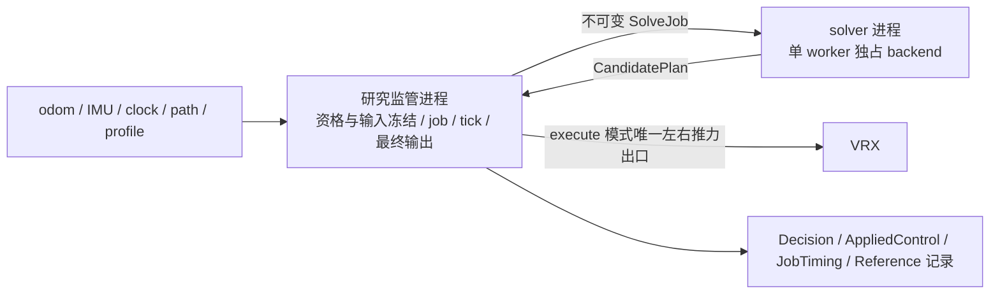

## 2026-10-09 当前推进：启动握手组件260项通过，生产准备与关闭认证待闭合

完成隔离publisher构造期身份、显式hold/release与pre-release shutdown无动作，观察器真实callback legacy_ready/永久失效及v2共同就绪协议；131个Ubuntu＋129个checker最终case全通过、0 skip。真实C++导出事件两侧ready组件兼容，synthetic输入/graph fixture不升级实际bag/Witness全链。原核心数值函数、参考算法、阈值与20ms工程门保持。

原3864资产现在25项live bringup/visualizer变化/缺失，整体guard=false；146 frozen源码和280 MPC/interface依赖仍匹配。2818 scoped输入前后不变，新隔离构建已封存；不覆盖既有文件变化、不替换原F5。owned helper不能证明DDS endpoint属于认证PID与publisher有效全配置，production release一律拒绝。完整production prepare/close、external Worker实际零hook、strict full Source/actualstorage/Witness正链、域、新版本压力/恢复与时间理由仍pending，D1/B4/M0b/execute继续No-Go。

详见[P1_M0b_B4_D1_启动握手组件_实施与验收_2026-10-09.md](C:/Users/sgh/Documents/MPC/P1_M0b_B4_D1_启动握手组件_实施与验收_2026-10-09.md)；下一最小步骤为[P1_M0b_B4_D1_owned端点与配置认证_最小计划_2026-10-09.md](C:/Users/sgh/Documents/MPC/P1_M0b_B4_D1_owned端点与配置认证_最小计划_2026-10-09.md)。旧计划和记录作为历史保留；不得从此前guard通过推断现在环境仍冻结。

# P1 时间与候选接纳契约＋独立执行架构：最小实施计划

## 历史推进（本轮前快照）：冻结参考逐条重建与86项strict组件验证完成，启动握手待修复

已完成原F5 193条6×21参考、24,318元素逐项重建，索引/身份/stamp exact一致；13份冻结源/config匹配原清单。独立source37+bag49共86项最终组件测试全部通过，原F5实际40,613消息负例计数/hash闭合且缺4个P1主题时严格拒绝。

新事实纠正启动前提：原F5无动作timer前的producer startup文件，research_logging_armed=false只关闭telemetry；entry_v2无actual legacy_ready，当前source允许集与bag门不能组成共享正链。组件已验证、启动链未闭合。原≤1.2冻结只有末2条/.2s，.8参考不是实际航速上限；当前域内recipe、新统一版本R5、20ms真实主时钟界均未证明。

D1动态、B4/B5/M0b/M4/F6/P1/execute继续false；本轮无新动态launch、未改默认install/模型/权重/GP/PPO/plant。下一步先做隔离启动身份/动作release与executor实际legacy-ready版本协议，按[P1_M0b_B4_D1_启动身份与legacy就绪握手_最小计划_2026-10-09.md](C:/Users/sgh/Documents/MPC/P1_M0b_B4_D1_启动身份与legacy就绪握手_最小计划_2026-10-09.md)执行前置有限验证。详见[P1_M0b_B4_D1_冻结参考与严格检查器_实施与验收_2026-10-09.md](C:/Users/sgh/Documents/MPC/P1_M0b_B4_D1_冻结参考与严格检查器_实施与验收_2026-10-09.md)。

## 2026-10-09 历史推进：D1正文核验与隔离入口针对验证完成，动态仍No-Go

已严格只读核验七包187081条消息、23份原字节正文，metadata/实际storage计数及登记SHA一致。F5的193冻结状态只有两帧域内、最长0.2s；24.16s低速odom尾段主要零命令，不能算20s动态覆盖。twin确有旧低速转向及非空曲线参考，但持续空/非空交替与当前复现身份待解释，原≤1.2域不扩大。

已建立独立shadow-only观察入口并native构建，23新+8D0+10enqueue=41case全通过；v1测试宏编译失败与v2仅拆行修订全部保留。旧3322及v1失败199资产无漂移，本轮封存3864项；未替换默认源码/install、合同、Worker、IDL或Witness。见[本轮实施与验收](C:/Users/sgh/Documents/MPC/P1_M0b_B4_D1_前置核验与隔离入口_实施与验收_2026-10-09.md)和[精确状态](C:/Users/sgh/Documents/MPC/P1_M0b_B4_D1_前置核验与状态_2026-10-09.json)。

20ms工程门的陈述范围明确，真实时间界/参数校准未闭合。本轮有rclcpp机制测试，没有新Gazebo/F5动态运行，D1尚未采集。当前可复现域、严格shadow reader/driver、外部Worker零argv与真实legacy owner/readiness及统一版本压力资格仍pending；先执行[下一最小计划](C:/Users/sgh/Documents/MPC/P1_M0b_B4_D1_工况与严格shadow链_最小计划_2026-10-09.md)。B4/M0b/B5/M4/F6/P1/execute保持未闭合。

## 历史推进（2026-10-09）：D0来源观察机制完成，D1前置仍待闭合

已完成D0a来源缺失审查、D0b新隔离观察与18项C++/61项检查器测试，以及单次静止无输出正常管线；实际测量10.020325702s，52决策/51job/50传播成功及虚拟接纳，2无候选明确null。source/实际bag/worker/owned/Witness/输送与D0字段门全部通过，旧3067资产无漂移，当前封存3322项；普通/default安装、正式合同/IDL/Witness布局保持。见[本轮实施与验收](C:/Users/sgh/Documents/MPC/P1_M0b_B4_D0_来源观察_实施与验收_2026-10-09.md)、[契约与状态](C:/Users/sgh/Documents/MPC/P1_M0b_B4_D0_来源契约与状态_2026-10-09.json)。

D0c原≤1.2域/20ms工程门的书面决定已记录，但动态域与真实时间界没有闭合。静止速度0/history0/误差0不能作plant残差或GP标签；新增负载不继承旧压力资格。D0入口只允许no_output+diag5，D1shadow尚未启动；先按[下一前置闭合计划](C:/Users/sgh/Documents/MPC/P1_M0b_B4_D1_前置闭合_最小计划_2026-10-09.md)恢复既有域内正文和核验隔离shadow入口，满足前置后才一次20s来源窗。B4/M0b/B5/M4/F6/P1/execute仍未闭合。

## 历史推进（2026-10-09）：B4来源审查完成，动态冻结门仍待闭合

**已完成77个预冻结字段、19个hydro子字段的来源/政策/版本适用登记和旧动态全量审查；B4整体保持部分完成。** 原74字段登记、B1/C0/R5及Decision修复报告保留原字节。新入队修复隔离版本及有限静止正常对照的完成事实保持，各旧版本资格不自动转移。

旧v11本批全183决策（160有job、23无job、2接纳）和163任务均纳入；160完整六维名义传播差值未超候选门，初始化零项排除，但拒绝final来源不能自动认证传播快照。1817条实测体速度全部为1.239153–1.259542m/s、高于原拟1.2域，参考只有直线u=.8，mixed覆盖有限，不能据此冻结当前动态域。

新增明确例外：旧job16实际曾接纳，却与333.200133ms接收clock间隙、约65.233ms未来接收插值代理偏差并存。代理不是真实plant时间误差，但平均RTF和同公式自洽不足以证明20ms独立对齐。保留原阈值及全部例外；本轮没有新ROS/控制实验、源码/合同/默认安装变更，3067关闭资产提取前后无漂移。

- [x] B4逐字段来源、完整旧动态记录、异常政策与版本矩阵审查。
- [x] 创建B4-D0来源可重建与有限补证最小计划。
- [ ] B4所有execute必需参数选择依据与研究域闭合。
- [ ] 最终统一版本受影响压力/恢复/关闭资格、B5不可变合同；M0b正式冻结仍未完成。
- [ ] 默认安装切换、M4新物理出口、F6与P1整体；execute仍关闭。

**下一步先B4-D0：传播所用快照、predict成功和完整差值可用性；先决定有限研究域及20ms时钟政策，必要才一次事前有限F5 shadow。** 域内/转弯/mixed输入前置不足时先解决来源，不重复全域外直线、不改门凑通过；随后最终版本资格绑定，再B5/M4。

详细记录：[B4参数来源与版本审查](C:/Users/sgh/Documents/MPC/P1_M0b_B4_参数来源与版本适用审查_2026-10-09.md)、[新来源/冻结决策JSON](C:/Users/sgh/Documents/MPC/P1_M0b_B4_参数来源与冻结决策_2026-10-09.json)、[D0最小计划](C:/Users/sgh/Documents/MPC/P1_M0b_B4_D0_来源可重建与有限补证_最小计划_2026-10-09.md)。事实索引SHA `12fd852fe2e923c8a029d46fdb03d6b157e10a3a684a1752434477b83e837e2e`。以下日期批次属于历史范围，当前状态以本更新为准。

## 2026-10-08 归档记录：Decision 入队失败即时失效已修复并验证

**首次 DecisionEnqueue 失败可能零动作同拍退出、共享槽未清空的代码缺口，已在新的隔离版本中修复。** 普通与诊断源码均在真实 Sink 返回 false 后取得业务锁，设置停止状态，无条件清 admission ready/committed、candidate 和 pending，再判断同拍退出。Ubuntu 普通/诊断各10个正例通过；旧两源关键负例各RC1，真实检出残留槽2/候选/pending。诊断真实容量1队列拒绝测试中首次phase5/phase8均来自DecisionEnqueue/obs3，清理前后槽2→0、候选和pending true→false，未依赖下一Tick。这是实际源码链接分支验证，不是完整ROS图首次DecisionEnqueue压力顺序证明。

新诊断版本唯一实际正常no_output对照 `p1_enqueue_fix_normal_20261008_03` 窗口10.002600190s，Job/Candidate/Decision=51/51/52，虚拟激活50；source generated/emitted=1977/1977、drop0，严格source/实际MCAP/应用输送/Witness逐项对账和owned收尾通过。原2626资产无漂移，新关闭清单3067项无漂移；两次封装拒绝发生在spawn前，原夹具失败和原拒绝均保留。

**当前下一步为 B4 来源与版本适用矩阵；B5 前必须为最终统一版本补齐压力等资格绑定，之后才决定切换默认ROS安装与进入M4。** 修复产物位于 `/home/trevor/USV/.sgh-research/experiments/p1_execution_architecture_20261005_01/authored_enqueue_fix_20261008_v1`；当前ROS默认source/install仍是受旧guard保护的旧版，本轮没有覆盖默认安装。历史B0/B1/C0/R5验收按各自SHA保留，新源不能自动继承旧R5压力资格。M0b正式冻结、M4、F6、P1整体、execute资格仍未完成。

- [x] 普通/诊断代码分支修复、真实源码链接定向正例与旧源负例。
- [x] 新诊断版本有限正常ROS对照、独立对账与归档。
- [ ] 最终统一版本压力/恢复/关闭等资格复核；B4来源补齐、B5正式冻结。
- [ ] 默认安装切换、M4物理接管、新基线/F6与P1整体。

详细记录：[Decision入队失败修复与验收](C:/Users/sgh/Documents/MPC/P1_M0b_Decision入队失败即时失效_修复与验收_2026-10-08.md)。事实索引SHA `c567d850898e5c14e320125b9f56d4edcccc273aa6e0dfe4e532ccdbcba92156`；原B1/C0/R5报告及参数JSON保持原字节，下方旧批次保留当时范围，当前状态以此更新为准。

## 2026-10-08 归档记录：B3/R5 有限压力验收已完成

B0、B1、B2/C0 与本次 B3/R5 已完成。唯一 R5 压力窗口 3.113345033s，实际 Sink generated/emitted/dropped=776/762/14；旧正常源和应用账本 RC2/false 原样保留。独立机制与 worker/MCAP/输入/owned 门通过，响应保守上界 199.865993ms（事前220ms），首次停止后 Submit/accepted=0/0。123 新工具测试本地及 Ubuntu 均通过，原2521与新2626关闭资产清单无漂移，物理 publisher 观测0。

**当前下一步：首先关闭“首次 DecisionEnqueue 故障直接退出”的共享槽失效缺口，再 B4 来源补齐、B5 正式冻结与 M4。** 本次首次停于 TickStart 并真实失效，之后还有 DecisionEnqueue 失败；不能授予另一先后顺序。M0b正式冻结、M4、F6、P1整体及execute资格仍未完成。详见[R5实施与验收](C:/Users/sgh/Documents/MPC/P1_M0b_R5_日志压力机制_实施与验收_2026-10-08.md)。下方此前的日期记录属于历史范围，当前状态以本更新为准；B1/C0历史报告和参数JSON继续保留。

## 2026-10-08 归档记录：B2/C0 已完成

B0、B1与B2/C0已完成。本次唯一正常no_output对照窗口10.019557190s，Job51/Candidate51/Decision52，50次候选虚拟激活；完整source/实际bag/应用ledger/Witness逐项对账通过，物理推力publisher观测0，owned收尾完整。Ubuntu新增88单元测试及两项真实回收测试通过，原2340与新2521关闭资产清单无漂移。计数覆盖整个owned生命周期。

**下一步B3/R5：专用有限runner、机制checker、事前政策与真实日志队列压力。** 当前R5未运行；Decision enqueue失败共享槽失效缺口仍未验证/修复；M0b正式冻结、M4、F6、P1整体及physical execute资格仍未完成。详细记录见[P1_M0b_C0_正常无输出对照_实施与验收_2026-10-08](C:/Users/sgh/Documents/MPC/P1_M0b_C0_正常无输出对照_实施与验收_2026-10-08.md)。以下既存日期记录保留其历史范围，当前状态以此更新为准。

## 2026-10-07 归档记录：B0 正式合同校验已完成

**B0 已实施并验收。** 修复正式模式与诊断租约条件互斥，新增 v3 预冻结合同、完整字段/类型/模型/policy 校验及物理入口独立禁用。Ubuntu 当前 91 个不同 C++ GoogleTest 与 329 个 Python 方法全通过；565 份原始 JSON 跨语言结果一致；7 个真实启动拒绝和 4 个 formal 入口非零 hook 拒绝通过。

新旧合同分别完成 10 秒 no_output 回归：各 Job51/Candidate51，Decision52/53，候选虚拟激活50；源/bag、raw input 和应用输送分账闭合，物理 publisher 观测0，清理完整。计数覆盖 owned 生命周期，不能当作只裁剪测量窗的数量。当前源归档 v14、runtime_v30（44 Python），worker 原源 v9 未改但使用新共享 loader 重建了 bin。1845 项运行前守卫及1908项关闭证据清单核对通过。

**下一步 B1：独立诊断副本与固定容量 witness；之后 C0/R5、B4来源补齐、B5冻结和 M4。** M0b 正式冻结、M4、F6、P1整体仍未完成，`physical_execute_release_enabled=false`、`execute_qualified=false`。当前预冻结 contract diagnostic_only=true/fault=false；fake frozen marker 仅为拒绝测试夹具。完整实现、指纹与限制见 [P1_M0b_B0_正式合同校验_实施与验收_2026-10-07](C:/Users/sgh/Documents/MPC/P1_M0b_B0_正式合同校验_实施与验收_2026-10-07.md)。下方此前的批次记录保留其历史范围，以本更新判断当前版本和下一步。

## 历史推进：本轮B0之前的M0b参数准备

**M0b参数准备已完成，正式冻结尚未完成。** 已核对全部74个当前合同顶层字段、19个hydro子项及隐含硬常数，建立来源/政策/时间轴；只读补提已有原source与F5 MCAP，没有新ROS运行或生产代码变更。当前51任务freeze→ready最大4.192197ms；F5左右steady gap最大200.182406/200.184748ms、双路调用返回span最大0.095192ms。这些有限数据支持候选研究预算，不授予新监管器物理资格。

发现v13 execute非诊断门与能力租约诊断门互斥；正式合同必须显式版本/模式兼容及完整参数语义验证，不能只翻flags。**下一步先实现B0合同兼容/校验与B1独立诊断副本/有限witness，再执行C0对照和R5真实512队列溢出。** 动态容差、真实非零rho/HOLD/partial仍按具体来源与M4门处理；R5、M0b正式冻结、M4、F6和P1整体均未完成，execute_qualified=false。

完整步骤、参数JSON、实际来源指纹、停止条件及各阶段依赖见[M0b参数来源与政策及最小校准计划](C:/Users/sgh/Documents/MPC/P1_M0b_参数来源与政策表及最小校准计划_2026-10-07.md)。下方此前资源实施和各轮历史记录保留原验收范围，当前推进顺序以本更新为准。

日期：2026-10-05（Asia/Shanghai）。版本：v1；2026-10-07实施进度更新。**状态：M1/M3已有子项通过；M0a资源前置及M2声明有限工程范围已由A1–A5实现、边界/回归/实际metadata与最终证据闭合。M0b参数准备和B0完整候选合同校验已完成；下一项B1独立诊断副本/witness，之后C0/R5、B4/B5；R5压力、M0b正式冻结、M4/F6及P1整阶段未完成。最新结论见页首B0更新及B0实施报告。**

目标：在研究首选 A 的动态 B 平台上，让求解阻塞、结果迟到、任务清空和版本变化不再直接决定推力发布时刻；每个候选有明确的目标激活 tick，每次执行决策有可复核的输入、版本、期限和最终发布锚点。

本计划是 P1 的时间/调度最小工作包。完成它后可进入有限模型真实切换与 P2 备份验证，**不自动令完整 P1、P0、有限安全证书或 GP 标签准入完成**。

## 1. 已知起点、证据锁和范围

依据：[首选 A 主方案](C:/Users/sgh/Documents/MPC/02_Paper_Research/02_研究课题与创新/首选A_现有ROS平台可行性与实施方案_2026-10-03.md)第 4.3、4.4 节及 P1 工作包；[F5 修复及验收报告](C:/Users/sgh/Documents/MPC/P1_求解资格与输入原子冻结_最小修复及验收_2026-10-05.md)第 7 节。

| 项目 | 当前已验收事实 |
|---|---|
| 平台 | Ubuntu `/home/trevor/USV`，ROS2 Jazzy，动态 B，acados，N=20、prediction dt=0.2 s |
| 基线 | `F5_20261005_atomic_freeze_01`；146 source/config、177 installed、5 model |
| F5 manifest SHA256 | `77737a5924f1bcd97996dee3c08e204a4a4c8fbf2f3716ff65d41fbc4bad6762` |
| 当前已验收节点源码 SHA256 | `2f1b457ce9644d6ceff722e4ce328fa6a5de23a2cb94f8470c022e0bd70f2dd8` |
| F5 安装 mpc_node SHA256 | `bc753aa81d27e16e7df2570539e6bc66d34a3bc973afbee18fbf232ea85d41bc` |
| 回归与正常运行 | 67 个不同 GTest 全通过；成功 run `p1_f5_atomic_baseline_20261005_02` 四流 3004/302/301/193，两 checker 通过，单 epoch 有效状态跨度60.06 s |
| 现有保证边界 | 同锁检查资格并冻结本次状态/参考；同步 solve 返回后拒绝迟到候选。freeze 后 clear 仍允许当前候选完成，后续 control_loop 调用待机 |
| 尚未闭合 | 独立 worker/tick/唯一出口、发布前在途失效、完整执行时序、plant ACK/实测力、认证备份与 GP 标签 |

本轮只读取本地已验收文档/元数据并创建计划，未连接 Ubuntu 核验当前 live assets；实施 M0a 时必须重做现场资产、overlay 和进程门禁。历史 hash 不能代替未来现场核验。

本次纳入：单固定名义模型、不可变 job/candidate、有界进程交接、steady tick、任务/时钟/配置失效、工程 fallback、版本化记录、正常与受控故障验收。PPO 保持冻结。真实在线模型参数切换、GP/残差 codegen、障碍硬约束、认证备份与真船 watchdog 按后续工作包实施。

## 2. 前置判断与选定架构

最重要的前提：**F5 的“求解输入一致”不等于“候选到未来执行时仍适用”。** 在旧冻结状态上异步求解后直接发布旧 `U[0]`，会遗漏等待期间的状态、参考和上一拍输入变化。worker 线程本身也不解决任务失效或 native 调用永不返回时的有限退出。

沿用 [control-preflight-reflect](C:/Users/sgh/.agents/skills/control-preflight-reflect/SKILL.md) 的事实→机制→A/B/C→验收流程。EDA 专属 route/STA/Slurm 产物不适用，此处以 F5 hash、ROS 合同、调度和输出证据替代；[独立前置反思](C:/Users/sgh/Documents/Codex/2026-10-02/referenced-chatgpt-conversation-this-is-an-2/work/p1_execution_plan_2026-10-05/preflight_reflection_20261005.md)保存在本任务。

| 架构选项 | 判断 | 本计划选择 |
|---|---|---|
| A：监管器拥有输入/job/输出，独立 solver 进程单 worker | 所有权明确；solver 卡住时仍可终止其进程而保留监管器。新增 IPC 与身份/时钟校验成本 | **选定** |
| B：旧 B 继续拥有输入，向监管器输出 mixed 状态并接收 target/anchor 请求 | 需新增同语义 ControllerState 与双向请求，容易形成两个任务版本域及冻结时刻混淆 | 首版不选 |
| C：同进程单 worker 线程＋tick | 修改较少，可验证受控阻塞；真实 native 无限阻塞下难以承诺有界退出 | 若 A 的接口复用被证据否定才重新评估，不在实施中静默换方案 |

执行模式使用 **2 个进程**；完整影子联调临时使用 **3 个进程**：旧 B 继续物理输出，新监管器 shadow，新 solver worker。两套 solver 各自独占实例；不让旧同步控制与新 job 并发操作同一 capsule。影子资源开销不作为 F5 或最终执行模式的公平性能比较。

## 3. 所有权、最小接口与有界资源

| 对象 | 唯一责任方 | 首版约束 |
|---|---|---|
| 输入准入、mixed state、path/profile、任务/调度 generation | 监管进程 | 复用/提取 F5 等价准入、融合及参考函数；不以 odom-only StateSnapshot 替代 mixed state |
| SolveJob 和目标 tick | 监管进程 | 同锁检查并复制输入/来源/版本、取得不可变 path/profile 快照指针；锁外只能读取快照生成预测和参考，不回读 mutable 全局量 |
| solver、warmstart、reset、set_applied_control | solver 进程内单 worker | backend 调用全部串行。启动能力合同确认 N/dt/布局/配置 hash；freeze 不等待 solver 查询 |
| 候选接纳与发布决策 | 监管进程 | 最新状态、版本、期限与 anchor 在同一短决策临界区核验并提交不可变决定 |
| 正常/fallback/standby/HOLD/shutdown 的物理 publish | 监管进程唯一输出责任 | callback 和 worker 不直接发布。左右仍是两个通道，保留各调用时刻及部分异常 |
| 实际 publisher anchor | 监管进程 | 保存每通道最终 mapped N、成功/异常、sequence、steady；未成功的通道不伪造成功锚点 |

建议只新增一个研究包 `usv_research_safety_cpp`，内含监管和 solver 两个可执行目标，扩展现有 `usv_research_interfaces`。名称是计划入口，尚不存在时不得当成可运行命令。

最小消息/记录语义：

- `SolveJob`：run/producer/baseline/contract/boot identity、job_id、target_tick、各 generation、冻结 source 身份与 `[x,y,psi,u,v,r]`、源年龄/时刻与传播起点语义、预测激活状态、实际未来 reference、N/dt、名义配置 hash、预期激活前输入锚点和执行历史、绝对 deadline、target steady/sim 及对齐依据。
- `CandidatePlan`：原样回显 job 身份/目标/版本、worker 实例与能力合同、worker 开始/结束、完整成功状态、X/U、失败原因及 candidate_id。X 为6×(N+1)、U为2×N，reference 按实际 solver 布局明确；首版不接收来源不明的只含左右 Float64 结果。
- `DecisionRecord`：tick_id、候选 ID、接纳/拒绝原因、版本与年龄、预测偏差、当前每通道 anchor、工程 fallback 分支、提交时刻、关联最终 AppliedControl。
- `JobTiming` 与新 tick 语义记录：freeze、enqueue、worker start/end、监管器完整接收、decision commit、左右 publish 起止。当前同步 `CycleTiming` 作为 legacy 保留；异步意义使用新 schema/话题或显式版本，不能冒用旧字段。

队列上限为一个 active、一个可替换 pending、一个 ready；ROS transport QoS depth 有限。监管器另有“本目标 tick 的已截止锁定候选”槽，截止后不可被迟到消息替换。pending 替换、ready 拒绝及输送丢弃均有独立计数，不把有意 superseded 伪装成采集丢帧。

M0a还须限定path点数、profile行数、消息字节数、job/candidate矩阵规模、输入/锚点历史缓存和日志队列。callback在短锁外检查并生成不可变容器，在短锁内交换/取得快照指针；freeze锁内不复制无限path。超尺寸输入明确拒绝，不静默截断；F5等价性对拍覆盖新合同允许的输入域，额外尺寸拒绝是明确的新规则。

job/candidate 去重账本保留有界窗口；落后 tick 的结果先按目标过期淘汰。不得靠每次超时新建线程/进程续接。首版active运行超过已冻结worker watchdog上限即推定本run不能继续使用该worker，停止新submit、淘汰pending/ready/未激活候选、执行工程降级和退出。deadline过期不等于已证明卡死，heartbeat存活也不等于solve有进展；首版不在同一run自动重启。2026-10-06新增诊断revision 3策略：单次native失败或完整预测无效即将本run的worker标fatal、同锁清空pending；receive取锁后复查terminal，后续job拒绝。失败结果保留，flush与业务fatal分开记录。该最小隔离已实测，不声称reset已恢复同一capsule；真实regulator联动已在上一批独立验收；非空preparation pending/worker退出并发已由第13节验收，有限能力接收失联与同run恢复隔离由第14节诊断验收；调度/准备恢复与Job/Candidate固定原字节观察子项已有有限验收；资源/输送分账R1–R4于第18节闭合；第17节为上一批审查快照，保留unknown单列。

2026-10-06 已实施监管器进程退出检查：启动用 Linux pidfd 固定 worker 身份；任务 submit commit 与最终 activation commit 处零超时检查。在原 decision mutex 下记录首次 worker_unusable_transition 并失效 candidate/preparation pending。故障被观察之后禁止新提交与激活，先前已提交的 DDS 尾部单列；不声称死亡瞬间零延迟。已有 ready 候选失效已实测；非空 preparation pending 与worker退出同时故障已在no_output受控准备屏障下验收，能力接收失联已按第14节有限诊断矩阵验收；v1无发送时间/序号，不据此证明源新鲜度或求解进展。v10把pending旧值读取和清除合并一次取锁，记录实际清除tick；诊断屏障默认0、仅no_output fault允许且上限3000ms。

## 4. 时间契约与未来输入对齐

### 4.1 调度与截止

以监管器的 monotonic 时钟定义绝对 tick：

\[
t_k=t_{anchor}+kT,\qquad T=200\text{ ms（设计默认）}.
\]

周期 k 发布本拍命令后准备 `target_tick=k+1` 的 job，绝对提交截止：

\[
d_k=t_k+150\text{ ms（设计默认）}.
\]

截止包含冻结/准备、排队、solve、结果复制、IPC、监管器完整接收和基础校验。实际 tick 开始迟到、worker 排队或 solve 开始晚均**不重新延长期限**。将完整基础校验和候选槽登记作为同一串行事件，记录监管侧 `ready_commit_steady_ns`；只有它 ≤ d_k 才有资格，等号接纳。worker end、DDS到达戳和backend报时不能代替这个完成时刻。

明确两个不同边界：`candidate_cutoff_commit`锁定本目标的截止候选，`activation_decision_commit`是在目标tick复查后提交最终执行决策。前者不授予发布资格，150～200ms之间处理的clear仍会使旧候选失效。

若设置截止关闭回调，首版仅在 `now > d_k` 关闭槽；恰在d_k不提前关闭，排除等号事件因timer先后顺序被随机拒绝。关闭回调调度晚也不接纳晚候选，因为每次登记均独立检查自身完成时间≤d_k。确定性用例覆盖等号候选和关闭事件的两种调用次序。

到下一目标tick才进行最终激活复查和发布。150ms内ready只代表可供截止选择，不能提前执行。错过目标tick的旧 `U[0]` 默认过期，首版不支持顺延/移位复用。

首次 bootstrap 是已声明的工程输出；在建立已知 publisher anchor、合法输入和时钟对齐之前不 submit job。P2 带证书执行时仍须已有有效初始备份，零推力不代替该条件。

### 4.2 求解初态、参考和输入历史

freeze 时记录 controller 实际混合状态与各源年龄，声明它如何对应传播起点。若不同源龄导致无法按本合同对齐，则拒绝 job，不把异步源自动当成同一物理采样时刻。

以本拍实际 publisher 命令及必要的分段历史，从声明起点传播至目标 sim 时刻，生成名义激活状态；未来参考在冻结的 path/profile 上，以该激活状态调用既有数值构建逻辑，记录实际 nearest/start/t0/矩阵与版本。不能直接沿用 freeze 时刻的 reference 或默认只移一列。

backend 的上一输入也绑定预期激活前 publisher anchor。激活时以当前实际 anchor 重新检查；中途命令改变使传播假设不成立时拒绝候选，首版不临时修补已算计划。普通同值重复 publish 只增加事件身份，是否改变物理假设按命令值/区间历史判断，不能只因 sequence 增加一概作废。

这里使用的是 publisher 命令驱动的**名义工程传播**，不是已测 plant 输入，也不是 P2 可达集合。接口为后续误差集合保留版本字段，但本工作包不伪造有效包络。

### 4.3 时钟、暂停和 tick 异常

计算期限/调度用 monotonic；动力学传播用 sim。两进程交换绝对时间前，核验同 host/boot 和显式相同的时钟实现，例如 CLOCK_MONOTONIC；不能无条件认为任意 `std::steady_clock` 记录可跨进程相减。

target_sim 的映射需记录当前 sim/steady 锚点和声明的 RTF/对齐范围；VRX 首轮限制为1附近，具体容差在 M0 冻结。时钟尚未收到、超龄、确认无 sim 进展、reset/jump、RTF或 tick 偏差超范围时，旧候选失效。单条重复 clock 观察不等于确认持续暂停。

暂停/恢复即使 raw epoch 不变，也更新 schedule_generation，清空旧 target，并重建调度对齐。迟到 tick 不补发一串 catch-up 动作；记录 skipped tick、拒绝过期目标，进入已声明工程分支。不得在激活前一律声称物理步长恰好为200 ms。

## 5. 接纳、任务失效和最终输出规则

### 5.1 最终接纳真值表

所有条件同时满足才接纳。首先检查 shutdown/时钟/输入资格，其次候选，再检查最终命令；失败形成明确拒绝原因与工程 fallback 决策。

| 检查 | 首版通过条件 | 不通过的处理 |
|---|---|---|
| 来源/布局 | run、boot、baseline/contract、worker实例及静态能力合同一致；N/dt/形状正确、数值有限、状态成功 | 拒绝 foreign/shape/nonfinite/solver_failed |
| 目标/期限 | 恰为本 tick；完整接收校验 ≤ 原绝对截止；未消费 | 拒绝 wrong_tick/late/duplicate；不顺延 |
| 任务/配置/时钟版本 | task、model、config、schedule generation 与当前有效值相同；epoch及对齐有效 | 拒绝 version/epoch/schedule mismatch |
| 当前输入 | 当前资格合法，各源年龄在冻结上限内，mixed 来源组合符合合同 | 拒绝 ineligible/stale/invalid_source |
| 激活状态 | 最新观测按相同激活时刻语义对齐，分量偏差满足冻结门槛 | 拒绝 activation_state_mismatch；不要求 source sequence 严格相等 |
| 实际输入锚点 | 实际每通道 publisher anchor 与 job 的预期历史/锚点相容，未有未知部分异常 | 拒绝 anchor_mismatch/unknown_anchor |
| 最终 N 命令 | 映射后的幅值/变化率满足研究合同 | 拒绝 command_limit；不静默夹紧候选后仍标为原预测 |

状态偏差分别按 m、rad、m/s、rad/s 定义六分量门槛；psi 使用 wrapped angle。不能用一个混合单位的欧氏范数阈值。source sequence 用于追溯，不是“有新 odom 就失效”的门禁。

### 5.2 task generation 与提交边界

- clear、单点、实质任务替换或参考内容/时序改变，更新 task_generation，失效 pending/ready/committed-but-not-activated 的旧任务候选；worker 内 native solve 可算完，结果丢弃。
- 同内容同语义重发只更新 received sequence。task 内容指纹须包含影响语义的 frame、坐标、yaw/profile数值与时间绑定；仅用于消息配对/接收身份的header戳刷新不单独改变task generation，真正改变任务绝对时间原点才改变generation，具体字段在M0按实际构建函数确认。path/profile成对匹配未完成期间不接纳旧任务候选。不能只比较点数。
- raw 消息到达 DDS 与实际 callback 处理不是同一时刻。本合同的逻辑失效事件以已处理 callback 更新 generation 为准，并记录来源戳/接收与更新时刻；不宣称知道尚未处理的队列内容。
- clear/shutdown 与激活并发时，以同一短决策锁内的提交序列为边界：失效先于决策提交则拒绝；晚于已提交决策的事件由唯一输出责任按后继策略处理，不能宣称撤回已发布/已被 plant 接受的动作。
- 共享锁不跨 solve、IPC等待或物理 publish。这里的发布边界是 `activation_decision_commit`，不是 `candidate_cutoff_commit`。提交后记录实际 publish 起止；若 publish/调度超过预算，保留为验收失败并降级，不能追溯改写成“动作未执行”。

本政策会替换 F5 的“freeze 后 clear 当前候选仍可完成”发布准入现状，但仅在新 execute 模式启用；legacy F5 的历史行为与测试证据保留。

### 5.3 工程 fallback、限幅和关闭

首版拟采用：bootstrap 无可追溯历史时发布声明的零目标并建立新 anchor；单次无合法候选时允许有限保持上一最终命令；超过已声明最大工程保持时长、任务失效或输入无效后，按已冻结变化率向零目标退化。关闭同样通过唯一输出责任执行。连续第五拍不是瞬时归零的隐含例外。

保持上限、变化率、关闭 grace 及异常政策在 M0 必须有有限数值。零目标不证明船停下，也不称认证备份。若决定用其他政策，先发布合同版本并重新验收，不能运行失败后偷偷改 fallback。

正常研究命令幅值拟沿用 solver `[-25,+25] N`；F5 的 VRX publisher 配置上限100和scale=1.0是另一个映射边界，不当作25 N安全证明。F5 `dynamic.dT_max=80.0` 的实际使用公式/单位须现场确认；确认后才决定研究 rho，不把字段名自动解释为 N/s。

若合同选择每通道 rho（N/s），则以实际相邻成功 publish 的 steady 间隔核验：

\[
|q_{pub,j}-q_{pub,j-1}|\leq\rho\,\Delta t_{steady}.
\]

部分发布异常逐通道记录，失败通道可能处于unknown状态，不能只凭last-success anchor继续宣称正常rho约束成立；进入明确异常状态，禁止基于假联合成功接纳正常候选，后继工程输出标保证域外并按已冻结故障策略收尾。工程fallback可做已声明的slew；候选若映射后违反门槛则拒绝，不把夹紧后的动作与原X/U预测混称一致。

物理publish已返回成功后若source enqueue失败/日志drop，不能回滚、删除或改写已发生的命令；内存anchor继续反映真实逐通道结果，立即停止正常submit/候选接纳并有界降级收尾。该run正常完整性标志为false，缺失事件仍unknown，不能用正确故障响应把正常日志合同改为通过。

## 6. 实施前必须冻结的参数表

此表的“待冻结”分M0a结构/身份及临时shadow约束、M0b最终execute数值，不是留给每次运行自由调参。顺序为 **M0a → M1/M2/M3无输出实现与校准 → M0b冻结 → M4独立execute确认 → M5**。任何execute必需字段缺失、NaN、无限保持或互相矛盾，execute启动即失败；可以继续离线fixture、无输出联调及符合临时shadow合同的校准，未定字段的shadow判定显式标diagnostic/unqualified。

| 参数/政策 | 本计划初值或状态 | M0 处理与证据 |
|---|---|---|
| T / absolute submission deadline | 200 / 150 ms，主方案设计默认 | 固定参考时钟、等号规则、正常与边界fixture；实测压力后决定是否保持；不称硬实时保证 |
| N / prediction dt / 静态模型 | 20 / 0.2 s / F5单固定nominal | 现场source/install/config与两进程能力合同对拍 |
| 输入幅值/映射 | 研究拟[-25,25]N；F5 scale1.0，publisher上限100 | 确认映射公式；区分solver、发布和plant界 |
| 发布变化率 rho | 待冻结；F5 dT_max字段80.0 | 查真实backend公式/单位，选择研究边界，验证fallback/部分异常 |
| odom/IMU/mixed来源与clock最大年龄 | 待冻结 | 不自动沿用旧odom_timeout=2.0s或state_timeout=0作为异步激活适用性；建立组合语义与年龄报告 |
| 六分量激活偏差门槛 | 待冻结 | 相同fixture传播对拍＋无输出预试验；按单位/工况记录依据，有限经验门禁不称可达外界 |
| tick jitter / 最大publish间隔 / publish预算 | 待冻结 | 先在shadow/无物理输出双进程校准并参考F5发布观察，选择预冻结预算；M4 execute只确认预设值，超期失败与skip策略先定义；有限试验不证明最坏RT |
| RTF/target_sim对齐/确认暂停门槛 | 待冻结 | 双时钟样本和pause/resume/reset用例；恢复更新schedule generation |
| 工程最大保持时长 / bootstrap / ramp / shutdown grace | 待冻结 | 明确有限H和关闭路径；grace覆盖声明ramp窗口与进程清理；不把bag结束当plant持有终点 |
| 消息/快照/缓存/队列大小 | M0a必须先限界 | 最大path/profile长度、字节/矩阵数、历史窗口/QoS depth；超界拒绝并记录 |
| active watchdog / TERM / KILL / KILL后检查期限 | 待冻结为有限值 | 与150ms候选期限分开；进程终止只是有界尝试，超期未退出则cleanup_failed并停止run，不重启 |
| 任务指纹/版本变化/worker退出 | 本文语义确定，细节待固化为代码合同 | fake真值表＋内容重发/替换；进程停止规则与身份失效测试 |

M0a产出结构/临时shadow合同；M0b产出完整 `p1_execution_contract.yaml/json` 及其hash、参数来源表、真值表、正常与迟到/clear两个时间轴例子。数值不足时安排独立编号的无输出校准或shadow预试验；其目的不是execute验收通过，记录观测后先冻结合同，再跑独立确认。不得先execute后决定首次门槛；超门槛后若需修订，保留失败run、升版本并重验受影响项。

## 7. 最小执行顺序与交付物

### M0a：现场门禁与结构/临时shadow合同

核对F5完整live hash、dirty状态、包前缀/实际程序、无残留controller/Gazebo、namespace/domain/partition隔离。检查当前候选/回退/映射/solver所有权源码，明确结构、模式、临时shadow时钟/资源/退出上限及缺数值时的diagnostic判定，不升级现有ROS/Python依赖。

交付：现场preflight、静态能力/临时shadow合同、参数来源与待冻结清单、两个时间轴和接纳真值表。门禁：差异可解释、结构与临时资源上限明确；尚不接管物理发布。

### M1：提取共用输入核心与建立不可变job

把F5准入、mixed state组合、参考与映射数值逻辑提取为可复用核心/接口，保留legacy wrapper行为；新监管器是execute的唯一输入/job owner。用同fixture核对legacy与新核心的合法/非法输入、freeze身份、参考、映射及logging off/on，先跑受影响旧回归。

新job的名义传播和未来参考单独测试，不要求它与旧“当前时刻reference”数值相同；要求与独立声明的目标时刻fixture相同。禁止复制两套准入规则后没有等价性测试。交付：接口/布局schema、freeze→target输入对拍报告。

### M2：独立solver进程与有界输送

单worker只消费完整SolveJob，串行调用backend，结果回显身份；在job开始应用其绑定的model/anchor副本，不由tick并发修改warmstart。startup握手核对worker能力和boot/clock，通信等待只在非tick路径。

交付：active/pending/ready上限、去重/替换账本、正常/坏布局/迟到/进程异常fixture。受控native block时tick无需等待；worker退出先停止submit，有限grace后TERM、再有限期限KILL其owned进程，确认退出后才标清理成功。不detach悬空线程，不永久join；真native不可取消与受控屏障可释放分别报告。KILL也不证明内核层绝对有界退出；到检查期限仍未退出则记录cleanup_failed、终止该run的推进并禁止重启，不伪造资源清理完成。监管器自身崩溃后的末段动作仍无plant watchdog证据，不由solver进程隔离解决。

### M3：固定tick与影子联调

监管器采用绝对monotonic计划，tick只做有界快照/检查/决策，不等待solver。通过确定性时钟/屏障先验证target、deadline、版本、fallback和输出责任；再启动3进程shadow。

shadow只有legacy B创建并发布物理推力，新监管器和proposal不创建物理publisher endpoint；其传播和worker锚点来自可追溯legacy AppliedControl，记录anchor_source_producer/mode，warmup之前不submit。虚拟shadow动作不作为真实船已执行输入；预测区间legacy实际改命令时按history/anchor mismatch拒绝。验证job→worker→candidate→shadow decision全链，高拒绝率如实记录，不能因影子决策未执行而声称其闭环轨迹已验收。

交付：shadow契约报告及真实时序观察。原F5 source合同只验legacy流；新job/decision使用独立schema/checker。shadow可通过接口和拒绝规则，不用于宣称控制性能改善或双进程执行预算已通过。

### M0b：用校准证据冻结execute合同

M1/M2/M3之后核对第6节所有必需字段，利用独立编号shadow/无输出校准、确定性对拍及F5先前发布观察选择有限工程门槛，说明估计误差与适用负载；首次execute观测不是这一步的前置来源。发布完整合同与hash，锁定预期故障清单/判据后才进入M4。

门禁：必需值完整、时间/单位/指纹/退出规则一致，阈值有来源，无法支撑的字段继续阻止execute。M0b完成后不在同一个确认run内调阈值。

### M4：隔离仿真接管与故障确认

结束shadow run并确认旧物理publisher退出；以新run_id启动2进程execute。禁止在同run热切换造成双发布者。启动门禁核对publisher数量/进程与已冻结合同，执行时source审计防止worker或callback暗中发布。

先无障碍正常直行，再受控故障。只有监管器创建物理publishers；正常run沿用F5的nominal/plant/参考输入资产，不同时调权重、加GP或改变plant。工程时序对齐可能改变正常动作，逐项解释，不能要求异步新架构在真实closed loop逐动作等同旧B。execute测量用于确认M0b预冻结预算，不用于事后定义首次通过门槛。

交付：正常与故障bag、两进程实际参数/可执行hash、完整新checker报告、所有失败保留、计时与最后unknown区间账本。门禁见第8节；不以正常run通过替代故障确认。

### M5：冻结和方案进度更新

通过后创建新独立基线（实施时选择未占用F6 ID），记录source/install/model、schema/contract、actual test binary/XML及run关联；F5和旧失败原件保留。写实施验收MD并更新主方案与用户打开的镜像。

仅勾选P1时间/候选/worker/tick/唯一输出已验收子项；真实有限模型切换、不可变反馈备份及相应机制实验若尚未实现，完整P1仍不勾选。plant执行和GP准入字段按真实证据继续false。

## 8. 最小验收矩阵与完成门槛

| 组 | 必须触发 | 合格结果 |
|---|---|---|
| 兼容/输入 | F5资格/混合来源/reference/mapping旧回归、logging off/on、未来referencefixture | 复用核心保持旧语义；新target输入符合声明；无新隐式物理publisher |
| 时间边界 | 50/150/250/400ms、截止前/等号/后、早ready、错target、tick延误 | 提交按完整绝对期限；不提前激活/顺延；backend假报快不掩盖完整超时 |
| 实际阻塞 | worker在native边界受控挂起直到测试释放；独立结果返回延迟另测 | solver未释放时多个tick仍完整决策；上限/替换明确；不并发同backend，不增生worker |
| 候选异常 | failed/bad shape/NaN、重复、旧ID/乱序、foreign producer/boot | 拒绝原因完整；每candidate最多消费一次；非法候选被选择/发布为正常动作数=0 |
| 任务/参考 | freeze前clear/单点、solve期间clear/替换、同内容重发、path/profile失配、新odom | 提交前旧task候选拒绝；普通新odom不无条件饥饿；语义改变才推进task generation |
| 状态/时钟 | 过龄、激活偏差、clock未到/超龄/暂停恢复/reset/jump、RTF变化 | 按冻结门槛拒绝，不跨域相减；旧schedule结果不复活 |
| anchor/fallback | 中途命令变更、同值重复、不同publish间隔、无history、连续5tick无新解 | 当前mapped每通道anchor正确；有界保持/变化率退化；不瞬间归零隐藏违规 |
| 发布/退出 | clear/shutdown提交前后、左右部分异常、worker崩溃/不退出 | 唯一输出责任；边界符合规则；部分异常不假全成功；owned worker可有界清理，末段未知如实保留 |
| 实际运行 | 新正常/受控故障run、日志队列压力、source/emit/bag计数、资产前后hash | source完整性与新schema检查通过，无未解释漏录/错误/中断；限时压力超预算即失败，不用平均值覆盖 |

延迟注入应区分两种：独立事件释放/丢弃结果用于接纳逻辑，真实worker内阻塞用于调度/资源。不能用“结果晚送”冒称native阻塞测试，也不能排队五个不可取消block任务制造无限资源。

tick验收先证明功能不变量，再用Ubuntu有限运行测量P50/P95/P99/max及所有超门槛事件。输入准备、队列、IPC、solve、decision和publish分别报告。非实时内核/标准executor下的有限run通过不称硬实时最坏保证；ROS2官方说明并发与callback groups相关，且标准executor存在顺序和优先级限制：[Jazzy executor文档源码](https://github.com/ros2/ros2_documentation/blob/jazzy/source/Concepts/Intermediate/About-Executors.rst)。

故障口径预先分开：partial output、source日志drop或worker强制退出场景，可以通过“预期机制正确拒绝/降级/退出”的断言；其normal_contract_complete、publisher_rate_verification_available或worker_session_complete仍按事实false/unknown。不得为了故障用例通过而放宽正常checker。超出预声明故障的额外丢帧、异常或超期仍使该场景失败。

完成须同时满足：契约已冻结、所有权审查通过、确定性正常/故障回归通过、新execute正常run满足预冻结门槛且正常合同完整、受控故障run满足预声明机制判据并保留真实不完整/未知flag、资产/编译/配置/记录绑定闭合、失败和例外完整归档。test数量届时从实际XML算，不预编造未来通过数。

## 9. STOP、回滚与后续依赖

STOP：无法解释F5/live差异；输入核心不等价；新candidate身份/时钟不明；tick等待solver或共享锁跨solve/IPC等待；发现双物理发布者；迟到/错误target/旧task候选成为正常输出；资源无界；部分异常被伪装成成功；契约缺字段；为过验收事后放宽阈值或修改旧bag。

STOP后保留现场日志/失败run，修复具体原因；可继续不依赖该问题的离线工作，不启动受阻的execute。回滚优先停新研究launch、确认publisher全部退出，再从F5核验启动旧B；禁止同时启动两套输出。源码回滚逐项处理用户新改动，不reset --hard、不清空bags/快照。

并行核验PPO训练端历史时序和plant接受/执行器滞后/6DOF响应，不把它们塞入本次调度重构。P2之前需解决试验域与物理包络：F4记录solve输入u均值约1.249m/s，超出方案拟声明u≤1.2m/s，不能默认基线域内。扩大域需要重新建立包络，不能只改标签。

当前publisher证据不授权精确GP残差标签。P3先标签合同和性能GP，P2先有限模型/固定宽界/反馈备份；普通性能均值更新不必使仍适用的固定物理备份失效，后续D0要检验这个前提，避免制造伪收益。

## 10. 当前勾选状态

- [x] 已核对本地F5证据、完成方案取舍并创建本最小计划。
- [x] M0a现场门禁、结构与临时shadow合同已有证据；2026-10-06补审的资源前置已在第18节闭合。
- [x] M1共用输入核心、不可变job与未来输入对拍。
- [x] M2独立solver进程与有界交接/受控退出：原声明有限工程范围通过；资源/应用账本A1–A5已闭合，强保证unknown单列。
- [x] M2逐条范围与证据矩阵审查；任意raw与原合法域要求分别登记，不改变原失败。
- [x] M0a资源前置/A1–A5：字节派生/绑定、固定帽兼容、metadata先验拒绝/恢复及应用独立分账，详见第18节。
- [x] M2 Job/Candidate的8个对齐原字节样本：独立进程观察、实际bag、业务拒绝和fresh native恢复核验。
- [x] M2多拍调度延迟清除旧候选、不补拍/不顺延（v12独立无输出实测）。
- [x] M2准备等待自然释放、pending容量1替换、原deadline内最新项恢复（v12独立无输出实测）。
- [x] M3固定tick与3进程shadow联调（影子工程范围；regulator v11本批163/161/183分别完整对账，156次真实历史拒绝与2次虚拟接纳、无能力到期；F5仍独占物理输出，不代表execute）。
- [ ] M0b用独立校准证据冻结全部execute必需参数和合同。
- [ ] M4两进程execute及正常/故障新验收。
- [ ] M5新基线、实施验收报告和主方案进度更新。

**2026-10-06 上一批历史更新：M2真实数值失败/worker退出联动通过，M2整体仍未完成。** 当前worker v8、regulator v9、入口v20、整链检查器v6、联动检查器v2，诊断revision 3和全部数值不变，execute_qualified=false。

旧idle退出后仍提交、旧active退出约1078.769ms才观察不可用的失败已保留。新版idle_exit03/active_exit03/numerical03分别为2/2/10、2/0/10、3/3/11；198.278/209.342/184.614ms有限观察差值通过，各自源/实际bag及独立判据0问题，之后1.4s无新提交/激活。idle实际已有candidate被失效；非空preparation pending同时故障仍未覆盖。KILL闭合unknown与idle截断末行保留。

normal10为51/51/52且50次非零建议接纳；delay150_04为51/51/52、接纳0；barrier06为6/0/8、watchdog机制通过但3项worker闭合unknown；真实shadow10为169/169/183、168次有实际推力变化依据的拒绝、接纳0，F5仍唯一物理publisher，新两个进程零物理端点。151项Ubuntu Python与当前38项C++通过，结合旧回归/oracle共114个不同GTest；817项终检无意外差异。

no_output仍不证明建议被实际执行；actual反馈、变化率和双路预算校准尚未完成。新版数值压力由原始worker的有限reference触发native失败，不增加worker hook、不改变模型。哈希声明多字符的启动前拒绝、GTest宏构建失败及旧检查器对KILL末行异常均保留，未覆盖旧结果。

完整事实见[P1实施记录](C:/Users/sgh/Documents/MPC/P1_独立执行架构_实施进展与验收记录_2026-10-06.md)。下一步补其他候选、clock/task、源年龄/激活偏差及故障并发状态矩阵，再闭合M0b来源和执行校准。M0b/M4/新基线未勾选，尚未创建F6。

## 11. 2026-10-06 上一批更新：时间／任务／激活诊断矩阵（历史快照）

- [x] 12 项真实 worker/regulator no_output 用例的实际 source/MCAP 验收：截止后 clear、同点数路径替换、profile 数值改变、配对中断/同义刷新、暂停/恢复、clock 回跳/跃迁、收据过期、源戳过旧/过新、激活 x 偏差。
- [ ] M2整体：其他异常候选及非空 preparation pending/退出并发等仍待补。
- [ ] M0b完整 execute 合同、M4物理接管及新基线冻结。

各用例先核对真实成功候选的 ready_commit ≤ 原150ms截止，再于截止后、原目标tick前触发异常。12个独立报告issues=[]，可恢复项有后续正常接纳。成对同义header刷新保留原候选；当前参考t0来自前瞻点profile时间，header仅配对，不是任务绝对时间原点。配对未完成仍阻止接纳。

暂停/恢复更新schedule且raw epoch不变；reset/jump更新epoch并清空anchor，no_output不静默重建合成anchor。其RTF恢复后保持unknown_anchor、无新job；真实shadow/execute的恢复需实际publisher历史另验，不能从本用例推定已恢复。

当前runtime v21、worker v8/regulator v9生产字节不变；173项Ubuntu Python通过（本批新增22），此前38项当前C++与合计114个不同GTest仍按原证据计数。842项pre/post与终检drift=[]，合同revision 3和全部数值不变，execute_qualified=false；累计保留62项运行/启动摘要。详见[P1实施记录](C:/Users/sgh/Documents/MPC/P1_独立执行架构_实施进展与验收记录_2026-10-06.md)。

## 12. 2026-10-06 上一批：38类异常候选真实传输（历史快照）

- [x] 38类可编码异常候选的声明、actual MCAP内容及真实regulator登记/最终决定验收：来源、布局/时刻、非有限/失败标志、U0/X0、完整echo、native timing、重复/旧结果/迟到。
- [ ] M2整体：非空preparation pending与退出并发、活进程失联等仍待补；非法CDR字节未覆盖，需明确合同边界。
- [ ] M0b完整执行合同、M4物理接管及新基线冻结。

本批只有1个run，包含42个原始native候选+38个测试副本，实际bag42job/80candidate/43decision，80次登记逐项绑定。原合法候选在注入前ready，38副本全部按声明原因拒绝，原ready/命令保持；41个虚拟接纳决定不代表plant动作。测试副本不是实际native失败，固定长度typed数组测试不代替非法序列化验证。

生产worker v8/regulator v9和revision 3数值不变；runtime v22、Python200项通过（新增27）、871项声明资产pre/post与终检无漂移。原38项当前C++和114个不同GTest保留原计数；累计63项运行/启动摘要，不把38类当38个独立run。当前execute_qualified=false。详见[P1实施记录](C:/Users/sgh/Documents/MPC/P1_独立执行架构_实施进展与验收记录_2026-10-06.md)。

## 13. 2026-10-06 上一批：非空preparation pending与退出并发（历史快照）

- [x] 非空准备队列实际存在时worker退出：pending_before=true，实际cleared target tick=4，pending_after=false；active preparation tick=3取消；后7个决定无新提交/激活。
- [x] regulator v10必要回归：normal 49/49/67、46次合法虚拟接纳；delay150 51/51/52、接纳0、拒绝机制通过；shadow 170/169/171、165次真实历史拒绝和3次输入收据时序拒绝、0接纳。
- [ ] M2整体：PID存活但不响应/能力消息失联及必要调度异常仍需实测和明确有限政策；非法CDR字节的合同范围未闭合。
- [ ] M0b完整数值来源及执行失联/恢复/输出政策冻结。
- [ ] M4正式唯一输出、实际双路预算与新基线/F6。

worker v8不变；regulator v10仅同锁清除/身份记录、默认关闭的有限准备诊断屏障及取消事件；所有合同数值不变。220项Ubuntu Python、当前45项C++与合计121个不同GTest通过；912声明资产无非预期漂移；新增4个独立运行，累计67项运行/启动摘要。非空并发差值41.734516ms满足原220ms诊断门槛，不能当成最坏实时上界。KILL的4项worker闭合unknown和截断原字节保留。

delay检查器正常passed=false/RC2而故障机制通过的原状态保留；外层误用正常门禁的中止记录及判读纠正有SHA依据，不重跑、不改阈值。正常段保护性拒绝和shadow的3次收据时序拒绝均保留。完整事实见[P1实施记录](C:/Users/sgh/Documents/MPC/P1_独立执行架构_实施进展与验收记录_2026-10-06.md)。当前execute_qualified=false，未证明plant执行、GP或严格安全。

## 14. 2026-10-06 上轮记录：活进程能力接收失联与恢复隔离

- [x] 旧v10 idle STOP时仍在1.2s后提交3个新job的缺口已实际复现并保留。
- [x] v11/revision4：有效能力callback本地验证提交间隔>600ms终止，检查先于续期，invalid不续期/不更新active，terminal后同run不复活。
- [x] 新idle/active/invalid三场景：4/2/16、4/0/16、5/2/16；lease_age677.515059/676.921138/671.752578ms，均满足>600且≤820ms；失效后无新提交/激活，恢复窗口不重新接纳；18条invalid副本完整对拍且不续期。
- [x] 五项必要回归：normal51/51/52（50合法虚拟接纳）、delay15051/51/52（0）、barrier6/0/8（有效续期6次仍由active watchdog终止）、pending退出2/2/13（清除tick5、active tick3取消、后7决定无接纳）、shadow163/161/183（156历史拒绝、2虚拟接纳）。
- [ ] M2整体；必要调度/跳tick/队列边界证据与非法CDR/序列化责任范围。
- [ ] M0b全部execute数值来源、源响应/接收有效期范围、恢复/输出政策及合同冻结。
- [ ] M4正式唯一输出、真实反馈/变化率/双路publish预算、新基线与F6。

600ms是200ms能力周期3倍的诊断试值；WorkerCapability v1无发送时间/序号，不能证明源新鲜度、抗重放或native进展。原T200/deadline150/active watchdog1000ms及worker v8、F5资产不变，regulator v11要求明确revision4合同；旧v10/revision3保留。

两份观察器/actual能力消息对账失败保留为未通过。新v27明示独立订阅发现前缀，只允许首次实际observer wall receipt前、初始idle原始能力前缀；之后ordered内容suffix完整相等。processed能力源内容仍需对应actual bag，不能称所有raw已处理。新三项前缀0/9/0；未篡改旧报告或补字段。active/barrier强杀source闭合3项unknown、pending另有截断末行共4项unknown均保留。

Ubuntu Python262、当前C++59、沿用旧121加新14共135个不同GTest；1069资产无非预期漂移，终检controller/Gazebo0。完整事实、数值来源、版本/失败/未知见[P1实施记录](C:/Users/sgh/Documents/MPC/P1_独立执行架构_实施进展与验收记录_2026-10-06.md)。新增11份真实run摘要含旧缺口1/证据失败2/矩阵3/回归5；execute_qualified=false，未证明plant执行、GP标签或严格安全。

## 15. 2026-10-06 上轮记录：调度跳拍与准备队列正常释放

| 新独立 run（均后缀 20261006_01） | 实际 job / candidate / decision | 预声明结果 |
|---|---|---|
| p1_scheduler_tick_skip | 48 / 48 / 49 | 等待 610.258410ms；第 2→5 拍、跳 3 拍；清除实际 ready job 2 / target 2，不补拍、不激活旧目标；等待中 3 次有效能力续期；之后 45 次新目标虚拟接纳 |
| p1_scheduler_prepare_release | 37 / 37 / 54 | 等待 2810.107477ms；活动准备 target 5 按 tick_changed_before_submit 拒绝；pending 容量 1、14 次入队/13 次替换，最新 target 19 成为第一恢复提交，保留原 deadline；等待中 14 决定，恢复后 34 次虚拟接纳 |
| p1_scheduler_normal | 51 / 51 / 52 | 48 次真实 native 结果的虚拟接纳；默认诊断参数不触发；完整正常诊断通过 |
| p1_scheduler_delay150 | 51 / 51 / 52 | 0 接纳；保留预期故障 passed=false / RC2；迟到拒绝机制与完整证据通过 |

四项均 issues=[]，source 与实际 typed bag 全内容一致、raw 输入计数和激活来源检查通过；worker/regulator 正常 source/flush 关闭、owned 清理完整、物理 publisher=0。两种新增故障的 base passed=false / RC2 保留，独立 selected proof=true；不能把故障机制通过写成 normal/execute 通过。

当前 worker v8 / regulator v12 / runtime v28，revision4 契约原字节不变；T200ms、deadline150ms、能力接收租约600ms及active watchdog1s未改变。regulator 二进制 SHA256 `2840550545057e5f71ce1d64ca8bc884c4c5ceed2771b4e1b1e2cc5f18e86efd`；worker 二进制 `e78dd29dd86a329e5edf6a92f4bd1eac778ef1fe07dcabc78ddfb4095ffb028a`；契约 `d2178741bcdd82a53089e08ffe508c16526c3782b4d4b99a8c5d22109e731e0f`。当前保护 1123 项 SHA256 `952adef65c073044d2133b3638b988ccd7524138a65be750e1bf0c785a403fb7`；旧1069仅预声明 regulator 源/CMake/二进制3项变化，worker、F5及旧失败证据保持。终检 controller/Gazebo=0、不可读cmdline=0，boot不变。

Ubuntu Python 274项；当前架构C++64个不同GTest，旧59身份包含在内、新增5；沿用此前135+5共140个不同GTest。colcon 汇总69包含5个测试入口，不能写成69个GTest。新增12个Python证据反例通过。新运行只有4份ROS摘要，另有2次本地CDR审计；不混计成6个闭环运行。

已装 rmw_fastrtps_cpp 的本地解码审计：有效 SolveCandidate 2860字节按规范完整字段内容一致；empty、截断3字节封装头、有效消息尾部少1字节均在2s单独限时子进程内返回RMWError。未创建ROS节点或publisher，**不是 live DDS / C++ take-error / 业务隔离验收**。Jazzy上游executor会捕获take阶段RCLError，取消息失败不调用业务callback；不能假定全部异常进入main catch。[rclcpp主来源](https://github.com/ros2/rclcpp/blob/jazzy/rclcpp/src/rclcpp/executor.cpp)、[rmw_fastrtps主来源](https://github.com/ros2/rmw_fastrtps/blob/jazzy/rmw_fastrtps_shared_cpp/src/rmw_take.cpp)。安装头文件SHA与包版本在事实元数据中；上游分支和已装二进制不是同一证据。

首次CDR控制样本因“再序列化原字节相等”的验收条件而失败；复核使用既有规范字段摘要，两者内容相等，原字节差异继续记录。保留首次失败报告，不重新标通过。首次构建因同一行多个GTest异常宏重复label失败，拆行后通过；原失败源码/日志保留。修复前guard发现安装入口symlink指向已重建bin，先确认恰好3项预声明漂移和固定新SHA才继续。旧v11源/二进制备份完整，未启动未验收版本。

- [x] 多拍tick跳过、旧ready候选身份清除与新目标恢复。
- [x] 准备线程自然释放、容量1替换链与旧项拒绝/最新项原deadline提交。
- [x] default-hook normal及delay150回归、已装库本地CDR样本审计。
- [ ] M2整体：序列化接收责任/错误观测范围需最小隔离无输出工作包。
- [ ] M0b / M4 / 新基线 / F6；本地解码样本不替代这些门。

下一顺序：CDR接收范围及有限政策→M2清单审核→M0b数值来源/恢复/输出政策冻结→M4。最新VRX影子证据仍是上轮v11，本批新v12无输出证据单列。完整事实见[P1统一实施记录](C:/Users/sgh/Documents/MPC/P1_独立执行架构_实施进展与验收记录_2026-10-06.md)；[progress_v13_20261006.json](C:/Users/sgh/Documents/Codex/2026-10-02/referenced-chatgpt-conversation-this-is-an-2/work/p1_execution_architecture_2026-10-05/evidence/progress_v13_20261006.json)，SHA256 `976fc35c9ec50a6e0752c33ac5fe3dd096241f418a70e6c7d1c4ef4afd9a688e`；Ubuntu原件同字节。

## 16. 2026-10-06 上轮更新：Job/Candidate原始消息责任与有限观察政策

本批完成 **Job/Candidate的8个对齐原字节样本：跨进程DDS观察、实际storage、生产业务响应及恢复核对**；独立门通过、issues=[]。原生产worker v8 / regulator v12 / runtime v28、revision4及模型/IDL/F5未改。新增归档诊断工具集 `authored_cdr_aligned_v2_20261006` 共48个Python文件（包含原v28及原诊断继承文件），不能冒充生产runtime升级。execute_qualified=false。

- [x] 8次对齐原字节publish尝试与独立进程raw observer/实际mcap逐条topic、长度、SHA对账；每条恰好1次，完整110条原blob存储与bag一致。
- [x] 两个通道before/after可解码foreign控制均进入业务身份门拒绝；Job tail-4实际解码/身份拒绝，Candidate tail-4和header4的目标内部路径unknown分别保留。
- [x] 原生流source/bag、激活来源、租约、生命周期与完整关闭核对；末次注入后新提交任务恢复真实native虚拟接纳。
- [x] 原v28 normal必要回归；新独立检查器及反例验证。
- [ ] M2整体scope审查：逐条要求→实现→证据→unknown→下一门；其他消息类型raw范围、责任接受政策仍需显式判定。
- [ ] M0b数值来源、恢复/失联/输出政策冻结；M4正式唯一出口、真实反馈和双路发布预算；新基线/F6。

### 本批原始结果与重要反例

当前混合run `p1_cdr_receive_aligned_20261006_01` 实际原生Job/Candidate/Decision为51/51/52；Job与Candidate各额外4条固定注入，实际raw bag两topic各55条，外部raw observer共110条、每条另存原始二进制。外部观察者PID268510与driver不同，完整endpoint GID（本批16字节）和不同participant GUID前缀均核验。四个foreign before/after控制及Job tail-4进入既有身份拒绝门；worker有3条job_rejected，监管器有2条注入candidate_registration（均不注册）。注入ID没有进入native求解或已接纳决定。原生虚拟接纳50次，首次注入前5次，末次注入返回后新提交且成功native的恢复接纳30次。

| 样本（每条只发送1次） | bytes / raw观察 / 实际bag | raw工具 / bag工具本地解码 | 生产typed响应 |
|---|---|---|---|
| Job before | 1492 / 1 / 1 | 成功 / 成功 | foreign身份门拒绝 |
| Job header4 | 4 / 1 / 1 | 失败 / 失败 | 未观察到可归因业务事件；目标reader具体阶段unknown |
| Job tail_minus4 | 1488 / 1 / 1 | 成功 / 成功 | foreign身份门拒绝 |
| Job after | 1492 / 1 / 1 | 成功 / 成功 | foreign身份门拒绝 |
| Candidate before | 2908 / 1 / 1 | 成功 / 成功 | foreign身份门拒绝 |
| Candidate header4 | 4 / 1 / 1 | 失败 / 失败 | 未观察到可归因业务事件；目标reader具体阶段unknown |
| Candidate tail_minus4 | 2904 / 1 / 1 | 失败 / 失败 | 未观察到可归因业务事件；目标reader具体阶段unknown |
| Candidate after | 2908 / 1 / 1 | 成功 / 成功 | foreign身份门拒绝 |

**“截断一定不可解码、发布API返回代表目标reader见到原bytes”不能作为前提。** 当前Job tail-4仍能被本地解码、进入worker并由身份门拒绝；Candidate tail-4本地失败且未观察到对应业务事件。后者不能反推目标typed reader是否交付/在哪层丢弃。所有固定样本的实际可解码性和业务响应单列，不按样本标签补造source行。

当前两条header4及Candidate tail-4在独立raw reader和实际storage见到精确字节、本地解码失败，未见可归因业务事件。**独立raw reader/recorder收到，不等于生产typed reader收到同一packet；具体取消息/解码/丢弃环节unknown。** 生产console只有已知localhost弃用提示和正常flush，无实际executor take ERROR，不能因此声称无错误或已证明middleware拒绝。

首次run `p1_cdr_receive_20261006_01` 的10尝试保留为独立字节门失败，verification_cdr_v1不重判。其同进程driver raw共112条，而actual bag两topic各55条，仅4个有效控制按原SHA匹配。直接MCAP Message.data与两种rosbag2读取设置结果一致：header3变4字节、Job tail1483→1484、Candidate tail2899→2900且均追加00，两个empty无记录。变化已存在于MCAP原记录，不是rosbag2读取/转换路径独有的变化；具体发生于传输、接收缓冲还是录制/写入边界仍unknown。原观察者和sender同进程，不能替代跨进程证据；旧Candidate本地失败/生产typed拒绝不能称“完全相同长度字节经过不同decoder”，因为实际跨进程记录长度已改变。新试验有此新增机制依据，使用独立PID/participant和4字节对齐刺激修正观测流程，未豁免原SHA门或删除失败证据。empty仍是未覆盖的跨进程发送边界。

未注入run `p1_cdr_normal_regression_20261006_01` 实际51/51/54，原checker passed/diagnostic_complete=true，issues=[]。混合bag原件不重写；独立checker仅从精确声明topic/hash剔除注入行构造内存中的原生合同视图，完整原source仍参与关闭计数，原raw字节单独对账。混合run不改成正常physical合同完成。

### 验证、资产与研究边界

Ubuntu归档诊断工具集完整Python测试309项通过，较原v28的274项新增35个有意义的证据负例/边界用例（原检查器21＋aligned14）；第一次295结果及失败报告保留。当前架构64个不同GTest、历史不同140个保持，不因本轮未改C++而重计。前后1123项保护清单无漂移，worker/regulator二进制、revision4契约SHA沿用上批。本工作包3份不同ROS摘要：原字节不匹配run、正常回归、aligned新run；均零物理publisher、source关闭flush和owned清理完整。当前aligned的5个owned子进程均正常退出；最终controller/Gazebo=0、不可读cmdline=0。

固定版本源码用于厘清take失败与业务callback的责任边界：[rclcpp28.1.21 executor](https://raw.githubusercontent.com/ros2/rclcpp/28.1.21/rclcpp/src/rclcpp/executor.cpp)、[rmw_fastrtps8.4.4 take](https://raw.githubusercontent.com/ros2/rmw_fastrtps/8.4.4/rmw_fastrtps_shared_cpp/src/rmw_take.cpp)。行为结论来自本批实际日志；上游tag不替代已装二进制实测。

已通过的字节接收范围只覆盖Job/Candidate规定8尝试：4有效控制、4字节mutation，不称全部损坏消息已被middleware拒绝。原10尝试中的empty/header3/tail-1原SHA跨进程不匹配保持失败/未覆盖。未独立投递损坏WorkerCapability、其他状态/参考/stop消息，未验证matching-identity损坏载荷、任意恶意长度/资源耗尽或监管器自身native反序列化崩溃隔离。既有38类可编码候选、能力失联租约等证据分别保留，不能合成为任意原始字节安全保证。有限试验不推出最坏实时界。M2整体/M0b/M4/P0/P1/plant执行/GP标签/F6未完成；最新VRX shadow仍是上轮v11，本批未做v12 VRX shadow。

下一项选择只读M2 scope证据矩阵审查：先确认每个原要求的实现、试验、unknown及所属M0b/M4门；若确需补Capability等raw类型范围，再只为具体缺项创建有限无输出计划。然后推进M0b数值与政策冻结、M4正式接管。600ms仍为诊断租约值；WorkerCapability v1没有源时序号/源新鲜度；F4 1.249m/s与拟1.2域差异、真实有限模型切换、认证备份与plant精确执行继续待办。

事实原件：[progress_v14_20261006.json](C:/Users/sgh/Documents/Codex/2026-10-02/referenced-chatgpt-conversation-this-is-an-2/work/p1_execution_architecture_2026-10-05/evidence/progress_v14_20261006.json)，SHA256 `48afaca858f958a5a211fe387a47aef6554e03f16be527f634b6986bb9c41fc6`（与Ubuntu事实原件同字节）。运行前反思：[preflight](C:/Users/sgh/Documents/Codex/2026-10-02/referenced-chatgpt-conversation-this-is-an-2/work/p1_execution_architecture_2026-10-05/preflight_reflection_20261006_cdr_aligned.md)；即时及最终复盘：[retro](C:/Users/sgh/Documents/Codex/2026-10-02/referenced-chatgpt-conversation-this-is-an-2/slurm_logs/04_delay_modeling/p1_cdr_aligned_20261006.retro.md)。原mcap/blob/source/console/owned台账及此前失败证据保留Ubuntu实验目录 `/home/trevor/USV/.sgh-research/experiments/p1_execution_architecture_20261005_01`。本轮停止重复注入递归，不删除原始或失败证据。

## 17. 2026-10-06 上轮审查（历史快照）：M2范围与证据矩阵

**本次M2范围与证据矩阵审查完成；M2整体仍部分完成。** 本次只读核对原要求、Windows保存事实包及生产源码镜像，没有新ROS run、没有远端连接或生产修改。已有M2正常/候选/任务时钟/退出失联/跳tick/准备恢复有限子项保持通过；8个对齐Job/Candidate字节观察通过与原v1失败、目标typed内部路径unknown分别保留。

发现原第3/6节资源前置有具体缺项：R1 max_job_bytes=8192/max_candidate_bytes=16384尚未与已装类型最大CDR尺寸及startup绑定；R2 dds_depth=1、history<=256、max_profile_rows等固定/合同兼容验证不完整；R3 profile dim/label复制及path frame fingerprint仍有未限处理范围；R4不能证明所有DDS输送丢弃已独立计数。已有IDL固定数组/bounded string/有限history和active/pending/ready容器真实有界，不能写成“没有资源限制”。此前M0a已有子项通过，但资源前置补审尚未闭合；不缩小原要求使M2通过。

- [x] M2原要求→实现→证据→unknown→下一门矩阵与范围审查。
- [x] 已有有限工程fixture及对齐raw子项证据归档；旧失败/强杀worker source和flush未知保持原判定。
- [ ] A最小资源与分账闭合：R1类型/字节派生与绑定；R2固定帽与合同兼容；R3 reference metadata允许域/前置拒绝；R4输送账本可观测性。
- [ ] 全P1日志压力门；M0b数值来源/恢复/部分发布/关闭政策冻结；M4正式接管、新基线/F6。

**下一项：执行A最小资源合同与应用输入/输送分账闭合计划；可并行准备M0b参数来源表。** 原M2不要求所有ROS类型任意恶意raw穷举，停止无新机制的固定字节递归；合法编码的准入与有界要求仍须满足。A闭合后再复判M2整体，M0b冻结后才进入M4。不能仅以文字接受unknown代替原独立分账门。R5日志压力留在全P1验收与M0b有限无输出校准，当前正常无drop不算压力通过。

完整矩阵、责任政策、A1–A5可执行步骤、阶段门及SHA来源见[P1_M2_范围与证据矩阵审查及最小闭合计划_2026-10-06](C:/Users/sgh/Documents/MPC/P1_M2_范围与证据矩阵审查及最小闭合计划_2026-10-06.md)；[审查事实索引](C:/Users/sgh/Documents/Codex/2026-10-02/referenced-chatgpt-conversation-this-is-an-2/work/p1_execution_architecture_2026-10-05/evidence/m2_scope_audit_20261006.json) SHA256 `e783e2075016d76afe1b3a8b17bc06399013aaa6d831d93669fdd755ffb0eaa1`。原progress_v14事实SHA `48afaca858f958a5a211fe387a47aef6554e03f16be527f634b6986bb9c41fc6`不变。生产worker v8/regulator v12/runtime v28/revision4未改；归档工具309 Python、生产既验274、当前64/历史140个不同GTest未重计。最新VRX shadow仍v11，未完成M0b/M4/P0/P1整体/plant执行/GP标签/F6，execute_qualified=false。本次没有重新现场核验，下一运行前须复核实际host/资产。

## 18. 2026-10-07 最新更新：A1–A5完成与M2有限工程复判

**A1–A5资源合同、应用输入上限和原生应用输送分账最小闭合已完成；M0a资源前置闭合，M2独立solver、有界交接与退出的声明有限工程范围通过复判。** 当前worker v9 / regulator v13 / runtime v29 / diagnostic revision5，79个当前不同GTest及300项生产Python测试通过；原时序/控制数值未升格为执行合同，execute_qualified=false。

- [x] R1：安装类型最大合法CDR Job6460/Candidate8204字节（含4字节封装），与实际边界序列化相符；8192/16384预算绑定loader与typed域检查。
- [x] R2：真整型、history1..256、P1交接depth1、path/profile/log实施帽和资源版本/政策兼容；预算不足启动拒绝。
- [x] R3：metadata复制/fingerprint前限制4dim、64字节label、128字节frame；实际5dim/65label/129frame各1条拒绝，合法边界14条，无旧task随后激活，恢复后49次新freeze真实native虚拟接纳。
- [x] R4：Job publish返回/worker完整receipt、Candidate publish返回/全部登记、source→实际storage多重集合及逐Job缺口/歧义拒绝门；normal和delay150均51/51/52、虚拟激活50/0，应用账本issues=[]。
- [x] A5：必要回归、实际metadata拒绝/恢复、原base与补充账本、1196资产末态无漂移和owned关闭；最终host controller/Gazebo与不可读cmdline均0。
- [ ] R5日志压力专门实测；M0b参数来源/恢复/关闭/部分发布政策正式冻结；M4真实唯一输出与预算；新基线/F6。

原计划§3要求的计数对象为应用Job/Candidate与队列处置，现已补入实际边界记录和独立计数；DDS内部packet数/原因仍null/unknown，不称DDS丢包0，也不能据unknown放行应用缺口。typed域检查不证明反序列化前资源防护，有限受控故障不证明自然native永久挂死、监管器崩溃安全或硬实时。此前失败/强杀source尾部未知/CDR未知保持原事实。

**下一项：建立M0b字段来源与政策表，创建有限无输出校准计划，统一纳入R5压力；冻结通过后才进入M4。** 最新实际VRX shadow仍v11；本批全为无输出诊断，没有v13 shadow或物理接管，P0/P1整体、plant ACK/实测力、GP标签、真实有限模型切换和认证备份仍未完成。

详细改动、结果、失败和阶段边界见[P1_资源合同与输送分账_实施与验收_2026-10-07](C:/Users/sgh/Documents/MPC/P1_资源合同与输送分账_实施与验收_2026-10-07.md)。完整事实[progress_v15_20261007.json](C:/Users/sgh/Documents/Codex/2026-10-02/referenced-chatgpt-conversation-this-is-an-2/work/p1_execution_architecture_2026-10-05/evidence/progress_v15_20261007.json) SHA256 `43da08e4fd292b16a05feb60a13210d569f66cf9c4ea1169561ab0d5d48038a6`，Ubuntu同字节；[阶段复判](C:/Users/sgh/Documents/Codex/2026-10-02/referenced-chatgpt-conversation-this-is-an-2/work/p1_execution_architecture_2026-10-05/evidence/resource_stage_decision_20261007.json)独立于首批运行时m2_complete=false，不回写旧批次。

## 2026-10-08 更新：B1 工具实施与验收已完成

独立诊断副本绑定当前 B0 v14。Ubuntu 实测 37 个新增 C++ 测试、63 个新增 Python 测试、9 个错误配置真实启动拒绝全部通过；固定 Witness 54728 bytes。生产 B0 1908 项原资产无漂移，最终继承清单 2340 项无漂移；实际拒绝测试 physical publisher 最大0，owned清理完整。新完整 C0 runtime 49文件已建立，默认 pause0/witness关闭，业务政策未变。

B1 完成仅表示诊断/独立审计工具验收。下一步 B2/C0 正常无输出对照及逐项source—witness关联，再进行 B3/R5。C0、R5、M0b正式冻结、M4、F6、P1和physical execute资格仍未完成。Decision enqueue失败可能同拍退出且未清所有共享槽，保留为待R5验证的实际政策缺口。

详细记录：[B1实施与验收](C:/Users/sgh/Documents/MPC/P1_M0b_B1_独立诊断副本与固定审计_实施与验收_2026-10-08.md)。最终事实SHA `2d34adaf5c8902f8d6737a5806a70a2ab485c82218f7b1fd8461c5ac2211a88f`；旧失败原件保留，既有B0验收事实不改。

## 2026-10-08 更新：B2/C0 正常无输出对照已验收

[P1_M0b_C0_正常无输出对照_实施与验收_2026-10-08](C:/Users/sgh/Documents/MPC/P1_M0b_C0_正常无输出对照_实施与验收_2026-10-08.md) 已归档；最终事实SHA `53b74f6103c071e4fde0a6a93170d5c4ce8b8c0b1249b7201f945483c6d22132`。C0通过仅代表有限正常对照，未授予R5/性能改进/正式冻结或physical execute。未启动的v1工具和原B0/B1历史证据保留，v2异常回收另有88单元与2实际进程组测试。
