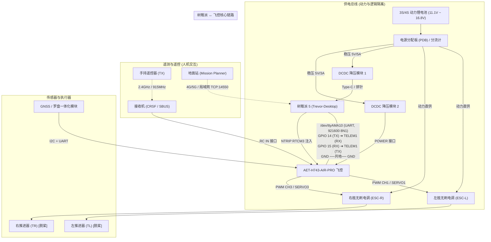
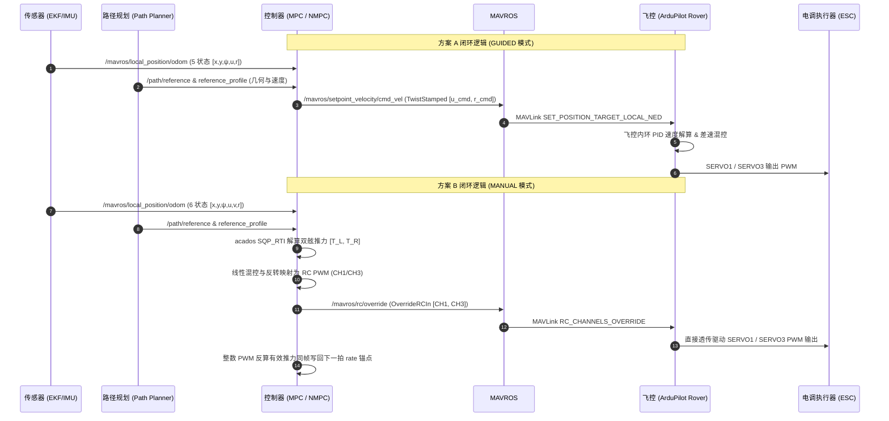
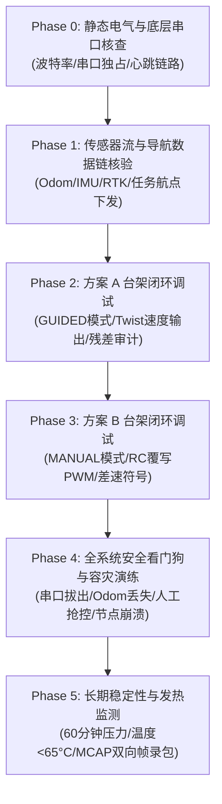
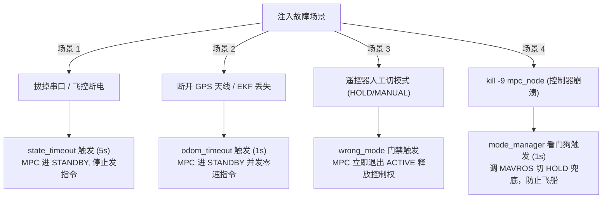

# USV MPC 控制系统台架联调与硬件接入验证方案

> **文档标识**：`docs/bench_and_hardware_verification.md`  
> **适用版本**：Release `pi5-20261113T044740Z-c0d84ac04c81`（基于 `usv_acados` 统一后端的 Release 优化版）  
> **运行宿主**：Raspberry Pi 5（8GB，AArch64，ROS 2 Jazzy）  
> **目标飞控**：AET-H743-AIR-PRO（ArduPilot Rover 固件）  
> **核心目标**：在实船下水前，基于台架架空环境，全面闭环验证电气拓扑、MAVLink 双向链路、双方案控制回路、PreArm 消除、执行器 PWM 差速响应与容灾安全看门狗。

---

## 1. 背景与验证目标

### 1.1 背景与现状
当前 USV 控制软件栈已完成全方位的工程重构与代码级收敛：
- **包结构规范化**：已彻底重构为 `usv_acados`（共用后端）、`usv_mpc`（方案 A 运动学）、`usv_nmpc`（方案 B 动力学）、`usv_planning`（规划）、`usv_safety`（安全监控）及 `usv_bringup`；
- **求解器统一与 CasADi 解耦**：方案 A 运动学 MPC 与方案 B 动力学 NMPC 均由纯 C++ 编译的 `libusv_acados_backend.so` 驱动，彻底消除了外部 Python pip `libcasadi.so` 的运行时依赖；
- **双变体发布闭环**：候选版本 `pi5-20261113T044740Z-c0d84ac04c81` 已在树莓派 5 上完成离线 68/68 单元测试与 520 拍基准压测，且生产环境已通过原子软链切换至 `install_release`，并通过了零 `(deleted)` 残留、MAVROS 独占串口的在线只读取证（`runtime_release.json`）。

### 1.2 为什么必须进行台架联调？
根据项目验收结论（`ACCEPTANCE.md §6`），当前系统仍存在**五项关键的“未验证边界”**，这些边界在纯软件离线或无外设运行态下无法覆盖：
1. **真实物理链路与传感器输入**：缺少真实 EKF 里程计数据流（`odom`）、高频陀螺角速度（`imu`）和 RTK 厘米级定位注入；
2. **5 Hz 真实闭环环境时序**：真实的传感器发布抖动、MAVLink 串口传输开销是否会导致 MPC 出现 deadline miss；
3. **飞控模式与执行器响应**：
   - 方案 A（GUIDED 速度设定值模式）飞控内环能否正确解算；
   - 方案 B（MANUAL RC Override 模式）双推进器差速推力到 PWM（1100~1900 µs）的混控符号与舵角/油门响应是否符合实际动力学；
4. **PreArm 门禁与状态机跳变**：飞控解锁（ARM）与状态机由 `STANDBY` 跃迁至 `ACTIVE` 的双向协同闭环；
5. **系统看门狗与容灾注错**：通信中断、传感器丢失、节点崩溃时，安全看门狗切入 `HOLD` 或 `disarm` 的兜底有效性。

### 1.3 台架联调的核心原则
> [!CAUTION]
> **台架安全第一铁律：严禁带桨调试！**
> 台架联调过程中，必须**拆卸两舷物理螺旋桨**或脱开电机动力传动轴；电机电调可接无感假负载、示波器或空转。即便在空载状态下，也必须配备物理紧急断电开关与手持遥控器最高优先级抢控。

---

## 2. 硬件拓扑与电气接线规范

系统硬件由 **树莓派 5 主控**、**AET-H743-AIR-PRO 飞控**、**双无刷推进器/电调**、**GNSS/RTK 差分模块**、**遥控接收机** 和 **供电/接地管理模块** 构成。



### 2.1 串口与总线连接规范
1. **主通信串口**：树莓派 5 片上 PL011 串口硬件设备为 `/dev/ttyAMA10`，对应 GPIO 排针的 Pin 8 (TXD0) 与 Pin 10 (RXD0)。
   - **波特率**：固定为 `921600`，数据位 8，停止位 1，无奇偶校验（8N1），无硬件流控（`-crtscts`）；
   - **对端接口**：连接 AET-H743-AIR-PRO 飞控的 `TELEM1`（或 `TELEM2`）端口；
   - **接线关系**：树莓派 TXD $\rightarrow$ 飞控 RXD；树莓派 RXD $\rightarrow$ 飞控 TXD；树莓派 GND $\rightarrow$ 飞控 GND。
2. **共地（Common Ground）要求**：
   - 树莓派与飞控必须共地，严禁悬空接地或经由长导线产生地环路，防止高频通信信号共模电压失步导致 MAVLink 丢包重传。
3. **执行器通道分配**：
   - **左推进器**：接入飞控 `MAIN OUT 1`（`SERVO1`）；
   - **右推进器**：接入飞控 `MAIN OUT 3`（`SERVO3`）；
   - 电调信号地线必须与飞控舵机地并联。

---

## 3. 双控制方案在台架上的回路与执行机理

控制软件栈提供 **方案 A（运动学 MPC）** 与 **方案 B（动力学 NMPC）** 两种运行时变体。两者在台架验证中的控制逻辑与硬件反馈截然不同：



### 3.1 方案 A（运动学 MPC，`usv_mpc`）台架机理
- **求解器特征**：acados `NONLINEAR_LS` 形式，SQP 算法，包含 8 维全局参数 $p_{\text{global}}$ 动态注入与 4 项残差审计；
- **控制量输出**：输出机体纵向速度与艏摇角速度指令 $[u_{\text{cmd}}, r_{\text{cmd}}]$（`geometry_msgs/TwistStamped`）；
- **飞控模式门禁**：必须处于 **`GUIDED`** 模式（`allowed_fcu_modes: ["GUIDED"]`）；
- **执行器闭环表现**：
  - MAVROS 将指令打包为 `SET_POSITION_TARGET_LOCAL_NED`（type_mask 仅保留速度分量）；
  - 飞控根据内置参数（`CRUISE_SPEED`、`CRUISE_THROTTLE`、`ATC_STR_RAT_P/I/D`）在内部闭环计算舵/油输出；
  - **台架特点**：由于台架上船体静止，飞控速度环积分项（I 环）可能缓慢爬升，需重点观察指令归零时的迅速回中能力。

### 3.2 方案 B（动力学 NMPC，`usv_nmpc`）台架机理
- **求解器特征**：acados `SQP_RTI`（实时迭代），直接基于 Fossen 3-DOF 动力学非线性模型计算双推进器物理推力 $[T_L, T_R]$（单侧 $\pm 25\ \text{N}$）；
- **控制量输出**：推力经线性映射转为 RC 脉宽指令（`mavros_msgs/OverrideRCIn`）：
  $$\text{Steering PWM} = 1500 + \text{steering\_sign} \times \text{gain} \times \frac{T_R - T_L}{2} \times \frac{400}{T_{\max}}$$
  $$\text{Throttle PWM} = 1500 + \text{throttle\_sign} \times \text{gain} \times \frac{T_L + T_R}{2} \times \frac{400}{T_{\max}}$$
- **飞控模式门禁**：必须处于 **`MANUAL`** 模式（`allowed_fcu_modes: ["MANUAL"]`）；
  > [!IMPORTANT]
  > **为什么方案 B 绝不能进 GUIDED？**  
  > 在 ArduRover 固件实现中，GUIDED 模式下主控通道完全接管，RC 通道覆写中的 CH1（转向）被彻底忽略，CH3（油门）仅作为“微调（nudge）”；无外部速度目标时飞控强制停车。因此方案 B 的推力覆盖只有在 MANUAL 模式下才被作为主舵/主油门直接映射到推进器。
- **锚点同帧写回**：节点将实际下发的整数 PWM 反算为有效物理推力，写回下一拍作为推力变化率约束 $\Delta T$ 的起点，消除控制死区漂移；
- **台架特点**：直接反映推进器推力分配，转向时两电机呈现反向差速旋转（如左增右减）。

---

## 4. 飞控参数配置与 PreArm 消除清单

在连接主控前，必须通过 Mission Planner 对 AET-H743-AIR-PRO 飞控参数进行针对性配置，解决此前实测中发现的数据流瓶颈与阻断项：

### 4.1 核心通信与数据流参数
| 参数项 | 设定值 | 作用与必要性 |
| :--- | :--- | :--- |
| `SERIAL1_PROTOCOL` | `2` | 开启 TELEM1 的 MAVLink v2 协议支持 |
| `SERIAL1_BAUD` | `921` | 波特率设为 921600 bps，确保 5 Hz 控制下串口带宽充裕 |
| `SR1_RAW_IMU` | **`10`** | **由 1 Hz 提速至 10 Hz**，解决 IMU 角速度采样滞后于 MPC 5 Hz 周期的瓶颈 |
| `SR1_POSITION` | `5` | 里程计与位置以 5 Hz 输出，匹配 MPC 控制周期 |
| `SR1_EXT_STAT` | `5` | 飞控状态与电池电压上报频率 5 Hz |
| `SYSID_THISMAV` | `1` | 飞控本端 System ID 固定为 1 |

### 4.2 差速推进器混控参数
| 参数项 | 设定值 | 说明 |
| :--- | :--- | :--- |
| `FRAME_TYPE` | `2` | 履带/双桨差速模式（Skid-Steering） |
| `SERVO1_FUNCTION` | `73` | 输出通道 1 映射为左油门（Throttle Left） |
| `SERVO3_FUNCTION` | `74` | 输出通道 3 映射为右油门（Throttle Right） |
| `SERVO1_MIN / MAX` | `1100 / 1900` | PWM 行程范围（µs），1500 为零推力中位 |
| `SERVO3_MIN / MAX` | `1100 / 1900` | 同上 |

### 4.3 PreArm 检查项排查与临时放行策略
在历史实测中，飞控常被两项 PreArm 警告阻塞而无法解锁：
1. **`Radio failsafe on`（遥控信号中断）**：
   - **成因**：接收机未上电或未与遥控器对频；
   - **排查**：打开遥控器并确保与接收机建立通信；若台架无遥控器，可在 Mission Planner 中临时调整 `ARMING_CHECK` 屏蔽遥控项。
2. **`Check mag field`（磁力计偏差）**：
   - **成因**：室内测试环境中钢筋、工作台等硬磁干扰导致磁场绝对值超出范围；
   - **排查**：校准罗盘，或在台架测试中临时关闭罗盘检查（`ARMING_CHECK = 1` 仅基础检查），**实船下水前必须恢复完整检查并完成现场罗盘校准**。
3. **飞控时间异常防崩溃**：
   - 树莓派端 `mavros_config.yaml` 必须保留 `plugin_denylist: ["sys_time"]`，防止飞控未授时发出 2070 年非法时间戳导致 MAVROS 异常崩溃。

---

## 5. 台架验证五阶段执行规程

台架联调必须按照 **物理通信 $\rightarrow$ 传感器闭环 $\rightarrow$ 方案 A 调试 $\rightarrow$ 方案 B 调试 $\rightarrow$ 异常容灾注错** 的五阶段严格递进执行。



---

### Phase 0: 静态电气与底层串口核查

**目标**：确保树莓派与飞控物理链路连通，MAVROS 正确加载且独占串口。

1. **串口底层检测**：
   ```bash
   stty -F /dev/ttyAMA10 -a
   # 验证输出包含: speed 921600 baud; -crtscts; cs8;
   ```
2. **重启生产主控服务并检查串口独占**：
   ```bash
   sudo systemctl restart usv-system
   python3 deploy/capture_release_identity.py runtime \
     --expected-install /home/trevor/usv_runtime \
     --output /tmp/identity_check.json
   # 检查: identity_ok == true, /dev/ttyAMA10 仅由 mavros_node (PID) 单一持有
   ```
3. **验证 MAVLink 心跳建立**：
   ```bash
   journalctl -u usv-system -n 50 --no-pager | grep -E "HEARTBEAT|endpoint|connected"
   # 预期输出: [mavros]: CON: Got HEARTBEAT, connected. FCU: ArduPilot
   ```

---

### Phase 1: 传感器流与导航数据链核验

**目标**：确认 EKF 里程计、IMU 与航点发布链条畅通，无脏数据进入。

1. **核验状态与定位流**：
   ```bash
   source /opt/ros/jazzy/setup.bash && source /home/trevor/usv_runtime/setup.bash
   ros2 topic hz /mavros/local_position/odom    # 检查频率: 接近 5 Hz
   ros2 topic hz /mavros/imu/data               # 检查频率: 达到 10 Hz (SR1 调优后)
   ros2 topic echo /mavros/state --once         # 检查: connected=true, mode=HOLD/MANUAL
   ```
2. **数据有效性审计**：
   - 检查 `/mavros/local_position/odom` 输出中的 `position.x/y` 与 `twist.linear.x`，确认无 `NaN` 或 `Inf`；
   - 晃动飞控硬件，观察 `/mavros/imu/data` 的 `angular_velocity.z` 是否灵敏变化且符号符合右手定则（逆时针转动为正）。
3. **任务航点下发与规划器管线拉通**：
   - 地面站连接飞控，在规划航线中写入至少 3 个有效经纬度航点（跳过 Home 点）；
   - 检查任务桥接与规划器输出：
     ```bash
     ros2 topic echo /usv/mission/waypoints_local --once   # 检查稀疏航点是否转换为 map 系
     ros2 topic echo /path/reference --once               # 检查稠密路径点数 > 0
     ros2 topic echo /path/reference_profile --once       # 检查 TOPP 速度剖面已配对
     ```

---

### Phase 2: 方案 A 台架闭环调试（GUIDED 速度回路）

**目标**：验证基于 `usv_mpc`（acados NONLINEAR_LS）的速度指令控制回路。

1. **设置方案 A**：
   ```bash
   sudo usv-scheme A
   # 检查输出: allowed_fcu_modes=['GUIDED'], 控制器为 usv_mpc
   ```
2. **解锁与模式就绪**：
   - 遥控器或地面站将飞控切入 **`GUIDED`** 模式；
   - 执行飞控解锁（ARM）；
   - 观察 `/mpc/status` 状态机跃迁：
     ```bash
     ros2 topic echo /mpc/status --truncate-length 2000
     # 检查: state="ACTIVE", standby_reason=""
     # 检查求解耗时: solve_time_ms < 20.0, success=true, fail_count=0
     ```
3. **执行器输出观测**：
   - 观察速度指令输出：
     ```bash
     ros2 topic echo /mavros/setpoint_velocity/cmd_vel
     # 预期: twist.linear.x > 0 (按 TOPP 巡航线速度推进), twist.angular.z 响应转弯
     ```
   - 观察电机空转表现：飞控两舷电调输出 PWM，电机转速平稳，无异常啸叫；
4. **任务完成回退**：
   - 清除地面站航点任务；
   - 观察控制器进入 `STANDBY(no_path)`，同时持续向 `/mavros/setpoint_velocity/cmd_vel` 发送零速度包（确保飞控不锁存旧指令）。

---

### Phase 3: 方案 B 台架闭环调试（MANUAL RC 覆写推力回路）

**目标**：验证基于 `usv_nmpc`（acados SQP_RTI）的双推进器差速推力与 PWM 映射。

1. **设置方案 B**：
   ```bash
   sudo usv-scheme B
   # 检查输出: allowed_fcu_modes=['MANUAL'], 控制器为 usv_nmpc
   ```
2. **解锁与模式就绪**：
   - 遥控器或地面站将飞控切入 **`MANUAL`** 模式；
   - 执行飞控解锁（ARM）；
   - 观察 `/mpc/status` 状态机跳变为 `ACTIVE`，求解耗时应稳定在 `0.3 ~ 0.6 ms`。
3. **差速转向与推力符号标定**：
   - 观察 RC 覆写话题：
     ```bash
     ros2 topic echo /mavros/rc/override
     # 观察 CH1 (转向，索引 0) 与 CH3 (油门，索引 2)
     ```
   - **正向直行验证**：当路径在正前方时，CH1 $\approx 1500\ \mu\text{s}$，CH3 $> 1500\ \mu\text{s}$，左右电机以相同转速正向旋转；
   - **右转差速验证**：手动将飞控向左偏转（制造右转需求），控制器应输出负偏航力矩：
     * 左电机推力增大（PWM 升高），右电机推力降低或反转（PWM 降低）；
     * 确认物理旋转方向与船体右转力矩一致，验证 `steering_sign = -1.0` 配置正确。

---

### Phase 4: 全系统安全看门狗与异常注错演练

**目标**：模拟真实恶劣海况下的硬软件故障，验证系统容灾鲁棒性。



1. **注错 1：里程计丢失（`odom_timeout`）**
   - **动作**：通过命令停发或滤波模拟屏蔽 `/mavros/local_position/odom` 超过 1.0 秒；
   - **检验**：MPC 必须在 1.0 秒内将 `state` 置为 `STANDBY`，`standby_reason` 显示 `no_odom` 或 `odom_timeout`，并立即将推力或速度指令清零。
2. **注错 2：人工遥控优先抢控（`wrong_mode`）**
   - **动作**：在方案 A 处于 ACTIVE 状态时，通过遥控器切入 `HOLD` 或 `MANUAL`；
   - **检验**：MPC 必须在下一拍（0.2 秒内）退回 `STANDBY`，放弃控制权；遥控器输入能够完全掌控舵机与电机。
3. **注错 3：控制器节点崩溃（`mpc_status_timeout` 致命看门狗）**
   - **动作**：执行 `kill -9 $(pgrep mpc_node)` 强行终止控制器；
   - **检验**：由于飞控在收到 MAVLink 速度后可能保持运行，`mode_manager_node` 必须在 1.0 秒内检测到 `/mpc/status` 停发，并连续调用 `/mavros/set_mode` 服务将飞控切入 `HOLD` 模式（或 disarm 兜底），彻底杜绝失控狂奔。
4. **注错 4：飞控链路硬断开（串口拔出）**
   - **动作**：拔掉串口接线；
   - **检验**：MAVROS 报错断连，各节点平稳转入等待状态，系统不产生段错误或内存泄漏。

---

### Phase 5: 长期稳态运行、热设计与数据录制验证

**目标**：评估系统在真实环境下的长期可靠性与数据闭环完整度。

1. **60 分钟持续闭环压力运行**：
   - 保持系统在台架连续运行 1 小时，循环下发航线任务；
   - 监控树莓派 5 核心温度与节流状态：
     ```bash
     vcgencmd measure_temp          # 要求: <= 65°C
     vcgencmd get_throttled         # 要求: 必须为 0x0 (从未降频/从未欠压)
     ```
2. **MCAP 录包完整性验证**：
   - 启动录制服务 `sudo systemctl start usv-record`；
   - 确认包含核心 14 话题以及 `/uas1/mavlink_source`、`/uas1/mavlink_sink` 双向 MAVLink 帧；
   - 录制完毕后使用 `scripts/analyze_usv_bag.py` 回放分析，确认时间戳连续无丢包。

---

## 6. 台架通过验收指标矩阵

| 序号 | 验证模块 | 测量项与观测方法 | 合格准则 (Pass Criteria) | 严重度 |
| :---: | :--- | :--- | :--- | :---: |
| **M1** | 底层链路 | 串口 `/dev/ttyAMA10` 通信质量 | 波特率 921600，无串口 overrun 错误，MAVROS 独占 | **P0 (阻断)** |
| **M2** | 传感器流 | `/mavros/local_position/odom` 质量 | 频率 $\ge 4.5\ \text{Hz}$，零 NaN/Inf，坐标系严格符合 ENU/base_link 契约 | **P0 (阻断)** |
| **M3** | 传感器流 | `/mavros/imu/data` 采样率 | 角速度 $r$ 频率 $\ge 10\ \text{Hz}$，手晃动时转向符号正确 | **P1 (关键)** |
| **M4** | 规划器 | 动态航点与路径速度剖面 | 下发航点后 1.0s 内生成 `/path/reference`，dim 标签时间戳完全匹配 | **P0 (阻断)** |
| **M5** | 方案 A | 运动学 MPC 求解耗时与残差 | SQP 求解 p95 $\le 20\ \text{ms}$，4 项残差全部 $\le 0.005$，0 失败拍 | **P0 (阻断)** |
| **M6** | 方案 A | GUIDED 模式速度输出响应 | 航点前方有路径时下发有效速度指令；任务结束时平稳归零 | **P0 (阻断)** |
| **M7** | 方案 B | 动力学 NMPC 求解耗时 | acados SQP_RTI 求解 p95 $\le 1.0\ \text{ms}$，0 求解崩溃 | **P0 (阻断)** |
| **M8** | 方案 B | MANUAL RC Override 差速逻辑 | 直行双桨同速；转向时两舷呈明显差速；停机时 PWM 回复 1500 $\mu\text{s}$ | **P0 (阻断)** |
| **M9** | 安全看门狗 | odom 丢失保护响应 | 停发 odom 后 $\le 1.0\ \text{s}$ 内进入 STANDBY，推力/速度归零 | **P0 (阻断)** |
| **M10** | 安全看门狗 | 控制器崩溃兜底机制 | 杀死 `mpc_node` 后 $\le 1.0\ \text{s}$ 内飞控被强制切入 HOLD / disarm | **P0 (阻断)** |
| **M11** | 人工接管 | 遥控器优先抢控门禁 | 遥控器切非允许模式时，MPC $\le 0.2\ \text{s}$ 内无条件退出 ACTIVE | **P0 (阻断)** |
| **M12** | 热与稳定性 | 60 分钟持续运行热指标 | CPU 核心温度 $\le 65\ ^\circ\text{C}$，`get_throttled = 0x0`，内存无泄漏 | **P1 (关键)** |

---

## 7. 实机台架排障决策树与应急预案

```
[台架上电自检]
      │
      ├─► 串口连不上? (connected=false)
      │     └─► 检查 GPIO 14/15 接线交叉 (TX-RX) ➔ 查共地 ➔ 查波特率 (921600) ➔ 查 dialout 组权限
      │
      ├─► 飞控无法解锁? (PreArm: Check mag field / Radio failsafe)
      │     ├─► 罗盘干扰: 远离电机硬磁 ➔ 校准磁力计 ➔ 台架临时配置 ARMING_CHECK
      │     └─► 遥控失步: 开启遥控器并对频 ➔ 检查 RC IN 信号
      │
      ├─► 控制器停在 STANDBY 不动?
      │     ├─► standby_reason = "no_odom": 检查 GPS 搜星或 EKF 初始化状态
      │     ├─► standby_reason = "wrong_mode(...)": 
      │     │     方案 A 必须切 GUIDED; 方案 B 必须切 MANUAL (勿搞混!)
      │     └─► standby_reason = "no_path": 地面站写入 >=2 个航点并点击下发
      │
      ├─► 电机转向反了或差速方向相反?
      │     ├─► 单电机旋转方向反: 调换无刷电机任意两根相线
      │     └─► 转向差速反 (想左转右桨反而减速): 
      │           检查 mpc_params_B.yaml 中的 steering_sign (必须为 -1.0)
      │
      └─► 电机突发狂转 / 失控风险?
            └─► 立即拍下物理紧急急停 ➔ 遥控器切 HOLD / 扳动熄火开关 ➔ 拔出动力锂电池
```

### 应急断电第一响应动作
1. **第一优先级**：拍下手持急停按键断开推进器动力电源；
2. **第二优先级**：拨动遥控器安全锁定开关（Cutoff / Disarm）切断 PWM 信号；
3. **第三优先级**：在树莓派终端执行 `sudo systemctl stop usv-system` 强行终止全部控制输出。

