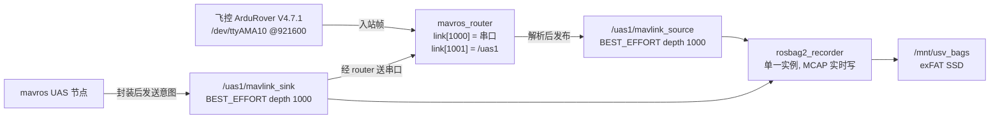

# 树莓派 MAVLink 帧 rosbag 记录 — 改动清单与运行逻辑

> 日期：2026-11-11
> 主机：`trevor-desktop`（Raspberry Pi 5，aarch64）
> **路径现状（2026-11-12 复核，重要）**：会话中途工作空间被合并迁移，三个路径含义不同，不能混用：
>
> | 用途 | 路径 | 状态 |
> |---|---|---|
> | 当前源码/安装树 | `/home/trevor/usv_mpc_ws` | 有效；本文所有配置改动都在这里（`src/` 与 `install/` 一致） |
> | `/etc/systemd/system/*.service`（已安装 unit） | `/home/trevor/usv_mpc_ws` | 已改为新路径并 `daemon-reload` + 重启验证通过（见 §3.3） |
> | 历史验收包 | `/mnt/usv_bags/usv_run_20261111_225441` 等 | 数据有效，与上面的路径变更无关 |
>
> 仓库内 `deploy/systemd/*.service` 已安装到 `/etc/systemd/system/`。
> 本文记录**本次实际改了什么**、**现在怎么跑**、**哪些结论有实测证据**、**哪些还不能宣称**。
> 详细验收数据见 [`bag_recording.md`](bag_recording.md) §10；链路背景见 [`pi_fcu_link_dataflow.md`](pi_fcu_link_dataflow.md)。

---

## 1. 目标与边界

**目标**：在树莓派端用 rosbag 保存飞控 MAVLink 双向原始帧，供参数辨识离线重解与输入—输出对齐。

**不做**（明确排除，避免误读为已完成）：

- 不做串口噪声/残帧的线路层抓包。
- 不为记录另开串口；不写飞控参数；不在本任务内提高下传速率。
- 不恢复已删除的 GCS/TCP 转发链路。
- 不承诺"录到原始帧就等于够辨识"。

**记录边界**：帧封装只能保存该链路实际经过的数据。树莓派 UAS 端点未收到的帧、飞控未下传的高频内部量，都**不会**出现在 bag 里。

---

## 2. 改动清单

生产环境文件逐文件打补丁，`src/` 与 `install/` 三份资源保持一致（md5 相同），未整体覆盖工作空间。

### 2.1 `src/usv_bringup/config/bag_topics.yaml`

新增两个帧话题，其余 12 项保持不变：

```yaml
  - /uas1/mavlink_source   # 入站帧（飞控下传）
  - /uas1/mavlink_sink     # 出站报文（MAVROS 发送意图）
```

开发树另补齐生产早已有、但 dev 缺失的 `/mavros/setpoint_velocity/cmd_vel`（方案 A 控制输入）。

现共 **14 项**（原 12 项；此前文档写的"9 话题"已过时）。

### 2.2 `src/usv_bringup/config/rosbag_qos_overrides.yaml`

为两个帧话题显式匹配原生 QoS：

```yaml
/uas1/mavlink_source:
  reliability: best_effort
  durability: volatile
  history: keep_last
  depth: 1000

/uas1/mavlink_sink:        # 同上
```

原有 odom/imu/raw-fix 的 best_effort 覆盖保留未动。

### 2.3 `src/usv_bringup/config/topic_contract.yaml`

新增 `mavlink_frames` 段，固化：

- 方向（`from_fcu` / `to_fcu`）、发布端（`mavros_node`）、来源标识（`header.frame_id = "ep:<id>"`）。
- 原生 QoS 与**时间戳含义**（ROS 发布时刻，不是 UART 首字节到达/线路发送时刻）。
- 完整性边界：保留 `framing_status`/`magic`/`len`/`flags`/`seq`/`sysid`/`compid`/`msgid`/`checksum`/`payload64`/`signature`；含可路由的坏 CRC 帧，**不含**解析器丢弃的噪声/残帧/不支持的 `incompat_flags`；`FRAMING_OK` ≠ 签名认证通过。
- 明确 `/uas1/mavlink_sink` 只表示**发送意图**，不得记作实际执行量。

dev 树同时补上方案 A 的 `cmd_vel` 契约条目。

### 2.4 `src/usv_bringup/config/mavros_config.yaml`

`plugin_denylist` 追加 `sys_time`（原因见 §4.2）：

```yaml
    plugin_denylist:
      - "_disabled_plugin_name_that_matches_nothing"
      - "sys_time"
```

`plugin_allowlist`、`fcu_url`、`gcs_url`、串口参数**未改**。

### 2.5 `src/usv_bringup/test/test_config_smoke.py`

- 保留：YAML 可解析、话题非空/绝对/唯一、录制话题在契约中有说明。
- 删除：精确 QoS 集合断言、`depth` 钉死、源码文字断言（`--storage-preset-profile` 等实现细节）。
- 结果：dev `usv_bringup/test` **10/10 通过**；prod 该文件 **4/4 通过**。

### 2.6 `/home/trevor/.ros/fastdds_lan.xml`（系统级，非仓库）

接口白名单：`lo, eth0` → `eth0, enx889e96164bd0`。原因见 §4.1。

传输参数（buffer 大小）、`useBuiltinTransports=false` 等**未改**。

### 2.7 文档

- `docs/bag_recording.md`：话题清单 9→14；新增 §3.1（帧语义/边界）、§10（实测验收，含发布端分组、载荷值、时间轴、存储估算）；§5 增加"禁止在连接真实飞控的 ROS 图上整包回放"。
- `docs/pi_fcu_link_dataflow.md`：录包 9→14 话题；契约表加两行帧话题；frpc 隧道 4→3 条（`mavlink-tcp`/14550 确已移除）；§7.3 新增两条已知问题（DDS 白名单、`SYSTEM_TIME` 崩溃）。

### 2.8 备份位置

| 内容 | 路径 |
|---|---|
| 配置（src+install+test+DDS） | `~/usv_bringup_config_backup_20261111-223334/`（含 `MD5SUMS`） |
| `mavros_config.yaml` 改前 | 同目录 `*mavros_config.yaml.bak2` |
| `fastdds_lan.xml` 改前 | `~/.ros/fastdds_lan.xml.bak_20261111-2240` |

---

## 3. 当前运行逻辑

### 3.1 数据路径



关键点：

- **串口唯一持有者**是 `mavros_node`。记录进程不打开串口，只订阅 ROS 话题。
- `/uas1/mavlink_source` 与 `/uas1/mavlink_sink` 都是路由器/UAS 的**原生接口**，插件 allowlist 不影响它们，**不需要额外桥接节点**。
- 全程**一个** recorder、**一个** MAVROS、TCP 转发保持关闭。

### 3.2 服务与配置

| 服务 | 作用 | 与本次改动的关系 |
|---|---|---|
| `usv-system` | `real.launch.py scheme:=B`，拉起 MAVROS + 控制栈 | 使用修改后的 `mavros_config.yaml`（含 `sys_time` deny） |
| `usv-record` | `record.launch.py`，单一 `ros2 bag record` | 读取修改后的 `bag_topics.yaml` / `rosbag_qos_overrides.yaml` |
| `usv-rtk` | NTRIP 差分注入（ntrip_client 原生 SensorDataQoS 直连） | 未改配置，与其它服务共用同一 DDS profile |

三个服务共用 `FASTDDS_DEFAULT_PROFILES_FILE=/home/trevor/.ros/fastdds_lan.xml`、`ROS_DOMAIN_ID=0`、`ROS_AUTOMATIC_DISCOVERY_RANGE=SUBNET`。

### 3.3 启动方式与迁移注意事项

**迁移已于 2026-11-12 完成**：`/etc/systemd/system/usv-system.service` 现指向
`/home/trevor/usv_mpc_ws/install/setup.bash`，已执行 `daemon-reload` 并重启验证
（`systemctl show usv-system -p ExecStart` 显示新路径，`/mpc/status` 正常发布）。
此前的 `/home/trevor/usv_mpc_ws_B` 路径不再被任何已安装 unit 引用。

若再次出现"unit 文件变了但行为没变"，顺序如下（需维护窗口 + 船体安全确认）：

```bash
# 1) 安装仓库内 unit
sudo cp /home/trevor/usv_mpc_ws/deploy/systemd/usv-system.service         /home/trevor/usv_mpc_ws/deploy/systemd/usv-record.service         /home/trevor/usv_mpc_ws/deploy/systemd/usv-rtk.service         /etc/systemd/system/
sudo systemctl daemon-reload

# 2) 按依赖顺序重启
sudo systemctl restart usv-system     # MAVROS + 控制栈
sudo systemctl restart usv-rtk        # NTRIP 差分
sudo systemctl restart usv-record     # 录包（会封口当前包并新开一个）
```

方案切换用 `sudo usv-scheme A|B`（脚本源在 `deploy/usv-scheme`，
`sudo install -m 755 deploy/usv-scheme /usr/local/bin/usv-scheme` 安装）。

### 3.4 实际录制命令（运行态）

```bash
ros2 bag record -s mcap \
  --storage-config-file /home/trevor/.ros/mcap_realtime.yaml \
  --max-bag-size 0 --max-bag-duration 0 --max-cache-size 0 \
  --qos-profile-overrides-path \
    /home/trevor/usv_mpc_ws/install/usv_bringup/share/usv_bringup/config/rosbag_qos_overrides.yaml \
  -o /mnt/usv_bags/usv_run_<timestamp> \
  --topics /mavros/local_position/odom /mavros/imu/data /mavros/state \
           /mavros/rc/override /mavros/setpoint_velocity/cmd_vel \
           /mpc/status /path/reference /path/reference_profile \
           /usv/mission/waypoints_local /mpc/predicted_trajectory \
           /mavros/gpsstatus/gps1/raw /mavros/global_position/raw/fix \
           /uas1/mavlink_source /uas1/mavlink_sink
```

存储策略**未改**：实时 MCAP、`cache=0`、`max_bag_size=0`、不分卷。

---

## 4. 两个必须知道的既有缺陷

这两条都是**改动前就存在**的问题，不是本次配置引入；但会直接决定记录能否工作，因此写在这里。

### 4.1 DDS 白名单不能包含 `lo`

**现象**：网卡地址变化后，MAVROS 等进程仍绑定在已消失的 `10.0.0.3`（`eth0` 变 `NO-CARRIER`），recorder 看到的所有 `/mavros/*` 话题 `Publisher count: 0`。

**根因**：`fastdds_lan.xml` 白名单只列了 `lo` 和 `eth0`。实测发现：

- 白名单同时含 `lo` 与任一物理网卡时，FastDDS 新建 reader 报
  `No unicast locators to create unique flows`，拿不到数据。
- 只用物理网卡（`eth0` + `enx889e96164bd0`）时收发正常。

**修复**：白名单改为 `eth0` + `enx889e96164bd0`，然后重启 `usv-system`（MAVROS 需要重建 DDS participant）。**仅改配置不重启无效**。

**排查方法**：

```bash
ss -uanp | grep -E '10\.0\.0\.3|<旧地址>'   # 有残留=旧进程绑在消失的地址上
```

### 4.2 飞控 `SYSTEM_TIME` 越界会打死 MAVROS

**现象**：MAVROS 启动约 5 s 后 `abort()`：

```
terminate called after throwing an instance of 'std::runtime_error'
  what():  cannot store a negative time point in rclcpp::Time
```

**根因链**（已用 gdb 栈 + 载荷解码证实）：

| 步骤 | 值 |
|---|---|
| 飞控 `SYSTEM_TIME.time_unix_usec` | `3155760742730791`（≈2070 年） |
| `sec = usec/1e6` | `3155760742` |
| `INT32_MAX` | `2147483647` → **溢出** |
| 转为 `int32` 后 | `-1139206554`（负） |
| `rclcpp::Time(int,...)` | 抛异常 → `abort()` |

调用栈：`SystemTimePlugin::handle_system_time` → `rclcpp::Time::Time(int,unsigned,rcl_clock_type_e)` → `__cxa_throw` → `std::terminate`。

该值能通过 MAVROS 的"时间有效"判断（`> 1234567890 s`），2.14.0 没有上界检查。

**为什么不能用 `timesync_mode` 规避**：`SystemTimePlugin::get_subscriptions()` 无条件注册 `SYSTEM_TIME` handler，与 `timesync_mode` 无关。只有 deny 插件能绕开。

**当前规避**：`plugin_denylist: sys_time`。已确认工作区没有订阅 `/mavros/time_reference` 或 `/mavros/timesync_status`，停用不影响其它功能。副作用：不再做飞控时间同步（本来也因时间值错误而不可用）。

**根治方向**：修正飞控侧 GPS/`SYSTEM_TIME` 来源，或在上游给 `rclcpp::Time` 加范围检查。恢复 `sys_time` 前必须先确认飞控不再发出越界时间。

---

## 5. 实测证据

### 5.1 封口验收包

`/mnt/usv_bags/usv_run_20261111_225441` — 128.6 s，6386 条消息，1.5 MiB。

| 方向 | 完整键 `(frame_id, sysid, compid)` | 帧数 | 速率 | HEARTBEAT |
|---|---|---|---|---|
| source | `('ep:1000', 1, 1)` 飞控 | 3166 | 24.67 Hz | 1.01 Hz |
| source | `('ep:1000', 255, 190)` **来源未确认** | 210 | 1.64 Hz | 1.00 Hz |
| sink | `('mavros', 255, 191)` | 1460 | 11.49 Hz | 1.01 Hz |

- `framing_status` 全为 1（FRAMING_OK）；`signature` 长度恒为 0（未启用签名）。
- 帧长度公式自洽 4836/4836；载荷长度截断感知校验 0 违规（`len ≤ 规范全长`，尾部截断字节全为 0）。
- 飞控 `1.1` 序号步长全为 `{1: 3165}`（本包内全部 +1）。这是**观测事实，不构成零丢失保证**：链路为 BEST_EFFORT，只覆盖树莓派 UAS 端点看到的帧。
- `255.190` 步长 `{1:197, 3:9, 5:2, 8:1}`、sink 步长 `{1:1444, 2:10, 255:5}`：**成因未确定**，不要归因为"按速率抽取"，也不能据此判丢包。
- `255.190` **只出现在 source**，sink 只有一个身份 `255.191`；本任务没有证据说明 `255.190` 是什么，不得写成"MAVROS 回环"。

### 5.2 载荷抽样（证明不是只有空壳）

| 消息 | 实测值 |
|---|---|
| `ATTITUDE`(30) | roll=0.0060 pitch=0.0037 yaw=−0.0004 rad |
| `LOCAL_POSITION_NED`(32) | x=−0.00 y=0.00 z=−0.03 m，速度≈0 |
| `GLOBAL_POSITION_INT`(33) | lat=30.8877999 lon=121.8954999 alt=4030 mm，hdg=359.98°（uint16 cdeg） |
| `GPS_RAW_INT`(24) | **fix_type=5 (RTK Float)**，24 星，eph=0.60 m |
| `SERVO_OUTPUT_RAW`(36) | servo1=1500 servo2=0 servo3=1500 servo4=0 µs |
| `RC_CHANNELS`(65) | ch1..4 全 0，rssi=0 → **无遥控输入** |
| `SYS_STATUS`(1) | 12.130 V，0.22 A |
| `BATTERY_STATUS`(147) | `voltages` 全为 65535（无效哨兵），pct=86 |
| `GPS_RTCM_DATA`(233) | 948 帧在 sink；`fragment_id=(flags>>1)&3` 实测 0/1，`sequence_id=(flags>>3)&0x1F` 覆盖 0–31 |

### 5.3 时间轴

| 检查 | 结果 |
|---|---|
| 同消息采样间隔 | 标称 1001.7 ms，最大 1022.0 ms，**>2× 间隔 0 次** |
| 跨消息 FCU 纪元 | 6 类消息同为 9598005→9725005 ms，单调无回退 |
| source `header` 回拨 | 0 次 |
| sink `header` 回拨 | **5 次**（−148 ns ~ −175 908 ns，成因未确定） |

**`SERVO_OUTPUT_RAW.time_usec` 是 u32 µs，本包已回绕 2 次**：`1008070695 + 2×2³² = 9598005287 µs = 9598005.287 ms`，与 `ATTITUDE` 的 `9598005 ms` 相差 **+0.287 ms**，回绕后单调。不减回绕直接比较会得到约 **−2.4 h** 的假偏移；对齐前必须展开，且不要混用 µs/ms 推导 `k`。

三条时间轴必须分开用：bag 接收时间（ROS 墙钟）、帧 `header` 时间（发布时刻）、载荷内 FCU boot/usec（设备侧）。**不要**用 ROS 时间差声称测出了串口延迟。

### 5.4 存储

| 项 | 值 |
|---|---|
| 写盘速率 | 1 513 342 B / 128.5997 s ≈ **0.67 MiB/min** |
| SSD 剩余 | 25 GiB（`/dev/sda1`，17% 已用） |
| 粗估可录时长 | ≈**26 天**（25 GiB ÷ 0.67 MiB/min ≈ 26.4 天），仅在该实测工况下成立 |

出海时消息率上升会线性增加写入量，不要沿用旧的"数百天"估算。

---

## 6. 仍未解决 / 不能宣称的部分

1. **本次数据不能建立控制输入—输出关系**。`disarmed` + STANDBY，`/mavros/setpoint_velocity/cmd_vel` 与 `/mavros/rc/override` 均为 **0 条**。
2. **辨识频率不足**。`ATTITUDE`/`LOCAL_POSITION_NED`/`RAW_IMU`/`SERVO_OUTPUT_RAW`/`RC_CHANNELS` 全部 1 Hz，远低于 5 Hz 控制周期。需在飞控侧调整 SRx 流率（本任务未做）或改用飞控 BIN 日志。
3. **`ATTITUDE_QUATERNION`(31) 本次完全未出现**（已验证缺失，非稀疏）。
4. **`framing_status=1` 不代表签名认证通过**；也不代表覆盖了飞控全部物理通道。
5. **RTCM 边界**：单独 RTCM ROS 话题不录，但 MAVROS 经 UAS 发出的 `GPS_RTCM_DATA`(233) 会出现在 `mavlink_sink` 内（实测 7.46 Hz、载荷 27–182 B 可变）。文档不再声称"RTCM 完全不在 bag 中"。
6. **开发树未同步 `mavros_config.yaml`**。dev 里仍是 Jetson 的 `ttyTHS1` / `tcp-l://:14550` 默认值（不能带回生产），因此 dev 侧只改了配置与测试，**没有** `sys_time` deny。是否也在 dev 加，待确认。

---

## 7. 回放禁令

**禁止在连接真实飞控的 ROS 图上直接回放整个 bag。** `/uas1/mavlink_sink` 会把 MAVLink 报文注入 UAS 并送串口；`/mavros/rc/override` 与 `/mavros/setpoint_velocity/cmd_vel` 会直接控制飞控——整包回放等于向实船重放历史控制量。

分析一律用离线 reader：

```python
import rosbag2_py
from rclpy.serialization import deserialize_message

r = rosbag2_py.SequentialReader()
r.open(rosbag2_py.StorageOptions(uri=BAG, storage_id="mcap"),
       rosbag2_py.ConverterOptions("cdr", "cdr"))
```

确需回放只能在与实船完全隔离的环境，并显式使用安全话题白名单。

---

## 8. 常用核查命令

```bash
# 服务状态
systemctl is-active usv-system usv-record usv-rtk
systemctl show -p NRestarts -p ActiveEnterTimestamp usv-system

# 帧话题是否存在且有发布端
ros2 topic list -t | grep uas1
ros2 topic info -v /uas1/mavlink_source     # 期望 Publisher count: 1

# 实时速率（不要加 --no-daemon，该标志不支持 hz 子命令）
ros2 topic hz /uas1/mavlink_source

# 抽一帧看方向/来源
ros2 topic echo --once /uas1/mavlink_source   # frame_id: ep:1000, magic: 254
ros2 topic echo --once /uas1/mavlink_sink     # frame_id: mavros,  magic: 253

# 封口包（未封口时读不到 metadata，属正常）
ros2 bag info /mnt/usv_bags/usv_run_<ts>
```

服务与配置都需要 `FASTDDS_DEFAULT_PROFILES_FILE=/home/trevor/.ros/fastdds_lan.xml` 与 `ROS_DOMAIN_ID=0` 才能和运行中的控制栈互相发现。

---

## 9. 变更溯源

| 文件 | 变更类型 | 校验方式 |
|---|---|---|
| `src/usv_bringup/config/bag_topics.yaml` | +2 话题 | `_load_topics()` 解析出 14 项 |
| `src/usv_bringup/config/rosbag_qos_overrides.yaml` | +2 覆盖 | YAML 解析 + 子集校验 |
| `src/usv_bringup/config/topic_contract.yaml` | +`mavlink_frames` 段 | 4/4 冒烟测试 |
| `src/usv_bringup/config/mavros_config.yaml` | +`sys_time` deny | 运行态 `Plugin sys_time ignored` |
| `src/usv_bringup/test/test_config_smoke.py` | 重写断言 | 10/10（dev）、4/4（prod） |
| `~/.ros/fastdds_lan.xml` | 白名单改网卡 | 端到端 pub/sub 实测 |
| `docs/*.md` ×3 | 内容更新 | 已同步到 `/home/trevor/usv_mpc_ws/docs/` |

`src/` 与 `install/` 四份 YAML 的 md5 完全一致，未来 `colcon build` 不会回退。
