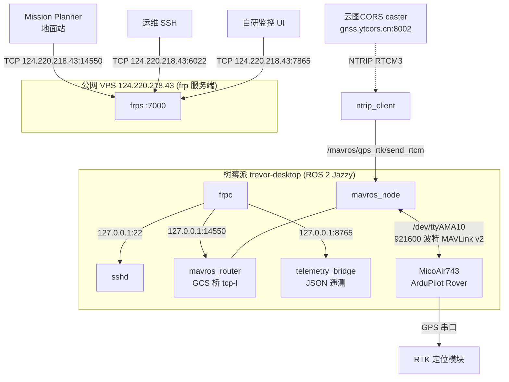
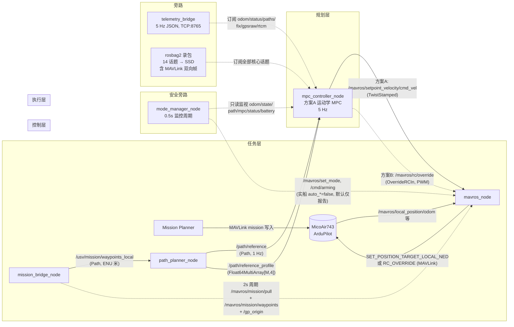

# 树莓派 ↔ 飞控链路与数据流全面解析

> - 日期：2026-10-09（实测数据采集当日）
> - 状态：架构解析文档，基于实机 `trevor-desktop`（树莓派）运行态实测 + 源码梳理
> - 适用范围：实船部署形态（`real.launch.py`，方案 A 运行 / 方案 B 对照，方案 C 仅一句话提及）
> - 配套文档：接口契约见 [topic_contract.md](topic_contract.md)，运行操作见 [runbook.md](runbook.md)，
>   部署过程见 [pi5_deploy.md](pi5_deploy.md)，录包细节见 [bag_recording.md](bag_recording.md)

本文回答三个问题：

1. 树莓派和飞控（MicoAir743，ArduPilot 固件）之间**物理上和协议上**怎么连？
2. 整个控制软件栈里，数据**从哪来、到哪去**、被谁消费？
3. 链路上的每一种消息**长什么样**、每个字段什么含义、什么单位、什么坐标系？

---

## 1. 系统总览：五条链路

整个系统可以看成以树莓派为中心的**五条独立链路**。它们物理上共用一台 Pi 和一个 frp 隧道，但逻辑上互不依赖，任何一条断掉不影响其他链路（除了控制回路本身）。



| # | 链路 | 路径 | 用途 |
|---|------|------|------|
| ① | **SSH 运维** | 操作机 → VPS:6022 → frp → Pi:22 | 远程登录、部署、查看日志 |
| ② | **GCS 遥控链路** | Mission Planner → VPS:14550 → frp → Pi:14550（mavros_router GCS 桥）→ MAVLink 转发给飞控 | 下发任务航点、监控飞控状态、手动接管 |
| ③ | **RTK 差分注入** | 云图CORS → NTRIP → ntrip_client → `/mavros/gps_rtk/send_rtcm` → MAVROS → `GPS_RTCM_DATA` MAVLink → 飞控 GPS 串口 → RTK 模块 | 厘米级定位 |
| ④ | **遥测** | telemetry_bridge → 127.0.0.1:8765 → frp → VPS:7865 → 监控 UI | 5 Hz JSON 状态/轨迹/日志流 |
| ⑤ | **数据录包** | rosbag2 → `/mnt/usv_bags`（外接 SSD，MCAP+zstd） | 事后分析/辨识 |

**注意**：GCS 链路（②）中 Mission Planner 看到的是**经 frp 穿透的 MAVROS GCS 桥**，不是直连飞控串口。MAVROS 在这里同时是"飞控话题的发布者"和"MAVLink 分发路由器"——mavros_router 把一条串口链路扇出到 `/uas1`（ROS 侧）和 `tcp-l://:14550`（GCS 侧）两个端点。

---

## 2. 物理与协议链路层

### 2.1 串口

| 项目 | 值 | 实测依据 |
|---|---|---|
| 设备 | `/dev/ttyAMA10` | `ls /dev/ttyAMA*`（Pi 上唯一 PL011 串口节点） |
| 波特率 | **921600** | `stty -F /dev/ttyAMA10 -a`，与 `fcu_url` 一致 |
| 帧格式 | 8N1，无硬件流控（`-crtscts`） | stty 输出 |
| 权限 | root:dialout，0660 | 运行用户 trevor 需在 dialout 组 |
| 启用方式 | `enable_uart=1`（config.txt），内核命令行**未**占用该串口做 console | cmdline.txt 无 `console=ttyAMA10` |
| udev 规则 | **无**（设备名靠内核分配，换板卡/串口有漂移风险） | `/etc/udev/rules.d/` 仅 snap 规则 |

> ⚠️ **历史坑**：代码与文档里出现过三种串口名——`ttyTHS1`（Jetson 命名，`mavros_config.yaml` 与 launch 默认值）、`ttyAMA0`（pi5_deploy.md 旧写法）、`ttyAMA10`（**实际使用**，部署记录 `docs/deploy_records/20260912_mpc_update_01.md` 已确认）。Pi 上部署时通过 launch 参数 `fcu_url:=/dev/ttyAMA10:921600` 覆盖了默认值。

### 2.2 MAVLink 协议

| 项目 | 值 |
|---|---|
| 协议版本 | **v2.0**（`fcu_protocol: "v2.0"`；FCU 能力位 0xd1ef 含 MAVLink v2 位） |
| MAVROS 身份 | system_id=255（地面站级），component_id=191 |
| 目标 | tgt_system=1, tgt_component=1（飞控本体） |
| 固件 | ArduPilot（Rover 舵/油双通道输出），飞行软件版本 040701ff，板卡 049b0000，VID/PID 1209:5741 |

链路建立日志（journalctl，2026-10-09 15:23）：

```text
Requested to add endpoint: type: 0, url: /dev/ttyAMA10:921600   ← 串口(飞控)
Requested to add endpoint: type: 1, url: tcp-l://:14550          ← GCS 桥
Requested to add endpoint: type: 2, url: /uas1                   ← ROS 侧
link[1000..1002] opened successfully
[mavros]: CON: Got HEARTBEAT, connected. FCU: ArduPilot          ← 连接成功
```

### 2.3 MAVROS 插件与话题

`mavros_config.yaml` 里写了 8 个插件的 `plugin_allowlist`（local_position、imu、rc_io、rc_override、setpoint_velocity、command、global_position、waypoint），意图是只加载需要的插件以避免 Jazzy 下无关 status 插件在 `/mavros/mavros/status` 上的类型冲突。

> ⚠️ **实测发现**：2026-10-09 运行态里 **allowlist 并未生效**——`ros2 node list` 显示全部 ~65 个 MAVROS 插件子节点都已创建（actuator_control、gimbal、hil……）。原因待查（可能是 Jazzy 版 MAVROS 对该参数的解析方式）。**影响有限**：控制栈只消费自己订阅的话题，多出来的话题只是白占一点带宽和内存；但文档/配置中"只加载 8 个插件"的说法与实际不符，后续可修复。

控制栈实际用到的 MAVROS 话题（8 插件各自负责）：

| 插件 | 提供的话题 | 控制栈用途 |
|---|---|---|
| `local_position` | `/mavros/local_position/odom` | 全栈位姿/速度来源（EKF 融合输出） |
| `imu` | `/mavros/imu/data` | MPC 取艏摇角速度 r |
| `sys` | `/mavros/state` | 解锁/模式门禁（`sys` 属于核心插件，不在 allowlist） |
| `rc_io` | `/mavros/rc/out` | RC 输出反馈（方案 B 调试用） |
| `rc_override` | `/mavros/rc/override` | **方案 B** 的执行输出 |
| `setpoint_velocity` | `/mavros/setpoint_velocity/cmd_vel` | **方案 A** 的执行输出 |
| `command` | `/mavros/cmd/arming`、`/mavros/set_mode` | mode_manager 的解锁/切模式服务 |
| `global_position` | `/mavros/global_position/gp_origin`、`/raw/fix` | ENU 原点、RTK/NTRIP GGA 来源 |
| `waypoint` | `/mavros/mission/waypoints`、`/mission/pull` | mission_bridge 拉取任务航点 |
| `gps_rtk` | `/mavros/gps_rtk/send_rtcm` | NTRIP → 飞控的 RTCM 注入口 |
| `battery` | `/mavros/battery` | mode_manager 电量看门狗 |

### 2.4 GCS 链路（frp 穿透）

frpc 配置（`/usr/local/frp/frpc.toml`）当前只有三条 TCP 隧道：`raspberry-ssh`(6022→22)、`raspberry-rdp`(6033→3389)、`usv-telemetry`(7865→8765)。`mavlink-tcp`(14550) 隧道已随 `gcs_url` 置空一并移除（2026-11-11 复核：未监听 14550，frpc 配置中亦无该条目）。

Mission Planner 端配置 TCP 连接 `124.220.218.43:14550` 即可接入。**这条链路是任务下发的唯一入口**：MP 把航点写入飞控任务（MAVLink mission 协议），飞控存任务，MAVROS `waypoint` 插件再把任务镜像到 ROS 侧供 mission_bridge 消费。

---

## 3. 系统数据流

### 3.1 节点图（实船，方案 A 运行态）



### 3.2 数据流分层讲解

**任务层（Mission → 航点）**
Mission Planner 在地面站编辑航线，经 GCS 链路用 MAVLink mission 协议写入飞控任务存储。`mission_bridge_node` 每 2 秒调 `/mavros/mission/pull` 服务拉取任务镜像（`mavros_msgs/WaypointList`，经纬度），结合 `/mavros/global_position/gp_origin`（ENU 原点，地理坐标）把经纬度航点**转换成局部 map 系米制坐标**，发布 `/usv/mission/waypoints_local`。转换用简化球面公式（EARTH_RADIUS=6378137 m）：

```
dE = Δlon · (π/180) · R · cos(lat0)    ← 东向偏移
dN = Δlat · (π/180) · R                ← 北向偏移
```

只保留 `MAV_CMD_NAV_WAYPOINT` / `NAV_SPLINE_WAYPOINT` 类型航点，跳过 home（索引 0），过滤 (0,0) 等退化坐标，按航点签名去重。

**规划层（航点 → 参考路径）**
`path_planner_node` 订阅动态航点 + odom（取当前位置作 v_start），执行三步管线：
1. **航点管理**——推进/到达判定（默认到达半径 2 m，见 `path_config.yaml`）；
2. **fillet 圆弧平滑**——转折处用圆弧倒角（转弯半径 12 m），按 0.5 m 间距采样成稠密参考路径；
3. **TOPP 速度剖面**——在曲率约束下做时间参数化：巡航 ≤0.8 m/s、转艏 ≤0.18 rad/s、侧向加速度 ≤0.12 m/s²、末端减速到 0。

输出两个**配对发布**的话题：`/path/reference`（几何）+ `/path/reference_profile`（速度剖面），每 1 秒重发一次（保证 late-joiner 也能拿到当前任务）。航点数 <2 或任务完成时发布**空路径**，主动触发 MPC 进 STANDBY。

**控制层（参考 → 指令）**
`mpc_controller_node`（方案 A，`usv_mpc_kinematic_cpp`，CasADi/IPOPT 后端）以 5 Hz（`mpc_dt=0.2s`）运行：取最新 odom 状态 `[x,y,ψ,u,r]`（5 状态，一阶滞后模型），从参考路径上找最近点构建 N=20 步参考序列，解二次规划得到首步控制 `[u_surge, r_yaw]`。**先过 8 项就绪门禁**（odom/path/state 收到且新鲜、armed、模式 ∈ allowed_fcu_modes=`["GUIDED"]`），任一不满足即 STANDBY 并**持续发布零速度指令**（防 FCU 锁存旧指令）。连续求解失败 ≥5 次进 HOLD（零速度+重置热启动）。

**执行层（指令 → 船）**
- **方案 A**（当前）：速度指令 `TwistStamped` → `/mavros/setpoint_velocity/cmd_vel` → MAVROS `setpoint_velocity` 插件转成 `SET_POSITION_TARGET_LOCAL_NED`（type_mask 只留速度字段）→ 飞控 GUIDED 模式内部的速度控制器 → 舵/油输出。**推力分配由飞控完成**，ROS 侧不做混控。
- **方案 B**（对照）：推力指令 `[T_L,T_R]` 经 RC 线性映射转 PWM → `/mavros/rc/override`（CH1 舵/CH3 油，1100–1900 µs）→ 飞控按手动通道解析。ROS 侧自主混控，绕过 GUIDED。切换方式：`sudo usv-scheme B`（改 `/etc/default/usv-system` 后重启服务）。

**安全旁路（mode_manager_node）**
0.5 s 周期监控：odom 新鲜度（1 s）、MPC status 新鲜度（1 s，防 MPC 崩溃后 FCU 锁存最后速度指令）、路径新鲜度（5 s）、地理围栏（半径 200 m）、超速（3 m/s）、低电量（10.5 V）+ MPC 求解失败计数。触发 failsafe 时按 `failsafe_mode` 行动——实船当前为 `"report"`（只告警不切模式，控制权留人工；9-03 实测教训：测试期自动切模式弊大于利）。`auto_arm`/`auto_mode_switch` 在 real.launch 中强制 false，即**实船永不自动解锁/切模式**，只监视报告。另有人工接管后自动恢复目标模式（A=GUIDED / B=MANUAL，取自 MPC status 的 `allowed_fcu_modes`）的冷却逻辑（report 模式下被抑制）。

**遥测/录包旁路**
`telemetry_bridge`（Python）聚合 odom/status/三类路径/fix/gpsraw/rtcm 统计 + journalctl 日志尾巴，5 Hz 打成 JSON 帧推给 TCP 客户端（当前 0 个连接）。rosbag2 以 MCAP+实时写（`mcap_realtime.yaml`，不分卷、`cache=0`）录 14 个核心话题到 SSD，其中包含 `/uas1/mavlink_source` 与 `/uas1/mavlink_sink` 两个 MAVLink 双向帧话题（详见 [bag_recording.md](bag_recording.md) §3.1 与 §10）。

---

## 4. 话题契约总表

### 4.1 控制回路（实时性敏感）

| 话题 | 类型 | 发布者 → 订阅者 | QoS | 速率 |
|---|---|---|---|---|
| `/mavros/local_position/odom` | `nav_msgs/Odometry` | MAVROS → MPC、planner、mode_mgr、telem、recorder | SensorDataQoS（BE/Volatile） | 1 Hz（SRx 配置） |
| `/mavros/imu/data` | `sensor_msgs/Imu` | MAVROS → MPC、recorder | SensorDataQoS | **1 Hz（实测偏低）** |
| `/mavros/state` | `mavros_msgs/State` | MAVROS → MPC、mode_mgr、recorder | RELIABLE + TRANSIENT_LOCAL | 1 Hz |
| `/path/reference` | `nav_msgs/Path` | planner → MPC、mode_mgr、telem、recorder | RELIABLE/Volatile, depth 10 | 1 Hz 定时重发 |
| `/path/reference_profile` | `std_msgs/Float64MultiArray` | planner → MPC、recorder | RELIABLE/Volatile, depth 10 | 1 Hz 定时重发 |
| `/mavros/setpoint_velocity/cmd_vel` | `geometry_msgs/TwistStamped` | **MPC-A** → MAVROS | RELIABLE, depth 10 | 5 Hz |
| `/mavros/rc/override` | `mavros_msgs/OverrideRCIn` | **MPC-B** → MAVROS | RELIABLE, depth 10 | 5 Hz（仅方案 B） |

### 4.2 任务与诊断

| 话题 | 类型 | 发布者 → 订阅者 | QoS | 速率 |
|---|---|---|---|---|
| `/mavros/mission/waypoints` | `mavros_msgs/WaypointList` | MAVROS → mission_bridge | 双路：TRANSIENT_LOCAL latched + Volatile | 航点变化时 |
| `/mavros/global_position/gp_origin` | `geographic_msgs/GeoPointStamped` | MAVROS → mission_bridge | 双路同上 | 原点设置时 |
| `/usv/mission/waypoints_local` | `nav_msgs/Path` | mission_bridge → planner、telem、recorder | RELIABLE, depth 10 | 航点/原点变化时 |
| `/mpc/status` | `std_msgs/String`(JSON) | MPC → mode_mgr、telem、recorder | RELIABLE, depth 10 | 5 Hz |
| `/mpc/predicted_trajectory` | `nav_msgs/Path` | MPC → telem、recorder | RELIABLE, depth 10 | 1 Hz（每 5 拍） |
| `/mavros/battery` | `sensor_msgs/BatteryState` | MAVROS → mode_mgr | SensorDataQoS | ~1 Hz |
| `/mavros/gps_rtk/send_rtcm` | `mavros_msgs/RTCM` | ntrip_client → MAVROS | RELIABLE | 1 Hz（NTRIP 数据流） |
| `/uas1/mavlink_source` | `mavros_msgs/Mavlink` | MAVROS router → recorder | BEST_EFFORT/Volatile, depth 1000 | 实测 24.67 Hz（飞控 `1.1`）+ 1.64 Hz（`255.190` 回环） |
| `/uas1/mavlink_sink` | `mavros_msgs/Mavlink` | MAVROS UAS → recorder | BEST_EFFORT/Volatile, depth 1000 | 实测 11.49 Hz（发送速率，非采样率） |

> **MAVLink 双向帧**（2026-11-11 起入包）。`source` 是路由器交给 UAS 的**入站**帧（`header.frame_id=ep:1000` 指向 `/dev/ttyAMA10`），`sink` 是 UAS 封装后发出的**报文**，只表示发送意图，不代表串口已发出或飞控已执行。两个话题都是 `mavros_msgs/msg/Mavlink`，保留全部消息 ID 与 `framing_status`，不按插件过滤。**这不是串口线抓包**：解析器丢弃的噪声/残帧不会出现，`FRAMING_OK` 也不等于签名已认证（实测 `signature` 恒为空）。MAVROS 发出的 `GPS_RTCM_DATA` 会出现在 `sink` 内，因此不能再笼统声称“RTCM 完全不在 bag 中”。三条时间轴（bag 接收、帧 `header`、载荷内 FCU boot/usec）不可混用。

> **STANDBY 期间**（当前状态）：`/path/reference` 发空 Path（`poses: []`），`/mpc/predicted_trajectory` 与方案 A 的 `cmd_vel` 零发布/零速度，`/mavros/rc/override` 无发布者。

---

## 5. 消息格式逐个解析

本章是文档核心。每种消息给字段表（含义/单位/坐标系）+ 实测样例。

### 5.1 `nav_msgs/Odometry` — `/mavros/local_position/odom`

全栈的**位姿与速度唯一来源**（EKF 融合 GPS+IMU）。遵循 nav_msgs 标准契约：pose 在 `header.frame_id`，twist 在 `child_frame_id`。

| 字段路径 | 含义 | 单位/坐标系 |
|---|---|---|
| `header.stamp` | EKF 输出时刻 | ROS 时间 |
| `header.frame_id` | 位姿参考系 | `map`（ENU 局部系，原点=home） |
| `child_frame_id` | 速度参考系 | `base_link`（船体系） |
| `pose.pose.position.x/y` | 位置 | m，map 系 |
| `pose.pose.orientation` | 姿态四元数 | z 分量主承载艏向 ψ |
| `twist.twist.linear.x` | 纵荡速度 u（前进） | m/s，base_link |
| `twist.twist.linear.y` | 横荡速度 v | m/s，base_link |
| `twist.twist.angular.z` | 艏摇角速度 r | rad/s，base_link |
| `pose.covariance` / `twist.covariance` | 6×6 协方差 | 实测全 0（MAVROS 未透传 EKF 协方差） |

实测样例（2026-10-09）：

```yaml
header: {stamp: {sec: 1791533745, ...}, frame_id: map}
child_frame_id: base_link
pose:
  pose:
    position: {x: 12.785, y: 15.299, z: 0.0031}
    orientation: {x: 0.02049, y: -0.00421, z: -0.73000, w: -0.68312}
twist:
  twist:
    linear: {x: 0.0, y: 0.0, z: 0.0}      # 船静止
    angular: {x: 0.0, y: 0.0, z: 0.0}
```

消费要点：MPC 对 position/orientation/twist 全字段做 **NaN/Inf 门禁**（GPS 重定位/EKF 发散的单个污染样本直接丢弃，防止 NaN 指令进 GUIDED）；四元数经 `quaternion_to_yaw()` 提取 ψ（全零四元数等退化输入也丢弃）。

### 5.2 `sensor_msgs/Imu` — `/mavros/imu/data`

MPC 用它拿**比 odom 更灵敏的艏摇角速度**（odom 的 r 来自 EKF，有平滑滞后；IMU 陀螺是原始角速度）。

| 字段 | 含义 | 单位 |
|---|---|---|
| `header.frame_id` | `base_link` | — |
| `orientation` | EKF 融合姿态四元数 | — |
| `angular_velocity.z` | **艏摇角速度 r**（唯一被消费的字段） | rad/s |
| `angular_velocity.x/y` | 横摇/纵摇角速度 | rad/s |
| `linear_acceleration` | 机体线加速度 | m/s² |

实测：`angular_velocity ≈ (-0.00061, -0.00041, 0.00055) rad/s`（船静止）。同样过 NaN/Inf 门禁。

### 5.3 `mavros_msgs/State` — `/mavros/state`

飞控连接/解锁/模式门禁信号。

| 字段 | 含义 | 实测值 |
|---|---|---|
| `connected` | MAVROS 与飞控心跳是否建立 | `true` |
| `armed` | 是否解锁 | `false` |
| `guided` | 是否在 GUIDED 模式 | `false` |
| `mode` | 飞控模式字符串 | `"HOLD"`（等待任务） |
| `system_status` | MAVLink 系统状态码 | `5`（critical? 实为 standby 相关枚举） |

MPC 的 `allowed_fcu_modes` 检查就落在 `mode` 字段上——模式不对时 STANDBY 原因显示 `wrong_mode(<实际模式>)`。取值按方案区分，由各自参数文件声明（不再依赖 launch 传参）：**方案 A（运动学，速度 setpoint）为 `["GUIDED"]`（`mpc_params_A.yaml`）；方案 B（动力学 NMPC，RC 覆写）为 `["MANUAL"]`（`mpc_params_B.yaml`）**。B 的 RC 覆写只有在 MANUAL 下才经 ArduRover 的 pilot 输入链（`channel_steer`/`channel_throttle`）成为 steering/throttle 主控制；GUIDED 由自身 submode 驱动：CH1 转向被忽略，CH3 仅作 speed nudge（且限 WP/Heading/TurnRate 子模式），进入 GUIDED 时无 target 即 Stop/Loiter 停车，因此 RC 覆写无法驱动船。`/mpc/status` 会回显 `allowed_fcu_modes`，mode_manager 的 `auto_mode_switch` 以它作为切换目标，不再硬编码 GUIDED。

### 5.4 `mavros_msgs/WaypointList` + `geographic_msgs/GeoPointStamped`

任务航点输入对（经纬度世界坐标）。

**WaypointList**：`waypoints[]` 数组，每项 `x_lat`（纬度）、`y_long`（经度）、`z_alt`（高度，m）、`command`（MAV_CMD 枚举，16=NAV_WAYPOINT）、`is_current_waypoint` 等。来自 Mission Planner 的任务镜像。

**GeoPointStamped**（gp_origin）：`position.latitude/longitude/altitude`，ENU 局部系原点的地理坐标。**航点转换依赖它**——没有原点时 mission_bridge 无法输出局部航点。

实测日志（2026-10-09，HOLD 状态下 MP 只写了 home 项）：

```text
[mavros.mission]: WP: item #0  F:0 C: 16 p: 0 0 0 0 x: 30.88985 y: 121.8928 z: 26.71
[mission_bridge]: Mission Planner 无有效导航航点，已发布空航点列表以触发 HOLD(跳过 1 项)
```

### 5.5 `nav_msgs/Path` — `/path/reference`、`/usv/mission/waypoints_local`、`/mpc/predicted_trajectory`

同一个消息类型，三个语义不同的实例：

| 话题 | frame | 语义 | 生成 |
|---|---|---|---|
| `/usv/mission/waypoints_local` | `map` | 稀疏任务航点（米制 ENU） | mission_bridge 经纬度转换 |
| `/path/reference` | `map` | 稠密参考路径（0.5 m 间距，圆弧倒角） | path_planner fillet 采样 |
| `/mpc/predicted_trajectory` | `map` | MPC 预测轨迹（N=20 步 × 0.2 s = 4 s） | MPC 求解副产物 |

`poses[i].pose.position.x/y` 为平面坐标（m），`orientation` 四元数编码该点航向（quaternion from yaw）。`/path/reference` 的 `header.stamp` 与配对 profile 的 stamp 编码**必须一致**（见 5.6）。

### 5.6 `std_msgs/Float64MultiArray` — `/path/reference_profile`（重点）

**全栈最特殊的数据格式**：几何路径的"时间参数化速度剖面"，用裸数组+维度标签承载结构化数据。MPC 用它做参考速度/曲率前馈，与 `/path/reference` **配对同步**。

**`layout.dim` 结构（4 个维度标签）：**

| dim 标签 | size | stride | 作用 |
|---|---|---|---|
| `points` | m | 4m | 数据行数（航点数） |
| `v_kappa_r_t` | 4 | 4 | 每行 4 列 |
| `stamp_sec:<秒>` | 0 | 0 | **时间戳秒部**（编码在标签字符串里！） |
| `stamp_nanosec:<纳秒>` | 0 | 0 | 时间戳纳秒部 |

**`data` 布局（行主序 [m, 4]）：**

```
data = [v₀, κ₀, r₀, t₀,  v₁, κ₁, r₁, t₁, ..., v_{m-1}, κ_{m-1}, r_{m-1}, t_{m-1}]
        └────────第 0 个路径点┘ └────────第 1 个路径点┘
```

| 列 | 含义 | 单位 | 来源 |
|---|---|---|---|
| v | 期望前进速度 | m/s | TOPP（巡航 ≤0.8） |
| κ | 路径曲率 | 1/m | fillet 几何 |
| r | 期望艏摇角速度 = v·κ | rad/s | 运动学关系 |
| t | 距起点的**累积时间** | s | TOPP 积分 |

**配对同步规则**（`topic_contract.yaml` §104-134）：`/path/reference` 的 `header.stamp` 与 profile 的 dim 标签时间戳**必须相等**才算配对成功；不等则 MPC 标记 `profile_synced=false` 并在 `profile_sync_reason` 给出原因（当前实测：`empty_or_malformed_profile`，因为无任务）。解析代码见 `usv_mpc_kinematic_cpp/src/mpc_node.cpp:313-338`，构造见 `usv_planning_cpp/src/path_planner_node.cpp:276-304`。

> 设计动机：Path 消息没有放浮点数组的字段，velocity profile 若用单独 PoseStamped/CollisionObject 都不合适；借用 MultiArray 的 dim 标签塞时间戳，让两条话题能无锁配对，是务实的工程折中。

### 5.7 `geometry_msgs/TwistStamped` — `/mavros/setpoint_velocity/cmd_vel`（方案 A 输出）

| 字段 | 含义 | 单位/坐标系 |
|---|---|---|
| `header.frame_id` | `base_link` | — |
| `twist.linear.x` | **u_surge 纵向速度指令** | m/s，机体前向 |
| `twist.linear.y/z` | 恒 0（水面船无横移/垂荡指令） | — |
| `twist.angular.z` | **r_yaw 艏摇角速度指令** | rad/s |

发布后**同帧写回**求解器作速率约束锚点（`set_applied_command`），保证下一拍的 du/dr 约束从真实执行值出发，指令与执行不漂移。STANDBY/HOLD/关机时发零速度（`safe_shutdown` 亦然）。

### 5.8 `mavros_msgs/OverrideRCIn` — `/mavros/rc/override`（方案 B 输出）

18 通道 PWM 覆盖数组，单位 µs。方案 B 的映射（`mpc_params_B.yaml`）：

| 参数 | 值 | 说明 |
|---|---|---|
| `rc_steering_channel` | 0（CH1） | 舵通道索引 |
| `rc_throttle_channel` | 2（CH3） | 油门通道索引 |
| `rc_pwm_min/center/max` | 1100/1500/1900 | 线性映射三锚点 |
| `steering_sign` | **-1** | ArduRover RC1 艏向正方向与 NMPC 的 (TR−TL) 相反 |
| `throttle_sign` | +1 | 正推力 → 高 RC3 → 前进 |
| `steering_gain` / `throttle_gain` | 0.4 / 0.75 | 映射斜率 |

混控关系：NMPC 输出 `[T_L, T_R]`（单推进器 ±25 N）→ 舵 = steering_sign·gain·(TR−TL)/2 类的线性组合 → PWM = center + 值·(max−min)/2，整型量化。**全零消息 = 释放通道**（交还手动控制）。节点把最终整数 PWM 按当前线性混控反算为等效 `[TL,TR]` 写回下一拍 `delta_T` 锚点（含 gain/sign/量化近似；死区、非线性、电压影响需实船标定）。

> 当前方案 A 运行态下该话题**无发布者**（0 publisher），录包里此话题为空——属预期行为，排查时不要误判为故障。

### 5.9 `mavros_msgs/RTCM` — `/mavros/gps_rtk/send_rtcm`

NTRIP 客户端下发的差分数据容器。`data` 字段为**原始 RTCM3 二进制报文**（可能多报文拼接），`header.stamp` 为接收时刻。MAVROS `gps_rtk` 插件把它分包成 `GPS_RTCM_DATA` MAVLink 消息（flags 标分片）发给飞控，飞控经 GPS 串口转发给 RTK 模块。**2026-10-09 实测此链路未运行**（见 §7）。

### 5.10 `/mpc/status` JSON 字段字典（方案 A）

`std_msgs/String`，`data` 为 JSON 文本。分三组：

**状态机与求解健康：**

| 字段 | 类型 | 含义 |
|---|---|---|
| `state` | string | `ACTIVE` / `HOLD` / `STANDBY` |
| `success` | bool | 本拍求解是否成功 |
| `fail_count` | int | 连续失败计数（≥5 触发 HOLD） |
| `solve_time_ms` | float | 求解耗时 |
| `max_solve_time_ms` | float | deadline（200 ms） |
| `deadline_miss` | bool | 是否超时 |
| `hold` | bool | 是否处于 HOLD |
| `standby_reason` | string | STANDBY 原因：`no_odom`/`odom_timeout`/`no_path`/`no_state`/`state_timeout`/`disarmed`/`wrong_mode(...)` |
| `error` | string | 失败时的错误描述 |

**方案标识与飞控门禁：**

| 字段 | 含义 |
|---|---|
| `scheme` / `control_mode` / `backend` | `"A"` / `"kinematic"` / `"ipopt"` |
| `require_fcu_state` / `fcu_mode` / `allowed_fcu_modes` / `armed` | 门禁快照 |

**路径同步与状态回显：**

| 字段 | 含义 |
|---|---|
| `path_received` / `path_len` | 参考路径接收与点数 |
| `profile_synced` / `profile_sync_reason` | 速度剖面配对结果（见 5.6） |
| `x`,`y`,`psi`,`u`,`v`,`r` | 当前状态回显（map 系位姿 + base_link 系速度） |
| `u_cmd` / `r_cmd` | 本拍下发指令 |
| `psi_ref` / `e_psi` | 首参考点航向 / 航向误差 |
| `kinematic_dt` / `kinematic_N` / `prediction_time_s` | 0.2 s / 20 / 4.0 s |
| `initial_state_residual` 等 4 个残差字段 | IPOPT 解可行性诊断（均需 < `solution_constraint_tol=0.005`） |

方案 B 额外字段：`tl_n`/`tr_n`（锚定等效推力）、`tl_cmd_n`/`tr_cmd_n`（规划推力）、`steering_pwm`/`throttle_pwm`、`actuation_anchor_source`、`actuation_mapping_error_n`、`solve_wall_time_ms`、`control_source`。mode_manager 只消费 `success/fail_count/solve_time_ms/hold/state/standby_reason` 六个字段做看门狗。

### 5.11 遥测 TCP 帧格式（telemetry_bridge）

自定义应用层协议，**不是 ROS 话题**：

```
[4 字节大端长度 N][N 字节 UTF-8 JSON]
```

JSON 帧 kind 分两类：
- `"tm"`（5 Hz 快照）：`seq`、`t`、`state{x,y,psi,u,v,r}`、`mpc{...}`（status JSON 展开）、`gps{...}`、`rtcm{统计}`、`cmd_vel`、`topics{freshness}`、`paths{ref,mpc,mission}`（哈希去重）、`track{append}`；
- `"log"`（journalctl 尾随）：`{lines:[...]}`。

### 5.12 录包配置（rosbag2 → MCAP）

`bag_topics.yaml` 固定 9 话题（即 4.1/4.2 表中标注 recorder 的那些）。`rosbag_qos_overrides.yaml` 对两个 SensorDataQoS 话题（odom/imu）显式用 best_effort 订阅（匹配 MAVROS 发布端）。存储 MCAP `zstd_fast` 预设，3 GiB/900 s 自动分片，100 MiB 写缓存，输出 `/mnt/usv_bags/usv_run_<时间戳>`。`--noChunking` 变体用于 P0 研究录制。

---

## 6. 坐标系与单位约定

| 约定 | 值 | 说明 |
|---|---|---|
| 全局系 | `map` | ENU 风格平面直角坐标（x 东 y 北），原点 = MAVROS gp_origin（home） |
| 机体系 | `base_link` | 船体坐标系：x 前向（surge），y 左舷，z 上 |
| 角度 | 弧度 | ψ 艏向角、r 艏摇角速度 |
| 速度 | m/s | u 纵荡、v 横荡 |
| 推力（方案 B） | N | 单推进器 ±25 N |
| PWM（方案 B） | µs | 1100–1900，1500 中位 |
| 航点地理坐标 | WGS84 度 | NTRIP 8002 端口基准与之一致，避免基准转换偏差 |

> 代码里 `body_to_ned`/`ned_to_body` 是**历史命名**，实际操作的是 map↔base_link 旋转（`utils.hpp:52-56`），与真正的 NED 无关。读代码时不要被误导。

**nav_msgs/Odometry 契约**是全栈坐标约定的根基：pose 在 map、twist 在 base_link，消费方直接拿 `twist.linear.x` 当机体纵速，**严禁再按 ψ 旋转**。

---

## 7. 2026-10-09 实测快照与发现的问题

### 7.1 运行态

- `usv-system.service`（SCHEME=A）+ `usv-record.service` 正常运行 40+ 分钟，6 节点全在线，MAVROS↔飞控心跳健康
- 飞控 `connected=true, armed=false, mode=HOLD`；MPC `STANDBY(no_path)`
- Mission Planner 仅写入 home 项（1 个航点），mission_bridge 正确跳过并触发 HOLD 语义——**等待下发 ≥2 个航点的任务**
- RTK **未注入**：`/mavros/gps_rtk/send_rtcm` 无发布者，fix_type=3（单点定位），12 星，eph≈320（约 3.2 m 精度）；CORS 服务器可达、ntrip_client 已安装、配置/凭据齐备，仅未启动
- PreArm 阻塞两项：Radio failsafe on（遥控链路失效）+ Check mag field（罗盘磁场 107–161 低于 185–875 区间，xy diff 203>100）
- 温度 59.5 °C、负载 1.0、内存 1.1G/7.8G，mavros_node 占 CPU ~55%（最高）

### 7.2 数据链路质量

| 项目 | 实测 | 评价 |
|---|---|---|
| odom/state 速率 | 1 Hz | 正常（ArduPilot SRx 流速率） |
| **IMU 速率** | **1 Hz** | ⚠️ 偏低。MPC 拿 IMU 是为了比 EKF 更快的 r，1 Hz 起不到作用；需在飞控 SRx 参数里调高 RAW_IMU 流速（如 SRx_EXTRA1=10Hz+），否则该输入形同虚设 |
| profile 配对 | 1.5 Hz（含重发） | 正常 |
| rc/override | 0 publisher | 符合方案 A 预期（见 5.8 注意） |
| predicted_trajectory | STANDBY 无输出 | 正常（ACTIVE 后 1 Hz） |
| 14550 GCS 桥 | 无连接 | MP 未接入或已断开 |

### 7.3 已知注意事项汇总

1. **串口名三种写法**（ttyTHS1/ttyAMA0/ttyAMA10）——以部署记录的 ttyAMA10 为准（§2.1）
2. **plugin_allowlist 未生效**——全部插件加载（§2.3），文档说法与实际不符
3. **CORS 凭据明文**存于 Pi 的 `ntrip_params.yaml`——文档不复制凭据，注意不要提交公共仓库
4. **IMU/state 1 Hz**——远低于 5 Hz 控制周期（§7.2）
5. **方案 A 不发 rc/override**——录包/排查时该话题为空是预期（§5.8）
6. **telemetry 端口**：本地监听 8765，frp 公网映射 7865，两者不是一个口（易混淆）
7. **DDS 白名单不能含 `lo`**——`~/.ros/fastdds_lan.xml` 若把 `lo` 与物理网卡同时列入，FastDDS 新建 reader 会报 `No unicast locators to create unique flows` 并拿不到数据；且网卡地址变化后旧进程会绑定在已消失的地址上。2026-11-11 改为 `eth0,enx889e96164bd0` 并重启 `usv-system`/`usv-rtk`/`usv-record` 才恢复发现。判断方法是 `ss -uanp | grep <旧地址>`。
8. **飞控 SYSTEM_TIME 越界会打死 MAVROS**——飞控重启后发出 `time_unix_usec≈3.16e15`（≈2070 年），MAVROS 2.14.0 转成负 `int32` 后 `rclcpp::Time` 抛异常并 abort，启动约 5 s 即死，`/uas1/mavlink_*` 没有发布端。`timesync_mode` 无法规避（该 handler 无条件注册），当前以 `plugin_denylist: sys_time` 规避，根治需修正飞控时间来源。详见 [bag_recording.md](bag_recording.md) §10.4。
9. **PreArm 未解除**：遥控 failsafe + 罗盘异常，下水前必须解决（罗盘或需重新校准/排查磁干扰）

---

## 8. 调试命令速查

```bash
# —— 在树莓派上（SSH: ssh -p 6022 trevor@124.220.218.43）——
source /opt/ros/jazzy/setup.bash && export ROS_DOMAIN_ID=0

# 服务与日志
systemctl status usv-system usv-record
journalctl -u usv-system -f                       # 实时日志
journalctl -u usv-system --since "-15 min" | grep -iE "error|warn"

# 话题体检
ros2 topic list -t | grep -E "mpc|path|mavros/(local|imu|state|rc|mission|battery|gps_rtk)"
ros2 topic hz /mavros/local_position/odom         # 期望 1 Hz
ros2 topic hz /mavros/imu/data                    # 期望 ≥5 Hz（当前 1 Hz，待调）
ros2 topic info -v /mavros/rc/override            # 方案 A 下 0 发布者属预期

# 关键消息（--truncate-length 防截断）
ros2 topic echo /mavros/state --once
ros2 topic echo /mpc/status --once --truncate-length 4000 | jq .   # 如有 jq
ros2 topic echo /path/reference --once --truncate-length 1500
ros2 topic echo /mavros/rc/override --once --truncate-length 1500

# RTK 链路
ros2 topic echo /mavros/global_position/raw/fix --once            # status: -1/0=单点, 2=差分
ros2 topic hz /mavros/gps_rtk/send_rtcm                            # 无输出=未注入
ros2 topic echo /mavros/gpsstatus/gps1/raw --once | grep fix_type  # 5=Float 6=Fixed

# 串口与链路
stty -F /dev/ttyAMA10 -a                          # 921600 -crtscts
journalctl -u usv-system | grep -E "HEARTBEAT|endpoint|connected"

# GCS 连接（在地面站侧）
# Mission Planner: TCP → 124.220.218.43:14550
ss -tn | grep 14550                               # Pi 上查 GCS 是否接入
```

排障决策树：`connected=false` → 查串口/飞控供电；`mode` 不在 `allowed_fcu_modes`（A=GUIDED，B=MANUAL）→ MP 手动切到该模式或查 wrong_mode 原因；`no_path` → MP 是否已写 ≥2 航点任务；`profile_synced=false` → 查 planner/MPC 时间窗；fix_type 停 3 → 启 NTRIP。
