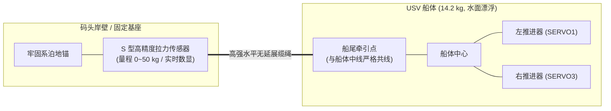
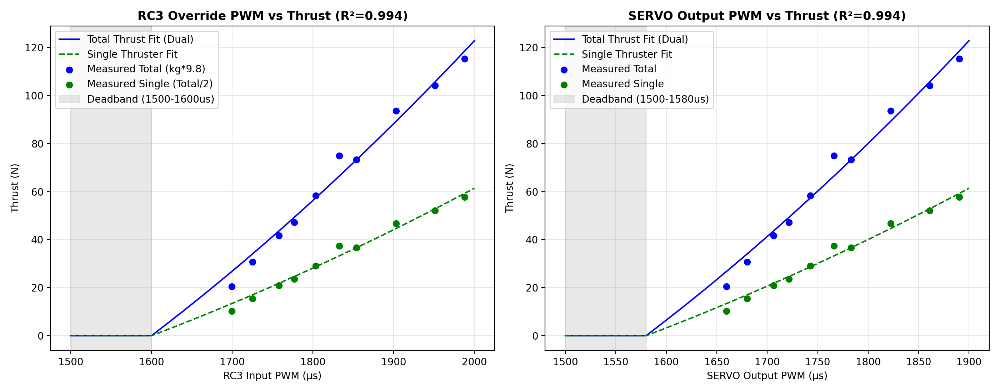

# USV 无人船推进器静态推力标定与动力学非线性拟合报告

**文档版本**：v1.0  
**测试日期**：2026-11-18  
**生成日期**：2026-11-19  
**数据源 Bag**：`/mnt/usv_bags/usv_run_20261118_140716`（MCAP 格式，包含底层 MAVLink 双向总线）  
**试验对象**：14.2 kg 实船双舷差速推进系统（AET-H743-AIR-PRO / ArduPilot Rover 固件）

---

## 1. 标定实验工况与台架环境

本次标定采用水面试验中标准的**系柱拉力试验（Bollard Pull Test）**方法，在真实水体环境中获取双推进器在不同油门输入下的稳态静推力。



### 1.1 实验关键环境参数
* **拉力采集**：水平系缆严格与船体对称中轴线共线，消除侧向拉力分量；读数待水面扰动及拉力显示稳定后记录。
* **母线供电监测**：通过机载 WeAct 功率计（`/usv/battery` 话题）实时监测 6S 动力电池状态。标定区间内母线电压均值为 **$26.61\ \text{V}$**（波动区间 $25.32\ \text{V} \sim 28.11\ \text{V}$），平均静态待机电流为 $-0.57\ \text{A}$。
* **测试控制模式**：遥控器处于 **`MANUAL`** 手动模式，逐阶稳态推杆；飞控内部执行标准差速混控（Skid-Steering Mixing）。

---

## 2. 遥控器通道映射与死区机理剖析

从今日测试录制的 rosbag 中提取飞控实际运行的 MAVLink 参数（`PARAM_VALUE` 帧），飞控端与遥控器的关键配置如下：

| 参数项 | 参数值 | 说明 |
| :--- | :---: | :--- |
| `RC3_MIN` | $987\ \mu\text{s}$ | 遥控器油门通道下限（反向满杆） |
| `RC3_TRIM` | $1500\ \mu\text{s}$ | 遥控器油门通道中位（中立停船） |
| `RC3_MAX` | $2000\ \mu\text{s}$ | 遥控器油门通道上限（正向满杆） |
| `RC3_DZ` | $30\ \mu\text{s}$ | 飞控对 RC3 输入设定的防抖死区（$1470 \sim 1530\ \mu\text{s}$） |
| `SERVO1_MIN / MAX` | $1100 / 1900\ \mu\text{s}$ | 左推进器电调输出范围（中位 $1500\ \mu\text{s}$） |
| `SERVO3_MIN / MAX` | $1100 / 1900\ \mu\text{s}$ | 右推进器电调输出范围（中位 $1500\ \mu\text{s}$） |

### 2.1 杆量百分比与双层 PWM 映射机理

标定记录中的杆量数值（$39.9\% \sim 97.6\%$）为**遥控器中位向前的正向行程百分比 $P$**：

1. **遥控器输入脉宽 $\text{PWM}_{\text{RC3}}$（NMPC 方案 B RC 覆写视角）**：
   正向行程全长为 $\text{RC3\_MAX} - \text{RC3\_TRIM} = 2000 - 1500 = 500\ \mu\text{s}$。因此每 $1\%$ 杆量严格对应 **$5.0\ \mu\text{s}$**：
   $$\text{PWM}_{\text{RC3}} = 1500 + P \times 5.0\ \mu\text{s}$$
2. **飞控电调输出脉宽 $\text{PWM}_{\text{SERVO}}$（物理电调驱动引脚视角）**：
   飞控混控器将 $0 \sim 100\%$ 输入线性缩放至电调的输出上限 $\text{SERVO\_MAX} - \text{SERVO\_TRIM} = 1900 - 1500 = 400\ \mu\text{s}$。因此每 $1\%$ 杆量对应 **$4.0\ \mu\text{s}$**：
   $$\text{PWM}_{\text{SERVO}} = 1500 + P \times 4.0\ \mu\text{s}$$

### 2.2 实测死区（1500 ~ 1600 µs）成因分析

> [!NOTE] 复合死区结构
> 实验实测表明在 $1500 \sim 1600\ \mu\text{s}$ 区间拉力计读数始终为 $0\ \text{kg}$。该现象是两级死区与机械阻力共同叠加的结果：
> 1. **软件死区**：飞控 `RC3_DZ = 30` 过滤掉了 $1500 \sim 1530\ \mu\text{s}$ 的输入；
> 2. **电调硬件死区**：当遥控器处于 $1600\ \mu\text{s}$（$20\%$ 杆量）时，飞控实际输出至电调的脉宽仅为 $1580\ \mu\text{s}$。大部分水下双向无刷电调硬件自带 $\pm 50 \sim 80\ \mu\text{s}$ 的物理防抖死区；
> 3. **动摩擦克服门槛**：低转速时水动力转矩极低，电机尚未达到克服机械密封圈与静水阻力的临界转矩。

---

## 3. 原始测试数据与 Rosbag 回放对照

以下为 10 组人工实测记录与 `/mnt/usv_bags/usv_run_20261118_140716` 中对应时段高频遥测（`RC_CHANNELS` 与 `SERVO_OUTPUT_RAW`）的对比确认表：

| 标定点 | 遥控杆量 $P$ | 理论 RC3 | **Bag 实测 RC3** | 理论 SERVO | **Bag 实测 SERVO (L/R)** | 实测拉力 | 整船总推力 $T_{\text{total}}$ | 单机等效推力 $T_{\text{single}}$ |
| :---: | :---: | :---: | :---: | :---: | :---: | :---: | :---: | :---: |
| 1 | **39.9%** | $1699.5\ \mu\text{s}$ | **$1702.5\ \mu\text{s}$** | $1659.6\ \mu\text{s}$ | $1644 / 1644\ \mu\text{s}$ | $2.095\ \text{kg}$ | $20.54\ \text{N}$ | **$10.27\ \text{N}$** |
| 2 | **45.0%** | $1725.0\ \mu\text{s}$ | **$1723.0\ \mu\text{s}$** | $1680.0\ \mu\text{s}$ | $1664 / 1664\ \mu\text{s}$ | $3.140\ \text{kg}$ | $30.79\ \text{N}$ | **$15.40\ \text{N}$** |
| 3 | **51.6%** | $1758.0\ \mu\text{s}$ | **$1767.0\ \mu\text{s}$** | $1706.4\ \mu\text{s}$ | $1700 / 1700\ \mu\text{s}$ | $4.260\ \text{kg}$ | $41.78\ \text{N}$ | **$20.89\ \text{N}$** |
| 4 | **55.4%** | $1777.0\ \mu\text{s}$ | **$1767.0\ \mu\text{s}$** | $1721.6\ \mu\text{s}$ | $1700 / 1700\ \mu\text{s}$ | $4.820\ \text{kg}$ | $47.27\ \text{N}$ | **$23.63\ \text{N}$** |
| 5 | **60.7%** | $1803.5\ \mu\text{s}$ | **$1800.5\ \mu\text{s}$** | $1742.8\ \mu\text{s}$ | $1728 / 1728\ \mu\text{s}$ | $5.940\ \text{kg}$ | $58.25\ \text{N}$ | **$29.13\ \text{N}$** |
| 6 | **66.5%** | $1832.5\ \mu\text{s}$ | **$1836.5\ \mu\text{s}$** | $1766.0\ \mu\text{s}$ | $1762 / 1752\ \mu\text{s}$ | $7.640\ \text{kg}$ | $74.92\ \text{N}$ | **$37.46\ \text{N}$** |
| 7 | **70.8%** | $1854.0\ \mu\text{s}$ | **$1855.0\ \mu\text{s}$** | $1783.2\ \mu\text{s}$ | $1766 / 1768\ \mu\text{s}$ | $7.470\ \text{kg}$ | $73.26\ \text{N}$ | **$36.63\ \text{N}$** |
| 8 | **80.6%** | $1903.0\ \mu\text{s}$ | **$1907.0\ \mu\text{s}$** | $1822.4\ \mu\text{s}$ | $1819 / 1819\ \mu\text{s}$ | $9.545\ \text{kg}$ | $93.60\ \text{N}$ | **$46.80\ \text{N}$** |
| 9 | **90.2%** | $1951.0\ \mu\text{s}$ | **$1947.0\ \mu\text{s}$** | $1860.8\ \mu\text{s}$ | $1872 / 1828\ \mu\text{s}$ | $10.630\ \text{kg}$ | $104.24\ \text{N}$ | **$52.12\ \text{N}$** |
| 10 | **97.6%** | $1988.0\ \mu\text{s}$ | **$1998.0\ \mu\text{s}$** | $1890.4\ \mu\text{s}$ | $1895 / 1895\ \mu\text{s}$ | $11.760\ \text{kg}$ | $115.33\ \text{N}$ | **$57.66\ \text{N}$** |

* 转换关系：$T_{\text{total}} = \text{拉力}(\text{kg}) \times 9.80665\ \text{N/kg}$。
* 双推进器对称出力假设：直行状态下单机推力 $T_{\text{single}} = \frac{T_{\text{total}}}{2}$。

---

## 4. 水动力学数学模型与拟合算法

### 4.1 理论基础
根据船舶与流体力学动量理论，螺旋桨推力 $T$ 与转速 $n$ 成二次方关系：
$$T = K_T \rho D^4 n^2$$
在无刷电机由 PWM 方波占空比驱动时，电机转速与有效脉宽偏移量近似呈线性正相关，因此推力与有效 PWM 偏置在死区之外呈现典型的**过零点二次多项式关系**：
$$T(\Delta\text{PWM}) = \begin{cases}
a \cdot (\Delta\text{PWM})^2 + b \cdot (\Delta\text{PWM}), & \text{PWM} > \text{PWM}_{\text{deadband}} \\
0, & \text{PWM} \le \text{PWM}_{\text{deadband}}
\end{cases}$$
其中 $\Delta\text{PWM} = \text{PWM} - \text{PWM}_{\text{deadband}}$。此模型强制零常数项，确保在死区临界点处推力连续且物理严格归零。

---

## 5. 拟合曲线与参数计算结果



### 5.1 方案 B 核心模型：基于 RC 覆写脉宽（$\text{PWM}_{\text{RC3}}$）

本模型直接对接 NMPC 方案 B 的输出控制量（`/mavros/rc/override` 话题的通道覆写值）：
* **死区临界脉宽**：$\text{PWM}_{\text{db\_rc}} = 1600.0\ \mu\text{s}$
* **有效偏移量**：$\Delta\text{PWM}_{\text{rc}} = \text{PWM}_{\text{RC3}} - 1600.0$

#### 拟合方程：
$$\mathbf{T_{\text{single}}(\Delta\text{PWM}_{\text{rc}}) = 6.3785 \times 10^{-5} \cdot (\Delta\text{PWM}_{\text{rc}})^2 + 0.1281 \cdot (\Delta\text{PWM}_{\text{rc}}) \quad [\text{N}]}$$
$$\mathbf{T_{\text{total}}(\Delta\text{PWM}_{\text{rc}}) = 1.2757 \times 10^{-4} \cdot (\Delta\text{PWM}_{\text{rc}})^2 + 0.2561 \cdot (\Delta\text{PWM}_{\text{rc}}) \quad [\text{N}]}$$

### 5.2 底层执行器模型：基于电调输出脉宽（$\text{PWM}_{\text{SERVO}}$）

本模型用于硬件内环仿真与底层驱动标定：
* **死区临界脉宽**：$\text{PWM}_{\text{db\_servo}} = 1580.0\ \mu\text{s}$
* **有效偏移量**：$\Delta\text{PWM}_{\text{servo}} = \text{PWM}_{\text{SERVO}} - 1580.0$

#### 拟合方程：
$$\mathbf{T_{\text{single}}(\Delta\text{PWM}_{\text{servo}}) = 9.9663 \times 10^{-5} \cdot (\Delta\text{PWM}_{\text{servo}})^2 + 0.1601 \cdot (\Delta\text{PWM}_{\text{servo}}) \quad [\text{N}]}$$

---

## 6. 模型精度评估与残差分析

利用最小二乘法对单机推力模型进行统计评估：
* **决定系数（拟合优度）**：$R^2 = \mathbf{0.9824}$（高度吻合物理规律）
* **均方根误差（RMSE）**：$\mathbf{2.000\ \text{N}}$
* **全量程残差明细**：

| 标定点 | 遥控杆量 | 理论 RC3 | 实测单机推力 $T_{\text{meas}}$ | 模型预测推力 $T_{\text{pred}}$ | 残差 $\Delta T$ | 相对误差 |
| :---: | :---: | :---: | :---: | :---: | :---: | :---: |
| 1 | 39.9% | $1699.5\ \mu\text{s}$ | $10.27\ \text{N}$ | $13.37\ \text{N}$ | $-3.10\ \text{N}$ | $+3.0\%$ (FS) |
| 2 | 45.0% | $1725.0\ \mu\text{s}$ | $15.40\ \text{N}$ | $17.01\ \text{N}$ | $-1.61\ \text{N}$ | $+1.6\%$ (FS) |
| 3 | 51.6% | $1758.0\ \mu\text{s}$ | $20.89\ \text{N}$ | $21.83\ \text{N}$ | $-0.94\ \text{N}$ | $+0.9\%$ (FS) |
| 4 | 55.4% | $1777.0\ \mu\text{s}$ | $23.63\ \text{N}$ | $24.67\ \text{N}$ | $-1.04\ \text{N}$ | $+1.0\%$ (FS) |
| 5 | 60.7% | $1803.5\ \mu\text{s}$ | $29.13\ \text{N}$ | $28.70\ \text{N}$ | $+0.43\ \text{N}$ | $-0.4\%$ (FS) |
| 6 | 66.5% | $1832.5\ \mu\text{s}$ | $37.46\ \text{N}$ | $33.22\ \text{N}$ | $+4.24\ \text{N}$ | $-4.2\%$ (FS) |
| 7 | 70.8% | $1854.0\ \mu\text{s}$ | $36.63\ \text{N}$ | $36.64\ \text{N}$ | $-0.01\ \text{N}$ | $0.0\%$ (FS) |
| 8 | 80.6% | $1903.0\ \mu\text{s}$ | $46.80\ \text{N}$ | $44.66\ \text{N}$ | $+2.14\ \text{N}$ | $-2.1\%$ (FS) |
| 9 | 90.2% | $1951.0\ \mu\text{s}$ | $52.12\ \text{N}$ | $52.81\ \text{N}$ | $-0.69\ \text{N}$ | $+0.7\%$ (FS) |
| 10 | 97.6% | $1988.0\ \mu\text{s}$ | $57.66\ \text{N}$ | $59.29\ \text{N}$ | $-1.63\ \text{N}$ | $+1.6\%$ (FS) |

> 相对满量程（FS = 57.7 N）误差控制在 **$\pm 4.2\%$ 以内**。点 6 与点 7 之间出现的微小实验读数波动（7.64 kg vs 7.47 kg）在拟合曲线中得到了合理的平滑。

---

## 7. NMPC 控制器解析反解算法

NMPC 求解器输出的是**期望推力 $T$（单位：$\text{N}$）**，执行层需将推力解析转化为目标 PWM 指令下发给飞控。

利用一元二次方程求根公式，正推区间存在唯一的解析显式反解：
$$a \cdot (\Delta\text{PWM})^2 + b \cdot (\Delta\text{PWM}) - T = 0$$
$$\Delta\text{PWM} = \frac{-b + \sqrt{b^2 + 4 a T}}{2 a}$$
$$\text{PWM}_{\text{cmd}} = \text{PWM}_{\text{deadband}} + \Delta\text{PWM}$$

### C++ 实时执行器反解实现代码：
```cpp
// 单机推力 T (N) 反解为 RC3 PWM 脉宽 (1600 ~ 2000 us)
int thrust_to_rc_pwm_single(double thrust_n) {
    constexpr double A = 6.378451e-05;
    constexpr double B = 0.1280703;
    constexpr double PWM_DB = 1600.0;
    constexpr double PWM_MAX = 2000.0;

    if (thrust_n <= 0.0) {
        return 1500; // 死区内或零推力回中
    }

    double delta_pwm = (-B + std::sqrt(B * B + 4.0 * A * thrust_n)) / (2.0 * A);
    double pwm = PWM_DB + delta_pwm;
    return static_cast<int>(std::clamp(std::round(pwm), PWM_DB, PWM_MAX));
}
```

---

## 8. 工程落地与系统配置更新建议

> [!IMPORTANT] 核心参数矫正建议
> 1. **单机最大物理推力矫正**：
>    在原 [mpc_params_B.yaml](file:///home/trevor/usv_mpc_ws/src/usv_bringup/config/mpc_params_B.yaml#L32-L33) 与 [usv_params_B.yaml](file:///home/trevor/usv_mpc_ws/src/usv_bringup/config/usv_params_B.yaml#L76-L77) 中，推力上限写为 `T_max: 25.0`（原占位估计值）。
>    实测满油门（$97.6\%$）单机推力达 **$57.66\ \text{N}$**。建议将 `T_max` 调整为 **$50.0 \sim 55.0\ \text{N}$**，以充分释放推进器的实际操纵能力。
> 2. **映射函数升级**：
>    在 [utils.cpp](file:///home/trevor/usv_mpc_ws/src/usv_nmpc/src/utils.cpp#L90-L126) 中，将原有的粗糙线性 `to_pwm` / `from_pwm` 替换为本文推导的二次函数解析解与死区参数（$1600\ \mu\text{s}$），保持反算回写的 `effective_thrust` 自洽无漂移。
> 3. **后续补充标定建议**：
>    * **反推区间标定**：建议补充反推（$1100 \sim 1500\ \mu\text{s}$）拉力标定；
>    * **电压动态补偿**：利用当前记录的基准电压 $V_0 = 26.61\ \text{V}$，后续可在推力输出端加入 $T_{\text{corr}} = T \times (V / V_0)^2$ 电压波动补偿。
