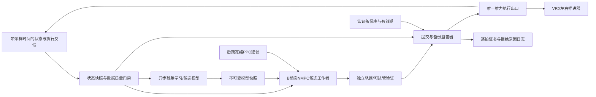

# 首选 A：基于现有 ROS2 / NMPC / PPO 平台的研究可行性与实施方案

日期：2026-10-03（Asia/Shanghai）  
研究主机：Ubuntu `192.168.1.222`；工作目录 `/home/trevor/USV`  
研究方向 A：**在线残差模型切换时，已验证安全备份的执行一致性与有效期管理**  
代码基线：分支 `codex/scheme-c-rl`，提交 `1e5becae622782526f20fc93928339133c94ec23`；本次检查开始时 Git 工作区干净。  
方法：按 `sgh-research` 与 `sgh-experiment-design` 进行平台核验、理论条件审查、实验设计和阶段验收。本文是设计与可行性文档；没有在本次任务中修改控制代码、训练策略、编译工作空间或启动控制/仿真。连接凭据不写入本文。

## 1. 决策与研究定位

**结论：工程原型可做，研究贡献有条件成立；当前还不能声称已有递归可行性或概率避碰保证。** 你已有可复用的双推力动态 NMPC、轻量 Python 植物、PPO 训练与 ONNX 部署链路、VRX 模型生成和历史数据。最合适的路线是先复用现有动态控制器，建立控制提交和备份监管机制，用已知模型版本验证问题，再加入 GP，最后把冻结 PPO 接为性能建议器。

仓库中 `scheme=A/B/C` 分别表示运动学 MPC、动态 NMPC、PPO。**本报告“研究 A”应基于仓库 `scheme=B` 实施。** 新研究功能命名为 `research_model_update_safety`，避免误启动运动学方案 A；动态 NMPC / PPO 已直接使用左右推力，不应串入运动学 A 的 `cmdvel_to_thrust` 速度内环。

首轮研究问题收窄为：

> 对单船欠驱动 USV，在声明的动力学、输入、观测误差和静态障碍范围内，如何保证模型切换、超时和备份接续使用同一套有效条件；这种管理是否能在相同算力预算下减少“执行了迟到或过期计划”的事件，并保留足够任务进度？

先讨论有限时域可执行备份。动态目标、COLREGs、多船协调、PPO 重训练、在线超参数优化和真船试验分别作为后续扩展，不放进第一个原型的必需条件。

### 1.1 必须纠正的前提

1. **不是任何 GP 均值更新都会使旧物理备份失效。** 如果原有固定误差包络仍覆盖真实动力学，并且时间、状态、障碍和执行器条件保持有效，性能均值改变本身不改变真实动力学集合。把这种情况当作“模型更新破坏安全”会制造伪创新。
2. **拒绝更新也不等于安全。** 实际阻尼、推进效率或海流仍会漂移。旧模型的紧误差界可能到期，必须扩张误差年龄界或退回仍有效的固定宽界；两者都失效时应报告保证域外。
3. **热启动移位不等于认证备份。** 当前后端移位旧输入并补零，缺少当前状态、误差界、障碍、执行器与终端条件检查。
4. **零推力、低速、HOLD、RTL 都不能直接作为安全证明。** 船会继续漂移，欠驱动船也不能默认在世界坐标小圆域内保持不变。
5. **GP 方差变小、求解器返回成功、任务完成、历史平均求解很快，分别都不能代替安全或实时证明。** 本方案明确记录它们与真实约束违反、数据覆盖、截止时间、证书有效性之间的区别。

### 1.2 创新可行性分级

| 项目 | 判断 | 对后续工作的要求 |
|---|---|---|
| 基于当前平台实现可复现原型 | GO | 先补提交时序、数据契约与备份检查；不依赖重新训练 PPO |
| 单船静态障碍下有限时域机制实验 | CONDITIONAL | 先有已知有效扰动范围、可接续备份、独立区间检查和实际执行日志 |
| 使用经验 GP 界缩小保守性 | CONDITIONAL | 时序留出校准、工况覆盖、年龄失效与宽界回退先通过；结论限定为经验结果 |
| 严格递归可行性 / 无限时域安全 | 当前 NO-GO | 未建立安全终端集合/控制律、统一有效误差事件与持续接续条件 |
| “首次 GP+NMPC 用于 USV”“首次更新门禁” | NO-GO | 已有明确先例，不能用作贡献 |
| 独特的执行器、数据年龄、动作保持与切换充分条件 | 待论证 | 要与成熟方法逐条比较；仅 ROS 集成应按系统/经验贡献定位 |

## 2. 当前平台进度：哪些已存在，哪些仍缺证据

本次只读取得 56 个选定源码、配置与文档文件，保存了 SHA-256；读取了 checkpoint JSON 元信息、ONNX 图常量、历史 GTest XML、rosbag 元数据与已有分析报告。没有加载 checkpoint 中的 pickle 执行对象，也没有进行策略推理。源码行号对应本次快照，路径均相对 `/home/trevor/USV`。

### 2.1 平台能力与限制

| 项目 | 核验事实 | 对研究 A 的用途 / 限制 |
|---|---|---|
| Ubuntu / ROS | Ubuntu 24.04.4 LTS、ROS2 Jazzy；CPU i7-10700，8 核 / 16 线程，内存约 15.35 GiB | 足以开展 CPU 原型与批量轻量仿真；能否达到规定时延必须测量 |
| GPU | `nvidia-smi` 当前不能与驱动通信 | 不把 GPU 加速作为方案前置条件；这不证明主机没有 GPU，也不建议为本报告升级驱动 |
| ROS overlay | 原登录 shell 找不到 `usv_mpc_cpp`；加载工作空间 `install/setup.bash` 后找到已安装包 | 必须显式加载正确 overlay；不是包不存在 |
| 当前运行状态 | 本次默认 ROS domain 下未发现节点，筛选的进程名未显示 Gazebo/MPC | 只说明检查时未发现该域运行链；不是闭环性能测量 |
| NMPC 模型 | 六维 `[x,y,psi,u,v,r]`，双输入 `[T_L,T_R]`，Fossen 3DOF | 可复用；现模型没有 GP、海流状态或真实推进器滞后状态 |
| acados 结构 | 实际 acados 仓库标签 v0.5.4；NX=8，NU=2，阶段 NP=6，全局参数30维 | NX 的额外2维是上一拍输入记忆；NP目前仅参考，不能直接塞 GP / 障碍而不重新生成 |
| 控制时间 | 配置 `Ts=0.2 s`，预测步长0.2 s，N=20，预测4 s | 是配置事实；当前 wall timer 与仿真时钟混用，实际保持时间和端到端耗时尚需测量 |
| 动作限制 | 每桨 ±25 N，80 N/s；0.2 s 时每拍最大变化16 N | 是当前软件约束；±25 N的真船能力尚有未完整推力标定的注释，不能当作新测量 |
| 内部预测结果 | `SolveInfo` 有完整 `X_pred(6×21)`、`U_pred(2×20)` | 可直接复用；外部 Path 只有位姿、成功时每5拍发布，各点同stamp |
| 现有约束 | 输入幅值与变化率；状态有限值处理；地理围栏/电池等健康监控 | 当前没有预测碰撞约束、障碍消息、误差管或终端安全集合 |
| 安全监控 | 当前状态健康与新鲜度检查，默认 `report`；VRX launch 未启动 mode manager | 不能将其等同逐拍推力安全滤波器 |
| PPO | 43维观测、二维归一化动作、0.2s决策、RK4四子步；四阶段训练资产 | 已有训练流水线，但任务是轨迹跟踪，无障碍或安全证书 |
| 域随机化 | 末阶段逐episode水动力±20%、0或1步执行延迟、观测噪声 | 不等于运行中模型漂移或随机计算超时；默认评估关闭DR |
| GP | 所检查的 NMPC / RL 自有源码未发现 GP、模型快照或认证备份实现；两套 Python 环境未发现 gpytorch | 属于新增模块；不应在报告中写成已有功能 |

NMPC 证据：`usv_mpc_ws/src/usv_mpc_cpp/scripts/regenerate_acados_codegen.py:139–168,216–281`，`include/usv_mpc_cpp/mpc_solver.hpp:55–67`，`src/acados_backend.cpp:103–134,194–305`。PPO 证据：`usv_rl/usv_rl/envs/usv_tracking_env.py:124–128,204–232,273–370`。

### 2.2 已有结果能说明什么

- `usv_rl/models/v5/train_meta.json` 记录目标1000万步、16环境、seed42、耗时2281.5s；`s4_dr/model.zip` 元数据记录实际10,092,544步。它们证明训练资产存在，不证明收敛、泛化或当前 ROS 部署正确。
- 已有6份 GTest XML 共43个测试，记录失败/错误均为0，时间为2026-09-14。本次没有重跑，不能作为当前分支重新构建后的通过记录；其余lint结果也未据此宣称全部通过。
- `vrx_twin_circle_007_fixed/analysis_report.txt` 的历史报告写 CTE均值0.316m、最大0.462m、求解均值0.4ms。它是历史报告，未在本次重算；均值只涉及该报告口径，不能证明本主机当前端到端实时性。
- `data/sim_bags/rl_c_001` 约476.44s、71,960条消息，只记录路径、剖面、odom、IMU，**没有左右推力、最终执行动作、clock或策略状态**。因此不能直接生成可信的GP输入—输出标签，也不能以该bag验证v5实际动作幅值。
- `vrx_twin_circle_007_fixed` 有左右推力、odom、IMU、MPC状态与预测Path，适合探索重放工具。但双推力无联合sequence，也不是实测推力；历史bag中没有新证书/版本语义，不能直接验证模型切换机制。

### 2.3 两套 Python 环境须分开使用

| 环境 | 已核验包 | 建议用途 |
|---|---|---|
| `/home/trevor/venv-ardupilot` | Python3.12.3、numpy2.4.6、scipy1.17.1、casadi3.7.2、gymnasium1.3.0、rclpy7.1.11；未发现SB3/torch/gpytorch | 现有ROS/辨识工具环境；不要直接把PPO依赖覆盖进去 |
| `/home/trevor/USV/usv_rl/.venv` | numpy2.5.3、gymnasium1.3.0、SB3 2.9.0、torch2.14.0、onnx1.23.1、onnxruntime1.30.0、pytest9.1.1；未发现scipy/casadi/gpytorch | 现有PPO/导出环境；保留锁定快照 |

第一轮有限模型与故障注入不需要 gpytorch。GP 阶段可另建研究环境并锁依赖，不原地升级两套现有环境。初始诱导点32/64、三个独立输出可在CPU上评估；具体实现和实时预算由基准测试决定，不以论文其他平台耗时作为保证。

## 3. 必须先处理的具体问题

### 3.1 迟到解仍可能执行：研究 A 的第一阻塞项

`usv_mpc_ws/src/usv_mpc_cpp/src/mpc_node.cpp:552–577` 同步调用求解，再检查超时。超时函数只把 `info.success` 改为false，默认前4次失败仍发布返回的 `u_opt`；到第5次才归零。一个数值成功但超过200ms的解因而仍可能被下发。后端在返回前已改热启动缓存。

必须分离三个对象：**候选解、优化热启动、认证备份**。后两者不能共用一个可被求解线程随时写入的缓存。提交监管器在截止时间前选择已验证候选或仍有效备份；迟到结果最多作为下一拍重验证的输入，不按旧初值直接执行。

仅把 `if(timeout) return old_action` 放在同步 `solve()` 后面还不够：求解阻塞期间同一执行线程无法准时接管。监管器要有独立执行上下文；求解器工作者各自拥有 capsule，不能并发修改同一 acados 对象的参数、求解和读解。

### 3.2 现存 v5 ONNX 的动作单位错误已确证

对 `usv_rl/models/v5/s4_dr/model.zip` 的JSON元信息和 `policy.onnx` 图常量进行了只读检查：动作空间确为 `[-1,1]`，ONNX末端为

`-1 + 2 × 0.5 × (clip(mean,-1,1)+1)`。

因此输出仍为 `[-1,1]`。`rl_policy_node.py:258–264` 直接将其作为N发布，当前该链路最大只有±1N，缺少到±25N的缩放。这不是“训练不够好”的证据，应先修物理契约。

推荐唯一契约：**ONNX输出归一化动作；建议节点执行一次 `T_proposal=25×a_norm`；唯一执行节点再按最终约束处理。** 也可让导出图输出物理N，但只能选择一处缩放。模型manifest必须写 `output_unit` 和 `thrust_scale`；独立测试输入−1/0/+1映射到−25/0/+25N，不能只比较两个复用同一错误公式的实现。

`s4_dr/vecnormalize.pkl` 存在并已记录hash；`v5/best/vecnormalize.pkl` 本次未发现。不要将best模型配最后一阶段统计而不核验。SB3将归一化统计作为独立状态保存，部署要同步冻结。[SB3 VecNormalize 官方说明](https://stable-baselines3.readthedocs.io/en/master/guide/vec_envs.html#vecnormalize)

### 3.3 观测历史推力与最终执行反馈

训练环境在生成 `step()` 返回观测后才更新 `prev_thrust`（`usv_tracking_env.py:227,232`）；ROS下一拍用的是上次发布值。现有等价测试重读内部观测，没有覆盖返回值的这一时序差异。

统一定义：`o_k`末两维是产生当前状态之前最近控制区间的**最终执行命令**。安全层接管或限幅后，PPO不能继续把自己的建议当作历史执行值。修复会改变旧策略观测分布，先保存旧行为并做冻结策略短程对拍；是否需要重训练根据实测决定，不把重训练作为A前置条件。

### 3.4 模型对齐与同模型试验偏差

Python默认 `Yr_dot=0、Nv_dot=-0.363545`；VRX生成的有效模型把两者都投影为−0.1817725，`model_report.json`明确记录该处理。Python–C++同参数对拍即使通过，也不能证明Python默认模型已对齐VRX。

VRX默认又把同一 `effective_vehicle.yaml` 交给plant与B控制器，属于接近同模型闭环。必须保存三份独立产物：`controller_nominal`、`plant_actual`、`generated_effective_plant`；只扰动plant，冻结控制器初始参数。生成后再次核对质量矩阵和投影结果，避免配置扰动被生成器抵消。

### 3.5 时间、状态与约束证据链

当前wall timer、steady接收时间、ROS仿真时间混用；odom/IMU可跨时刻组合，两个推力消息是无Header的Float64。先用单个ground-truth odom中一致的六维状态建立数据集，保存原始采样戳、接收steady时间、实际命令应用/保持区间。暂停或加速Gazebo时，0.2s墙钟不一定等于0.2s仿真时间。

独立验证器要重积分候选输入，检查输入/变化率、全部预测状态以及采样间占据区域；不能只检Path端点。acados官方说明SQP_RTI的非线性残差默认并不自动提供，需要重新计算；当前生成问题也没有碰撞约束。[acados残差接口说明](https://docs.acados.org/python_interface/index.html#acados_template.acados_ocp_solver.AcadosOcpSolver.get_residuals)

## 4. 最小架构与接口契约

### 4.1 推荐接线



最初没有PPO节点，也没有真实GP；由既有B生成候选。后期PPO通过相同接口输出建议左右推力，安全NMPC可以最小化与建议的差并生成备份。前期沿用原跟踪代价以复用基线，后期才引入建议跟踪权重，所有对照使用相同权重和约束。

### 4.2 新消息是计划新增，当前仓库尚不存在

新建 `usv_research_interfaces` 和 `usv_research_safety_cpp`，避免把长JSON文本当成执行语义。初期可用结构化JSON作影子日志，闭环执行采用明确类型。物理输出仍保留VRX的左右Float64兼容话题。

| 接口 | 建议话题 | 最少字段 |
|---|---|---|
| `StateSnapshot` | `/research/state` | sequence、odom原戳、sim_time、steady接收时刻、frame/child_frame、状态6、估计误差集合、执行器估计、质量标志 |
| `ControlProposal` | `/research/control/proposal` | source、sequence、state_sequence、模型id、生成时刻、有效截止时间、左右推力N、可选全序列 |
| `CandidatePlan` | `/research/control/candidate` | NX物理状态6、U2、N/dt、完整X/U、计划激活tick与首段持续时间、初始状态集合、参考/障碍版本、性能/安全模型id、求解状态和各残差 |
| `ModelSnapshot` | `/research/model/candidate` | 性能模型id、固定/学习包络id、训练数据末时刻、有效域、均值/方差参数hash、年龄规则、稀疏近似版本 |
| `SafetyCertificate` | `/research/safety/certificate` | certificate_id、plan_id、state/obstacle/envelope/executor版本、验证起止、有效区间、最大保持时间、可达管摘要、终端或有限时域类型 |
| `AppliedControl` | `/research/control/applied` | joint sequence、左右最终命令、来源（候选/备份/应急）、sim/steady时刻、保持区间、证书id、已执行备份索引 |
| `DecisionRecord` | `/research/safety/decision` | 接受/拒绝及原因码、候选与当前证书、包络年龄、端到端耗时、剩余有效期、独立约束违反 |

同一消息中的左右推力是逻辑上的同一拍；Gazebo两话题仍可能有传输先后差，记录/测量差值并纳入执行误差。`AppliedControl`初期代表最终发布命令，不冒充实测桨推力；如plant有滞后，另记录plant实际推力或估计状态。

### 4.3 状态机与提交条件

状态为 `CANDIDATE → VALIDATED → ACTIVE`；另有 `BACKUP_ACTIVE`、`EXPIRED`、`OUT_OF_DOMAIN`、`UNVERIFIED_EMERGENCY`。必须区分“候选被拒绝”与“现活动证书已经无效”。

每拍按以下顺序执行：

1. 取得一致状态、最终动作、障碍和误差年龄快照；检查仍处于声明域。
2. 优先确认当前备份还能覆盖本拍及接续，不等待新优化耗尽预算。
3. 工作线程冻结模型快照生成候选；每个worker独占solver实例。
4. 验证器从当前状态集合重算输入/状态可达外界，检查整个持有区间及备份尾段。
5. 提交时再比对state_sequence、模型/包络/障碍版本、截止时间、计划激活tick和执行器锚点。
6. 全部通过后原子提交“待激活模型+新备份+证书”；在计划执行tick核对状态集合与锚点后激活，同一拍只发布一次联合决策对应的左右命令。
7. 拒绝/超时：执行仍有效的旧备份或有效宽界备份；没有有效选项时明确记保证域外，并执行已声明的工程应急策略。

禁止读取混合的“新均值、旧误差界、旧备份”。状态在求解期间变化时，提交端需把实际测量纳入初始集合重新检查；仅版本相等仍不够。

### 4.4 时延预算：初始设计值，须测量后冻结

保持当前Ts=200ms。初始分配：状态/参考准备15ms，候选求解与GP均值计算80ms，独立验证40ms，提交/发布15ms，剩余50ms作调度和预留。**150ms为本拍候选提交截止设计值，不是本次测量结果，也不等于真船硬实时保证。** 接管动作必须由独立监管器按既定调度发布，不能等阻塞solver返回。

首版采用**固定执行tick**：在t_k执行由上一周期验证好的q_k；后台用q_k/已验证备份把状态集合传播到t_(k+1)，针对下一执行tick求解。t_k+150ms只原子提交候选，不提前发布；t_(k+1)再快速核对测量是否落在预测初始集合、执行锚点与证书是否有效，随后发布q_(k+1)，保持到再下一tick。这样候选准备与动作激活分离；启动第一拍须已有有效初始备份。新候选若不适用，执行覆盖该tick的有效备份，不临时阻塞求解。

两套时钟分工：物理积分/障碍运动用仿真时间；计算截止用steady时钟。VRX机制验收先限制real-time factor为1附近，记录实际比值；若时钟暂停/跳变或tick偏差超声明范围，候选失效并进入已定义分支。加速批量Python按仿真离散序列注入规定延迟，不将加速执行时间假装成真实调度。不得在150ms直接发布，再把到200ms的50ms首段当成完整200ms离散预测。

最大动作保持时长不能预先随意指定为安全。验证器对每个计划计算 `h_max`，监管器在保持时间达到该值之前接续。200/400ms保持是D2的受控试验变量；若某计划不能覆盖它，该计划应被拒绝或提前接管。进程崩溃后ROS层本身无法永久保证更新，后续真船还需底层watchdog且其动作同样经过物理安全分析。

## 5. 模型、GP标签与安全包络

### 5.1 原型先学离散速度增量

定义 `nu=[u,v,r]`，`q=[T_L,T_R]`。标签为

\[
y_k=\nu_{k+1}-[F_0(x_k,q_{exec,k};\Delta t_k)]_\nu.
\]

第一版GP输入 `z=[u,v,r,T_L,T_R]`，输出三个独立速度增量残差，单位分别m/s、m/s、rad/s；加入离散速度预测时**不再乘Ts**。区间内有多次命令切换时，按分段保持输入重放名义积分，或丢弃样本并记录比例。存在明显执行滞后时扩展执行器/队列状态；五维输入在这种情况下不能默认Markov。

固定200ms离散GP不能混合200/400ms的增量标签。首版只纳入固定tick、Δt在[0.198,0.202]s且区间内单一最终命令的样本；记录实际Δt积分，±2ms时间差引起的残差偏差单独纳入E0/质量检查。超时持有、应急中途换命令和不同Δt数据单列，不放入此五维GP；后续如利用，显式加入Δt/执行历史特征或改连续残差模型。分段重放得到正确名义误差并不自动让无执行历史的五维GP能解释该标签。

海流和世界方向可能依赖psi与位置。第一轮选择无海流或已声明固定流工况；随后用留出误差判断是否加入sin/cos psi、已知流或年龄特征。不得把时间戳问题和动作幅值错误交给GP“补偿”。

只修正速度不意味着位置/psi的一步离散误差为零。性能模型可先在RK4预测后注入三维速度增量，安全传播必须另覆盖位置/航向积分误差；或采用联合离散残差/连续残差正确重积分。两种方式不可混用标签单位。

### 5.2 接入acados的实际路径

当前NP=6只含参考，`p_global`仅构造时写入。修改数值 `usv_model_dynamic.cpp` 不会自动改变acados生成模型。必须扩展 `regenerate_acados_codegen.py::build_ocp()`，同步后端参数布局、重新生成、构建和做数值对拍。

最小实现分两步：

- **有限模型 / 固定偏置阶段**：每个候选快照给定有限参数版本或三维离散残差偏置；与新的求解器实例绑定。先验证事务机制，避免同时引入复杂GP导数。
- **GP阶段**：先在上一条候选/热启动轨迹各阶段计算均值，作为冻结的阶段残差参数；单次RTI中固定。这个近似不是完整状态依赖GP-NMPC，需重新预测检查其误差并计入包络。之后才考虑CasADi可微稀疏均值，纳入对状态/输入导数。固定诱导点和超参数先行，在线仅更新后验快照。

如只在旧轨迹上预计算均值，却把它说成沿新轨迹精确GP预测，会高估模型质量。NP新增参考+残差+障碍布局必须版本化；改变N、dt、状态维度、终端约束或障碍数量也需重新生成。

### 5.3 安全模型与性能模型分阶段

固定安全集合针对真实一步映射，记为 `F0(x,q) ⊕ B G0(x,q) ⊕ E0`，其中G0为三维速度增量残差集合，B∈R^(6×3)将其嵌入六维状态，E0⊂R^6覆盖其余离散化、位置/航向和估计误差。NX8的两维输入记忆另按最终执行动作传播，并用于变化率锚点，不作为物理滞后状态。性能中心可变为 `F0+B mu_v`，对应误差集合必须重心化：

\[
W_v=B(G_0-\mu_v)\oplus E_0.
\]

在精确集合语义下，中心相加后仍得到相同物理集合。首阶段GP只改性能，固定宽界安全集合不缩小。D0专门检查这一等价性。

学习界 `L_v` 第二阶段只在影子模式使用。使用旧界时引入有依据的年龄扩张 `L_v(t)=L_v(t_v)⊕D(t-t_v)`。在声明工况内失效可退回G0；超出G0时不能以拒绝更新恢复保证。

固定宽界来源分三层：

1. 有限已知plant版本：可逐版本计算当前序列与状态集合传播，先得有限模型集下的结论。
2. 已知连续仿真参数/扰动区间：用有效区间、Jacobian余项或其他有证明的外包络，覆盖整个声明域及积分误差。密集网格/蒙特卡洛只能作检查，不能替代外界证明。
3. 真实船：重新建立推力、状态估计、流扰动和漂移边界；数据分位数不能自动升级为全工况物理界。

### 5.4 GP数据与校准安排

首批收集60段×60s、5Hz，最多18,000个区间标签；包括直行、左转、右转、S形、推力阶跃和限率过渡，六类各10段。按完整episode分60%训练、20%校准、20%最终测试，避免相邻区间跨集合泄漏。模型/plant版本、执行滞后和流工况分层记录，测试保留至少一组未用于训练的版本。

先用固定超参数、输入标准化、32/64诱导点比较；记录训练与预测耗时、一步残差RMSE、分工况经验覆盖率和最差漏界。在线更新频率初始1Hz、每次最多5个合格新标签，异步形成不可变快照；更新开销不阻塞5Hz执行监管器。

安全缩界门槛初始设为留出每输出99%经验覆盖，按episode计算置信区间并列出最差工况；该门槛是工程筛选，三个输出、多拍与全域联合事件并不因此获得99%安全概率。稀疏近似误差、删点、核选择、超参数变化和闭环分布迁移必须单独处理，才能讨论统一概率事件。

## 6. 备份、障碍与理论结论的范围

首轮仅单船与静态圆形障碍。船体采用保守水平投影包围圆，初始实验半径0.7m、障碍半径0.5m、附加几何余量0.2m，名义中心间距门槛1.4m，**还要加位置可达管、估计误差和区间占据裕度**。0.7m是研究配置，不是已测船宽；运行前检查生成SDF水平包络是否被该半径覆盖，覆盖失败则扩大半径并重新冻结全部对照。

备份先采用反馈跟踪的“保持航速/左转/右转/减速”策略库，推荐目标航速0.4或0.6m/s、目标艏摇率0或±0.2rad/s，推力仍按±25N/80N/s限制。每个策略用当前状态集合、已知plant版本和执行器条件重算未来4s，保留实际可行项；无法验证的策略不进入认证库。

影子模式可先用开环序列诊断，但开环多步误差会扩大；闭环备份证书须包含反馈控制律及输入可达界，不能验证一条名义序列后随意加反馈。

### 6.1 有限时域第一目标

第一目标是“在剩余Tb≤4s内，声明条件下保持约束并执行接续”。证书记录剩余时域与保持上限，每拍都衰减或重验证。到期无新证书就算失败；不能把仿真截断或船停止前进算成持续安全。

### 6.2 何时才能升级为递归保证

至少需要：初始状态属于可验证可行集合；误差包络对整个声明时域统一有效；集合传播覆盖采样间轨迹与数值误差；执行器/消息延迟有有效界；备份尾端到达已证明可持续安全的终端集合；终端反馈在输入限制下保持安全；切换与执行保持同一证书语义。

优先研究正航速轨迹附近的反馈管或静态开阔区域中持续巡航/绕行终端。先检查对应线性化可稳定性，不能在欠驱动静止点直接调用DARE、加终端代价，就假定得到不变集。动态交通需要时变环境假设，不能套用静态终端结论。

### 6.3 可研究的充分条件草案

拟证明：若有效外包络、初始状态集合、障碍占据集和执行器界成立，备份反馈序列及其终端满足条件，且提交后的模型/包络/状态/时间与验证快照一致，则按该证书执行首段并以更新后的状态集合接续，得到相应有限时域安全；有持续安全终端及接续存在性时，再讨论递归执行。

这只是待证明命题框架，本文没有给出完整定理。实现中的每个门禁都要对应条件；若误差或执行时延超界，报告假设失效，不将命题继续使用。

### 6.4 与最接近文献的关系

Maiworm等已提出以候选最优代价不增接受在线更新，且说明不限于NARX或GP；Koller等已有安全回返、GP外包络和安全/性能预测分离。其安全定理依赖已知安全控制器、鲁棒不变安全集及统一置信条件。因此“更新门禁、旧解接续、双模型”自身不是新增贡献。[Maiworm作者原文](https://arxiv.org/html/1911.03315v3)，[Koller作者原文](https://arxiv.org/html/1803.08287v3)

本课题只有在**执行器与保持时间、非平稳误差年龄、模型/备份切换条件**形成新的可计算充分条件，或在正确强基线下形成可解释系统证据时，才有独立论文价值。还需继续比较GP-CBF递归可行性与最新GP-SMPC工作；前次《创新查新依据》提供线索，不能把有限查新写成确认新颖性。

## 7. 分阶段实施：具体工作、入口和验收

以下工期是单人熟悉当前代码、每天可投入约4–6小时的工程估计，不能当作完成承诺。若需要先修VRX或执行器辨识，顺延；每个阶段以验收通过为准。P0/P1/P2串行的最小有限模型原型约12–19个工作日，含GP与强对照的完整首轮约25–40个工作日；严格终端/理论证明不计入这个承诺范围。

### P0：冻结基线、消除量纲与时序歧义（3–5个工作日）

**工作包：**

1. 保存当前Git提交、源码/安装二进制hash、controller与plant有效配置、Python依赖、PPO ZIP/ONNX/VecNormalize hash、历史bag清单。不要覆盖原v5资产或原始辨识文件。
2. 显式加载ROS overlay，重新构建所用包后核对运行参数与实际二进制。先复现B直行/转弯，不同时修改权重和路径，以免无法比较。
3. 新增研究bag清单：ground-truth odom、IMU、clock、path/profile、候选、联合最终执行、模型快照、decision/certificate、左右物理输出。已有PPO bag缺动作，需要重新采集。
4. 定义状态/动作/时钟契约；先用odom一条消息中的u/v/r，IMU另记。验证frame、正艏摇方向、body速度，避免重复旋转twist。
5. 修ONNX单次缩放、`step()`返回历史动作时序、策略最终执行反馈；保存旧资产作诊断对照。PPO修复可并行进行，不阻塞以B为建议器的研究原型。
6. 分离controller和plant有效参数。基准同参数与已知交叉项差异分别命名，不混为学习改进。

**入口：** `usv_rl/usv_rl/export_policy.py`、`envs/usv_tracking_env.py`、`usv_mpc_ws/src/usv_rl_ros/usv_rl_ros/rl_policy_node.py`、`usv_bringup/launch/vrx.launch.py`、`config/topic_contract.yaml`、新增研究录包配置。

**验收：** 所有运行有完整manifest；独立动作映射−1/0/+1正确；两次不同动作的返回观测历史一致；同参数Python/C++离散一步和短轨迹差异能解释；VRX与模型差异另记；控制输出单一来源；得到实际P50/P95/P99/最大端到端耗时与输入应用间隔。源码/历史测试不能替代这些新记录。

### P1：独立提交监管器与有限模型切换（4–6个工作日）

**工作包：**

1. 新增接口与监管节点，修改原B `run_dynamic_mpc_()`为联合 `CandidatePlan` 发布，停用其直接物理发布；监管器成为唯一左右推力发布者。ROS remap不能把两个Float64变成带X/U与版本的联合消息；旧左右话题若保留，只放在影子诊断命名空间。
2. 把候选solver放到独立工作者；保留热启动，但认证备份单独不可变保存。求解结果携带初始状态sequence、截止时间与参数快照。
3. 首先加入影子模式：记录本拍会接受/拒绝什么，仍沿原B执行，明确不声称已安全。随后在可控仿真场景接管执行。
4. 使用有限已知模型版本和人工偏置快照，注入50/150/250/400ms异步结果返回延迟、数值失败、stale state、版本混合、连续5拍无候选等事件。用独立事件调度器释放/丢弃结果，待处理任务有界；不让独占worker堆积五个不可取消延迟任务，实际求解阻塞另设压力用例。
5. 未有碰撞证书前先验收时序/输入约束，不把该临时回退命名为安全认证。

**入口：** `mpc_node.cpp::run_dynamic_mpc_`、`enforce_solve_deadline_`、`acados_backend.cpp::solve/safe_fallback_`、`mpc_solver.hpp::SolveInfo`；新增 `usv_research_safety_cpp`、研究launch。capsule由单worker独占。

**验收：** 所有迟到/错误版本候选执行数为0；旧热启动变化不改变已保存备份；worker阻塞时监管器仍按预算调度；输入幅值/变化率不越界；双话题应用时差被记录；连续失败不靠第5拍瞬间归零绕过率限。

### P2：静态障碍、独立可达验证与有限备份（5–8个工作日）

**工作包：**

1. 先用known finite plant set建立固定物理包络，做D0等价性检查。若逐版本传播尚未覆盖观测/积分误差，只能称有限模型数值检查，不能越级认证。
2. 新增圆形障碍与船体几何配置；验证器从当前状态集合重放候选/备份，检查输入、非线性动力学一致性、碰撞距离及采样间区域。
3. 建立有限4s反馈备份库；每拍检查实际状态是否仍在初始/接续集合内、执行器锚点、误差界与障碍版本、剩余Tb和h_max。
4. acados问题新增障碍阶段参数与硬碰撞约束；几何安全约束不能用slack软化后继续标安全。先用独立检查器发现不安全，不指望原跟踪NMPC自然避障。
5. 影子与执行两种模式对拍。保证域外事件、应急行为、数值验证失败和真实碰撞分别计数。

**验收：** 所有接受动作都能关联完整证书；独立高频plant真值检查不出现“验证接受但实际违反”而未解释的事件；剩余时域/年龄正确衰减；D0不因单纯均值切换撤销仍适用的物理备份；D2能识别采样间风险；不能延长时域时明确记失败。

**进入下一阶段条件：** 包络来源和覆盖范围清楚；备份可行率与任务进度足够。如果宽界使所有备份均不可行，先收窄工况或改策略/传播方法，不能擅自缩界以让实验成功。

### P3：GP离线训练、影子更新与误差年龄（5–8个工作日）

**工作包：** 收集第5.4节数据；建立数据质量筛选；训练三个固定结构GP；比较32/64诱导点；保存episode级留出结果；1Hz异步生成候选快照；先只改性能预测。加D1中可控连续漂移与拒绝更新，分别比较紧界、年龄扩张、固定宽界。

**入口：** 新增 `usv_gp_learning` / `research/gp_model.py`（二者择一，前者ROS包、后者批量工具）、`dataset_builder.py`、`ModelSnapshot`、codegen残差参数。建议离线训练与C++执行独立，C++只读取版本化参数，不将Python训练回调塞进实时执行线程。

**验收：** 标签只使用最终执行输入/实际区间；训练/校准/测试episode不交叉；每个版本可重放；GP更新不阻塞执行；报告遗漏率、最差工况与近似误差；学习界失效时按规则退回有效宽界，宽界失效时标域外。经验覆盖未达到预设门槛时只做性能学习。

### P4：PPO接入与公平对照（4–7个工作日）

冻结已校验43维策略与归一化统计。PPO建议不直接到推进器，而通过统一候选与验证路径；完整记录限幅、过滤或备份接管后的执行反馈。若修复后的冻结策略明显退化，用原B/LOS继续A实验，并单独评估PPO再训练成本；不要让策略性能问题阻断备份机制研究。

新建共同evaluator，而不是直接使用默认关闭DR的旧 `evaluate.py`。B与PPO用相同plant、障碍、初值、时间、约束和故障注入；不同策略的结果单独分层，先证明机制不依赖某个策略。

### P5：强基线、贡献判断与论文边界（4–6个工作日，证明另计）

完成第8节实验、失败案例和第9节统计；比较成熟框架而非仅旧代码缺陷。若只修了超时、缩放和缓存问题，按工程改进归档。若出现有效的新年龄/执行器/接续条件，整理命题、反例、适用域与实现对应表，再决定是否进入严格终端构造、动态船或Pi5验证。

## 8. 可执行实验设计

### 8.1 可证伪假设

| 假设 | 实验与指标 | 推翻条件 |
|---|---|---|
| H0 固定真实包络下单纯性能均值改变不必破坏物理备份 | D0；集合重心等价、误拒绝、实际约束 | 完整条件一致时仍出现集合不等价；先判实现/传播错误，而非创新成立 |
| H1 版本+截止时间管理减少不合法执行 | D2及故障注入；迟到/混版/过期动作数 | 全机制仍执行非法候选；或修正原时序的强基线已同样解决且无其他增益 |
| H2 非平稳误差年龄管理有独立价值 | D1；过期紧界使用数、宽界回退、任务进度、真实违反 | 固定有效宽界以同成本/进度解决全部案例；或年龄界没有可信来源 |
| H3 GP性能补偿有用且不破坏执行保证 | GP留出RMSE、跟踪误差、证书接续、延迟 | 不改善留出/跟踪，或收益全来自默认同模型差异、错误动作幅值或额外算力 |
| H4 机制在冻结PPO建议下仍有效 | B与PPO分层同场景对照 | 只在某策略/特定轨迹成立；则收窄结论，不称策略通用 |

### 8.2 参数矩阵：先按组扫描，不做全部笛卡尔积

“固定”项用于公平比较；“扫描”项逐组改变。以下新数值是可复现实验设计值，未在本次执行。

| 参数 | 固定/默认 | 扫描值与用途 |
|---|---|---|
| 控制Ts / N | 0.2s /20，预测4s | 第一轮固定；改变必须重新生成与构建 |
| RK4 | 4子步 | 真值核验用0.01s积分；D2区间局部0.002s并检查收敛，不将高频点检当形式证明 |
| 推力 / 率限 | 命令与plant实际推力均±25N /80N/s | 修正后所有方法一致；首版允许tick最短0.198s，候选全部阶段保守限制ΔT≤15.84N，执行前再按实际锚点/间隔验证；不能继续用16N后事后发现越界 |
| Q/R/Rd/Qf | `[20,20,50,8,1,8]` / `[.05,.05]` / `[.2,.2]` /8 | 同当前B；第一轮不扫权重 |
| 巡航速度 | 0.6m/s | 0.4、0.6m/s；≥1m/s另行评估，不直接继承保证 |
| 声明速度域 | u∈[−0.2,1.2]m/s，v∈[−0.3,0.3]m/s，r∈[−0.6,0.6]rad/s | 首轮验证设计域；超域单记失败/域外，不删除不利结果 |
| plant质量倍率 | 1.0，相对14.2kg配置 | 0.8、1.0、1.2；惯量与新增负载按明确规则一起更新，不任意独立乱变 |
| 阻尼倍率 | 1.0 | 0.8、1.0、1.2；只改plant，控制器名义冻结 |
| 推力效率 | 1.0 | 0.8、1.0、1.2；效率作用于实际plant推力饱和前，`T_target=clip(η×q,−25,+25)N`，滞后跟踪该目标；分别记录命令和实际推力，避免1.2使实际30N却声称物理25N硬界 |
| 推进器一阶时间常数 | 0（原模型） | 0、0.15、0.30s；实际推力单独记录 |
| 执行传输延迟 | 0 | 0、0.05、0.20s；与计算延迟分开；原DR仅0/0.2s不替代此组 |
| 计算返回延迟 | 0 | 0.05、0.15、0.25、0.40s，在t=20s注入连续5拍；0.15s边界含其他费用，可能被拒绝 |
| 海流 | (0,0)m/s | D2补充(0,0.15)、(0.15,0)m/s；分别记录相对水/地速度语义 |
| 观测噪声sigma | 首轮0 | u/v 0.02m/s、r0.02rad/s、x/y0.05m；有噪声组须扩张初始集合 |
| 状态年龄 | 新鲜 | 0.05、0.20、0.40s；必须由保持输入传播到当前时刻，不能只放宽timeout |
| 模型数据年龄 | 0 | 2、5、10s，无新合格数据；从训练数据末时刻计算 |
| 运行中漂移 | 无 | t=20–40s阻尼倍率1.0线性增至1.2；已知斜率0.01/s映射为残差漂移界 |
| 运行中突变 | 无 | t=20s推力效率1.0→0.8；若违背慢漂移假设，则检验域外检测，不假装原保证继续有效 |
| GP诱导点 / 更新 | 32 /1Hz | 32、64；更新1Hz，每批最多5样本；先固定超参数与诱导点 |
| 候选提交截止 | 150ms（设计） | 所有修正后方法相同；须在P0测量后冻结，不能仅为新方法改预算 |
| 静态障碍 | 半径0.5m | 每船体半径0.7m+额外0.2m+可达误差；几何先校验 |
| 重复seed | 0–9 | 初筛0–4，确认0–9；最终冻结场景另用100–119 |
| 单次时长 | 60s | 故障在20s；进度/安全全程记录，不因接管自动截断成功 |

### 8.3 场景与最早三个诊断

场景R0：起点(0,0,0)，目标沿x轴到(25,0)，0.6m/s，无障碍；用于单位、数据与时延门禁。  
R1：相同起点/目标，障碍中心(12,1.5)，半径0.5；设计为擦边场景，是否可行由有效可达界决定。  
R2：障碍中心(12,0)，半径0.5；路径必须绕行，原纯跟踪B可能被拒绝，需新增障碍约束/备份策略。  
R3：先固定左右转/S形路径；轨迹文件及hash保存，后续只换plant和故障。初始x/y扰动±0.1m、psi±0.05rad由固定seed生成，初始速度0或0.4m/s分别分层。

- **D0：固定宽界+均值切换。** 在R0/R1、相同plant集合、相同执行器/时间上下文中切换残差均值为0、`[+0.02,0,+0.01]`、`[−0.02,0,−0.01]`（单位m/s,m/s,rad/s每0.2s）。这些是人工性能偏置，不是学习结果。重心化前后物理安全集合应等价；检查差异是近似保守性还是实现错误。
- **D1：年龄与漂移。** R1/R2，阻尼在20–40s慢变；候选更新允许/拒绝两组，数据年龄2/5/10s。比较固定宽界、冻结紧界、年龄扩张与退宽界。突变组单列假设外压力测试，不把其失败用于推翻满足慢漂移条件的定理。
- **D2：动作保持与执行器。** R1/R2，计算返回250/400ms，执行滞后0/0.15/0.30s，必要时加入有界流。检查迟到首拍、最大持有时长与节点之间的碰撞。先找出明确反例，再做同初值重复，不按新方法有利程度挑seed。

### 8.4 对照方法与消融

| 名称 | 定义 | 使用目的 |
|---|---|---|
| B0 原仓库B | 保留原超时/移位行为，固定模型 | 只诊断既有缺陷；击败它不足以说明研究贡献 |
| B1 修正时序的固定宽界备份 | 同一执行出口、截止时间、独立验证和有效备份；无GP | 必需强基线，判断是否根本不需要学习缩界 |
| B2 固定宽界+在线性能GP | 安全包络不变，性能模型更新，同样的截止与执行链 | 对H0/H3的关键对照；不故意移除已成熟安全机制 |
| B3 代价接受规则 | 相同安全层，候选代价不增才更新 | 若RTI只给近似代价，称Maiworm风格工程门禁；不能宣称复现其最优值定理 |
| B4 安全回返框架 | 采用统一置信/包络与安全备份接口的强框架 | 有对应安全终端/控制律才作Koller式严格对照；否则标为有限时域实现，不冒称论文定理复现 |
| A-full | 当前状态/执行器一致+模型/包络事务+年龄界+截止+采样间验证+备份有效期 | 所提机制 |
| A-no-age | 同A-full但去年龄扩张/到期 | 检验非平稳年龄作用 |
| A-no-hold | 同A-full但只验离散节点 | 检验保持区间作用；仅在仿真受控压力测试 |
| A-no-applied | 同A-full但用建议而非最终执行动作作标签/锚点 | 检验执行反馈作用 |
| A-no-version | 同A-full但允许混合快照 | 检验事务一致性；受控故障注入 |

所有强方法得到相同传感信息、plant先验、障碍、初值、输入限制、CPU线程数和端到端预算。真值oracle用于离线判断，不给某个在线方法额外真值。报告每个方法实际计算消耗；若A需要更多资源，另列等资源比较。严格基线条件不满足时，先补条件或收窄实验名称，不把随意弱化的实现当作者方法。

### 8.5 首轮运行规模与资源控制

1. P0/P1接口与故障回归：12类用例×5seed×30s，60次，另有离线序列测试；先不跑GP。
2. D0：2场景×3均值×B1/B2/A-full×5seed，90次×60s。
3. D1：2场景×3年龄×4方法（B1/B2/冻结紧界/A-full）×5seed，120次×60s；原假设外突变另记。
4. D2：2场景×2计算延迟×3滞后×3方法（B0/B1/A-full）×5seed，180次×60s。
5. GP数据60段×60s；机制通过后，确认集2场景×4plant工况×6方法×10seed=480次×60s。

每组先单因素/小样本，未过门禁停止后续大批量。Python离散批量先开展，VRX仅挑关键反例与确认案例，不用Gazebo承担全部扫描。Python初始并行4环境，VRX一次1实例以避免CPU干扰；同资源对照固定线程/进程设置。

执行前先做10次×60s pilot，测每次墙钟W，预算估计为 `run_count×median(W)/parallelism`，另记录尾部与仿真real-time factor。单批初始墙钟预算6小时、VRX日志预算10GiB，超预算分批保存/分析；运行时间目前未测，不能用v5训练耗时替代安全实验预算。

## 9. 指标、验收标准和结果解释

### 9.1 必须同时报告的四类指标

| 类别 | 指标 | 解释 |
|---|---|---|
| 实际约束 | 高频真值最小船体间距、碰撞数、输入/变化率越界、域外次数 | 区分真实违反和证书失败；有限高频点检仍不是连续时间形式证明 |
| 执行/证书 | 迟到动作、混版动作、过期证书使用、备份接续成功、拒绝原因、剩余Tb/h_max | 判断机制是否真的生效，不只看最终路径 |
| 性能 | CTE均值/RMSE/最大、到达率/时间、沿路径进度、平均速度、干预率、备份占比 | 排除永久停滞导致的“零碰撞” |
| 数据/计算 | 残差RMSE与覆盖、丢样率、端到端P50/P95/P99/最大、超时率、保持时长、CPU内存 | 不能只报告求解函数平均耗时 |

控制努力采用 `sum(TL²+TR²)×Δt`，单位N²s；没有电流/电压测量就不称实际能耗。记录原建议和最终动作差，可计算过滤强度；干预高不自动等于更安全或更差，要结合距离、进度和条件有效性。

### 9.2 工程通过标准（预注册设计值）

- 量纲/sequence/快照/截止故障用例：迟到、混版、过期动作执行数为0；每一物理动作均可追溯至联合决策。
- 输入数值检查初始容差：幅值/增量1e−4N；动力学一致性位置1e−4m、yaw1e−4rad、速度1e−4m/s或rad/s。数值外界与物理误差另计；若积分误差已大于容差，应先改积分/验证方法并重新冻结，不能事后调容差抹去违规。
- 几何违反按真实有效船体/障碍边界计数，不以宽松数值容差容许碰撞；工程裕度另有第6节0.2m及可达误差。
- 候选提交初始≤150ms；端到端P99≤150ms为筛选指标，同时报告最大值。超过预算只能接续有效备份，不能继续发迟到新解。P99达标不等于硬实时证明。
- R0与明确初始可行的静态组，首轮沿路径进度至少达到对应B1的80%，确认集到达率目标≥95%。这些是效用筛选阈值，不是已经取得的结果；同时报告不可行初值组，禁止删除其失败。
- 有效条件内确认组期望没有无法解释的实际违反；只要出现一次“接受证书但实际违反”，停止概率/安全表述，定位误差、时序或传播原因后重做相关门禁。

### 9.3 统计与反偏差

采用同seed成对比较，报告每episode差值、分工况均值/中位数与95%置信区间；不能把同episode的每拍样本当成独立重复。训练/校准调参和最终确认集分开。所有提前终止、保证域外与无备份都保留在结果表。

零事故不等于概率保证。若n个真正独立episode中0次事件，单侧95%二项上界为 `1−0.05^(1/n)`；例如n=100约2.95%。分布、独立性和场景覆盖不成立时该解释也不成立，更不能把逐拍相关样本当100万次独立试验。

结论要分类：

- 接受候选后实际违反：可能是不可靠证书，优先查实现/假设。
- 验证拒绝但真值安全：保守性或近似误拒绝，不计为碰撞。
- 输入/误差/时延出声明域：假设失效，单列压力测试结果。
- 全方法无碰撞但A停滞：没有达到有效控制目标。
- B1/B2以同成本取得同效果：缩小A贡献，考虑系统实现论文或换更有依据的问题，不制造反例。

## 10. 实施入口与修改范围

| 优先级 | 文件/新模块 | 具体改造 | 应有验证 |
|---|---|---|---|
| P0 | `usv_rl/usv_rl/export_policy.py` | 输出单位manifest、单次物理缩放、缺归一化资产即失败 | 独立物理量纲测试与SB3/ONNX/建议消息序列对拍 |
| P0 | `usv_rl/usv_rl/envs/usv_tracking_env.py` | 返回观测历史最终执行动作时序 | reset及两拍不同动作回归，含延迟队列 |
| P0/P4 | `usv_mpc_ws/src/usv_rl_ros/usv_rl_ros/rl_policy_node.py` | 改建议输出、订阅最终执行反馈、状态新鲜度、路径/剖面版本 | 限幅/备份接管后历史动作一致；重规划重置 |
| P1 | `usv_mpc_ws/src/usv_mpc_cpp/src/mpc_node.cpp` | solver/提交分离，取消迟到u_opt执行，完整逐拍候选 | 超时250/400ms与连续失败；不得阻塞监管 |
| P1/P3 | `src/acados_backend.cpp`、`include/.../mpc_solver.hpp` | capsule快照、候选结构、残差、热启动独立于认证备份 | 并发与版本用例、旧状态重验证 |
| P2/P3 | `scripts/regenerate_acados_codegen.py` | 残差/障碍参数，硬几何约束，后期执行器/终端布局 | 生成结构一致、Python/C++模型与约束对拍 |
| P1/P2 新包 | `usv_research_safety_cpp` | 状态机、验证器、BackupPolicy、Certificate、唯一动作执行 | D0/D1/D2、证书过期与域外分支 |
| P1 新包 | `usv_research_interfaces` | 联合动作、完整计划、模型/包络/环境版本 | 消息长度、单位、sequence和hash契约 |
| P0/P2 | `usv_bringup/launch/vrx.launch.py` 与新研究launch | 隔离plant/controller配置，条件启动监管，独占物理输出 | 发布者数量、有效参数和配置hash |
| P0 新配置 | `research_bag_topics.yaml` | clock、候选、最终执行、版本/证书等 | bag数据覆盖与序列完整性 |
| P3 新工具 | dataset/GP/offline verifier | 时间对齐、分段积分、episode拆分、校准 | 合成已知残差标签、无数据泄漏 |
| P4 新evaluator | `research/evaluate_safety.py` | 共同场景、明确DR/漂移/故障、独立真值事件 | 同seed重放、全失败保留、无策略独占信息 |

现有健康监控保留其用途，不让它承担未实现的碰撞证明。失败计数同步疑点、路径剖面同长度误配、硬写 `schedule_rebase_m`、缺IMU超时等列为工程维护项，按影响优先级修；不要包装成主要创新。

## 11. 操作入口与复现组织

### 11.1 当前已存在的检查入口

以下是拟实施时的人工复现步骤，**本次未执行构建、测试或启动仿真**。只在确认无其他控制进程和所用参数正确后启动闭环。显式指定动态B：

```bash
cd /home/trevor/USV
git status --short
git rev-parse HEAD
source /opt/ros/jazzy/setup.bash
source /home/trevor/USV/usv_mpc_ws/install/setup.bash
ros2 pkg prefix usv_mpc_cpp
ros2 launch usv_bringup vrx.launch.py --show-args
```

原B仿真基线入口（需要执行实验时使用）：

```bash
ros2 launch usv_bringup vrx.launch.py scheme:=B headless:=True record_bag:=True
```

PPO代码环境检查先用自己的虚拟环境，不假设登录shell有SB3：

```bash
/home/trevor/USV/usv_rl/.venv/bin/python -m pytest /home/trevor/USV/usv_rl/tests
```

上述测试需要先检查环境和具体测试副作用；其当前已有测试不覆盖本报告所有问题。NMPC测试先按原CMake/colcon构建实际后端，再做新增机制测试，保存完整报告，不能把9月旧XML当新通过。

### 11.2 新研究入口是待实现接口

计划新增 `gp_backup_research.launch.py` 和 `evaluate_safety.py`；现在尚不可直接运行。建议参数包括 `proposal_source:=nmpc|ppo`、`safety_mode:=shadow|execute`、`model_mode:=finite|gp_performance|gp_calibrated`、`scenario:=R0|R1|R2`、`seed`、`fault_config`。实现后分别做固定模型、故障注入、GP影子、GP执行和冻结PPO执行的入口，不在此编造当前可用命令。

按skill组织每个实验：

```text
/home/trevor/USV/.sgh-research/experiments/<experiment-id>/
  design.md
  hypothesis_matrix.tsv
  params.json
  env_snapshot.json
  manifest.json
  commands.log
  runs/<config-and-seed>/
    metrics.json
    bag-or-raw-log/
  results/metrics.csv
  report.md
  retro.md
```

`manifest.json`包含Git/二进制/配置/模型hash、plant有效参数、输入/坐标单位、时钟、seed、事件计划、CPU线程与预算。所有新实验文件在实验目录；既有代码或基础配置修改正常走项目版本管理。报告末尾输出GO / CONDITIONAL / NO-GO及下一次只改变哪个变量。

## 12. 最先开始的五个工作日

| 工作日 | 明确动作 | 当天产物 |
|---|---|---|
| 1 | 固化代码/模型/依赖/配置；建数据与单位契约；检查overlay与实际产物 | baseline_manifest、差异表、P0用例清单 |
| 2 | 修ONNX物理缩放和历史动作时序；建立联合建议/最终执行日志 | 物理映射与两拍序列报告；PPO暂冻结 |
| 3 | 分离plant/controller；B的R0基线重新录包、量端到端时延 | 可重放R0 bag与时延/动作间隔报告 |
| 4 | 独立提交监管原型，移出同步solver；热启动与备份分离 | 候选/提交日志，250/400ms延迟故障记录 |
| 5 | 逐项查非法执行和快照混合；制定P2外包络/障碍实现设计 | P1验收报告；通过则进入静态障碍验证，未通过则只修时序 |

若一天工作量超出实际可投入时间，按工作包延续，不为了日历压缩验收。真正的第一优先级是**迟到解提交路径**；PPO缩放与数据时序并行修，GP排在其后。

## 13. 停止、降级与转题条件

1. 无有效固定宽界或初始安全备份：只做性能GP和影子机制，不启动“安全认证”闭环表述。
2. 5Hz完整链始终超预算：先减少在线候选/传播计算或增加提前计算，保留真实持有时间；降低频率需要重新离散化、codegen与全部约束验收。
3. GP对留出数据无改善：保留有限模型/版本时序研究；不要继续投入在线SVGP复杂更新。
4. 校准界在未见工况失效：不启用安全缩界，保持固定宽界并单列域外检测。
5. 新机制与正确强基线同效：定位系统集成/经验贡献，或研究更弱且可证明的终端/年龄条件；不能用原仓库bug当唯一对照证明创新。
6. 终端集合迟迟不能成立：完成有限时域论文/报告，不写无限时域或递归可行性保证。
7. 真船推进器、状态估计和流界未重建：不直接迁移仿真证书。Pi5/船载平台单独量完整尾部时延和失联保持，不照抄i7或文献计算时间。

## 14. 本次核验材料与后续交付

本报告配套《NMPC与安全链路审查》《PPO与仿真接口审查》，保留准确代码行号与事实/推导/待测量界限。环境/资产核验摘要提供Git、包版本、ONNX图和历史结果来源。主报告、审查与核验材料在Windows指定创新目录同步归档；Ubuntu复制至工作空间文档目录便于实施。

研究产物应逐阶段增加：P0资产与契约 → P1故障状态机 → P2有限时域证书和反例 → P3残差数据/GP与校准 → P4冻结PPO共同评估 → P5强基线与贡献判断。任何阶段的报告均明确已运行内容、失败结果及假设，不能将本文计划中的数值和目标写成实验成果。

前次关联资料：`已读文献创新筛选_2026-10-02.md`、`创新验证实验设计_2026-10-02.md`、`创新查新依据_2026-10-02.md`，均位于 `C:\Users\sgh\Documents\MPC\02_Paper_Research\02_研究课题与创新`。本文以它们的首选A为主，根据实际源码进一步收窄实施范围。

**当前执行决策：GO于P0/P1；CONDITIONAL于静态障碍有限备份与GP安全缩界；严格安全/递归证明保持未完成状态。** 下一次实施从冻结B基线和修提交时序开始，不先启动新的PPO训练。
